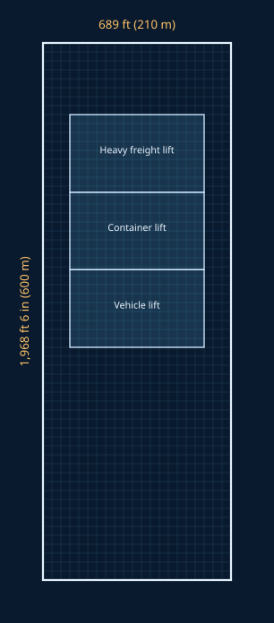
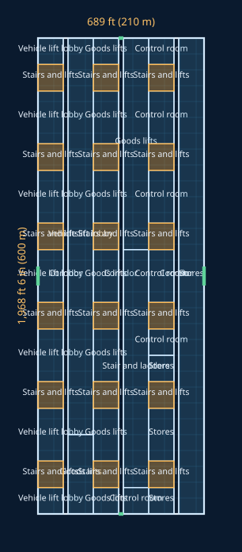
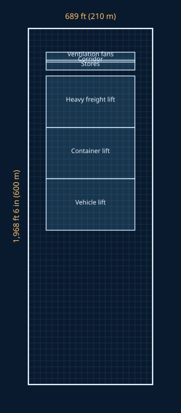

# P4-11 Freight Service Shaft: plan

Footprint 689 ft (210 m) × 1,968 ft 6 in (600 m) · structural grid 32 ft 10 in (10 m)

## Levels

| Level | Floor above deck | Height | Floor area |
|---|---|---|---|
| Level B1 · Shaft head | −32 ft 10 in (10 m) | 32 ft 10 in (10 m) | 419,793 sq ft (39,000 m²) |
| Level 1 · Ground floor | 0 ft (0 mm) | 23 ft (7,000 mm) | 463,386 sq ft (43,050 m²) |
| Level 2 · Lift machine level | 23 ft (7,000 mm) | 19 ft 8 in (6,000 mm) | 463,386 sq ft (43,050 m²) |

## Elements

| ID | Designation | Type | Name | Level(s) | Size / length | Area | Status |
|---|---|---|---|---|---|---|---|
| E001 | D5F3P4B3A2L1R1 | zone | Corridor | L1 | 492 ft 2 in (150 m) × 9 ft 10 in (3,000 mm) | 4,844 sq ft (450 m²) | proposed |
| E002 | D5F3P4B3A2L1R2 | room | Shaft control room | L1 | 492 ft 2 in (150 m) × 44 ft 3 in (14 m) | 21,797 sq ft (2,025 m²) | proposed |
| E003 | D5F3P4B3A2L1R3 | room | Crew room | L1 | 121 ft 5 in (37 m) × 44 ft 3 in (14 m) | 5,377 sq ft (500 m²) | proposed |
| E004 | D5F3P4B3A2L1R4 | room | Stores | L1 | 370 ft 9 in (113 m) × 44 ft 3 in (14 m) | 16,420 sq ft (1,526 m²) | proposed |
| E005 | D5F3P4B3A2L2R1 | zone | Corridor | L2 | 492 ft 2 in (150 m) × 9 ft 10 in (3,000 mm) | 4,844 sq ft (450 m²) | proposed |
| E006 | D5F3P4B3A2L2R2 | room | Ventilation fans | L2 | 492 ft 2 in (150 m) × 44 ft 3 in (14 m) | 21,797 sq ft (2,025 m²) | proposed |
| E007 | D5F3P4B3A2L2R3 | room | Stores | L2 | 492 ft 2 in (150 m) × 44 ft 3 in (14 m) | 21,797 sq ft (2,025 m²) | proposed |
| E008 | D5F3P4B3A2LB1R1, D5F3P4B3A2L1R5, D5F3P4B3A2L2R4 | room | Heavy freight lift | LB1, L1, L2 | 492 ft 2 in (150 m) × 284 ft 5 in (87 m) | 139,985 sq ft (13,005 m²) | proposed |
| E009 | D5F3P4B3A2LB1R2, D5F3P4B3A2L1R6, D5F3P4B3A2L2R5 | room | Container lift | LB1, L1, L2 | 492 ft 2 in (150 m) × 284 ft 1 in (87 m) | 139,823 sq ft (12,990 m²) | proposed |
| E010 | D5F3P4B3A2LB1R3, D5F3P4B3A2L1R7, D5F3P4B3A2L2R6 | room | Vehicle lift | LB1, L1, L2 | 492 ft 2 in (150 m) × 284 ft 5 in (87 m) | 139,985 sq ft (13,005 m²) | proposed |
| E011 | D5F3P4B3A2L1R8 | zone | Truck queue | L1 | 492 ft 2 in (150 m) × 721 ft 9 in (220 m) | 355,209 sq ft (33,000 m²) | proposed |

## Drawings

### Level B1 · Shaft head

### Level 1 · Ground floor

### Level 2 · Lift machine level

