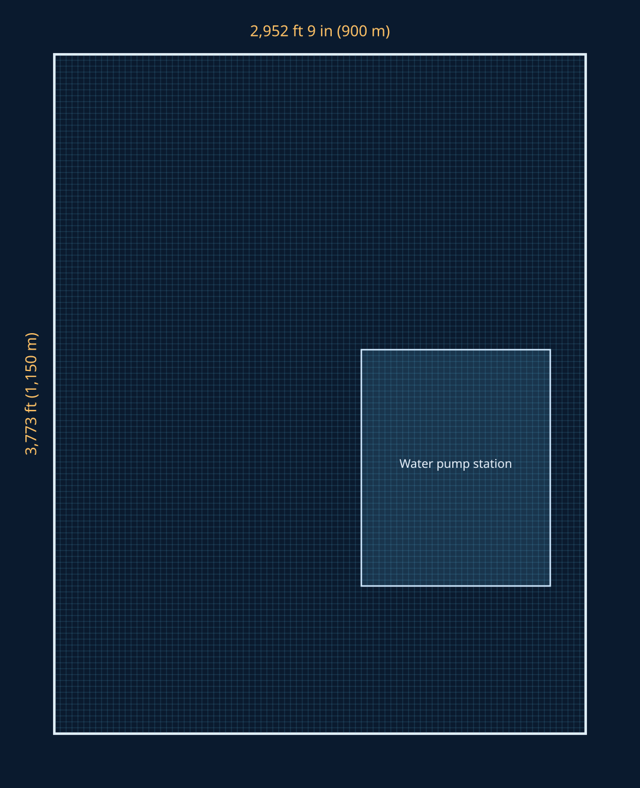
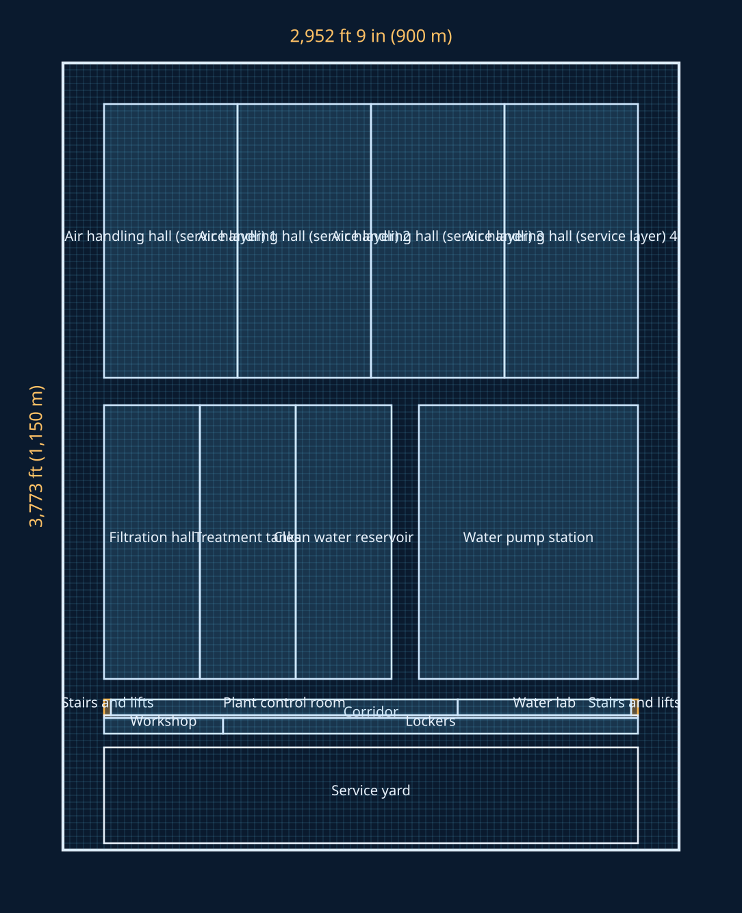
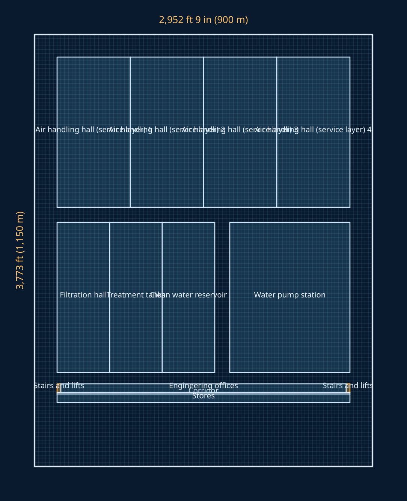
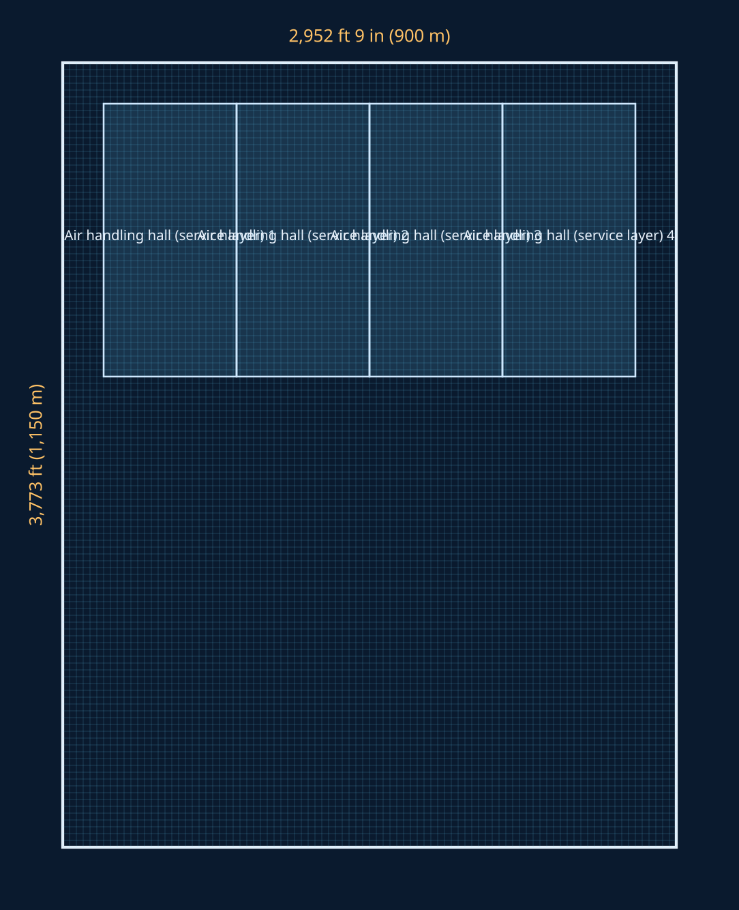

# P4-12 Service Plant: plan

Footprint 2,952 ft 9 in (900 m) × 3,773 ft (1,150 m) · structural grid 32 ft 10 in (10 m)

## Levels

| Level | Floor above deck | Height | Floor area |
|---|---|---|---|
| Level B1 · Pump level | −39 ft 4 in (12 m) | 39 ft 4 in (12 m) | 1,377,781 sq ft (128,000 m²) |
| Level 1 · Ground floor | 0 ft (0 mm) | 26 ft 3 in (8,000 mm) | 6,925,716 sq ft (643,420 m²) |
| Level 2 · Upper | 26 ft 3 in (8,000 mm) | 26 ft 3 in (8,000 mm) | 6,925,716 sq ft (643,420 m²) |
| Level 3 · Hall top | 52 ft 6 in (16 m) | 26 ft 3 in (8,000 mm) | 3,358,340 sq ft (312,000 m²) |

## Elements

| ID | Designation | Type | Name | Level(s) | Size / length | Area | Status |
|---|---|---|---|---|---|---|---|
| E001 | D5F3P4B5A1L1R1, D5F3P4B5A1L2R1, D5F3P4B5A1L3R1 | room | Air handling hall (service layer) 1 | L1, L2, L3 | 639 ft 9 in (195 m) × 1,312 ft 4 in (400 m) | 839,585 sq ft (78,000 m²) | proposed |
| E002 | D5F3P4B5A1L1R2, D5F3P4B5A1L2R2, D5F3P4B5A1L3R2 | room | Air handling hall (service layer) 2 | L1, L2, L3 | 639 ft 9 in (195 m) × 1,312 ft 4 in (400 m) | 839,585 sq ft (78,000 m²) | proposed |
| E003 | D5F3P4B5A1L1R3, D5F3P4B5A1L2R3, D5F3P4B5A1L3R3 | room | Air handling hall (service layer) 3 | L1, L2, L3 | 639 ft 9 in (195 m) × 1,312 ft 4 in (400 m) | 839,585 sq ft (78,000 m²) | proposed |
| E004 | D5F3P4B5A1L1R4, D5F3P4B5A1L2R4, D5F3P4B5A1L3R4 | room | Air handling hall (service layer) 4 | L1, L2, L3 | 639 ft 9 in (195 m) × 1,312 ft 4 in (400 m) | 839,585 sq ft (78,000 m²) | proposed |
| E005 | D5F3P4B5A1L1R5, D5F3P4B5A1L2R5 | room | Filtration hall | L1, L2 | 459 ft 4 in (140 m) × 1,312 ft 4 in (400 m) | 602,779 sq ft (56,000 m²) | proposed |
| E006 | D5F3P4B5A1L1R6, D5F3P4B5A1L2R6 | room | Treatment tanks | L1, L2 | 459 ft 4 in (140 m) × 1,312 ft 4 in (400 m) | 602,779 sq ft (56,000 m²) | proposed |
| E007 | D5F3P4B5A1L1R7, D5F3P4B5A1L2R7 | room | Clean water reservoir | L1, L2 | 459 ft 4 in (140 m) × 1,312 ft 4 in (400 m) | 602,779 sq ft (56,000 m²) | proposed |
| E008 | D5F3P4B5A1LB1R1, D5F3P4B5A1L1R8, D5F3P4B5A1L2R8 | room | Water pump station | LB1, L1, L2 | 1,049 ft 10 in (320 m) × 1,312 ft 4 in (400 m) | 1,377,781 sq ft (128,000 m²) | proposed |
| E009 | D5F3P4B5A1L1R9, D5F3P4B5A1L2R9 | core | Stairs and lifts | L1, L2 | 32 ft 10 in (10 m) × 75 ft 6 in (23 m) | 2,476 sq ft (230 m²) | proposed |
| E010 | D5F3P4B5A1L1R10, D5F3P4B5A1L2R10 | core | Stairs and lifts | L1, L2 | 32 ft 10 in (10 m) × 75 ft 6 in (23 m) | 2,476 sq ft (230 m²) | proposed |
| E011 | D5F3P4B5A1L1R11 | zone | Corridor | L1 | 2,559 ft 1 in (780 m) × 13 ft 1 in (4,000 mm) | 33,583 sq ft (3,120 m²) | proposed |
| E012 | D5F3P4B5A1L1R12 | room | Plant control room | L1 | 1,662 ft 5 in (507 m) × 75 ft 6 in (23 m) | 125,444 sq ft (11,654 m²) | proposed |
| E013 | D5F3P4B5A1L1R13 | room | Water lab | L1 | 831 ft (253 m) × 75 ft 6 in (23 m) | 62,709 sq ft (5,826 m²) | proposed |
| E014 | D5F3P4B5A1L1R14 | room | Workshop | L1 | 570 ft 6 in (174 m) × 75 ft 6 in (23 m) | 43,052 sq ft (4,000 m²) | proposed |
| E015 | D5F3P4B5A1L1R15 | room | Lockers | L1 | 1,988 ft 6 in (606 m) × 75 ft 6 in (23 m) | 150,052 sq ft (13,940 m²) | proposed |
| E016 | D5F3P4B5A1L2R11 | zone | Corridor | L2 | 2,559 ft 1 in (780 m) × 13 ft 1 in (4,000 mm) | 33,583 sq ft (3,120 m²) | proposed |
| E017 | D5F3P4B5A1L2R12 | room | Engineering offices | L2 | 2,493 ft 5 in (760 m) × 75 ft 6 in (23 m) | 188,153 sq ft (17,480 m²) | proposed |
| E018 | D5F3P4B5A1L2R13 | room | Stores | L2 | 2,559 ft 1 in (780 m) × 75 ft 6 in (23 m) | 193,105 sq ft (17,940 m²) | proposed |
| E019 | D5F3P4B5A1L1R16 | zone | Service yard | L1 | 2,559 ft 1 in (780 m) × 459 ft 4 in (140 m) | 1,175,419 sq ft (109,200 m²) | proposed |

## Drawings

### Level B1 · Pump level

### Level 1 · Ground floor

### Level 2 · Upper

### Level 3 · Hall top

