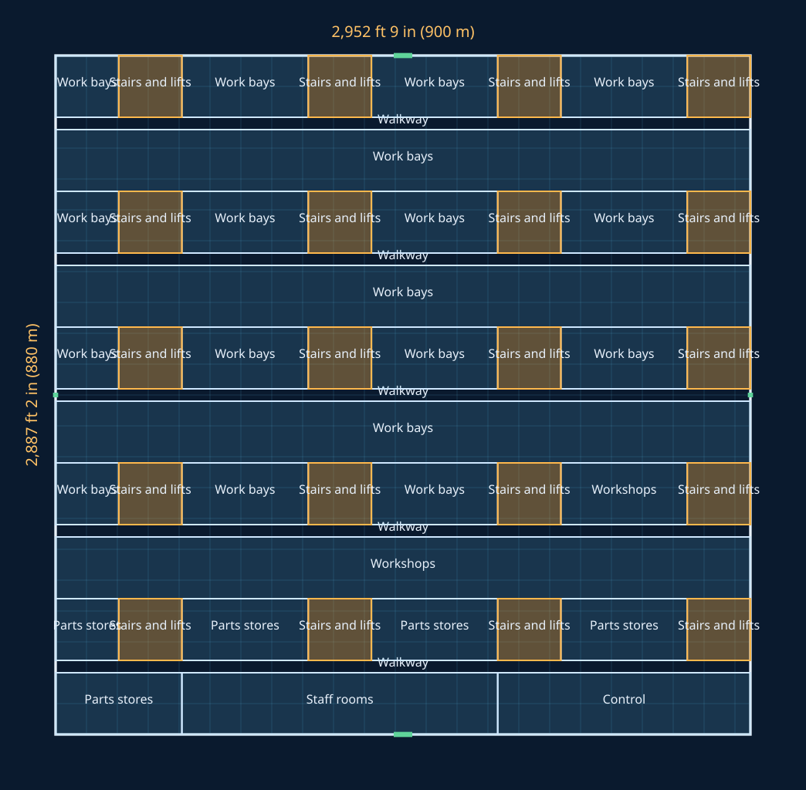
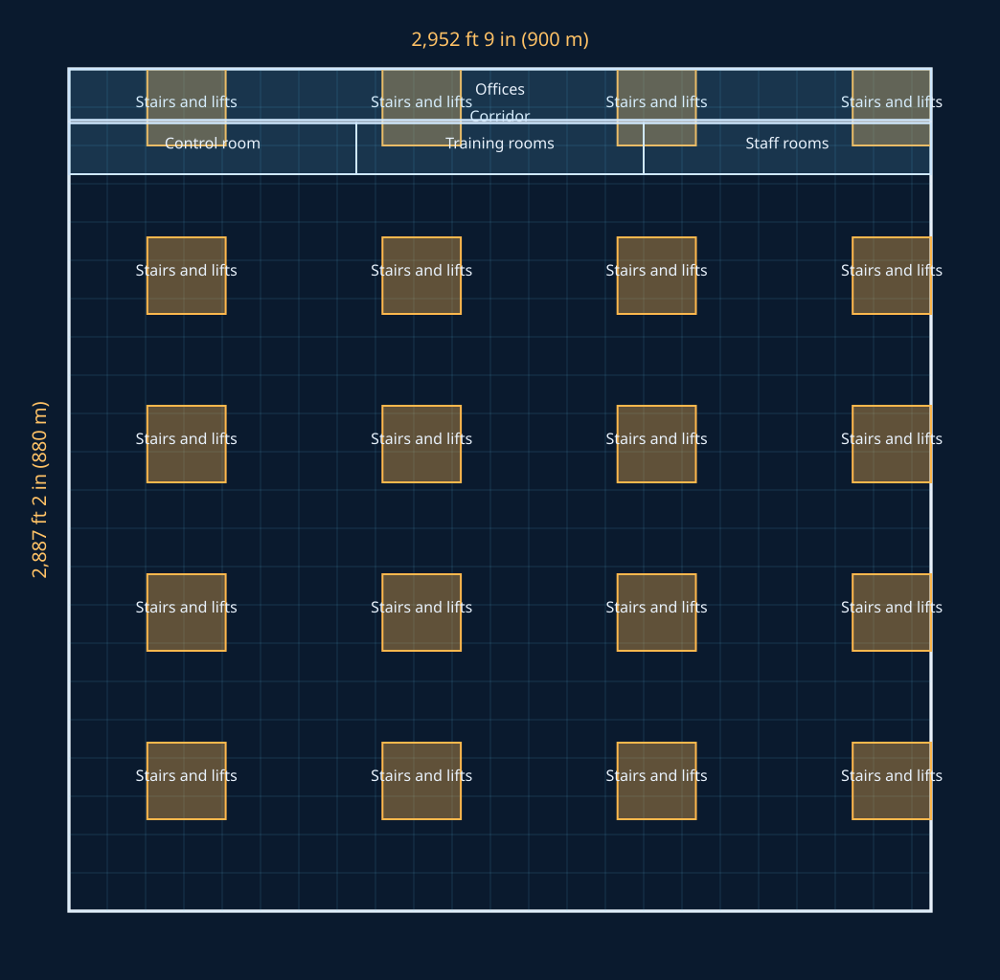
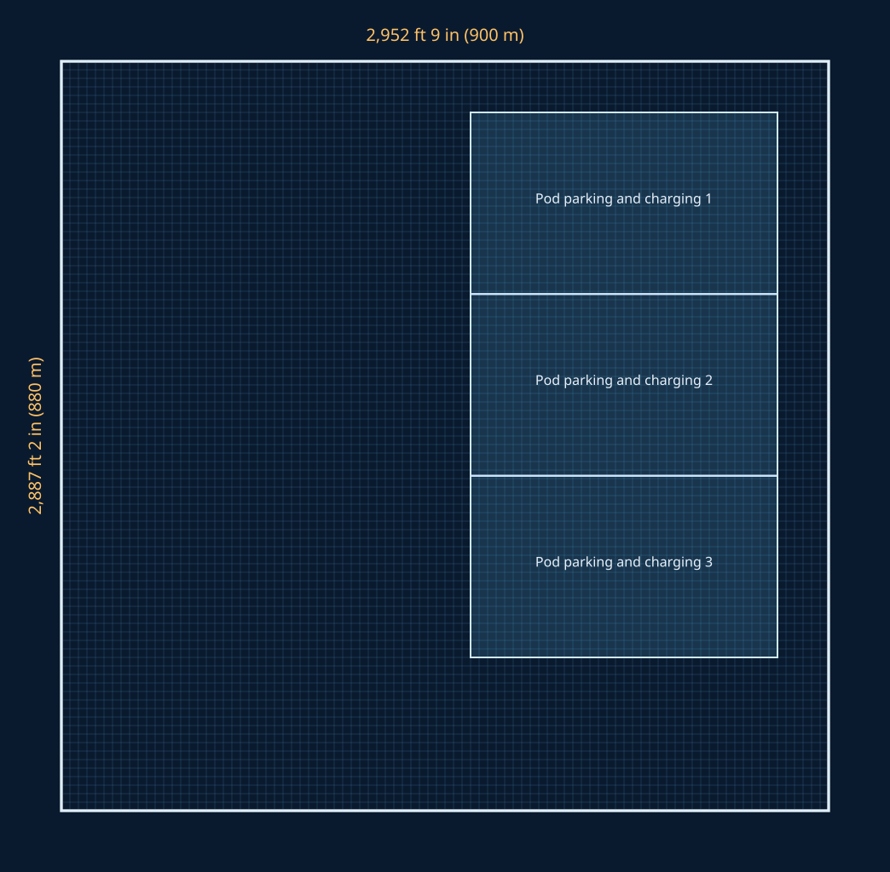

# P4-13 Ground Vehicle Depot: plan

Footprint 2,952 ft 9 in (900 m) × 2,887 ft 2 in (880 m) · structural grid 32 ft 10 in (10 m)

## Levels

| Level | Floor above deck | Height | Floor area |
|---|---|---|---|
| Level 1 · Ground deck | 0 ft (0 mm) | 26 ft 3 in (8,000 mm) | 5,479,046 sq ft (509,020 m²) |
| Level 2 · Pod deck 2 | 26 ft 3 in (8,000 mm) | 13 ft 1 in (4,000 mm) | 2,861,263 sq ft (265,820 m²) |
| Level 3 · Pod deck 3 | 39 ft 4 in (12 m) | 13 ft 1 in (4,000 mm) | 2,480,005 sq ft (230,400 m²) |
| Level 4 · Pod deck 4 | 52 ft 6 in (16 m) | 13 ft 1 in (4,000 mm) | 2,480,005 sq ft (230,400 m²) |

## Elements

| ID | Designation | Type | Name | Level(s) | Size / length | Area | Status |
|---|---|---|---|---|---|---|---|
| E001 | D5F3P4B5A2L1R1 | room | Truck parking and charging 1 | L1 | 1,246 ft 9 in (380 m) × 524 ft 11 in (160 m) | 654,446 sq ft (60,800 m²) | proposed |
| E002 | D5F3P4B5A2L1R2 | room | Truck parking and charging 2 | L1 | 1,246 ft 9 in (380 m) × 524 ft 11 in (160 m) | 654,446 sq ft (60,800 m²) | proposed |
| E003 | D5F3P4B5A2L1R3 | room | Truck parking and charging 3 | L1 | 1,246 ft 9 in (380 m) × 524 ft 11 in (160 m) | 654,446 sq ft (60,800 m²) | proposed |
| E004 | D5F3P4B5A2L1R4 | room | Truck parking and charging 4 | L1 | 1,246 ft 9 in (380 m) × 524 ft 11 in (160 m) | 654,446 sq ft (60,800 m²) | proposed |
| E005 | D5F3P4B5A2L1R5, D5F3P4B5A2L2R1, D5F3P4B5A2L3R1, D5F3P4B5A2L4R1 | room | Pod parking and charging 1 | L1, L2, L3, L4 | 1,181 ft 1 in (360 m) × 699 ft 10 in (213 m) | 826,539 sq ft (76,788 m²) | proposed |
| E006 | D5F3P4B5A2L1R6, D5F3P4B5A2L2R2, D5F3P4B5A2L3R2, D5F3P4B5A2L4R2 | room | Pod parking and charging 2 | L1, L2, L3, L4 | 1,181 ft 1 in (360 m) × 700 ft 2 in (213 m) | 826,927 sq ft (76,824 m²) | proposed |
| E007 | D5F3P4B5A2L1R7, D5F3P4B5A2L2R3, D5F3P4B5A2L3R3, D5F3P4B5A2L4R3 | room | Pod parking and charging 3 | L1, L2, L3, L4 | 1,181 ft 1 in (360 m) × 699 ft 10 in (213 m) | 826,539 sq ft (76,788 m²) | proposed |
| E008 | D5F3P4B5A2L1R8, D5F3P4B5A2L2R4 | core | Stairs and lifts | L1, L2 | 32 ft 10 in (10 m) × 75 ft 6 in (23 m) | 2,476 sq ft (230 m²) | proposed |
| E009 | D5F3P4B5A2L1R9, D5F3P4B5A2L2R5 | core | Stairs and lifts | L1, L2 | 32 ft 10 in (10 m) × 75 ft 6 in (23 m) | 2,476 sq ft (230 m²) | proposed |
| E010 | D5F3P4B5A2L1R10 | zone | Corridor | L1 | 2,559 ft 1 in (780 m) × 13 ft 1 in (4,000 mm) | 33,583 sq ft (3,120 m²) | proposed |
| E011 | D5F3P4B5A2L1R11 | room | Drivers' room | L1 | 1,781 ft 2 in (543 m) × 75 ft 6 in (23 m) | 134,406 sq ft (12,487 m²) | proposed |
| E012 | D5F3P4B5A2L1R12 | room | Dispatch desk | L1 | 712 ft 3 in (217 m) × 75 ft 6 in (23 m) | 53,747 sq ft (4,993 m²) | proposed |
| E013 | D5F3P4B5A2L1R13 | room | Canteen | L1 | 356 ft 8 in (109 m) × 75 ft 6 in (23 m) | 26,911 sq ft (2,500 m²) | proposed |
| E014 | D5F3P4B5A2L1R14 | room | Lockers | L1 | 2,202 ft 5 in (671 m) × 75 ft 6 in (23 m) | 166,194 sq ft (15,440 m²) | proposed |
| E015 | D5F3P4B5A2L2R6 | zone | Corridor | L2 | 2,559 ft 1 in (780 m) × 13 ft 1 in (4,000 mm) | 33,583 sq ft (3,120 m²) | proposed |
| E016 | D5F3P4B5A2L2R7 | room | Fleet control | L2 | 2,493 ft 5 in (760 m) × 75 ft 6 in (23 m) | 188,153 sq ft (17,480 m²) | proposed |
| E017 | D5F3P4B5A2L2R8 | room | Offices | L2 | 2,559 ft 1 in (780 m) × 75 ft 6 in (23 m) | 193,105 sq ft (17,940 m²) | proposed |
| E018 | D5F3P4B5A2L1R15 | zone | Wash and charge yard | L1 | 2,559 ft 1 in (780 m) × 262 ft 6 in (80 m) | 671,668 sq ft (62,400 m²) | proposed |

## Drawings

### Level 1 · Ground deck

### Level 2 · Pod deck 2

### Level 3 · Pod deck 3

### Level 4 · Pod deck 4

