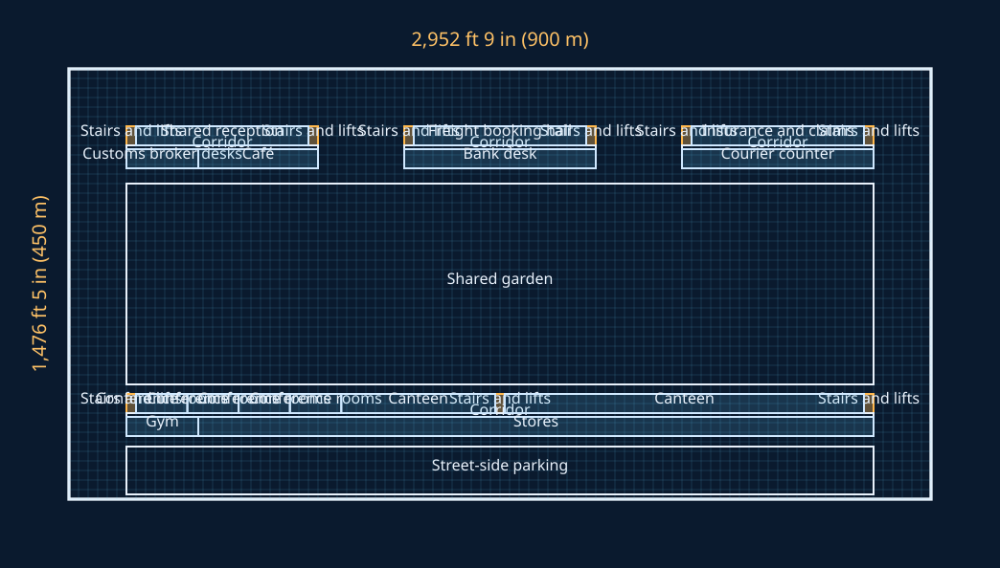
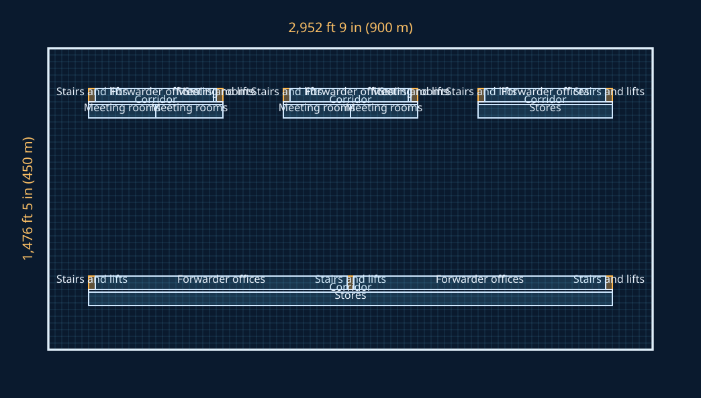
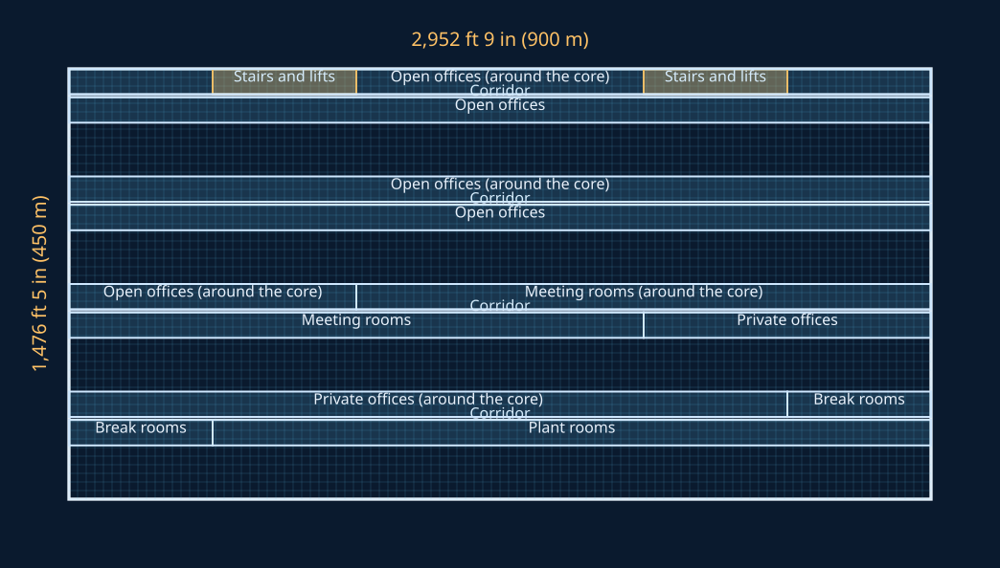

# P4-14 Forwarders: plan

Footprint 2,952 ft 9 in (900 m) × 1,476 ft 5 in (450 m) · structural grid 32 ft 10 in (10 m)

## Levels

| Level | Floor above deck | Height | Floor area |
|---|---|---|---|
| Level 1 · Ground floor | 0 ft (0 mm) | 14 ft 9 in (4,500 mm) | 574,793 sq ft (53,400 m²) |
| Level 2 · Level 2 | 14 ft 9 in (4,500 mm) | 13 ft 1 in (4,000 mm) | 574,793 sq ft (53,400 m²) |
| Level 3 · Level 3 | 27 ft 11 in (8,500 mm) | 13 ft 1 in (4,000 mm) | 574,793 sq ft (53,400 m²) |
| Level 4 · Level 4 | 41 ft (12 m) | 13 ft 1 in (4,000 mm) | 163,611 sq ft (15,200 m²) |

## Elements

| ID | Designation | Type | Name | Level(s) | Size / length | Area | Status |
|---|---|---|---|---|---|---|---|
| E001 | D5F3P4B8A1L1R1, D5F3P4B8A1L2R1, D5F3P4B8A1L3R1, D5F3P4B8A1L4R1 | core | Stairs and lifts | L1, L2, L3, L4 | 32 ft 10 in (10 m) × 65 ft 7 in (20 m) | 2,153 sq ft (200 m²) | proposed |
| E002 | D5F3P4B8A1L1R2, D5F3P4B8A1L2R2, D5F3P4B8A1L3R2, D5F3P4B8A1L4R2 | core | Stairs and lifts | L1, L2, L3, L4 | 32 ft 10 in (10 m) × 65 ft 7 in (20 m) | 2,153 sq ft (200 m²) | proposed |
| E003 | D5F3P4B8A1L1R3 | zone | Corridor | L1 | 656 ft 2 in (200 m) × 13 ft 1 in (4,000 mm) | 8,611 sq ft (800 m²) | proposed |
| E004 | D5F3P4B8A1L1R4 | room | Shared reception | L1 | 590 ft 7 in (180 m) × 65 ft 7 in (20 m) | 38,750 sq ft (3,600 m²) | proposed |
| E005 | D5F3P4B8A1L1R5 | room | Customs broker desks | L1 | 246 ft 1 in (75 m) × 65 ft 7 in (20 m) | 16,146 sq ft (1,500 m²) | proposed |
| E006 | D5F3P4B8A1L1R6 | room | Café | L1 | 410 ft 1 in (125 m) × 65 ft 7 in (20 m) | 26,910 sq ft (2,500 m²) | proposed |
| E007 | D5F3P4B8A1L2R3, D5F3P4B8A1L3R3, D5F3P4B8A1L4R3 | zone | Corridor | L2, L3, L4 | 656 ft 2 in (200 m) × 13 ft 1 in (4,000 mm) | 8,611 sq ft (800 m²) | proposed |
| E008 | D5F3P4B8A1L2R4, D5F3P4B8A1L3R4, D5F3P4B8A1L4R4 | room | Forwarder offices | L2, L3, L4 | 577 ft 5 in (176 m) × 65 ft 7 in (20 m) | 37,889 sq ft (3,520 m²) | proposed |
| E009 | D5F3P4B8A1L2R5, D5F3P4B8A1L3R5, D5F3P4B8A1L4R5 | room | Meeting rooms | L2, L3, L4 | 13 ft 1 in (4,000 mm) × 65 ft 7 in (20 m) | 861 sq ft (80 m²) | proposed |
| E010 | D5F3P4B8A1L2R6, D5F3P4B8A1L3R6, D5F3P4B8A1L4R6 | room | Meeting rooms | L2, L3, L4 | 328 ft 1 in (100 m) × 65 ft 7 in (20 m) | 21,528 sq ft (2,000 m²) | proposed |
| E011 | D5F3P4B8A1L2R7, D5F3P4B8A1L3R7, D5F3P4B8A1L4R7 | room | Meeting rooms | L2, L3, L4 | 328 ft 1 in (100 m) × 65 ft 7 in (20 m) | 21,528 sq ft (2,000 m²) | proposed |
| E012 | D5F3P4B8A1L1R7, D5F3P4B8A1L2R8, D5F3P4B8A1L3R8, D5F3P4B8A1L4R8 | core | Stairs and lifts | L1, L2, L3, L4 | 32 ft 10 in (10 m) × 65 ft 7 in (20 m) | 2,153 sq ft (200 m²) | proposed |
| E013 | D5F3P4B8A1L1R8, D5F3P4B8A1L2R9, D5F3P4B8A1L3R9, D5F3P4B8A1L4R9 | core | Stairs and lifts | L1, L2, L3, L4 | 32 ft 10 in (10 m) × 65 ft 7 in (20 m) | 2,153 sq ft (200 m²) | proposed |
| E014 | D5F3P4B8A1L1R9 | zone | Corridor | L1 | 656 ft 2 in (200 m) × 13 ft 1 in (4,000 mm) | 8,611 sq ft (800 m²) | proposed |
| E015 | D5F3P4B8A1L1R10 | room | Freight booking hall | L1 | 590 ft 7 in (180 m) × 65 ft 7 in (20 m) | 38,750 sq ft (3,600 m²) | proposed |
| E016 | D5F3P4B8A1L1R11 | room | Bank desk | L1 | 656 ft 2 in (200 m) × 65 ft 7 in (20 m) | 43,056 sq ft (4,000 m²) | proposed |
| E017 | D5F3P4B8A1L2R10, D5F3P4B8A1L3R10, D5F3P4B8A1L4R10 | zone | Corridor | L2, L3, L4 | 656 ft 2 in (200 m) × 13 ft 1 in (4,000 mm) | 8,611 sq ft (800 m²) | proposed |
| E018 | D5F3P4B8A1L2R11, D5F3P4B8A1L3R11, D5F3P4B8A1L4R11 | room | Forwarder offices | L2, L3, L4 | 577 ft 5 in (176 m) × 65 ft 7 in (20 m) | 37,889 sq ft (3,520 m²) | proposed |
| E019 | D5F3P4B8A1L2R12, D5F3P4B8A1L3R12, D5F3P4B8A1L4R12 | room | Meeting rooms | L2, L3, L4 | 13 ft 1 in (4,000 mm) × 65 ft 7 in (20 m) | 861 sq ft (80 m²) | proposed |
| E020 | D5F3P4B8A1L2R13, D5F3P4B8A1L3R13, D5F3P4B8A1L4R13 | room | Meeting rooms | L2, L3, L4 | 328 ft 1 in (100 m) × 65 ft 7 in (20 m) | 21,528 sq ft (2,000 m²) | proposed |
| E021 | D5F3P4B8A1L2R14, D5F3P4B8A1L3R14, D5F3P4B8A1L4R14 | room | Meeting rooms | L2, L3, L4 | 328 ft 1 in (100 m) × 65 ft 7 in (20 m) | 21,528 sq ft (2,000 m²) | proposed |
| E022 | D5F3P4B8A1L1R12, D5F3P4B8A1L2R15, D5F3P4B8A1L3R15 | core | Stairs and lifts | L1, L2, L3 | 32 ft 10 in (10 m) × 65 ft 7 in (20 m) | 2,153 sq ft (200 m²) | proposed |
| E023 | D5F3P4B8A1L1R13, D5F3P4B8A1L2R16, D5F3P4B8A1L3R16 | core | Stairs and lifts | L1, L2, L3 | 32 ft 10 in (10 m) × 65 ft 7 in (20 m) | 2,153 sq ft (200 m²) | proposed |
| E024 | D5F3P4B8A1L1R14 | zone | Corridor | L1 | 656 ft 2 in (200 m) × 13 ft 1 in (4,000 mm) | 8,611 sq ft (800 m²) | proposed |
| E025 | D5F3P4B8A1L1R15 | room | Insurance and claims | L1 | 590 ft 7 in (180 m) × 65 ft 7 in (20 m) | 38,750 sq ft (3,600 m²) | proposed |
| E026 | D5F3P4B8A1L1R16 | room | Courier counter | L1 | 656 ft 2 in (200 m) × 65 ft 7 in (20 m) | 43,056 sq ft (4,000 m²) | proposed |
| E027 | D5F3P4B8A1L2R17, D5F3P4B8A1L3R17 | zone | Corridor | L2, L3 | 656 ft 2 in (200 m) × 13 ft 1 in (4,000 mm) | 8,611 sq ft (800 m²) | proposed |
| E028 | D5F3P4B8A1L2R18, D5F3P4B8A1L3R18 | room | Forwarder offices | L2, L3 | 590 ft 7 in (180 m) × 65 ft 7 in (20 m) | 38,750 sq ft (3,600 m²) | proposed |
| E029 | D5F3P4B8A1L2R19, D5F3P4B8A1L3R19 | room | Stores | L2, L3 | 656 ft 2 in (200 m) × 65 ft 7 in (20 m) | 43,056 sq ft (4,000 m²) | proposed |
| E030 | D5F3P4B8A1L1R17, D5F3P4B8A1L2R20, D5F3P4B8A1L3R20 | core | Stairs and lifts | L1, L2, L3 | 32 ft 10 in (10 m) × 65 ft 7 in (20 m) | 2,153 sq ft (200 m²) | proposed |
| E031 | D5F3P4B8A1L1R18, D5F3P4B8A1L2R21, D5F3P4B8A1L3R21 | core | Stairs and lifts | L1, L2, L3 | 32 ft 10 in (10 m) × 65 ft 7 in (20 m) | 2,153 sq ft (200 m²) | proposed |
| E032 | D5F3P4B8A1L1R19, D5F3P4B8A1L2R22, D5F3P4B8A1L3R22 | core | Stairs and lifts | L1, L2, L3 | 32 ft 10 in (10 m) × 65 ft 7 in (20 m) | 2,153 sq ft (200 m²) | proposed |
| E033 | D5F3P4B8A1L1R20 | zone | Corridor | L1 | 2,559 ft 1 in (780 m) × 13 ft 1 in (4,000 mm) | 33,583 sq ft (3,120 m²) | proposed |
| E034 | D5F3P4B8A1L1R21 | room | Conference rooms | L1 | 175 ft 10 in (54 m) × 65 ft 7 in (20 m) | 11,539 sq ft (1,072 m²) | proposed |
| E035 | D5F3P4B8A1L1R22 | room | Conference rooms | L1 | 175 ft 6 in (54 m) × 65 ft 7 in (20 m) | 11,517 sq ft (1,070 m²) | proposed |
| E036 | D5F3P4B8A1L1R23 | room | Conference rooms | L1 | 175 ft 10 in (54 m) × 65 ft 7 in (20 m) | 11,539 sq ft (1,072 m²) | proposed |
| E037 | D5F3P4B8A1L1R24 | room | Conference rooms | L1 | 175 ft 10 in (54 m) × 65 ft 7 in (20 m) | 11,539 sq ft (1,072 m²) | proposed |
| E038 | D5F3P4B8A1L1R25 | room | Canteen | L1 | 527 ft 3 in (161 m) × 65 ft 7 in (20 m) | 34,595 sq ft (3,214 m²) | proposed |
| E039 | D5F3P4B8A1L1R26 | room | Canteen | L1 | 1,230 ft 4 in (375 m) × 65 ft 7 in (20 m) | 80,729 sq ft (7,500 m²) | proposed |
| E040 | D5F3P4B8A1L1R27 | room | Gym | L1 | 246 ft 1 in (75 m) × 65 ft 7 in (20 m) | 16,146 sq ft (1,500 m²) | proposed |
| E041 | D5F3P4B8A1L1R28 | room | Stores | L1 | 2,313 ft (705 m) × 65 ft 7 in (20 m) | 151,771 sq ft (14,100 m²) | proposed |
| E042 | D5F3P4B8A1L2R23, D5F3P4B8A1L3R23 | zone | Corridor | L2, L3 | 2,559 ft 1 in (780 m) × 13 ft 1 in (4,000 mm) | 33,583 sq ft (3,120 m²) | proposed |
| E043 | D5F3P4B8A1L2R24, D5F3P4B8A1L3R24 | room | Forwarder offices | L2, L3 | 1,230 ft 4 in (375 m) × 65 ft 7 in (20 m) | 80,729 sq ft (7,500 m²) | proposed |
| E044 | D5F3P4B8A1L2R25, D5F3P4B8A1L3R25 | room | Forwarder offices | L2, L3 | 1,230 ft 4 in (375 m) × 65 ft 7 in (20 m) | 80,729 sq ft (7,500 m²) | proposed |
| E045 | D5F3P4B8A1L2R26, D5F3P4B8A1L3R26 | room | Stores | L2, L3 | 2,559 ft 1 in (780 m) × 65 ft 7 in (20 m) | 167,917 sq ft (15,600 m²) | proposed |
| E046 | D5F3P4B8A1L1R29 | zone | Shared garden | L1 | 2,559 ft 1 in (780 m) × 689 ft (210 m) | 1,763,129 sq ft (163,800 m²) | proposed |
| E047 | D5F3P4B8A1L1R30 | zone | Street-side parking | L1 | 2,559 ft 1 in (780 m) × 164 ft 1 in (50 m) | 419,793 sq ft (39,000 m²) | proposed |

## Drawings

### Level 1 · Ground floor

### Level 2 · Level 2

### Level 3 · Level 3

### Level 4 · Level 4

