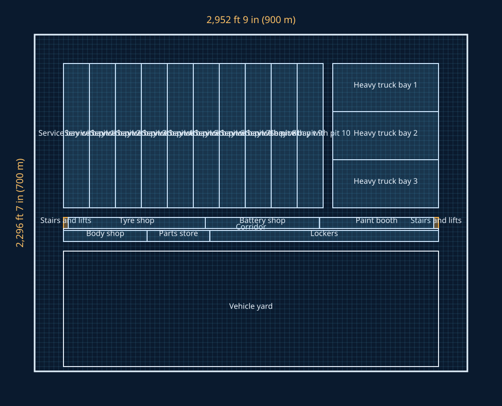

# P4-15 Vehicle Workshop: plan

Footprint 2,952 ft 9 in (900 m) × 2,296 ft 7 in (700 m) · structural grid 131 ft 3 in (40 m)

## Levels

| Level | Floor above deck | Height | Floor area |
|---|---|---|---|
| Level 1 · Ground floor | 0 ft (0 mm) | 65 ft 7 in (20 m) | 5,213,113 sq ft (484,314 m²) |
| Level 2 · Office level | 65 ft 7 in (20 m) | 14 ft 9 in (4,500 mm) | 818,595 sq ft (76,050 m²) |

## Elements

| ID | Designation | Type | Name | Level(s) | Size / length | Area | Status |
|---|---|---|---|---|---|---|---|
| L1-001 | D5F3P4B8A2L1R1 | zone | Walkway | L1 | 2,952 ft 9 in (900 m) × 52 ft 6 in (16 m) | 155,000 sq ft (14,400 m²) | proposed |
| L1-002 | D5F3P4B8A2L1R2 | zone | Walkway | L1 | 2,952 ft 9 in (900 m) × 52 ft 6 in (16 m) | 155,000 sq ft (14,400 m²) | proposed |
| L1-003 | D5F3P4B8A2L1R3 | zone | Walkway | L1 | 2,952 ft 9 in (900 m) × 52 ft 6 in (16 m) | 155,000 sq ft (14,400 m²) | proposed |
| L1-004 | D5F3P4B8A2L1R4 | zone | Walkway | L1 | 2,952 ft 9 in (900 m) × 52 ft 6 in (16 m) | 155,000 sq ft (14,400 m²) | proposed |
| L1-005 | D5F3P4B8A2L1R5 | room | Work bays | L1 | 227 ft (69 m) × 260 ft 10 in (80 m) | 59,217 sq ft (5,501 m²) | proposed |
| L1-006 | D5F3P4B8A2L1R6 | room | Work bays | L1 | 454 ft 1 in (138 m) × 260 ft 10 in (80 m) | 118,433 sq ft (11,003 m²) | proposed |
| L1-007 | D5F3P4B8A2L1R7 | room | Work bays | L1 | 454 ft 1 in (138 m) × 260 ft 10 in (80 m) | 118,433 sq ft (11,003 m²) | proposed |
| L1-008 | D5F3P4B8A2L1R8 | room | Work bays | L1 | 454 ft 5 in (138 m) × 260 ft 10 in (80 m) | 118,519 sq ft (11,011 m²) | proposed |
| L1-009 | D5F3P4B8A2L1R9 | room | Work bays | L1 | 454 ft 5 in (138 m) × 260 ft 10 in (80 m) | 118,519 sq ft (11,011 m²) | proposed |
| L1-010 | D5F3P4B8A2L1R10 | room | Work bays | L1 | 2,952 ft 9 in (900 m) × 260 ft 10 in (80 m) | 770,158 sq ft (71,550 m²) | proposed |
| L1-011 | D5F3P4B8A2L1R11 | room | Work bays | L1 | 227 ft (69 m) × 260 ft 10 in (80 m) | 59,217 sq ft (5,501 m²) | proposed |
| L1-012 | D5F3P4B8A2L1R12 | room | Work bays | L1 | 454 ft 1 in (138 m) × 260 ft 10 in (80 m) | 118,433 sq ft (11,003 m²) | proposed |
| L1-013 | D5F3P4B8A2L1R13 | room | Work bays | L1 | 454 ft 1 in (138 m) × 260 ft 10 in (80 m) | 118,433 sq ft (11,003 m²) | proposed |
| L1-014 | D5F3P4B8A2L1R14 | room | Work bays | L1 | 454 ft 5 in (138 m) × 260 ft 10 in (80 m) | 118,519 sq ft (11,011 m²) | proposed |
| L1-015 | D5F3P4B8A2L1R15 | room | Work bays | L1 | 454 ft 5 in (138 m) × 260 ft 10 in (80 m) | 118,519 sq ft (11,011 m²) | proposed |
| L1-016 | D5F3P4B8A2L1R16 | room | Work bays | L1 | 2,952 ft 9 in (900 m) × 260 ft 10 in (80 m) | 770,158 sq ft (71,550 m²) | proposed |
| L1-017 | D5F3P4B8A2L1R17 | room | Work bays | L1 | 227 ft (69 m) × 260 ft 10 in (80 m) | 59,217 sq ft (5,501 m²) | proposed |
| L1-018 | D5F3P4B8A2L1R18 | room | Work bays | L1 | 454 ft 1 in (138 m) × 260 ft 10 in (80 m) | 118,433 sq ft (11,003 m²) | proposed |
| L1-019 | D5F3P4B8A2L1R19 | room | Work bays | L1 | 454 ft 1 in (138 m) × 260 ft 10 in (80 m) | 118,433 sq ft (11,003 m²) | proposed |
| L1-020 | D5F3P4B8A2L1R20 | room | Work bays | L1 | 454 ft 5 in (138 m) × 260 ft 10 in (80 m) | 118,519 sq ft (11,011 m²) | proposed |
| L1-021 | D5F3P4B8A2L1R21 | room | Work bays | L1 | 454 ft 5 in (138 m) × 260 ft 10 in (80 m) | 118,519 sq ft (11,011 m²) | proposed |
| L1-022 | D5F3P4B8A2L1R22 | room | Work bays | L1 | 908 ft 6 in (277 m) × 260 ft 10 in (80 m) | 236,952 sq ft (22,014 m²) | proposed |
| L1-023 | D5F3P4B8A2L1R23 | room | Workshops | L1 | 2,044 ft 3 in (623 m) × 260 ft 10 in (80 m) | 533,206 sq ft (49,536 m²) | proposed |
| L1-024 | D5F3P4B8A2L1R24 | room | Workshops | L1 | 227 ft (69 m) × 260 ft 10 in (80 m) | 59,217 sq ft (5,501 m²) | proposed |
| L1-025 | D5F3P4B8A2L1R25 | room | Workshops | L1 | 454 ft 1 in (138 m) × 260 ft 10 in (80 m) | 118,433 sq ft (11,003 m²) | proposed |
| L1-026 | D5F3P4B8A2L1R26 | room | Workshops | L1 | 227 ft (69 m) × 260 ft 10 in (80 m) | 59,217 sq ft (5,501 m²) | proposed |
| L1-027 | D5F3P4B8A2L1R27 | room | Parts stores | L1 | 227 ft (69 m) × 260 ft 10 in (80 m) | 59,217 sq ft (5,501 m²) | proposed |
| L1-028 | D5F3P4B8A2L1R28 | room | Parts stores | L1 | 454 ft 5 in (138 m) × 260 ft 10 in (80 m) | 118,519 sq ft (11,011 m²) | proposed |
| L1-029 | D5F3P4B8A2L1R29 | room | Parts stores | L1 | 454 ft 5 in (138 m) × 260 ft 10 in (80 m) | 118,519 sq ft (11,011 m²) | proposed |
| L1-030 | D5F3P4B8A2L1R30 | room | Parts stores | L1 | 908 ft 6 in (277 m) × 260 ft 10 in (80 m) | 236,952 sq ft (22,014 m²) | proposed |
| L1-031 | D5F3P4B8A2L1R31 | room | Staff rooms | L1 | 1,135 ft 10 in (346 m) × 260 ft 10 in (80 m) | 296,254 sq ft (27,523 m²) | proposed |
| L1-032 | D5F3P4B8A2L1R32 | room | Control | L1 | 908 ft 6 in (277 m) × 260 ft 10 in (80 m) | 236,952 sq ft (22,014 m²) | proposed |
| L1-033 | D5F3P4B8A2L1R33, D5F3P4B8A2L2R1 | core | Stairs and lifts | L1, L2 | 227 ft 4 in (69 m) × 260 ft 10 in (80 m) | 59,302 sq ft (5,509 m²) | proposed |
| L1-034 | D5F3P4B8A2L1R34, D5F3P4B8A2L2R2 | core | Stairs and lifts | L1, L2 | 227 ft 4 in (69 m) × 260 ft 10 in (80 m) | 59,302 sq ft (5,509 m²) | proposed |
| L1-035 | D5F3P4B8A2L1R35, D5F3P4B8A2L2R3 | core | Stairs and lifts | L1, L2 | 227 ft (69 m) × 260 ft 10 in (80 m) | 59,217 sq ft (5,501 m²) | proposed |
| L1-036 | D5F3P4B8A2L1R36, D5F3P4B8A2L2R4 | core | Stairs and lifts | L1, L2 | 227 ft (69 m) × 260 ft 10 in (80 m) | 59,217 sq ft (5,501 m²) | proposed |
| L1-037 | D5F3P4B8A2L1R37, D5F3P4B8A2L2R5 | core | Stairs and lifts | L1, L2 | 227 ft 4 in (69 m) × 260 ft 10 in (80 m) | 59,302 sq ft (5,509 m²) | proposed |
| L1-038 | D5F3P4B8A2L1R38, D5F3P4B8A2L2R6 | core | Stairs and lifts | L1, L2 | 227 ft 4 in (69 m) × 260 ft 10 in (80 m) | 59,302 sq ft (5,509 m²) | proposed |
| L1-039 | D5F3P4B8A2L1R39, D5F3P4B8A2L2R7 | core | Stairs and lifts | L1, L2 | 227 ft (69 m) × 260 ft 10 in (80 m) | 59,217 sq ft (5,501 m²) | proposed |
| L1-040 | D5F3P4B8A2L1R40, D5F3P4B8A2L2R8 | core | Stairs and lifts | L1, L2 | 227 ft (69 m) × 260 ft 10 in (80 m) | 59,217 sq ft (5,501 m²) | proposed |
| L1-041 | D5F3P4B8A2L1R41, D5F3P4B8A2L2R9 | core | Stairs and lifts | L1, L2 | 227 ft 4 in (69 m) × 260 ft 10 in (80 m) | 59,302 sq ft (5,509 m²) | proposed |
| L1-042 | D5F3P4B8A2L1R42, D5F3P4B8A2L2R10 | core | Stairs and lifts | L1, L2 | 227 ft 4 in (69 m) × 260 ft 10 in (80 m) | 59,302 sq ft (5,509 m²) | proposed |
| L1-043 | D5F3P4B8A2L1R43, D5F3P4B8A2L2R11 | core | Stairs and lifts | L1, L2 | 227 ft (69 m) × 260 ft 10 in (80 m) | 59,217 sq ft (5,501 m²) | proposed |
| L1-044 | D5F3P4B8A2L1R44, D5F3P4B8A2L2R12 | core | Stairs and lifts | L1, L2 | 227 ft (69 m) × 260 ft 10 in (80 m) | 59,217 sq ft (5,501 m²) | proposed |
| L1-045 | D5F3P4B8A2L1R45, D5F3P4B8A2L2R13 | core | Stairs and lifts | L1, L2 | 227 ft 4 in (69 m) × 260 ft 10 in (80 m) | 59,302 sq ft (5,509 m²) | proposed |
| L1-046 | D5F3P4B8A2L1R46, D5F3P4B8A2L2R14 | core | Stairs and lifts | L1, L2 | 227 ft 4 in (69 m) × 260 ft 10 in (80 m) | 59,302 sq ft (5,509 m²) | proposed |
| L1-047 | D5F3P4B8A2L1R47, D5F3P4B8A2L2R15 | core | Stairs and lifts | L1, L2 | 227 ft (69 m) × 260 ft 10 in (80 m) | 59,217 sq ft (5,501 m²) | proposed |
| L1-048 | D5F3P4B8A2L1R48, D5F3P4B8A2L2R16 | core | Stairs and lifts | L1, L2 | 227 ft (69 m) × 260 ft 10 in (80 m) | 59,217 sq ft (5,501 m²) | proposed |
| L2-001 | D5F3P4B8A2L2R17 | zone | Corridor | L2 | 2,952 ft 9 in (900 m) × 9 ft 10 in (3,000 mm) | 29,063 sq ft (2,700 m²) | proposed |
| L2-002 | D5F3P4B8A2L2R18 | room | Offices | L2 | 2,952 ft 9 in (900 m) × 138 ft 5 in (42 m) | 408,813 sq ft (37,980 m²) | proposed |
| L2-003 | D5F3P4B8A2L2R19 | room | Control room | L2 | 984 ft 3 in (300 m) × 138 ft 9 in (42 m) | 136,594 sq ft (12,690 m²) | proposed |
| L2-004 | D5F3P4B8A2L2R20 | room | Training rooms | L2 | 984 ft 3 in (300 m) × 138 ft 9 in (42 m) | 136,594 sq ft (12,690 m²) | proposed |
| L2-005 | D5F3P4B8A2L2R21 | room | Staff rooms | L2 | 984 ft 3 in (300 m) × 138 ft 9 in (42 m) | 136,594 sq ft (12,690 m²) | proposed |
| D-54 |  | door | Main entrance | L1 | 78 ft 9 in (24 m), 78 ft 9 in (24 m) wide | — | proposed |
| D-55 |  | door | Second entrance | L1 | 78 ft 9 in (24 m), 78 ft 9 in (24 m) wide | — | proposed |
| D-56 |  | door | Side door | L1 | 19 ft 8 in (6,000 mm), 19 ft 8 in (6,000 mm) wide | — | proposed |
| D-57 |  | door | Side door | L1 | 19 ft 8 in (6,000 mm), 19 ft 8 in (6,000 mm) wide | — | proposed |

## Drawings

### Level 1 · Ground floor

### Level 2 · Office level

