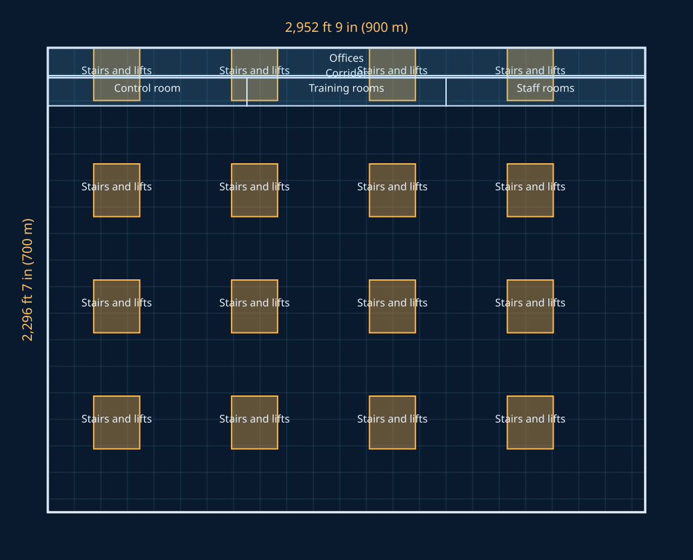

# P4-15 Vehicle Workshop: plan

Footprint 2,952 ft 9 in (900 m) × 2,296 ft 7 in (700 m) · structural grid 32 ft 10 in (10 m)

## Levels

| Level | Floor above deck | Height | Floor area |
|---|---|---|---|
| Level 1 · Ground floor | 0 ft (0 mm) | 19 ft 8 in (6,000 mm) | 2,835,429 sq ft (263,420 m²) |
| Level 2 · Upper | 19 ft 8 in (6,000 mm) | 19 ft 8 in (6,000 mm) | 2,835,429 sq ft (263,420 m²) |

## Elements

| ID | Designation | Type | Name | Level(s) | Size / length | Area | Status |
|---|---|---|---|---|---|---|---|
| E001 | D5F3P4B8A2L1R1, D5F3P4B8A2L2R1 | room | Service bay with pit 1 | L1, L2 | 177 ft 2 in (54 m) × 984 ft 3 in (300 m) | 174,375 sq ft (16,200 m²) | proposed |
| E002 | D5F3P4B8A2L1R2, D5F3P4B8A2L2R2 | room | Service bay with pit 2 | L1, L2 | 177 ft 2 in (54 m) × 984 ft 3 in (300 m) | 174,375 sq ft (16,200 m²) | proposed |
| E003 | D5F3P4B8A2L1R3, D5F3P4B8A2L2R3 | room | Service bay with pit 3 | L1, L2 | 177 ft 2 in (54 m) × 984 ft 3 in (300 m) | 174,375 sq ft (16,200 m²) | proposed |
| E004 | D5F3P4B8A2L1R4, D5F3P4B8A2L2R4 | room | Service bay with pit 4 | L1, L2 | 177 ft 2 in (54 m) × 984 ft 3 in (300 m) | 174,375 sq ft (16,200 m²) | proposed |
| E005 | D5F3P4B8A2L1R5, D5F3P4B8A2L2R5 | room | Service bay with pit 5 | L1, L2 | 177 ft 2 in (54 m) × 984 ft 3 in (300 m) | 174,375 sq ft (16,200 m²) | proposed |
| E006 | D5F3P4B8A2L1R6, D5F3P4B8A2L2R6 | room | Service bay with pit 6 | L1, L2 | 177 ft 2 in (54 m) × 984 ft 3 in (300 m) | 174,375 sq ft (16,200 m²) | proposed |
| E007 | D5F3P4B8A2L1R7, D5F3P4B8A2L2R7 | room | Service bay with pit 7 | L1, L2 | 177 ft 2 in (54 m) × 984 ft 3 in (300 m) | 174,375 sq ft (16,200 m²) | proposed |
| E008 | D5F3P4B8A2L1R8, D5F3P4B8A2L2R8 | room | Service bay with pit 8 | L1, L2 | 177 ft 2 in (54 m) × 984 ft 3 in (300 m) | 174,375 sq ft (16,200 m²) | proposed |
| E009 | D5F3P4B8A2L1R9, D5F3P4B8A2L2R9 | room | Service bay with pit 9 | L1, L2 | 177 ft 2 in (54 m) × 984 ft 3 in (300 m) | 174,375 sq ft (16,200 m²) | proposed |
| E010 | D5F3P4B8A2L1R10, D5F3P4B8A2L2R10 | room | Service bay with pit 10 | L1, L2 | 177 ft 2 in (54 m) × 984 ft 3 in (300 m) | 174,375 sq ft (16,200 m²) | proposed |
| E011 | D5F3P4B8A2L1R11, D5F3P4B8A2L2R11 | room | Heavy truck bay 1 | L1, L2 | 721 ft 9 in (220 m) × 328 ft 1 in (100 m) | 236,806 sq ft (22,000 m²) | proposed |
| E012 | D5F3P4B8A2L1R12, D5F3P4B8A2L2R12 | room | Heavy truck bay 2 | L1, L2 | 721 ft 9 in (220 m) × 328 ft 1 in (100 m) | 236,806 sq ft (22,000 m²) | proposed |
| E013 | D5F3P4B8A2L1R13, D5F3P4B8A2L2R13 | room | Heavy truck bay 3 | L1, L2 | 721 ft 9 in (220 m) × 328 ft 1 in (100 m) | 236,806 sq ft (22,000 m²) | proposed |
| E014 | D5F3P4B8A2L1R14, D5F3P4B8A2L2R14 | core | Stairs and lifts | L1, L2 | 32 ft 10 in (10 m) × 75 ft 6 in (23 m) | 2,476 sq ft (230 m²) | proposed |
| E015 | D5F3P4B8A2L1R15, D5F3P4B8A2L2R15 | core | Stairs and lifts | L1, L2 | 32 ft 10 in (10 m) × 75 ft 6 in (23 m) | 2,476 sq ft (230 m²) | proposed |
| E016 | D5F3P4B8A2L1R16 | zone | Corridor | L1 | 2,559 ft 1 in (780 m) × 13 ft 1 in (4,000 mm) | 33,583 sq ft (3,120 m²) | proposed |
| E017 | D5F3P4B8A2L1R17 | room | Tyre shop | L1 | 935 ft (285 m) × 75 ft 6 in (23 m) | 70,557 sq ft (6,555 m²) | proposed |
| E018 | D5F3P4B8A2L1R18 | room | Battery shop | L1 | 779 ft 2 in (238 m) × 75 ft 6 in (23 m) | 58,798 sq ft (5,462 m²) | proposed |
| E019 | D5F3P4B8A2L1R19 | room | Paint booth | L1 | 779 ft 2 in (238 m) × 75 ft 6 in (23 m) | 58,798 sq ft (5,462 m²) | proposed |
| E020 | D5F3P4B8A2L1R20 | room | Body shop | L1 | 570 ft 6 in (174 m) × 75 ft 6 in (23 m) | 43,052 sq ft (4,000 m²) | proposed |
| E021 | D5F3P4B8A2L1R21 | room | Parts store | L1 | 427 ft 10 in (130 m) × 75 ft 6 in (23 m) | 32,283 sq ft (2,999 m²) | proposed |
| E022 | D5F3P4B8A2L1R22 | room | Lockers | L1 | 1,560 ft 8 in (476 m) × 75 ft 6 in (23 m) | 117,769 sq ft (10,941 m²) | proposed |
| E023 | D5F3P4B8A2L2R16 | zone | Corridor | L2 | 2,559 ft 1 in (780 m) × 13 ft 1 in (4,000 mm) | 33,583 sq ft (3,120 m²) | proposed |
| E024 | D5F3P4B8A2L2R17 | room | Canteen | L2 | 2,493 ft 5 in (760 m) × 75 ft 6 in (23 m) | 188,153 sq ft (17,480 m²) | proposed |
| E025 | D5F3P4B8A2L2R18 | room | Service office | L2 | 356 ft 8 in (109 m) × 75 ft 6 in (23 m) | 26,911 sq ft (2,500 m²) | proposed |
| E026 | D5F3P4B8A2L2R19 | room | Training room | L2 | 85 ft 8 in (26 m) × 75 ft 6 in (23 m) | 6,462 sq ft (600 m²) | proposed |
| E027 | D5F3P4B8A2L2R20 | room | Offices | L2 | 2,116 ft 10 in (645 m) × 75 ft 6 in (23 m) | 159,732 sq ft (14,840 m²) | proposed |
| E028 | D5F3P4B8A2L1R23 | zone | Vehicle yard | L1 | 2,559 ft 1 in (780 m) × 787 ft 5 in (240 m) | 2,015,004 sq ft (187,200 m²) | proposed |

## Drawings

### Level 1 · Ground floor

### Level 2 · Upper

