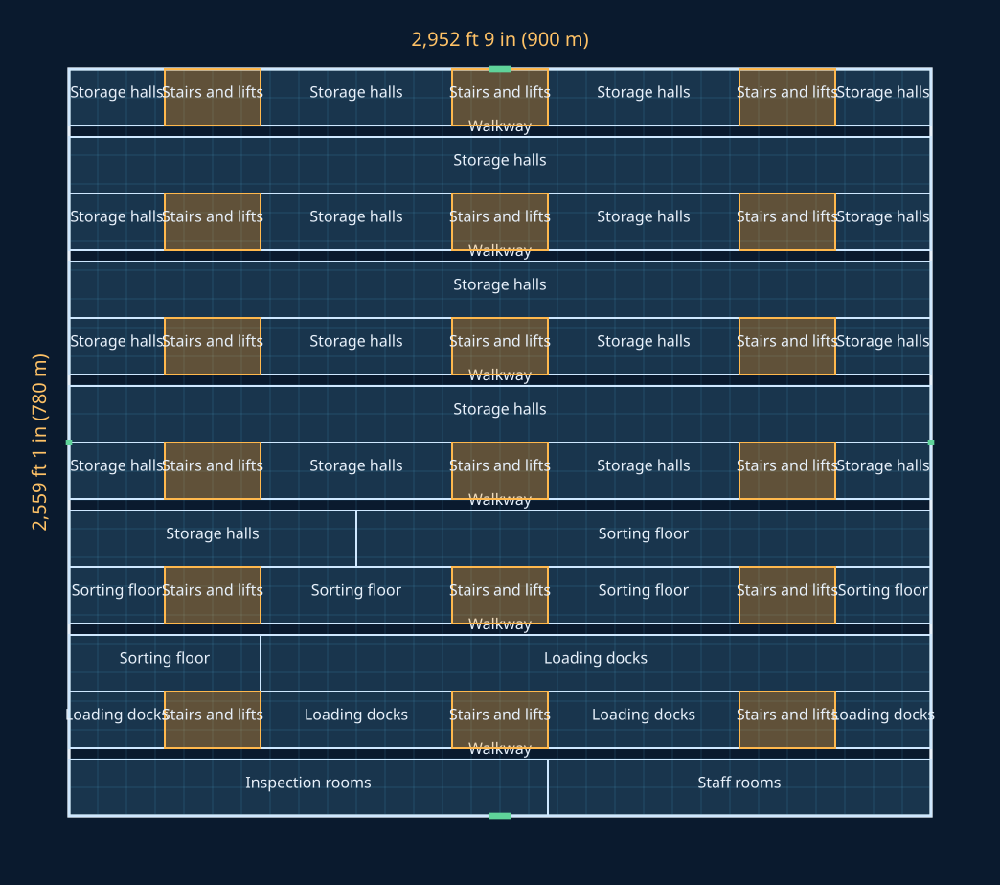
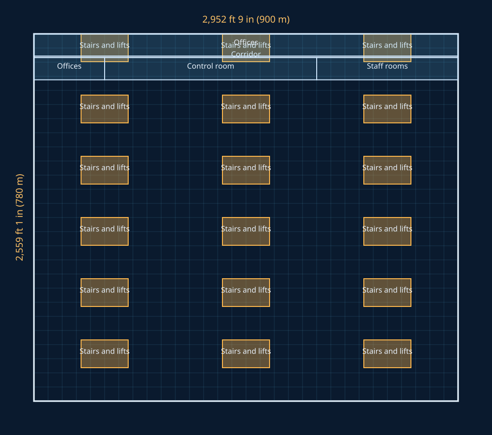

# P4-16 Container Yard: plan

Footprint 2,952 ft 9 in (900 m) × 2,559 ft 1 in (780 m) · structural grid 32 ft 10 in (10 m)

## Levels

| Level | Floor above deck | Height | Floor area |
|---|---|---|---|
| Level 1 · Ground | 0 ft (0 mm) | 42 ft 8 in (13 m) | 2,737,908 sq ft (254,360 m²) |
| Level 2 · Crane level | 42 ft 8 in (13 m) | 39 ft 4 in (12 m) | 90,417 sq ft (8,400 m²) |

## Elements

| ID | Designation | Type | Name | Level(s) | Size / length | Area | Status |
|---|---|---|---|---|---|---|---|
| E001 | D5F3P4B8A3L1R1 | zone | Corridor | L1 | 853 ft (260 m) × 13 ft 1 in (4,000 mm) | 11,194 sq ft (1,040 m²) | proposed |
| E002 | D5F3P4B8A3L1R2 | room | Gate lanes control | L1 | 853 ft (260 m) × 75 ft 6 in (23 m) | 64,368 sq ft (5,980 m²) | proposed |
| E003 | D5F3P4B8A3L1R3 | room | Customs check | L1 | 356 ft 8 in (109 m) × 75 ft 6 in (23 m) | 26,911 sq ft (2,500 m²) | proposed |
| E004 | D5F3P4B8A3L1R4 | room | Drivers' room | L1 | 213 ft 11 in (65 m) × 75 ft 6 in (23 m) | 16,142 sq ft (1,500 m²) | proposed |
| E005 | D5F3P4B8A3L1R5 | room | Yard office | L1 | 282 ft 6 in (86 m) × 75 ft 6 in (23 m) | 21,316 sq ft (1,980 m²) | proposed |
| E006 | D5F3P4B8A3L1R6 | zone | Truck lanes | L1 | 1,640 ft 5 in (500 m) × 196 ft 10 in (60 m) | 322,917 sq ft (30,000 m²) | proposed |
| E007 | D5F3P4B8A3L1R7 | room | Container stack row 1 | L1 | 2,559 ft 1 in (780 m) × 196 ft 10 in (60 m) | 503,751 sq ft (46,800 m²) | proposed |
| E008 | D5F3P4B8A3L1R8 | room | Container stack row 2 | L1 | 2,559 ft 1 in (780 m) × 196 ft 10 in (60 m) | 503,751 sq ft (46,800 m²) | proposed |
| E009 | D5F3P4B8A3L1R9 | room | Container stack row 3 | L1 | 2,559 ft 1 in (780 m) × 196 ft 10 in (60 m) | 503,751 sq ft (46,800 m²) | proposed |
| E010 | D5F3P4B8A3L1R10 | room | Container stack row 4 | L1 | 2,559 ft 1 in (780 m) × 196 ft 10 in (60 m) | 503,751 sq ft (46,800 m²) | proposed |
| E011 | D5F3P4B8A3L1R11 | room | Refrigerated container row (plugged in) | L1 | 2,559 ft 1 in (780 m) × 196 ft 10 in (60 m) | 503,751 sq ft (46,800 m²) | proposed |
| E012 | D5F3P4B8A3L1R12 | zone | Crane runway | L1 | 2,559 ft 1 in (780 m) × 393 ft 8 in (120 m) | 1,007,502 sq ft (93,600 m²) | proposed |
| E013 | D5F3P4B8A3L1R13, D5F3P4B8A3L2R1 | room | Rail gantry crane 1 | L1, L2 | 98 ft 5 in (30 m) × 459 ft 4 in (140 m) | 45,208 sq ft (4,200 m²) | proposed |
| E014 | D5F3P4B8A3L1R14, D5F3P4B8A3L2R2 | room | Rail gantry crane 2 | L1, L2 | 98 ft 5 in (30 m) × 459 ft 4 in (140 m) | 45,208 sq ft (4,200 m²) | proposed |
| E015 | D5F3P4B8A3L1R15 | zone | Keelway rail siding | L1 | 2,952 ft 9 in (900 m) × 295 ft 3 in (90 m) | 871,877 sq ft (81,000 m²) | proposed |

## Drawings

### Level 1 · Ground

### Level 2 · Crane level

