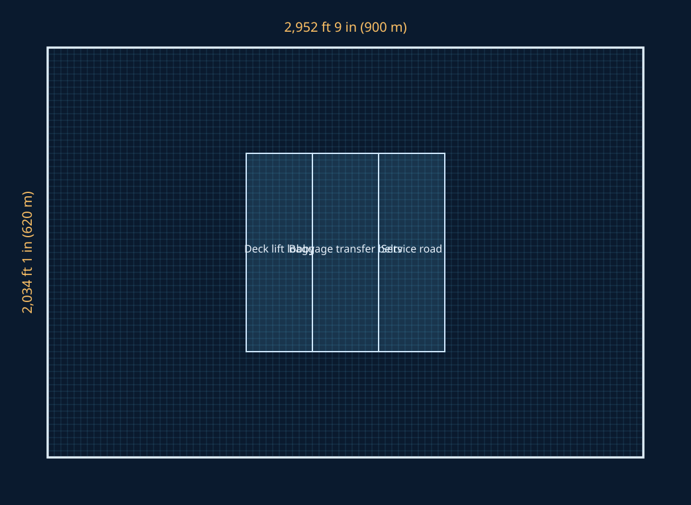
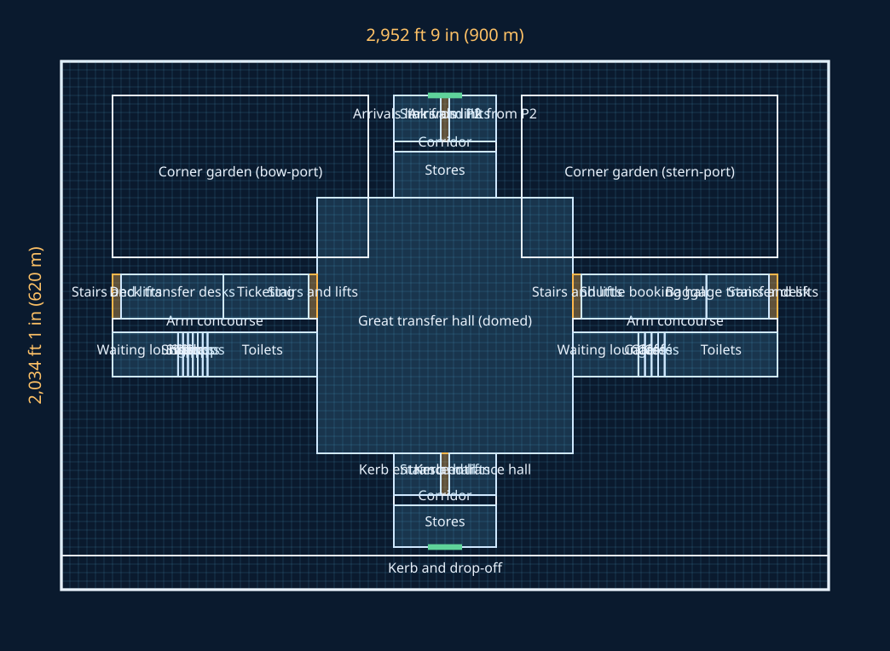
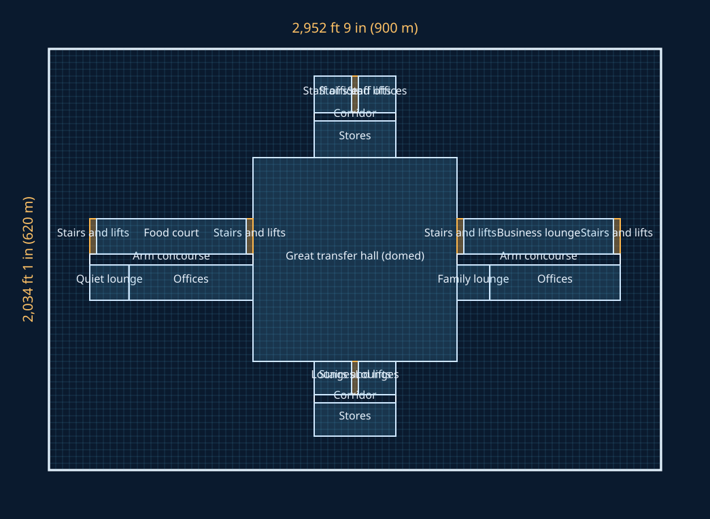
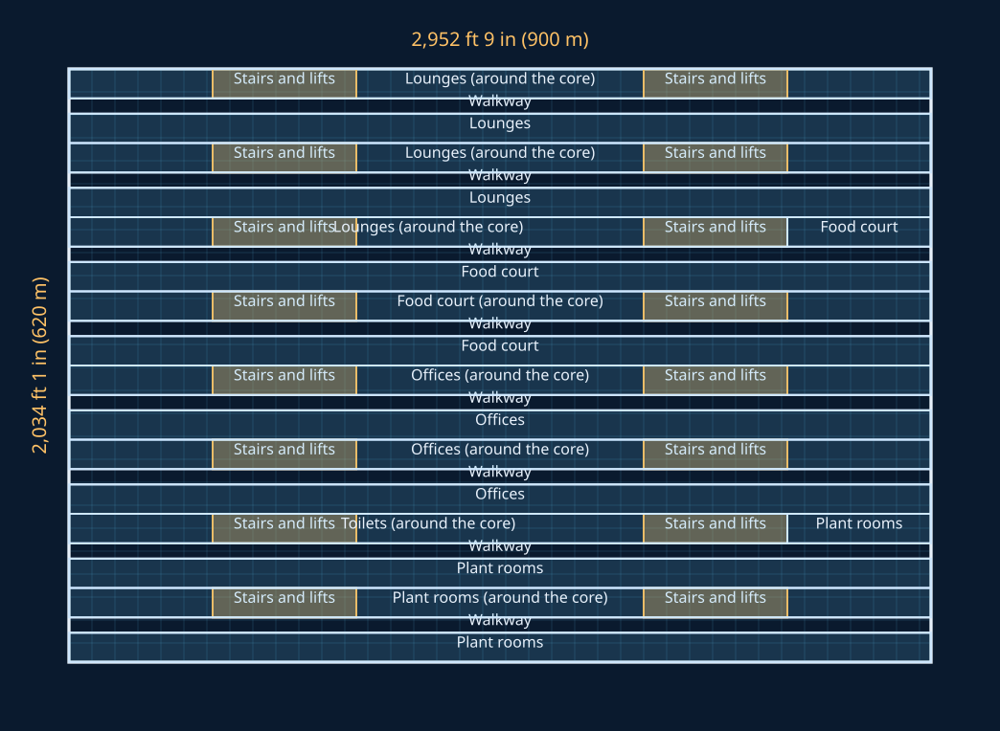
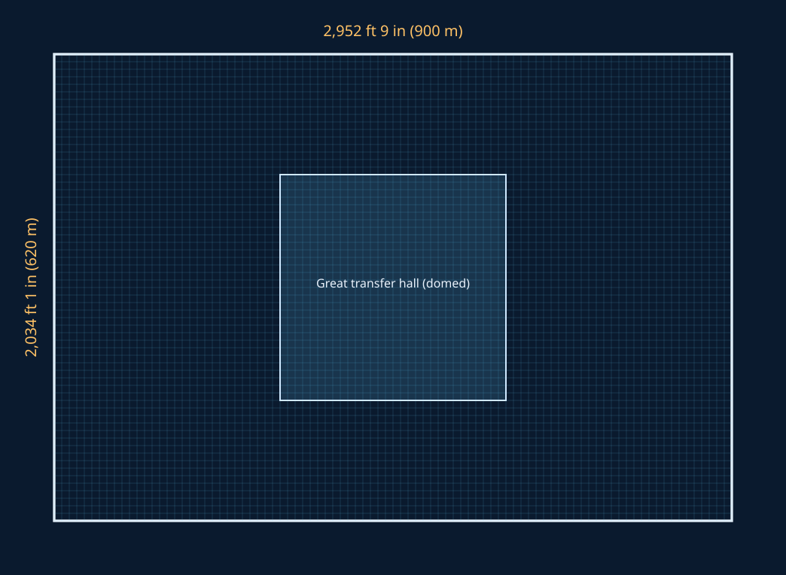

# P5-01 Transfer Hall: plan

Footprint 2,952 ft 9 in (900 m) × 2,034 ft 1 in (620 m) · structural grid 32 ft 10 in (10 m)

## Levels

| Level | Floor above deck | Height | Floor area |
|---|---|---|---|
| Level B1 · Lift and baggage level | −19 ft 8 in (6,000 mm) | 19 ft 8 in (6,000 mm) | 968,752 sq ft (90,000 m²) |
| Level 1 · Ground floor | 0 ft (0 mm) | 26 ft 3 in (8,000 mm) | 1,738,695 sq ft (161,530 m²) |
| Level 2 · Level 2 | 26 ft 3 in (8,000 mm) | 23 ft (7,000 mm) | 1,738,695 sq ft (161,530 m²) |
| Level 3 · Hall upper | 49 ft 3 in (15 m) | 23 ft (7,000 mm) | 968,752 sq ft (90,000 m²) |
| Level 4 · Dome | 72 ft 2 in (22 m) | 32 ft 10 in (10 m) | 968,752 sq ft (90,000 m²) |

## Elements

| ID | Designation | Type | Name | Level(s) | Size / length | Area | Status |
|---|---|---|---|---|---|---|---|
| E001 | D5F3P5B1A1L1R1, D5F3P5B1A1L2R1, D5F3P5B1A1L3R1, D5F3P5B1A1L4R1 | room | Great transfer hall (domed) | L1, L2, L3, L4 | 984 ft 3 in (300 m) × 984 ft 3 in (300 m) | 968,752 sq ft (90,000 m²) | proposed |
| E002 | D5F3P5B1A1L1R2, D5F3P5B1A1L2R2 | core | Stairs and lifts | L1, L2 | 32 ft 10 in (10 m) × 170 ft 7 in (52 m) | 5,597 sq ft (520 m²) | proposed |
| E003 | D5F3P5B1A1L1R3, D5F3P5B1A1L2R3 | core | Stairs and lifts | L1, L2 | 32 ft 10 in (10 m) × 170 ft 7 in (52 m) | 5,597 sq ft (520 m²) | proposed |
| E004 | D5F3P5B1A1L1R4 | zone | Arm concourse | L1 | 787 ft 5 in (240 m) × 52 ft 6 in (16 m) | 41,333 sq ft (3,840 m²) | proposed |
| E005 | D5F3P5B1A1L1R5 | room | Deck transfer desks | L1 | 393 ft 8 in (120 m) × 170 ft 7 in (52 m) | 67,167 sq ft (6,240 m²) | proposed |
| E006 | D5F3P5B1A1L1R6 | room | Ticketing | L1 | 328 ft 1 in (100 m) × 170 ft 7 in (52 m) | 55,972 sq ft (5,200 m²) | proposed |
| E007 | D5F3P5B1A1L1R7 | room | Waiting lounge | L1 | 252 ft 4 in (77 m) × 170 ft 7 in (52 m) | 43,043 sq ft (3,999 m²) | proposed |
| E008 | D5F3P5B1A1L1R8 | room | Shops | L1 | 19 ft (5,800 mm) × 170 ft 7 in (52 m) | 3,246 sq ft (302 m²) | proposed |
| E009 | D5F3P5B1A1L1R9 | room | Shops | L1 | 19 ft (5,800 mm) × 170 ft 7 in (52 m) | 3,246 sq ft (302 m²) | proposed |
| E010 | D5F3P5B1A1L1R10 | room | Shops | L1 | 18 ft 8 in (5,700 mm) × 170 ft 7 in (52 m) | 3,190 sq ft (296 m²) | proposed |
| E011 | D5F3P5B1A1L1R11 | room | Shops | L1 | 19 ft (5,800 mm) × 170 ft 7 in (52 m) | 3,246 sq ft (302 m²) | proposed |
| E012 | D5F3P5B1A1L1R12 | room | Shops | L1 | 19 ft (5,800 mm) × 170 ft 7 in (52 m) | 3,246 sq ft (302 m²) | proposed |
| E013 | D5F3P5B1A1L1R13 | room | Shops | L1 | 18 ft 8 in (5,700 mm) × 170 ft 7 in (52 m) | 3,190 sq ft (296 m²) | proposed |
| E014 | D5F3P5B1A1L1R14 | room | Toilets | L1 | 421 ft 7 in (128 m) × 170 ft 7 in (52 m) | 71,924 sq ft (6,682 m²) | proposed |
| E015 | D5F3P5B1A1L2R4 | zone | Arm concourse | L2 | 787 ft 5 in (240 m) × 52 ft 6 in (16 m) | 41,333 sq ft (3,840 m²) | proposed |
| E016 | D5F3P5B1A1L2R5 | room | Food court | L2 | 721 ft 9 in (220 m) × 170 ft 7 in (52 m) | 123,139 sq ft (11,440 m²) | proposed |
| E017 | D5F3P5B1A1L2R6 | room | Quiet lounge | L2 | 189 ft 4 in (58 m) × 170 ft 7 in (52 m) | 32,296 sq ft (3,000 m²) | proposed |
| E018 | D5F3P5B1A1L2R7 | room | Offices | L2 | 598 ft 1 in (182 m) × 170 ft 7 in (52 m) | 102,038 sq ft (9,480 m²) | proposed |
| E019 | D5F3P5B1A1L1R15, D5F3P5B1A1L2R8 | core | Stairs and lifts | L1, L2 | 32 ft 10 in (10 m) × 170 ft 7 in (52 m) | 5,597 sq ft (520 m²) | proposed |
| E020 | D5F3P5B1A1L1R16, D5F3P5B1A1L2R9 | core | Stairs and lifts | L1, L2 | 32 ft 10 in (10 m) × 170 ft 7 in (52 m) | 5,597 sq ft (520 m²) | proposed |
| E021 | D5F3P5B1A1L1R17 | zone | Arm concourse | L1 | 787 ft 5 in (240 m) × 52 ft 6 in (16 m) | 41,333 sq ft (3,840 m²) | proposed |
| E022 | D5F3P5B1A1L1R18 | room | Shuttle booking hall | L1 | 481 ft 4 in (147 m) × 170 ft 7 in (52 m) | 82,111 sq ft (7,628 m²) | proposed |
| E023 | D5F3P5B1A1L1R19 | room | Baggage transfer desk | L1 | 240 ft 6 in (73 m) × 170 ft 7 in (52 m) | 41,028 sq ft (3,812 m²) | proposed |
| E024 | D5F3P5B1A1L1R20 | room | Waiting lounge | L1 | 252 ft 4 in (77 m) × 170 ft 7 in (52 m) | 43,043 sq ft (3,999 m²) | proposed |
| E025 | D5F3P5B1A1L1R21 | room | Cafés | L1 | 25 ft 3 in (7,700 mm) × 170 ft 7 in (52 m) | 4,310 sq ft (400 m²) | proposed |
| E026 | D5F3P5B1A1L1R22 | room | Cafés | L1 | 25 ft 3 in (7,700 mm) × 170 ft 7 in (52 m) | 4,310 sq ft (400 m²) | proposed |
| E027 | D5F3P5B1A1L1R23 | room | Cafés | L1 | 25 ft 3 in (7,700 mm) × 170 ft 7 in (52 m) | 4,310 sq ft (400 m²) | proposed |
| E028 | D5F3P5B1A1L1R24 | room | Cafés | L1 | 25 ft 3 in (7,700 mm) × 170 ft 7 in (52 m) | 4,310 sq ft (400 m²) | proposed |
| E029 | D5F3P5B1A1L1R25 | room | Toilets | L1 | 434 ft 1 in (132 m) × 170 ft 7 in (52 m) | 74,051 sq ft (6,880 m²) | proposed |
| E030 | D5F3P5B1A1L2R10 | zone | Arm concourse | L2 | 787 ft 5 in (240 m) × 52 ft 6 in (16 m) | 41,333 sq ft (3,840 m²) | proposed |
| E031 | D5F3P5B1A1L2R11 | room | Business lounge | L2 | 721 ft 9 in (220 m) × 170 ft 7 in (52 m) | 123,139 sq ft (11,440 m²) | proposed |
| E032 | D5F3P5B1A1L2R12 | room | Family lounge | L2 | 157 ft 10 in (48 m) × 170 ft 7 in (52 m) | 26,923 sq ft (2,501 m²) | proposed |
| E033 | D5F3P5B1A1L2R13 | room | Offices | L2 | 629 ft 7 in (192 m) × 170 ft 7 in (52 m) | 107,411 sq ft (9,979 m²) | proposed |
| E034 | D5F3P5B1A1L1R26, D5F3P5B1A1L2R14 | core | Stairs and lifts | L1, L2 | 32 ft 10 in (10 m) × 177 ft 2 in (54 m) | 5,813 sq ft (540 m²) | proposed |
| E035 | D5F3P5B1A1L1R27 | zone | Corridor | L1 | 393 ft 8 in (120 m) × 39 ft 4 in (12 m) | 15,500 sq ft (1,440 m²) | proposed |
| E036 | D5F3P5B1A1L1R28 | room | Arrivals link from P2 | L1 | 180 ft 5 in (55 m) × 177 ft 2 in (54 m) | 31,969 sq ft (2,970 m²) | proposed |
| E037 | D5F3P5B1A1L1R29 | room | Arrivals link from P2 | L1 | 180 ft 5 in (55 m) × 177 ft 2 in (54 m) | 31,969 sq ft (2,970 m²) | proposed |
| E038 | D5F3P5B1A1L1R30 | room | Stores | L1 | 393 ft 8 in (120 m) × 177 ft 2 in (54 m) | 69,750 sq ft (6,480 m²) | proposed |
| E039 | D5F3P5B1A1L2R15 | zone | Corridor | L2 | 393 ft 8 in (120 m) × 39 ft 4 in (12 m) | 15,500 sq ft (1,440 m²) | proposed |
| E040 | D5F3P5B1A1L2R16 | room | Staff offices | L2 | 180 ft 5 in (55 m) × 177 ft 2 in (54 m) | 31,969 sq ft (2,970 m²) | proposed |
| E041 | D5F3P5B1A1L2R17 | room | Staff offices | L2 | 180 ft 5 in (55 m) × 177 ft 2 in (54 m) | 31,969 sq ft (2,970 m²) | proposed |
| E042 | D5F3P5B1A1L2R18 | room | Stores | L2 | 393 ft 8 in (120 m) × 177 ft 2 in (54 m) | 69,750 sq ft (6,480 m²) | proposed |
| E043 | D5F3P5B1A1L1R31, D5F3P5B1A1L2R19 | core | Stairs and lifts | L1, L2 | 32 ft 10 in (10 m) × 160 ft 9 in (49 m) | 5,274 sq ft (490 m²) | proposed |
| E044 | D5F3P5B1A1L1R32 | zone | Corridor | L1 | 393 ft 8 in (120 m) × 39 ft 4 in (12 m) | 15,500 sq ft (1,440 m²) | proposed |
| E045 | D5F3P5B1A1L1R33 | room | Kerb entrance hall | L1 | 180 ft 5 in (55 m) × 160 ft 9 in (49 m) | 29,009 sq ft (2,695 m²) | proposed |
| E046 | D5F3P5B1A1L1R34 | room | Kerb entrance hall | L1 | 180 ft 5 in (55 m) × 160 ft 9 in (49 m) | 29,009 sq ft (2,695 m²) | proposed |
| E047 | D5F3P5B1A1L1R35 | room | Stores | L1 | 393 ft 8 in (120 m) × 160 ft 9 in (49 m) | 63,292 sq ft (5,880 m²) | proposed |
| E048 | D5F3P5B1A1L2R20 | zone | Corridor | L2 | 393 ft 8 in (120 m) × 39 ft 4 in (12 m) | 15,500 sq ft (1,440 m²) | proposed |
| E049 | D5F3P5B1A1L2R21 | room | Lounges | L2 | 180 ft 5 in (55 m) × 160 ft 9 in (49 m) | 29,009 sq ft (2,695 m²) | proposed |
| E050 | D5F3P5B1A1L2R22 | room | Lounges | L2 | 180 ft 5 in (55 m) × 160 ft 9 in (49 m) | 29,009 sq ft (2,695 m²) | proposed |
| E051 | D5F3P5B1A1L2R23 | room | Stores | L2 | 393 ft 8 in (120 m) × 160 ft 9 in (49 m) | 63,292 sq ft (5,880 m²) | proposed |
| E052 | D5F3P5B1A1LB1R1 | room | Deck lift lobby | LB1 | 328 ft 1 in (100 m) × 984 ft 3 in (300 m) | 322,917 sq ft (30,000 m²) | proposed |
| E053 | D5F3P5B1A1LB1R2 | room | Baggage transfer belts | LB1 | 328 ft 1 in (100 m) × 984 ft 3 in (300 m) | 322,917 sq ft (30,000 m²) | proposed |
| E054 | D5F3P5B1A1LB1R3 | room | Service road | LB1 | 328 ft 1 in (100 m) × 984 ft 3 in (300 m) | 322,917 sq ft (30,000 m²) | proposed |
| E055 | D5F3P5B1A1L1R36 | zone | Corner garden (bow-port) | L1 | 984 ft 3 in (300 m) × 623 ft 4 in (190 m) | 613,543 sq ft (57,000 m²) | proposed |
| E056 | D5F3P5B1A1L1R37 | zone | Corner garden (stern-port) | L1 | 984 ft 3 in (300 m) × 623 ft 4 in (190 m) | 613,543 sq ft (57,000 m²) | proposed |
| E057 | D5F3P5B1A1L1R38 | zone | Kerb and drop-off | L1 | 2,952 ft 9 in (900 m) × 131 ft 3 in (40 m) | 387,501 sq ft (36,000 m²) | proposed |
| E058 |  | door | Kerb entrance | L1 | 131 ft 3 in (40 m), 131 ft 3 in (40 m) wide | — | proposed |
| E059 |  | door | Gates link | L1 | 131 ft 3 in (40 m), 131 ft 3 in (40 m) wide | — | proposed |

## Drawings

### Level B1 · Lift and baggage level

### Level 1 · Ground floor

### Level 2 · Level 2

### Level 3 · Hall upper

### Level 4 · Dome

