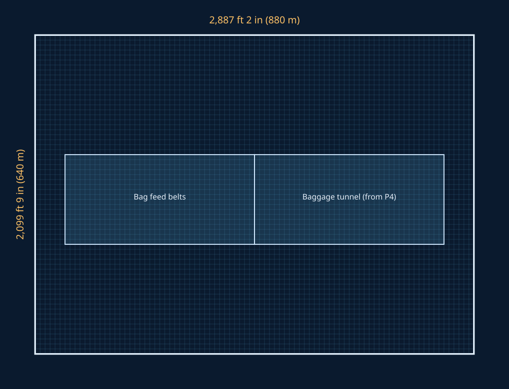
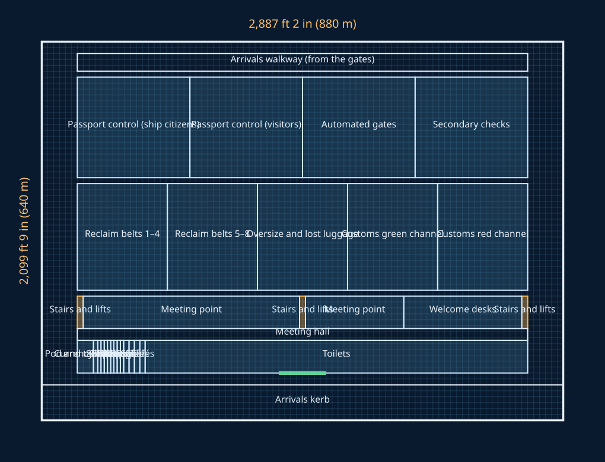
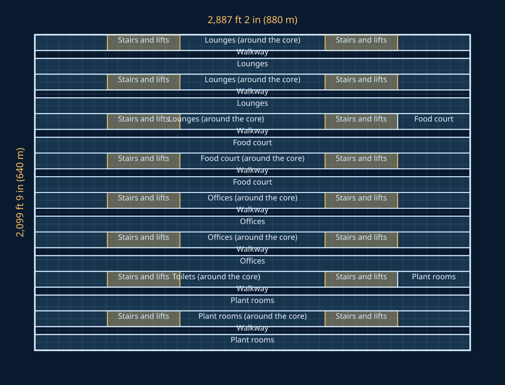

# P5-02 Arrivals Terminal: plan

Footprint 2,887 ft 2 in (880 m) × 2,099 ft 9 in (640 m) · structural grid 32 ft 10 in (10 m)

## Levels

| Level | Floor above deck | Height | Floor area |
|---|---|---|---|
| Level B1 · Baggage level | −19 ft 8 in (6,000 mm) | 19 ft 8 in (6,000 mm) | 1,472,503 sq ft (136,800 m²) |
| Level 1 · Ground floor | 0 ft (0 mm) | 29 ft 6 in (9,000 mm) | 3,745,303 sq ft (347,950 m²) |
| Level 2 · Mezzanine | 29 ft 6 in (9,000 mm) | 19 ft 8 in (6,000 mm) | 2,272,800 sq ft (211,150 m²) |

## Elements

| ID | Designation | Type | Name | Level(s) | Size / length | Area | Status |
|---|---|---|---|---|---|---|---|
| E001 | D5F3P5B3A1L1R1 | zone | Arrivals walkway (from the gates) | L1 | 2,493 ft 5 in (760 m) × 98 ft 5 in (30 m) | 245,417 sq ft (22,800 m²) | proposed |
| E002 | D5F3P5B3A1L1R2, D5F3P5B3A1L2R1 | room | Passport control (ship citizens) | L1, L2 | 623 ft 4 in (190 m) × 557 ft 9 in (170 m) | 347,674 sq ft (32,300 m²) | proposed |
| E003 | D5F3P5B3A1L1R3, D5F3P5B3A1L2R2 | room | Passport control (visitors) | L1, L2 | 623 ft 4 in (190 m) × 557 ft 9 in (170 m) | 347,674 sq ft (32,300 m²) | proposed |
| E004 | D5F3P5B3A1L1R4, D5F3P5B3A1L2R3 | room | Automated gates | L1, L2 | 623 ft 4 in (190 m) × 557 ft 9 in (170 m) | 347,674 sq ft (32,300 m²) | proposed |
| E005 | D5F3P5B3A1L1R5, D5F3P5B3A1L2R4 | room | Secondary checks | L1, L2 | 623 ft 4 in (190 m) × 557 ft 9 in (170 m) | 347,674 sq ft (32,300 m²) | proposed |
| E006 | D5F3P5B3A1L1R6 | room | Reclaim belts 1–4 | L1 | 498 ft 8 in (152 m) × 590 ft 7 in (180 m) | 294,501 sq ft (27,360 m²) | proposed |
| E007 | D5F3P5B3A1L1R7 | room | Reclaim belts 5–8 | L1 | 498 ft 8 in (152 m) × 590 ft 7 in (180 m) | 294,501 sq ft (27,360 m²) | proposed |
| E008 | D5F3P5B3A1L1R8 | room | Oversize and lost luggage | L1 | 498 ft 8 in (152 m) × 590 ft 7 in (180 m) | 294,501 sq ft (27,360 m²) | proposed |
| E009 | D5F3P5B3A1L1R9 | room | Customs green channel | L1 | 498 ft 8 in (152 m) × 590 ft 7 in (180 m) | 294,501 sq ft (27,360 m²) | proposed |
| E010 | D5F3P5B3A1L1R10 | room | Customs red channel | L1 | 498 ft 8 in (152 m) × 590 ft 7 in (180 m) | 294,501 sq ft (27,360 m²) | proposed |
| E011 | D5F3P5B3A1L1R11, D5F3P5B3A1L2R5 | core | Stairs and lifts | L1, L2 | 32 ft 10 in (10 m) × 180 ft 5 in (55 m) | 5,920 sq ft (550 m²) | proposed |
| E012 | D5F3P5B3A1L1R12, D5F3P5B3A1L2R6 | core | Stairs and lifts | L1, L2 | 32 ft 10 in (10 m) × 180 ft 5 in (55 m) | 5,920 sq ft (550 m²) | proposed |
| E013 | D5F3P5B3A1L1R13, D5F3P5B3A1L2R7 | core | Stairs and lifts | L1, L2 | 32 ft 10 in (10 m) × 180 ft 5 in (55 m) | 5,920 sq ft (550 m²) | proposed |
| E014 | D5F3P5B3A1L1R14 | zone | Meeting hall | L1 | 2,493 ft 5 in (760 m) × 65 ft 7 in (20 m) | 163,611 sq ft (15,200 m²) | proposed |
| E015 | D5F3P5B3A1L1R15 | room | Meeting point | L1 | 1,197 ft 6 in (365 m) × 180 ft 5 in (55 m) | 216,086 sq ft (20,075 m²) | proposed |
| E016 | D5F3P5B3A1L1R16 | room | Meeting point | L1 | 544 ft 3 in (166 m) × 180 ft 5 in (55 m) | 98,215 sq ft (9,124 m²) | proposed |
| E017 | D5F3P5B3A1L1R17 | room | Welcome desks | L1 | 653 ft 3 in (199 m) × 180 ft 5 in (55 m) | 117,870 sq ft (10,950 m²) | proposed |
| E018 | D5F3P5B3A1L1R18 | room | Pod and taxi desks | L1 | 89 ft 7 in (27 m) × 180 ft 5 in (55 m) | 16,162 sq ft (1,502 m²) | proposed |
| E019 | D5F3P5B3A1L1R19 | room | Currency exchange | L1 | 23 ft 7 in (7,200 mm) × 180 ft 5 in (55 m) | 4,263 sq ft (396 m²) | proposed |
| E020 | D5F3P5B3A1L1R20 | room | Shops | L1 | 18 ft 1 in (5,500 mm) × 180 ft 5 in (55 m) | 3,256 sq ft (302 m²) | proposed |
| E021 | D5F3P5B3A1L1R21 | room | Shops | L1 | 18 ft 1 in (5,500 mm) × 180 ft 5 in (55 m) | 3,256 sq ft (302 m²) | proposed |
| E022 | D5F3P5B3A1L1R22 | room | Shops | L1 | 17 ft 9 in (5,400 mm) × 180 ft 5 in (55 m) | 3,197 sq ft (297 m²) | proposed |
| E023 | D5F3P5B3A1L1R23 | room | Shops | L1 | 18 ft 1 in (5,500 mm) × 180 ft 5 in (55 m) | 3,256 sq ft (302 m²) | proposed |
| E024 | D5F3P5B3A1L1R24 | room | Shops | L1 | 17 ft 9 in (5,400 mm) × 180 ft 5 in (55 m) | 3,197 sq ft (297 m²) | proposed |
| E025 | D5F3P5B3A1L1R25 | room | Shops | L1 | 18 ft 1 in (5,500 mm) × 180 ft 5 in (55 m) | 3,256 sq ft (302 m²) | proposed |
| E026 | D5F3P5B3A1L1R26 | room | Shops | L1 | 17 ft 9 in (5,400 mm) × 180 ft 5 in (55 m) | 3,197 sq ft (297 m²) | proposed |
| E027 | D5F3P5B3A1L1R27 | room | Shops | L1 | 18 ft 1 in (5,500 mm) × 180 ft 5 in (55 m) | 3,256 sq ft (302 m²) | proposed |
| E028 | D5F3P5B3A1L1R28 | room | Cafés | L1 | 29 ft 10 in (9,100 mm) × 180 ft 5 in (55 m) | 5,387 sq ft (500 m²) | proposed |
| E029 | D5F3P5B3A1L1R29 | room | Cafés | L1 | 29 ft 10 in (9,100 mm) × 180 ft 5 in (55 m) | 5,387 sq ft (500 m²) | proposed |
| E030 | D5F3P5B3A1L1R30 | room | Cafés | L1 | 29 ft 10 in (9,100 mm) × 180 ft 5 in (55 m) | 5,387 sq ft (500 m²) | proposed |
| E031 | D5F3P5B3A1L1R31 | room | Cafés | L1 | 29 ft 6 in (9,000 mm) × 180 ft 5 in (55 m) | 5,328 sq ft (495 m²) | proposed |
| E032 | D5F3P5B3A1L1R32 | room | Toilets | L1 | 2,117 ft 9 in (646 m) × 180 ft 5 in (55 m) | 382,146 sq ft (35,502 m²) | proposed |
| E033 | D5F3P5B3A1L2R8 | zone | Meeting hall | L2 | 2,493 ft 5 in (760 m) × 65 ft 7 in (20 m) | 163,611 sq ft (15,200 m²) | proposed |
| E034 | D5F3P5B3A1L2R9 | room | Arrivals lounge | L2 | 1,197 ft 6 in (365 m) × 180 ft 5 in (55 m) | 216,086 sq ft (20,075 m²) | proposed |
| E035 | D5F3P5B3A1L2R10 | room | Arrivals lounge | L2 | 1,197 ft 6 in (365 m) × 180 ft 5 in (55 m) | 216,086 sq ft (20,075 m²) | proposed |
| E036 | D5F3P5B3A1L2R11 | room | Showers | L2 | 47 ft 7 in (14 m) × 180 ft 5 in (55 m) | 8,584 sq ft (798 m²) | proposed |
| E037 | D5F3P5B3A1L2R12 | room | Hotel booking | L2 | 36 ft 1 in (11 m) × 180 ft 5 in (55 m) | 6,512 sq ft (605 m²) | proposed |
| E038 | D5F3P5B3A1L2R13 | room | Offices | L2 | 2,409 ft 9 in (734 m) × 180 ft 5 in (55 m) | 434,835 sq ft (40,398 m²) | proposed |
| E039 | D5F3P5B3A1LB1R1 | room | Bag feed belts | LB1 | 1,246 ft 9 in (380 m) × 590 ft 7 in (180 m) | 736,252 sq ft (68,400 m²) | proposed |
| E040 | D5F3P5B3A1LB1R2 | room | Baggage tunnel (from P4) | LB1 | 1,246 ft 9 in (380 m) × 590 ft 7 in (180 m) | 736,252 sq ft (68,400 m²) | proposed |
| E041 | D5F3P5B3A1L1R33 | zone | Arrivals kerb | L1 | 2,887 ft 2 in (880 m) × 196 ft 10 in (60 m) | 568,335 sq ft (52,800 m²) | proposed |
| E042 |  | door | Kerb doors | L1 | 262 ft 6 in (80 m), 262 ft 6 in (80 m) wide | — | proposed |

## Drawings

### Level B1 · Baggage level

### Level 1 · Ground floor

### Level 2 · Mezzanine

