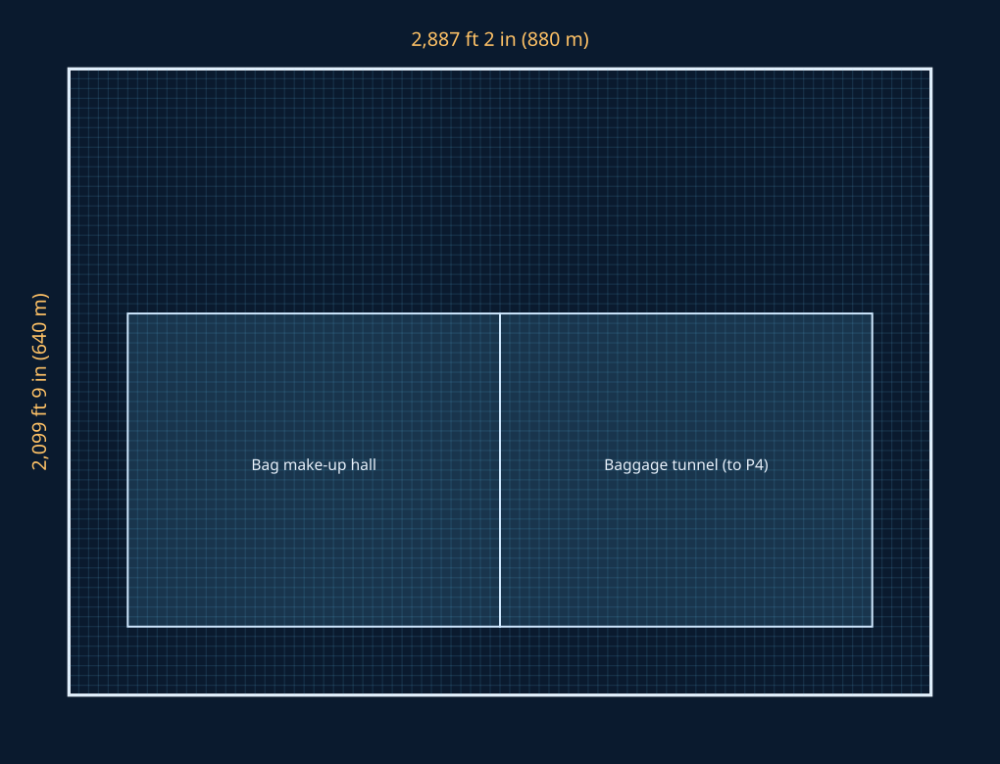
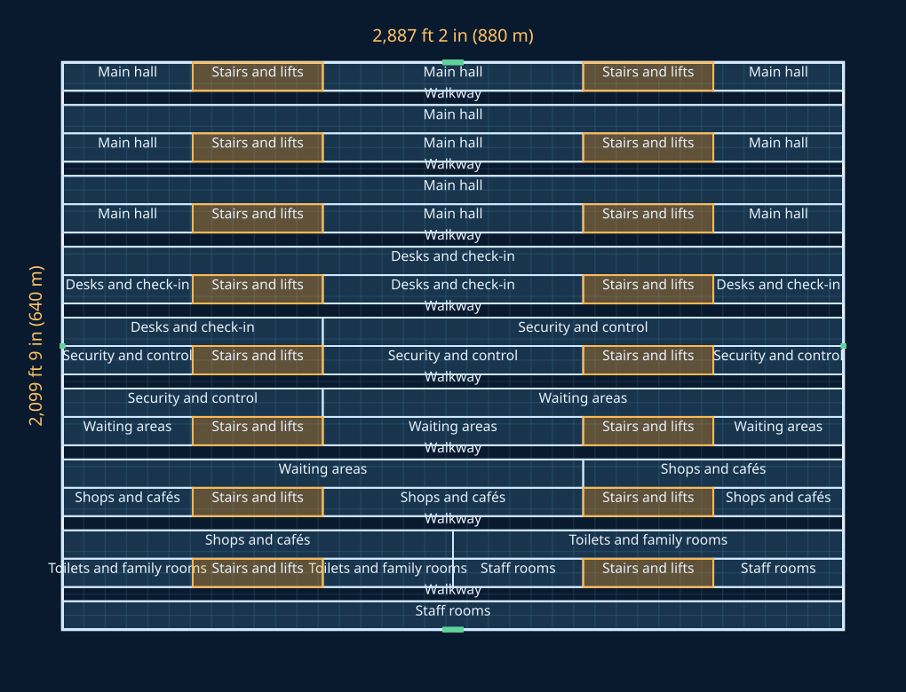
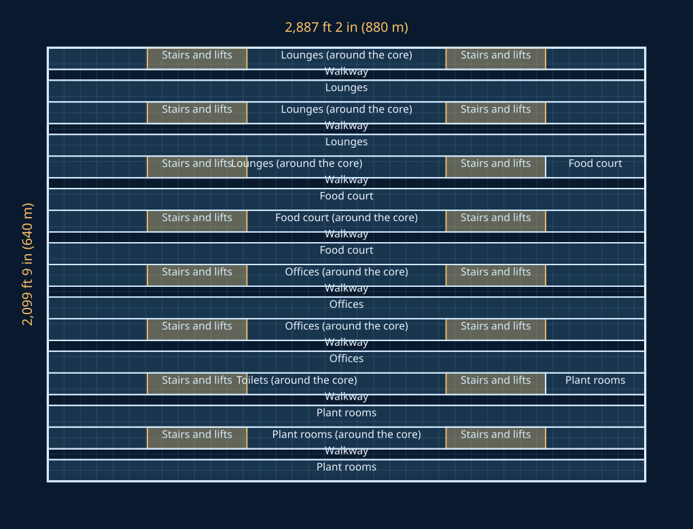
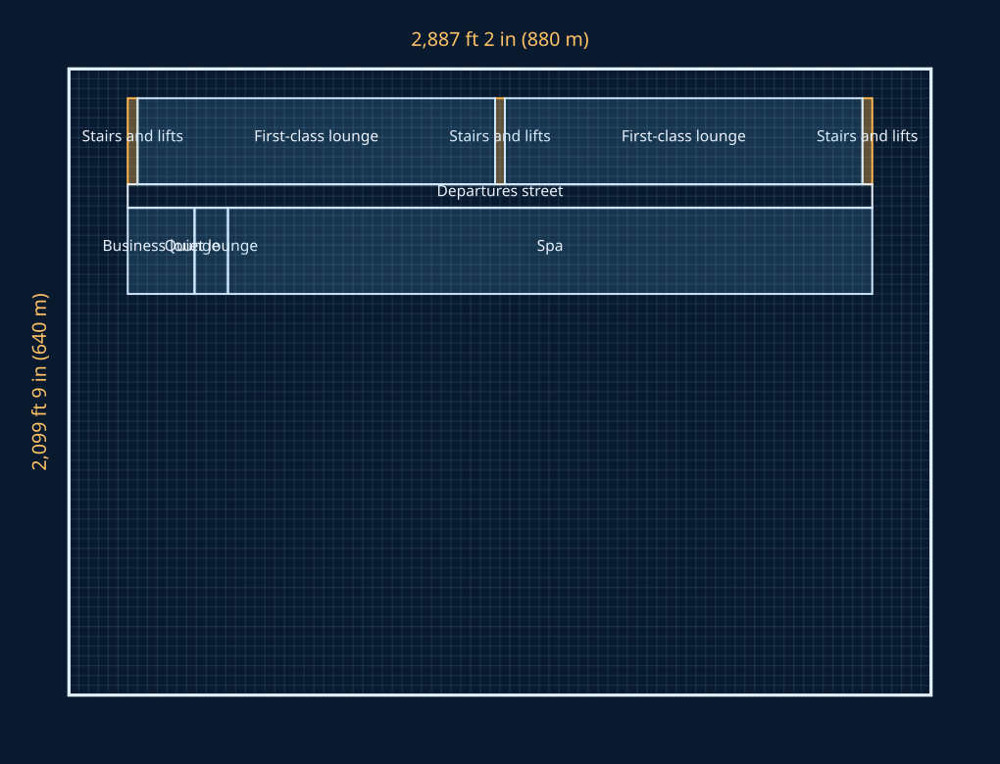

# P5-03 Departures Terminal: plan

Footprint 2,887 ft 2 in (880 m) × 2,099 ft 9 in (640 m) · structural grid 32 ft 10 in (10 m)

## Levels

| Level | Floor above deck | Height | Floor area |
|---|---|---|---|
| Level B1 · Baggage level | −19 ft 8 in (6,000 mm) | 19 ft 8 in (6,000 mm) | 2,617,783 sq ft (243,200 m²) |
| Level 1 · Ground floor | 0 ft (0 mm) | 26 ft 3 in (8,000 mm) | 3,687,931 sq ft (342,620 m²) |
| Level 2 · Departures level | 26 ft 3 in (8,000 mm) | 26 ft 3 in (8,000 mm) | 3,687,931 sq ft (342,620 m²) |
| Level 3 · Lounge level | 52 ft 6 in (16 m) | 19 ft 8 in (6,000 mm) | 1,411,364 sq ft (131,120 m²) |

## Elements

| ID | Designation | Type | Name | Level(s) | Size / length | Area | Status |
|---|---|---|---|---|---|---|---|
| E001 | D5F3P5B5A1L1R1, D5F3P5B5A1L2R1, D5F3P5B5A1L3R1 | core | Stairs and lifts | L1, L2, L3 | 32 ft 10 in (10 m) × 288 ft 9 in (88 m) | 9,472 sq ft (880 m²) | proposed |
| E002 | D5F3P5B5A1L1R2, D5F3P5B5A1L2R2, D5F3P5B5A1L3R2 | core | Stairs and lifts | L1, L2, L3 | 32 ft 10 in (10 m) × 288 ft 9 in (88 m) | 9,472 sq ft (880 m²) | proposed |
| E003 | D5F3P5B5A1L1R3, D5F3P5B5A1L2R3, D5F3P5B5A1L3R3 | core | Stairs and lifts | L1, L2, L3 | 32 ft 10 in (10 m) × 288 ft 9 in (88 m) | 9,472 sq ft (880 m²) | proposed |
| E004 | D5F3P5B5A1L1R4 | zone | Departures street | L1 | 2,493 ft 5 in (760 m) × 78 ft 9 in (24 m) | 196,334 sq ft (18,240 m²) | proposed |
| E005 | D5F3P5B5A1L1R5 | room | Gate lounges | L1 | 598 ft 9 in (182 m) × 288 ft 9 in (88 m) | 172,868 sq ft (16,060 m²) | proposed |
| E006 | D5F3P5B5A1L1R6 | room | Gate lounges | L1 | 598 ft 9 in (182 m) × 288 ft 9 in (88 m) | 172,868 sq ft (16,060 m²) | proposed |
| E007 | D5F3P5B5A1L1R7 | room | Gate lounges | L1 | 598 ft 9 in (182 m) × 288 ft 9 in (88 m) | 172,868 sq ft (16,060 m²) | proposed |
| E008 | D5F3P5B5A1L1R8 | room | Gate lounges | L1 | 598 ft 9 in (182 m) × 288 ft 9 in (88 m) | 172,868 sq ft (16,060 m²) | proposed |
| E009 | D5F3P5B5A1L1R9 | room | Gate lounges | L1 | 93 ft 2 in (28 m) × 288 ft 9 in (88 m) | 26,901 sq ft (2,499 m²) | proposed |
| E010 | D5F3P5B5A1L1R10 | room | Gate lounges | L1 | 93 ft 2 in (28 m) × 288 ft 9 in (88 m) | 26,901 sq ft (2,499 m²) | proposed |
| E011 | D5F3P5B5A1L1R11 | room | Gate lounges | L1 | 93 ft 2 in (28 m) × 288 ft 9 in (88 m) | 26,901 sq ft (2,499 m²) | proposed |
| E012 | D5F3P5B5A1L1R12 | room | Gate lounges | L1 | 93 ft 2 in (28 m) × 288 ft 9 in (88 m) | 26,901 sq ft (2,499 m²) | proposed |
| E013 | D5F3P5B5A1L1R13 | room | Toilets | L1 | 2,120 ft 9 in (646 m) × 288 ft 9 in (88 m) | 612,286 sq ft (56,883 m²) | proposed |
| E014 | D5F3P5B5A1L2R4 | zone | Departures street | L2 | 2,493 ft 5 in (760 m) × 78 ft 9 in (24 m) | 196,334 sq ft (18,240 m²) | proposed |
| E015 | D5F3P5B5A1L2R5 | room | Duty-free shops | L2 | 1,197 ft 6 in (365 m) × 288 ft 9 in (88 m) | 345,737 sq ft (32,120 m²) | proposed |
| E016 | D5F3P5B5A1L2R6 | room | Duty-free shops | L2 | 693 ft 3 in (211 m) × 288 ft 9 in (88 m) | 200,148 sq ft (18,594 m²) | proposed |
| E017 | D5F3P5B5A1L2R7 | room | Restaurants | L2 | 252 ft 4 in (77 m) × 288 ft 9 in (88 m) | 72,842 sq ft (6,767 m²) | proposed |
| E018 | D5F3P5B5A1L2R8 | room | Restaurants | L2 | 252 ft (77 m) × 288 ft 9 in (88 m) | 72,747 sq ft (6,758 m²) | proposed |
| E019 | D5F3P5B5A1L2R9 | room | Restaurants | L2 | 29 ft 10 in (9,100 mm) × 288 ft 9 in (88 m) | 8,620 sq ft (801 m²) | proposed |
| E020 | D5F3P5B5A1L2R10 | room | Restaurants | L2 | 29 ft 10 in (9,100 mm) × 288 ft 9 in (88 m) | 8,620 sq ft (801 m²) | proposed |
| E021 | D5F3P5B5A1L2R11 | room | Restaurants | L2 | 29 ft 10 in (9,100 mm) × 288 ft 9 in (88 m) | 8,620 sq ft (801 m²) | proposed |
| E022 | D5F3P5B5A1L2R12 | room | Restaurants | L2 | 29 ft 10 in (9,100 mm) × 288 ft 9 in (88 m) | 8,620 sq ft (801 m²) | proposed |
| E023 | D5F3P5B5A1L2R13 | room | Shops | L2 | 11 ft 2 in (3,400 mm) × 288 ft 9 in (88 m) | 3,221 sq ft (299 m²) | proposed |
| E024 | D5F3P5B5A1L2R14 | room | Shops | L2 | 11 ft 2 in (3,400 mm) × 288 ft 9 in (88 m) | 3,221 sq ft (299 m²) | proposed |
| E025 | D5F3P5B5A1L2R15 | room | Shops | L2 | 11 ft 2 in (3,400 mm) × 288 ft 9 in (88 m) | 3,221 sq ft (299 m²) | proposed |
| E026 | D5F3P5B5A1L2R16 | room | Shops | L2 | 11 ft 2 in (3,400 mm) × 288 ft 9 in (88 m) | 3,221 sq ft (299 m²) | proposed |
| E027 | D5F3P5B5A1L2R17 | room | Shops | L2 | 11 ft 2 in (3,400 mm) × 288 ft 9 in (88 m) | 3,221 sq ft (299 m²) | proposed |
| E028 | D5F3P5B5A1L2R18 | room | Shops | L2 | 11 ft 2 in (3,400 mm) × 288 ft 9 in (88 m) | 3,221 sq ft (299 m²) | proposed |
| E029 | D5F3P5B5A1L2R19 | room | Shops | L2 | 11 ft 2 in (3,400 mm) × 288 ft 9 in (88 m) | 3,221 sq ft (299 m²) | proposed |
| E030 | D5F3P5B5A1L2R20 | room | Shops | L2 | 11 ft 2 in (3,400 mm) × 288 ft 9 in (88 m) | 3,221 sq ft (299 m²) | proposed |
| E031 | D5F3P5B5A1L2R21 | room | Shops | L2 | 11 ft 2 in (3,400 mm) × 288 ft 9 in (88 m) | 3,221 sq ft (299 m²) | proposed |
| E032 | D5F3P5B5A1L2R22 | room | Shops | L2 | 11 ft 6 in (3,500 mm) × 288 ft 9 in (88 m) | 3,315 sq ft (308 m²) | proposed |
| E033 | D5F3P5B5A1L2R23 | room | Children's play area | L2 | 55 ft 9 in (17 m) × 288 ft 9 in (88 m) | 16,103 sq ft (1,496 m²) | proposed |
| E034 | D5F3P5B5A1L2R24 | room | Seating | L2 | 2,206 ft 4 in (672 m) × 288 ft 9 in (88 m) | 637,008 sq ft (59,180 m²) | proposed |
| E035 | D5F3P5B5A1L3R4 | zone | Departures street | L3 | 2,493 ft 5 in (760 m) × 78 ft 9 in (24 m) | 196,334 sq ft (18,240 m²) | proposed |
| E036 | D5F3P5B5A1L3R5 | room | First-class lounge | L3 | 1,197 ft 6 in (365 m) × 288 ft 9 in (88 m) | 345,737 sq ft (32,120 m²) | proposed |
| E037 | D5F3P5B5A1L3R6 | room | First-class lounge | L3 | 1,197 ft 6 in (365 m) × 288 ft 9 in (88 m) | 345,737 sq ft (32,120 m²) | proposed |
| E038 | D5F3P5B5A1L3R7 | room | Business lounge | L3 | 223 ft 9 in (68 m) × 288 ft 9 in (88 m) | 64,601 sq ft (6,002 m²) | proposed |
| E039 | D5F3P5B5A1L3R8 | room | Quiet lounge | L3 | 111 ft 11 in (34 m) × 288 ft 9 in (88 m) | 32,300 sq ft (3,001 m²) | proposed |
| E040 | D5F3P5B5A1L3R9 | room | Spa | L3 | 2,157 ft 10 in (658 m) × 288 ft 9 in (88 m) | 622,989 sq ft (57,878 m²) | proposed |
| E041 | D5F3P5B5A1L1R14, D5F3P5B5A1L2R25 | room | Security lanes 1–8 | L1, L2 | 415 ft 8 in (127 m) × 492 ft 2 in (150 m) | 204,568 sq ft (19,005 m²) | proposed |
| E042 | D5F3P5B5A1L1R15, D5F3P5B5A1L2R26 | room | Security lanes 9–16 | L1, L2 | 415 ft 4 in (127 m) × 492 ft 2 in (150 m) | 204,407 sq ft (18,990 m²) | proposed |
| E043 | D5F3P5B5A1L1R16, D5F3P5B5A1L2R27 | room | Fast-track security | L1, L2 | 415 ft 8 in (127 m) × 492 ft 2 in (150 m) | 204,568 sq ft (19,005 m²) | proposed |
| E044 | D5F3P5B5A1L1R17, D5F3P5B5A1L2R28 | room | Passport exit control | L1, L2 | 415 ft 8 in (127 m) × 492 ft 2 in (150 m) | 204,568 sq ft (19,005 m²) | proposed |
| E045 | D5F3P5B5A1L1R18, D5F3P5B5A1L2R29 | room | Passport exit control | L1, L2 | 415 ft 4 in (127 m) × 492 ft 2 in (150 m) | 204,407 sq ft (18,990 m²) | proposed |
| E046 | D5F3P5B5A1L1R19, D5F3P5B5A1L2R30 | room | Staff security | L1, L2 | 415 ft 8 in (127 m) × 492 ft 2 in (150 m) | 204,568 sq ft (19,005 m²) | proposed |
| E047 | D5F3P5B5A1L1R20, D5F3P5B5A1L2R31 | core | Stairs and lifts | L1, L2 | 32 ft 10 in (10 m) × 213 ft 3 in (65 m) | 6,997 sq ft (650 m²) | proposed |
| E048 | D5F3P5B5A1L1R21, D5F3P5B5A1L2R32 | core | Stairs and lifts | L1, L2 | 32 ft 10 in (10 m) × 213 ft 3 in (65 m) | 6,997 sq ft (650 m²) | proposed |
| E049 | D5F3P5B5A1L1R22 | zone | Check-in hall | L1 | 2,493 ft 5 in (760 m) × 98 ft 5 in (30 m) | 245,417 sq ft (22,800 m²) | proposed |
| E050 | D5F3P5B5A1L1R23 | room | Check-in islands | L1 | 606 ft 11 in (185 m) × 213 ft 3 in (65 m) | 129,436 sq ft (12,025 m²) | proposed |
| E051 | D5F3P5B5A1L1R24 | room | Check-in islands | L1 | 606 ft 11 in (185 m) × 213 ft 3 in (65 m) | 129,436 sq ft (12,025 m²) | proposed |
| E052 | D5F3P5B5A1L1R25 | room | Check-in islands | L1 | 606 ft 11 in (185 m) × 213 ft 3 in (65 m) | 129,436 sq ft (12,025 m²) | proposed |
| E053 | D5F3P5B5A1L1R26 | room | Check-in islands | L1 | 606 ft 11 in (185 m) × 213 ft 3 in (65 m) | 129,436 sq ft (12,025 m²) | proposed |
| E054 | D5F3P5B5A1L1R27 | room | Check-in islands | L1 | 151 ft 7 in (46 m) × 213 ft 3 in (65 m) | 32,324 sq ft (3,003 m²) | proposed |
| E055 | D5F3P5B5A1L1R28 | room | Check-in islands | L1 | 151 ft 3 in (46 m) × 213 ft 3 in (65 m) | 32,254 sq ft (2,996 m²) | proposed |
| E056 | D5F3P5B5A1L1R29 | room | Bag drop | L1 | 101 ft 1 in (31 m) × 213 ft 3 in (65 m) | 21,549 sq ft (2,002 m²) | proposed |
| E057 | D5F3P5B5A1L1R30 | room | Ticket desks | L1 | 75 ft 9 in (23 m) × 213 ft 3 in (65 m) | 16,162 sq ft (1,502 m²) | proposed |
| E058 | D5F3P5B5A1L1R31 | room | Toilets | L1 | 2,013 ft 9 in (614 m) × 213 ft 3 in (65 m) | 429,448 sq ft (39,897 m²) | proposed |
| E059 | D5F3P5B5A1L2R33 | zone | Check-in hall | L2 | 2,493 ft 5 in (760 m) × 98 ft 5 in (30 m) | 245,417 sq ft (22,800 m²) | proposed |
| E060 | D5F3P5B5A1L2R34 | room | Viewing gallery | L2 | 2,427 ft 10 in (740 m) × 213 ft 3 in (65 m) | 517,744 sq ft (48,100 m²) | proposed |
| E061 | D5F3P5B5A1L2R35 | room | Cafés | L2 | 25 ft 3 in (7,700 mm) × 213 ft 3 in (65 m) | 5,387 sq ft (500 m²) | proposed |
| E062 | D5F3P5B5A1L2R36 | room | Cafés | L2 | 25 ft 3 in (7,700 mm) × 213 ft 3 in (65 m) | 5,387 sq ft (500 m²) | proposed |
| E063 | D5F3P5B5A1L2R37 | room | Cafés | L2 | 25 ft 3 in (7,700 mm) × 213 ft 3 in (65 m) | 5,387 sq ft (500 m²) | proposed |
| E064 | D5F3P5B5A1L2R38 | room | Cafés | L2 | 25 ft 3 in (7,700 mm) × 213 ft 3 in (65 m) | 5,387 sq ft (500 m²) | proposed |
| E065 | D5F3P5B5A1L2R39 | room | Offices | L2 | 2,392 ft 5 in (729 m) × 213 ft 3 in (65 m) | 510,188 sq ft (47,398 m²) | proposed |
| E066 | D5F3P5B5A1LB1R1 | room | Bag make-up hall | LB1 | 1,246 ft 9 in (380 m) × 1,049 ft 10 in (320 m) | 1,308,892 sq ft (121,600 m²) | proposed |
| E067 | D5F3P5B5A1LB1R2 | room | Baggage tunnel (to P4) | LB1 | 1,246 ft 9 in (380 m) × 1,049 ft 10 in (320 m) | 1,308,892 sq ft (121,600 m²) | proposed |
| E068 | D5F3P5B5A1L1R32 | zone | Departures kerb | L1 | 2,887 ft 2 in (880 m) × 196 ft 10 in (60 m) | 568,335 sq ft (52,800 m²) | proposed |
| E069 |  | door | Kerb doors | L1 | 262 ft 6 in (80 m), 262 ft 6 in (80 m) wide | — | proposed |

## Drawings

### Level B1 · Baggage level

### Level 1 · Ground floor

### Level 2 · Departures level

### Level 3 · Lounge level

