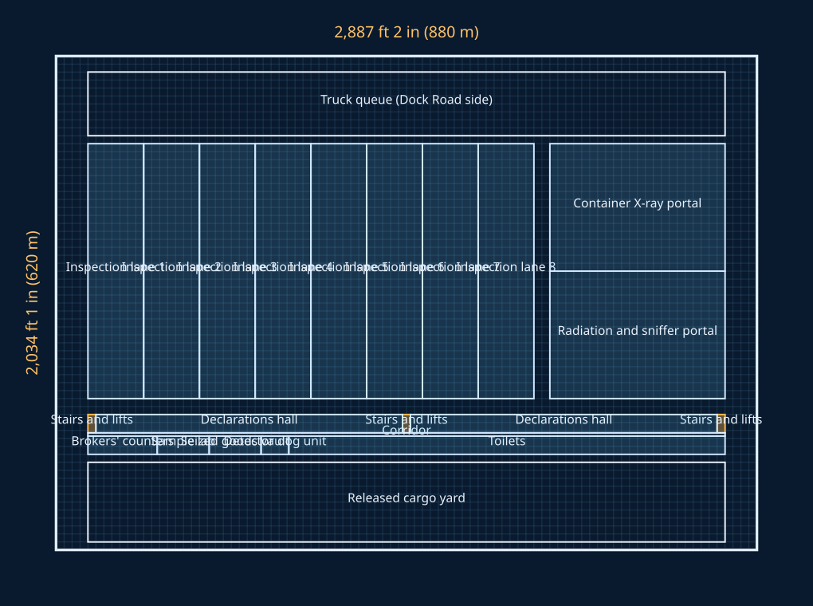
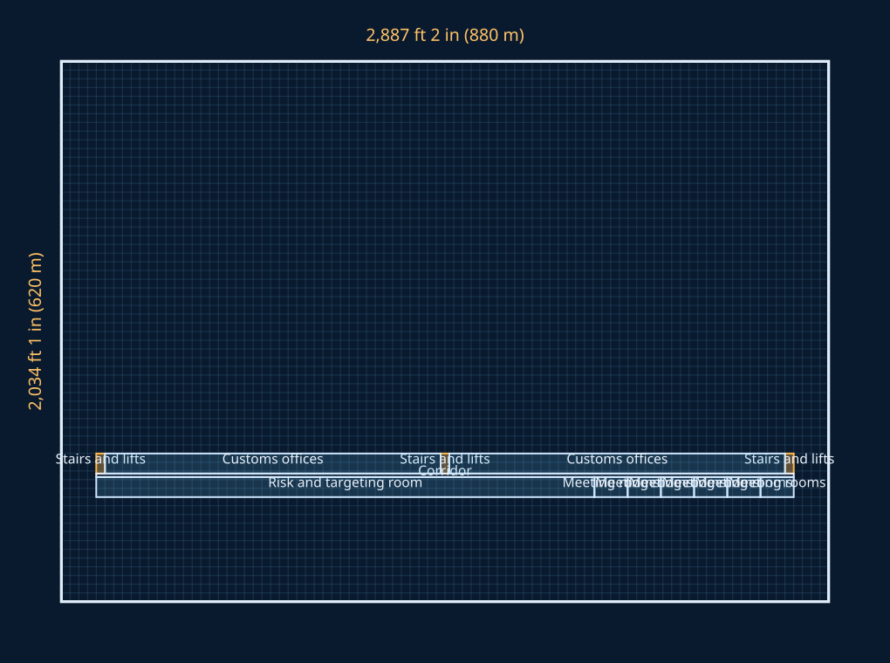

# P5-04 Cargo Customs: plan

Footprint 2,887 ft 2 in (880 m) × 2,034 ft 1 in (620 m) · structural grid 32 ft 10 in (10 m)

## Levels

| Level | Floor above deck | Height | Floor area |
|---|---|---|---|
| Level 1 · Ground floor | 0 ft (0 mm) | 32 ft 10 in (10 m) | 3,075,357 sq ft (285,710 m²) |
| Level 2 · Level 2 | 32 ft 10 in (10 m) | 14 ft 9 in (4,500 mm) | 388,685 sq ft (36,110 m²) |
| Level 3 · Level 3 | 47 ft 7 in (14 m) | 14 ft 9 in (4,500 mm) | 388,685 sq ft (36,110 m²) |

## Elements

| ID | Designation | Type | Name | Level(s) | Size / length | Area | Status |
|---|---|---|---|---|---|---|---|
| E001 | D5F3P5B6A1L1R1 | zone | Truck queue (Dock Road side) | L1 | 2,624 ft 8 in (800 m) × 262 ft 6 in (80 m) | 688,890 sq ft (64,000 m²) | proposed |
| E002 | D5F3P5B6A1L1R2 | room | Inspection lane 1 | L1 | 229 ft 8 in (70 m) × 1,049 ft 10 in (320 m) | 241,112 sq ft (22,400 m²) | proposed |
| E003 | D5F3P5B6A1L1R3 | room | Inspection lane 2 | L1 | 229 ft 8 in (70 m) × 1,049 ft 10 in (320 m) | 241,112 sq ft (22,400 m²) | proposed |
| E004 | D5F3P5B6A1L1R4 | room | Inspection lane 3 | L1 | 229 ft 8 in (70 m) × 1,049 ft 10 in (320 m) | 241,112 sq ft (22,400 m²) | proposed |
| E005 | D5F3P5B6A1L1R5 | room | Inspection lane 4 | L1 | 229 ft 8 in (70 m) × 1,049 ft 10 in (320 m) | 241,112 sq ft (22,400 m²) | proposed |
| E006 | D5F3P5B6A1L1R6 | room | Inspection lane 5 | L1 | 229 ft 8 in (70 m) × 1,049 ft 10 in (320 m) | 241,112 sq ft (22,400 m²) | proposed |
| E007 | D5F3P5B6A1L1R7 | room | Inspection lane 6 | L1 | 229 ft 8 in (70 m) × 1,049 ft 10 in (320 m) | 241,112 sq ft (22,400 m²) | proposed |
| E008 | D5F3P5B6A1L1R8 | room | Inspection lane 7 | L1 | 229 ft 8 in (70 m) × 1,049 ft 10 in (320 m) | 241,112 sq ft (22,400 m²) | proposed |
| E009 | D5F3P5B6A1L1R9 | room | Inspection lane 8 | L1 | 229 ft 8 in (70 m) × 1,049 ft 10 in (320 m) | 241,112 sq ft (22,400 m²) | proposed |
| E010 | D5F3P5B6A1L1R10 | room | Container X-ray portal | L1 | 721 ft 9 in (220 m) × 524 ft 11 in (160 m) | 378,890 sq ft (35,200 m²) | proposed |
| E011 | D5F3P5B6A1L1R11 | room | Radiation and sniffer portal | L1 | 721 ft 9 in (220 m) × 524 ft 11 in (160 m) | 378,890 sq ft (35,200 m²) | proposed |
| E012 | D5F3P5B6A1L1R12, D5F3P5B6A1L2R1, D5F3P5B6A1L3R1 | core | Stairs and lifts | L1, L2, L3 | 32 ft 10 in (10 m) × 75 ft 6 in (23 m) | 2,476 sq ft (230 m²) | proposed |
| E013 | D5F3P5B6A1L1R13, D5F3P5B6A1L2R2, D5F3P5B6A1L3R2 | core | Stairs and lifts | L1, L2, L3 | 32 ft 10 in (10 m) × 75 ft 6 in (23 m) | 2,476 sq ft (230 m²) | proposed |
| E014 | D5F3P5B6A1L1R14, D5F3P5B6A1L2R3, D5F3P5B6A1L3R3 | core | Stairs and lifts | L1, L2, L3 | 32 ft 10 in (10 m) × 75 ft 6 in (23 m) | 2,476 sq ft (230 m²) | proposed |
| E015 | D5F3P5B6A1L1R15 | zone | Corridor | L1 | 2,624 ft 8 in (800 m) × 13 ft 1 in (4,000 mm) | 34,445 sq ft (3,200 m²) | proposed |
| E016 | D5F3P5B6A1L1R16 | room | Declarations hall | L1 | 1,263 ft 1 in (385 m) × 75 ft 6 in (23 m) | 95,314 sq ft (8,855 m²) | proposed |
| E017 | D5F3P5B6A1L1R17 | room | Declarations hall | L1 | 1,263 ft 1 in (385 m) × 75 ft 6 in (23 m) | 95,314 sq ft (8,855 m²) | proposed |
| E018 | D5F3P5B6A1L1R18 | room | Brokers' counters | L1 | 285 ft 5 in (87 m) × 75 ft 6 in (23 m) | 21,539 sq ft (2,001 m²) | proposed |
| E019 | D5F3P5B6A1L1R19 | room | Sample lab | L1 | 213 ft 11 in (65 m) × 75 ft 6 in (23 m) | 16,142 sq ft (1,500 m²) | proposed |
| E020 | D5F3P5B6A1L1R20 | room | Seized goods vault | L1 | 213 ft 11 in (65 m) × 75 ft 6 in (23 m) | 16,142 sq ft (1,500 m²) | proposed |
| E021 | D5F3P5B6A1L1R21 | room | Detector dog unit | L1 | 114 ft 2 in (35 m) × 75 ft 6 in (23 m) | 8,615 sq ft (800 m²) | proposed |
| E022 | D5F3P5B6A1L1R22 | room | Toilets | L1 | 1,797 ft 3 in (548 m) × 75 ft 6 in (23 m) | 135,619 sq ft (12,599 m²) | proposed |
| E023 | D5F3P5B6A1L2R4, D5F3P5B6A1L3R4 | zone | Corridor | L2, L3 | 2,624 ft 8 in (800 m) × 13 ft 1 in (4,000 mm) | 34,445 sq ft (3,200 m²) | proposed |
| E024 | D5F3P5B6A1L2R5, D5F3P5B6A1L3R5 | room | Customs offices | L2, L3 | 1,263 ft 1 in (385 m) × 75 ft 6 in (23 m) | 95,314 sq ft (8,855 m²) | proposed |
| E025 | D5F3P5B6A1L2R6, D5F3P5B6A1L3R6 | room | Customs offices | L2, L3 | 1,263 ft 1 in (385 m) × 75 ft 6 in (23 m) | 95,314 sq ft (8,855 m²) | proposed |
| E026 | D5F3P5B6A1L2R7, D5F3P5B6A1L3R7 | room | Risk and targeting room | L2, L3 | 1,874 ft 8 in (571 m) × 75 ft 6 in (23 m) | 141,461 sq ft (13,142 m²) | proposed |
| E027 | D5F3P5B6A1L2R8, D5F3P5B6A1L3R8 | room | Meeting rooms | L2, L3 | 125 ft (38 m) × 75 ft 6 in (23 m) | 9,432 sq ft (876 m²) | proposed |
| E028 | D5F3P5B6A1L2R9, D5F3P5B6A1L3R9 | room | Meeting rooms | L2, L3 | 125 ft (38 m) × 75 ft 6 in (23 m) | 9,432 sq ft (876 m²) | proposed |
| E029 | D5F3P5B6A1L2R10, D5F3P5B6A1L3R10 | room | Meeting rooms | L2, L3 | 125 ft (38 m) × 75 ft 6 in (23 m) | 9,432 sq ft (876 m²) | proposed |
| E030 | D5F3P5B6A1L2R11, D5F3P5B6A1L3R11 | room | Meeting rooms | L2, L3 | 125 ft (38 m) × 75 ft 6 in (23 m) | 9,432 sq ft (876 m²) | proposed |
| E031 | D5F3P5B6A1L2R12, D5F3P5B6A1L3R12 | room | Meeting rooms | L2, L3 | 125 ft (38 m) × 75 ft 6 in (23 m) | 9,432 sq ft (876 m²) | proposed |
| E032 | D5F3P5B6A1L2R13, D5F3P5B6A1L3R13 | room | Meeting rooms | L2, L3 | 125 ft (38 m) × 75 ft 6 in (23 m) | 9,432 sq ft (876 m²) | proposed |
| E033 | D5F3P5B6A1L1R23 | zone | Released cargo yard | L1 | 2,624 ft 8 in (800 m) × 328 ft 1 in (100 m) | 861,113 sq ft (80,000 m²) | proposed |

## Drawings

### Level 1 · Ground floor

### Level 2 · Level 2

### Level 3 · Level 3

