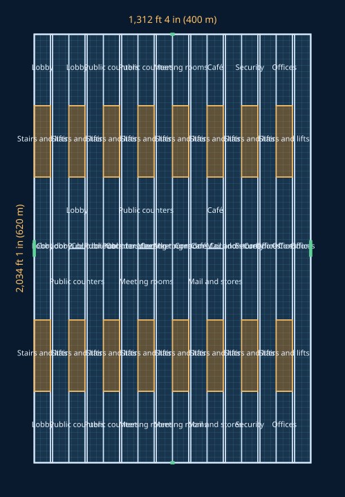
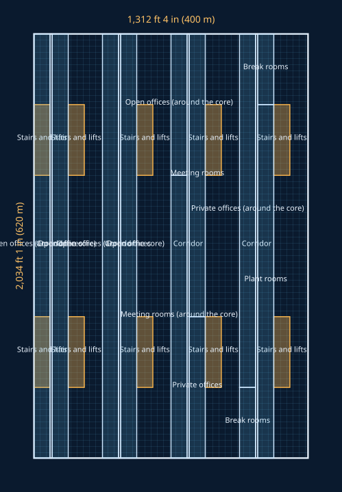

# P5-05 Terminals Private Flights Lounge: plan

Footprint 1,312 ft 4 in (400 m) × 2,034 ft 1 in (620 m) · structural grid 32 ft 10 in (10 m)

## Levels

| Level | Floor above deck | Height | Floor area |
|---|---|---|---|
| Level 1 · Ground floor | 0 ft (0 mm) | 19 ft 8 in (6,000 mm) | 156,938 sq ft (14,580 m²) |
| Level 2 · Level 2 | 19 ft 8 in (6,000 mm) | 14 ft 9 in (4,500 mm) | 156,938 sq ft (14,580 m²) |
| Level 3 · Roof terrace | 34 ft 5 in (10 m) | 13 ft 1 in (4,000 mm) | 156,938 sq ft (14,580 m²) |

## Elements

| ID | Designation | Type | Name | Level(s) | Size / length | Area | Status |
|---|---|---|---|---|---|---|---|
| E001 | D5F3P5B8A1L1R1 | zone | Garden court | L1 | 918 ft 8 in (280 m) × 721 ft 9 in (220 m) | 663,057 sq ft (61,600 m²) | proposed |
| E002 | D5F3P5B8A1L1R2, D5F3P5B8A1L2R1, D5F3P5B8A1L3R1 | core | Stairs and lifts | L1, L2, L3 | 32 ft 10 in (10 m) × 88 ft 7 in (27 m) | 2,906 sq ft (270 m²) | proposed |
| E003 | D5F3P5B8A1L1R3, D5F3P5B8A1L2R2, D5F3P5B8A1L3R2 | core | Stairs and lifts | L1, L2, L3 | 32 ft 10 in (10 m) × 88 ft 7 in (27 m) | 2,906 sq ft (270 m²) | proposed |
| E004 | D5F3P5B8A1L1R4 | zone | Corridor | L1 | 918 ft 8 in (280 m) × 19 ft 8 in (6,000 mm) | 18,083 sq ft (1,680 m²) | proposed |
| E005 | D5F3P5B8A1L1R5 | room | Private check-in | L1 | 465 ft 3 in (142 m) × 88 ft 7 in (27 m) | 41,211 sq ft (3,829 m²) | proposed |
| E006 | D5F3P5B8A1L1R6 | room | Private customs | L1 | 387 ft 10 in (118 m) × 88 ft 7 in (27 m) | 34,352 sq ft (3,191 m²) | proposed |
| E007 | D5F3P5B8A1L1R7 | room | Main lounge | L1 | 485 ft 11 in (148 m) × 88 ft 7 in (27 m) | 43,042 sq ft (3,999 m²) | proposed |
| E008 | D5F3P5B8A1L1R8 | room | Dining room | L1 | 303 ft 10 in (93 m) × 88 ft 7 in (27 m) | 26,912 sq ft (2,500 m²) | proposed |
| E009 | D5F3P5B8A1L1R9 | room | Kitchen | L1 | 128 ft 11 in (39 m) × 88 ft 7 in (27 m) | 11,422 sq ft (1,061 m²) | proposed |
| E010 | D5F3P5B8A1L2R3 | zone | Corridor | L2 | 918 ft 8 in (280 m) × 19 ft 8 in (6,000 mm) | 18,083 sq ft (1,680 m²) | proposed |
| E011 | D5F3P5B8A1L2R4 | room | Private suites | L2 | 85 ft 4 in (26 m) × 88 ft 7 in (27 m) | 7,556 sq ft (702 m²) | proposed |
| E012 | D5F3P5B8A1L2R5 | room | Private suites | L2 | 85 ft 4 in (26 m) × 88 ft 7 in (27 m) | 7,556 sq ft (702 m²) | proposed |
| E013 | D5F3P5B8A1L2R6 | room | Private suites | L2 | 85 ft 4 in (26 m) × 88 ft 7 in (27 m) | 7,556 sq ft (702 m²) | proposed |
| E014 | D5F3P5B8A1L2R7 | room | Private suites | L2 | 85 ft 4 in (26 m) × 88 ft 7 in (27 m) | 7,556 sq ft (702 m²) | proposed |
| E015 | D5F3P5B8A1L2R8 | room | Private suites | L2 | 85 ft 4 in (26 m) × 88 ft 7 in (27 m) | 7,556 sq ft (702 m²) | proposed |
| E016 | D5F3P5B8A1L2R9 | room | Private suites | L2 | 85 ft 4 in (26 m) × 88 ft 7 in (27 m) | 7,556 sq ft (702 m²) | proposed |
| E017 | D5F3P5B8A1L2R10 | room | Private suites | L2 | 85 ft 4 in (26 m) × 88 ft 7 in (27 m) | 7,556 sq ft (702 m²) | proposed |
| E018 | D5F3P5B8A1L2R11 | room | Private suites | L2 | 85 ft 4 in (26 m) × 88 ft 7 in (27 m) | 7,556 sq ft (702 m²) | proposed |
| E019 | D5F3P5B8A1L2R12 | room | Private suites | L2 | 85 ft 4 in (26 m) × 88 ft 7 in (27 m) | 7,556 sq ft (702 m²) | proposed |
| E020 | D5F3P5B8A1L2R13 | room | Private suites | L2 | 85 ft 4 in (26 m) × 88 ft 7 in (27 m) | 7,556 sq ft (702 m²) | proposed |
| E021 | D5F3P5B8A1L2R14 | room | Spa | L2 | 182 ft 5 in (56 m) × 88 ft 7 in (27 m) | 16,159 sq ft (1,501 m²) | proposed |
| E022 | D5F3P5B8A1L2R15 | room | Staff | L2 | 736 ft 3 in (224 m) × 88 ft 7 in (27 m) | 65,216 sq ft (6,059 m²) | proposed |
| E023 | D5F3P5B8A1L3R3 | zone | Corridor | L3 | 918 ft 8 in (280 m) × 19 ft 8 in (6,000 mm) | 18,083 sq ft (1,680 m²) | proposed |
| E024 | D5F3P5B8A1L3R4 | room | Roof bar | L3 | 853 ft (260 m) × 88 ft 7 in (27 m) | 75,563 sq ft (7,020 m²) | proposed |
| E025 | D5F3P5B8A1L3R5 | room | Stores | L3 | 918 ft 8 in (280 m) × 88 ft 7 in (27 m) | 81,375 sq ft (7,560 m²) | proposed |
| E026 | D5F3P5B8A1L1R10 | zone | Car court | L1 | 918 ft 8 in (280 m) × 721 ft 9 in (220 m) | 663,057 sq ft (61,600 m²) | proposed |
| E027 | D5F3P5B8A1L1R11 | zone | Valet kerb | L1 | 1,312 ft 4 in (400 m) × 164 ft 1 in (50 m) | 215,278 sq ft (20,000 m²) | proposed |

## Drawings

### Level 1 · Ground floor

### Level 2 · Level 2

### Level 3 · Roof terrace

