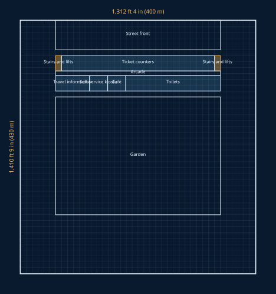
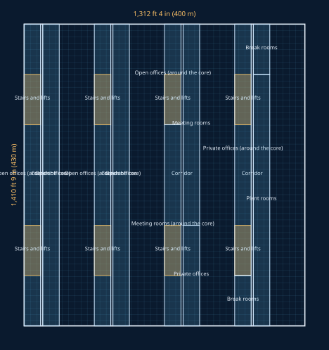

# P5-06 Travel Office: plan

Footprint 1,312 ft 4 in (400 m) × 1,410 ft 9 in (430 m) · structural grid 32 ft 10 in (10 m)

## Levels

| Level | Floor above deck | Height | Floor area |
|---|---|---|---|
| Level 1 · Ground floor | 0 ft (0 mm) | 16 ft 5 in (5,000 mm) | 151,125 sq ft (14,040 m²) |
| Level 2 · Level 2 | 16 ft 5 in (5,000 mm) | 13 ft 1 in (4,000 mm) | 151,125 sq ft (14,040 m²) |
| Level 3 · Level 3 | 29 ft 6 in (9,000 mm) | 13 ft 1 in (4,000 mm) | 151,125 sq ft (14,040 m²) |

## Elements

| ID | Designation | Type | Name | Level(s) | Size / length | Area | Status |
|---|---|---|---|---|---|---|---|
| E001 | D5F3P5B2A1L1R1, D5F3P5B2A1L2R1, D5F3P5B2A1L3R1 | core | Stairs and lifts | L1, L2, L3 | 32 ft 10 in (10 m) × 85 ft 4 in (26 m) | 2,799 sq ft (260 m²) | proposed |
| E002 | D5F3P5B2A1L1R2, D5F3P5B2A1L2R2, D5F3P5B2A1L3R2 | core | Stairs and lifts | L1, L2, L3 | 32 ft 10 in (10 m) × 85 ft 4 in (26 m) | 2,799 sq ft (260 m²) | proposed |
| E003 | D5F3P5B2A1L1R3 | zone | Arcade | L1 | 918 ft 8 in (280 m) × 26 ft 3 in (8,000 mm) | 24,111 sq ft (2,240 m²) | proposed |
| E004 | D5F3P5B2A1L1R4 | room | Ticket counters | L1 | 853 ft (260 m) × 85 ft 4 in (26 m) | 72,764 sq ft (6,760 m²) | proposed |
| E005 | D5F3P5B2A1L1R5 | room | Travel information | L1 | 189 ft 4 in (58 m) × 85 ft 4 in (26 m) | 16,148 sq ft (1,500 m²) | proposed |
| E006 | D5F3P5B2A1L1R6 | room | Self-service kiosks | L1 | 101 ft 1 in (31 m) × 85 ft 4 in (26 m) | 8,620 sq ft (801 m²) | proposed |
| E007 | D5F3P5B2A1L1R7 | room | Café | L1 | 100 ft 9 in (31 m) × 85 ft 4 in (26 m) | 8,592 sq ft (798 m²) | proposed |
| E008 | D5F3P5B2A1L1R8 | room | Toilets | L1 | 527 ft 7 in (161 m) × 85 ft 4 in (26 m) | 45,002 sq ft (4,181 m²) | proposed |
| E009 | D5F3P5B2A1L2R3, D5F3P5B2A1L3R3 | zone | Arcade | L2, L3 | 918 ft 8 in (280 m) × 26 ft 3 in (8,000 mm) | 24,111 sq ft (2,240 m²) | proposed |
| E010 | D5F3P5B2A1L2R4, D5F3P5B2A1L3R4 | room | Booking offices | L2, L3 | 853 ft (260 m) × 85 ft 4 in (26 m) | 72,764 sq ft (6,760 m²) | proposed |
| E011 | D5F3P5B2A1L2R5, D5F3P5B2A1L3R5 | room | Call centre | L2, L3 | 378 ft 7 in (115 m) × 85 ft 4 in (26 m) | 32,296 sq ft (3,000 m²) | proposed |
| E012 | D5F3P5B2A1L2R6, D5F3P5B2A1L3R6 | room | Offices | L2, L3 | 540 ft (165 m) × 85 ft 4 in (26 m) | 46,065 sq ft (4,280 m²) | proposed |
| E013 | D5F3P5B2A1L1R9 | zone | Garden | L1 | 918 ft 8 in (280 m) × 656 ft 2 in (200 m) | 602,779 sq ft (56,000 m²) | proposed |
| E014 | D5F3P5B2A1L1R10 | zone | Street front | L1 | 918 ft 8 in (280 m) × 164 ft 1 in (50 m) | 150,695 sq ft (14,000 m²) | proposed |

## Drawings

### Level 1 · Ground floor

### Level 2 · Level 2

### Level 3 · Level 3

