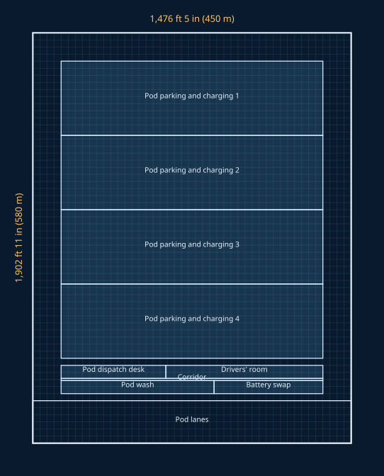

# P5-07 Terminals Pod Depot: plan

Footprint 1,476 ft 5 in (450 m) × 1,902 ft 11 in (580 m) · structural grid 131 ft 3 in (40 m)

## Levels

| Level | Floor above deck | Height | Floor area |
|---|---|---|---|
| Level 1 · Ground floor | 0 ft (0 mm) | 65 ft 7 in (20 m) | 2,092,149 sq ft (194,367 m²) |
| Level 2 · Office level | 65 ft 7 in (20 m) | 14 ft 9 in (4,500 mm) | 332,131 sq ft (30,856 m²) |

## Elements

| ID | Designation | Type | Name | Level(s) | Size / length | Area | Status |
|---|---|---|---|---|---|---|---|
| L1-001 | D5F3P5B2A2L1R1 | zone | Walkway | L1 | 52 ft 6 in (16 m) × 1,902 ft 11 in (580 m) | 99,889 sq ft (9,280 m²) | proposed |
| L1-002 | D5F3P5B2A2L1R2 | zone | Walkway | L1 | 52 ft 6 in (16 m) × 1,902 ft 11 in (580 m) | 99,889 sq ft (9,280 m²) | proposed |
| L1-003 | D5F3P5B2A2L1R3 | zone | Walkway | L1 | 52 ft 6 in (16 m) × 1,902 ft 11 in (580 m) | 99,889 sq ft (9,280 m²) | proposed |
| L1-004 | D5F3P5B2A2L1R4 | room | Work bays | L1 | 219 ft 10 in (67 m) × 127 ft (39 m) | 27,910 sq ft (2,593 m²) | proposed |
| L1-005 | D5F3P5B2A2L1R5 | room | Work bays | L1 | 219 ft 10 in (67 m) × 253 ft 11 in (77 m) | 55,819 sq ft (5,186 m²) | proposed |
| L1-006 | D5F3P5B2A2L1R6 | room | Work bays | L1 | 219 ft 10 in (67 m) × 253 ft 11 in (77 m) | 55,819 sq ft (5,186 m²) | proposed |
| L1-007 | D5F3P5B2A2L1R7 | room | Work bays | L1 | 219 ft 10 in (67 m) × 253 ft 11 in (77 m) | 55,819 sq ft (5,186 m²) | proposed |
| L1-008 | D5F3P5B2A2L1R8 | room | Work bays | L1 | 219 ft 10 in (67 m) × 253 ft 11 in (77 m) | 55,819 sq ft (5,186 m²) | proposed |
| L1-009 | D5F3P5B2A2L1R9 | room | Work bays | L1 | 219 ft 10 in (67 m) × 127 ft (39 m) | 27,910 sq ft (2,593 m²) | proposed |
| L1-010 | D5F3P5B2A2L1R10 | room | Work bays | L1 | 219 ft 10 in (67 m) × 1,902 ft 11 in (580 m) | 418,286 sq ft (38,860 m²) | proposed |
| L1-011 | D5F3P5B2A2L1R11 | room | Work bays | L1 | 219 ft 10 in (67 m) × 127 ft (39 m) | 27,910 sq ft (2,593 m²) | proposed |
| L1-012 | D5F3P5B2A2L1R12 | room | Work bays | L1 | 219 ft 10 in (67 m) × 253 ft 11 in (77 m) | 55,819 sq ft (5,186 m²) | proposed |
| L1-013 | D5F3P5B2A2L1R13 | room | Work bays | L1 | 219 ft 10 in (67 m) × 253 ft 11 in (77 m) | 55,819 sq ft (5,186 m²) | proposed |
| L1-014 | D5F3P5B2A2L1R14 | room | Work bays | L1 | 219 ft 10 in (67 m) × 253 ft 11 in (77 m) | 55,819 sq ft (5,186 m²) | proposed |
| L1-015 | D5F3P5B2A2L1R15 | room | Work bays | L1 | 219 ft 10 in (67 m) × 253 ft 11 in (77 m) | 55,819 sq ft (5,186 m²) | proposed |
| L1-016 | D5F3P5B2A2L1R16 | room | Work bays | L1 | 219 ft 10 in (67 m) × 127 ft (39 m) | 27,910 sq ft (2,593 m²) | proposed |
| L1-017 | D5F3P5B2A2L1R17 | room | Work bays | L1 | 219 ft 10 in (67 m) × 1,775 ft 11 in (541 m) | 390,376 sq ft (36,267 m²) | proposed |
| L1-018 | D5F3P5B2A2L1R18 | room | Workshops | L1 | 219 ft 10 in (67 m) × 127 ft (39 m) | 27,910 sq ft (2,593 m²) | proposed |
| L1-019 | D5F3P5B2A2L1R19 | room | Workshops | L1 | 219 ft 10 in (67 m) × 127 ft (39 m) | 27,910 sq ft (2,593 m²) | proposed |
| L1-020 | D5F3P5B2A2L1R20 | room | Workshops | L1 | 219 ft 10 in (67 m) × 253 ft 11 in (77 m) | 55,819 sq ft (5,186 m²) | proposed |
| L1-021 | D5F3P5B2A2L1R21 | room | Workshops | L1 | 219 ft 10 in (67 m) × 253 ft 11 in (77 m) | 55,819 sq ft (5,186 m²) | proposed |
| L1-022 | D5F3P5B2A2L1R22 | room | Workshops | L1 | 219 ft 10 in (67 m) × 253 ft 11 in (77 m) | 55,819 sq ft (5,186 m²) | proposed |
| L1-023 | D5F3P5B2A2L1R23 | room | Workshops | L1 | 219 ft 10 in (67 m) × 253 ft 11 in (77 m) | 55,819 sq ft (5,186 m²) | proposed |
| L1-024 | D5F3P5B2A2L1R24 | room | Workshops | L1 | 219 ft 10 in (67 m) × 127 ft (39 m) | 27,910 sq ft (2,593 m²) | proposed |
| L1-025 | D5F3P5B2A2L1R25 | room | Parts stores | L1 | 219 ft 10 in (67 m) × 1,014 ft 9 in (309 m) | 223,062 sq ft (20,723 m²) | proposed |
| L1-026 | D5F3P5B2A2L1R26 | room | Staff rooms | L1 | 219 ft 10 in (67 m) × 380 ft 7 in (116 m) | 83,657 sq ft (7,772 m²) | proposed |
| L1-027 | D5F3P5B2A2L1R27 | room | Control | L1 | 219 ft 10 in (67 m) × 507 ft 7 in (155 m) | 111,567 sq ft (10,365 m²) | proposed |
| L1-028 | D5F3P5B2A2L1R28, D5F3P5B2A2L2R1 | core | Stairs and lifts | L1, L2 | 219 ft 10 in (67 m) × 126 ft 8 in (39 m) | 27,838 sq ft (2,586 m²) | proposed |
| L1-029 | D5F3P5B2A2L1R29, D5F3P5B2A2L2R2 | core | Stairs and lifts | L1, L2 | 219 ft 10 in (67 m) × 126 ft 8 in (39 m) | 27,838 sq ft (2,586 m²) | proposed |
| L1-030 | D5F3P5B2A2L1R30, D5F3P5B2A2L2R3 | core | Stairs and lifts | L1, L2 | 219 ft 10 in (67 m) × 126 ft 8 in (39 m) | 27,838 sq ft (2,586 m²) | proposed |
| L1-031 | D5F3P5B2A2L1R31, D5F3P5B2A2L2R4 | core | Stairs and lifts | L1, L2 | 219 ft 10 in (67 m) × 126 ft 8 in (39 m) | 27,838 sq ft (2,586 m²) | proposed |
| L1-032 | D5F3P5B2A2L1R32, D5F3P5B2A2L2R5 | core | Stairs and lifts | L1, L2 | 219 ft 10 in (67 m) × 126 ft 8 in (39 m) | 27,838 sq ft (2,586 m²) | proposed |
| L1-033 | D5F3P5B2A2L1R33, D5F3P5B2A2L2R6 | core | Stairs and lifts | L1, L2 | 219 ft 10 in (67 m) × 126 ft 8 in (39 m) | 27,838 sq ft (2,586 m²) | proposed |
| L1-034 | D5F3P5B2A2L1R34, D5F3P5B2A2L2R7 | core | Stairs and lifts | L1, L2 | 219 ft 10 in (67 m) × 126 ft 8 in (39 m) | 27,838 sq ft (2,586 m²) | proposed |
| L1-035 | D5F3P5B2A2L1R35, D5F3P5B2A2L2R8 | core | Stairs and lifts | L1, L2 | 219 ft 10 in (67 m) × 126 ft 8 in (39 m) | 27,838 sq ft (2,586 m²) | proposed |
| L1-036 | D5F3P5B2A2L1R36, D5F3P5B2A2L2R9 | core | Stairs and lifts | L1, L2 | 219 ft 10 in (67 m) × 126 ft 8 in (39 m) | 27,838 sq ft (2,586 m²) | proposed |
| L1-037 | D5F3P5B2A2L1R37, D5F3P5B2A2L2R10 | core | Stairs and lifts | L1, L2 | 219 ft 10 in (67 m) × 126 ft 8 in (39 m) | 27,838 sq ft (2,586 m²) | proposed |
| L1-038 | D5F3P5B2A2L1R38, D5F3P5B2A2L2R11 | core | Stairs and lifts | L1, L2 | 219 ft 10 in (67 m) × 126 ft 8 in (39 m) | 27,838 sq ft (2,586 m²) | proposed |
| L1-039 | D5F3P5B2A2L1R39, D5F3P5B2A2L2R12 | core | Stairs and lifts | L1, L2 | 219 ft 10 in (67 m) × 126 ft 8 in (39 m) | 27,838 sq ft (2,586 m²) | proposed |
| L1-040 | D5F3P5B2A2L1R40, D5F3P5B2A2L2R13 | core | Stairs and lifts | L1, L2 | 219 ft 10 in (67 m) × 126 ft 8 in (39 m) | 27,838 sq ft (2,586 m²) | proposed |
| L1-041 | D5F3P5B2A2L1R41, D5F3P5B2A2L2R14 | core | Stairs and lifts | L1, L2 | 219 ft 10 in (67 m) × 126 ft 8 in (39 m) | 27,838 sq ft (2,586 m²) | proposed |
| L1-042 | D5F3P5B2A2L1R42, D5F3P5B2A2L2R15 | core | Stairs and lifts | L1, L2 | 219 ft 10 in (67 m) × 126 ft 8 in (39 m) | 27,838 sq ft (2,586 m²) | proposed |
| L2-001 | D5F3P5B2A2L2R16 | zone | Corridor | L2 | 9 ft 10 in (3,000 mm) × 1,902 ft 11 in (580 m) | 18,729 sq ft (1,740 m²) | proposed |
| L2-002 | D5F3P5B2A2L2R17 | room | Offices | L2 | 87 ft 3 in (27 m) × 1,902 ft 11 in (580 m) | 166,066 sq ft (15,428 m²) | proposed |
| L2-003 | D5F3P5B2A2L2R18 | room | Control room | L2 | 87 ft 3 in (27 m) × 634 ft 2 in (193 m) | 55,346 sq ft (5,142 m²) | proposed |
| L2-004 | D5F3P5B2A2L2R19 | room | Training rooms | L2 | 87 ft 3 in (27 m) × 634 ft 6 in (193 m) | 55,374 sq ft (5,144 m²) | proposed |
| L2-005 | D5F3P5B2A2L2R20 | room | Staff rooms | L2 | 87 ft 3 in (27 m) × 634 ft 2 in (193 m) | 55,346 sq ft (5,142 m²) | proposed |
| D-48 |  | door | Main entrance | L1 | 78 ft 9 in (24 m), 78 ft 9 in (24 m) wide | — | proposed |
| D-49 |  | door | Second entrance | L1 | 78 ft 9 in (24 m), 78 ft 9 in (24 m) wide | — | proposed |
| D-50 |  | door | Side door | L1 | 19 ft 8 in (6,000 mm), 19 ft 8 in (6,000 mm) wide | — | proposed |
| D-51 |  | door | Side door | L1 | 19 ft 8 in (6,000 mm), 19 ft 8 in (6,000 mm) wide | — | proposed |

## Drawings

### Level 1 · Ground floor

### Level 2 · Office level

