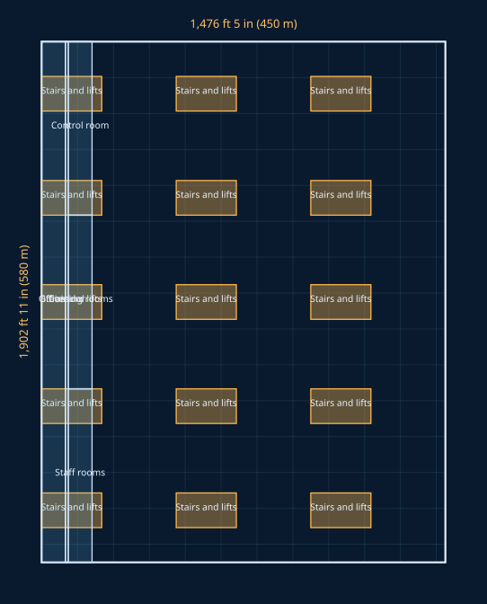
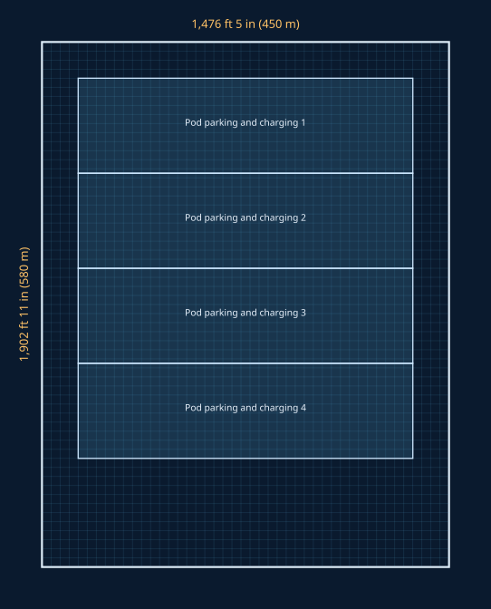

# P5-07 Terminals Pod Depot: plan

Footprint 1,476 ft 5 in (450 m) × 1,902 ft 11 in (580 m) · structural grid 32 ft 10 in (10 m)

## Levels

| Level | Floor above deck | Height | Floor area |
|---|---|---|---|
| Level 1 · Ground deck | 0 ft (0 mm) | 14 ft 9 in (4,500 mm) | 1,820,070 sq ft (169,090 m²) |
| Level 2 · Deck 2 | 14 ft 9 in (4,500 mm) | 13 ft 1 in (4,000 mm) | 1,672,712 sq ft (155,400 m²) |
| Level 3 · Deck 3 | 27 ft 11 in (8,500 mm) | 13 ft 1 in (4,000 mm) | 1,672,712 sq ft (155,400 m²) |
| Level 4 · Deck 4 | 41 ft (12 m) | 13 ft 1 in (4,000 mm) | 1,672,712 sq ft (155,400 m²) |

## Elements

| ID | Designation | Type | Name | Level(s) | Size / length | Area | Status |
|---|---|---|---|---|---|---|---|
| E001 | D5F3P5B2A2L1R1, D5F3P5B2A2L2R1, D5F3P5B2A2L3R1, D5F3P5B2A2L4R1 | room | Pod parking and charging 1 | L1, L2, L3, L4 | 1,213 ft 11 in (370 m) × 344 ft 6 in (105 m) | 418,178 sq ft (38,850 m²) | proposed |
| E002 | D5F3P5B2A2L1R2, D5F3P5B2A2L2R2, D5F3P5B2A2L3R2, D5F3P5B2A2L4R2 | room | Pod parking and charging 2 | L1, L2, L3, L4 | 1,213 ft 11 in (370 m) × 344 ft 6 in (105 m) | 418,178 sq ft (38,850 m²) | proposed |
| E003 | D5F3P5B2A2L1R3, D5F3P5B2A2L2R3, D5F3P5B2A2L3R3, D5F3P5B2A2L4R3 | room | Pod parking and charging 3 | L1, L2, L3, L4 | 1,213 ft 11 in (370 m) × 344 ft 6 in (105 m) | 418,178 sq ft (38,850 m²) | proposed |
| E004 | D5F3P5B2A2L1R4, D5F3P5B2A2L2R4, D5F3P5B2A2L3R4, D5F3P5B2A2L4R4 | room | Pod parking and charging 4 | L1, L2, L3, L4 | 1,213 ft 11 in (370 m) × 344 ft 6 in (105 m) | 418,178 sq ft (38,850 m²) | proposed |
| E005 | D5F3P5B2A2L1R5 | zone | Corridor | L1 | 1,213 ft 11 in (370 m) × 9 ft 10 in (3,000 mm) | 11,948 sq ft (1,110 m²) | proposed |
| E006 | D5F3P5B2A2L1R6 | room | Pod dispatch desk | L1 | 485 ft 7 in (148 m) × 60 ft 8 in (18 m) | 29,472 sq ft (2,738 m²) | proposed |
| E007 | D5F3P5B2A2L1R7 | room | Drivers' room | L1 | 728 ft 4 in (222 m) × 60 ft 8 in (18 m) | 44,207 sq ft (4,107 m²) | proposed |
| E008 | D5F3P5B2A2L1R8 | room | Pod wash | L1 | 709 ft 4 in (216 m) × 60 ft 8 in (18 m) | 43,052 sq ft (4,000 m²) | proposed |
| E009 | D5F3P5B2A2L1R9 | room | Battery swap | L1 | 504 ft 7 in (154 m) × 60 ft 8 in (18 m) | 30,627 sq ft (2,845 m²) | proposed |
| E010 | D5F3P5B2A2L1R10 | zone | Pod lanes | L1 | 1,476 ft 5 in (450 m) × 196 ft 10 in (60 m) | 290,626 sq ft (27,000 m²) | proposed |

## Drawings

### Level 1 · Ground deck

### Level 2 · Deck 2

### Level 3 · Deck 3

### Level 4 · Deck 4

