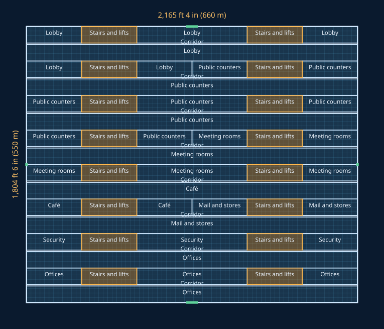
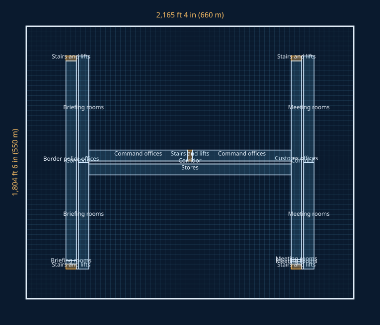
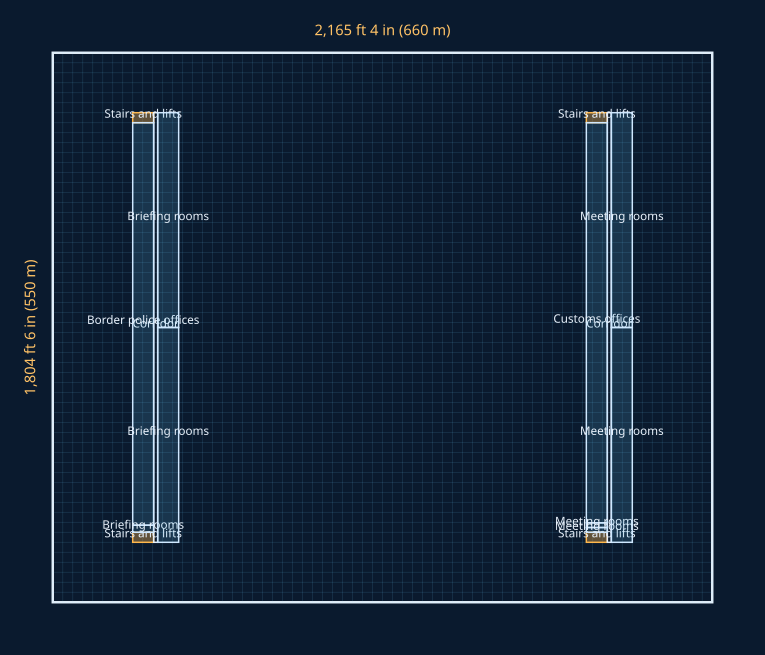

# P5-08 Customs & Border Hq: plan

Footprint 2,165 ft 4 in (660 m) × 1,804 ft 6 in (550 m) · structural grid 32 ft 10 in (10 m)

## Levels

| Level | Floor above deck | Height | Floor area |
|---|---|---|---|
| Level 1 · Ground floor | 0 ft (0 mm) | 16 ft 5 in (5,000 mm) | 570,616 sq ft (53,012 m²) |
| Level 2 · Level 2 | 16 ft 5 in (5,000 mm) | 13 ft 1 in (4,000 mm) | 570,616 sq ft (53,012 m²) |
| Level 3 · Level 3 | 29 ft 6 in (9,000 mm) | 13 ft 1 in (4,000 mm) | 570,616 sq ft (53,012 m²) |
| Level 4 · Level 4 | 42 ft 8 in (13 m) | 13 ft 1 in (4,000 mm) | 570,616 sq ft (53,012 m²) |
| Level 5 · Level 5 | 55 ft 9 in (17 m) | 13 ft 1 in (4,000 mm) | 379,751 sq ft (35,280 m²) |
| Level 6 · Level 6 | 68 ft 11 in (21 m) | 13 ft 1 in (4,000 mm) | 379,751 sq ft (35,280 m²) |

## Elements

| ID | Designation | Type | Name | Level(s) | Size / length | Area | Status |
|---|---|---|---|---|---|---|---|
| E001 | D5F3P5B4A1L1R1, D5F3P5B4A1L2R1, D5F3P5B4A1L3R1, D5F3P5B4A1L4R1, D5F3P5B4A1L5R1, D5F3P5B4A1L6R1 | core | Stairs and lifts | L1, L2, L3, L4, L5, L6 | 68 ft 11 in (21 m) × 32 ft 10 in (10 m) | 2,260 sq ft (210 m²) | proposed |
| E002 | D5F3P5B4A1L1R2, D5F3P5B4A1L2R2, D5F3P5B4A1L3R2, D5F3P5B4A1L4R2, D5F3P5B4A1L5R2, D5F3P5B4A1L6R2 | core | Stairs and lifts | L1, L2, L3, L4, L5, L6 | 68 ft 11 in (21 m) × 32 ft 10 in (10 m) | 2,260 sq ft (210 m²) | proposed |
| E003 | D5F3P5B4A1L1R3 | zone | Corridor | L1 | 13 ft 1 in (4,000 mm) × 1,410 ft 9 in (430 m) | 18,514 sq ft (1,720 m²) | proposed |
| E004 | D5F3P5B4A1L1R4 | room | Border police station | L1 | 68 ft 11 in (21 m) × 1,345 ft 2 in (410 m) | 92,677 sq ft (8,610 m²) | proposed |
| E005 | D5F3P5B4A1L1R5 | room | Custody suite | L1 | 68 ft 11 in (21 m) × 312 ft 4 in (95 m) | 21,519 sq ft (1,999 m²) | proposed |
| E006 | D5F3P5B4A1L1R6 | room | Vehicle bay | L1 | 68 ft 11 in (21 m) × 1,098 ft 5 in (335 m) | 75,679 sq ft (7,031 m²) | proposed |
| E007 | D5F3P5B4A1L2R3, D5F3P5B4A1L3R3, D5F3P5B4A1L4R3, D5F3P5B4A1L5R3, D5F3P5B4A1L6R3 | zone | Corridor | L2, L3, L4, L5, L6 | 13 ft 1 in (4,000 mm) × 1,410 ft 9 in (430 m) | 18,514 sq ft (1,720 m²) | proposed |
| E008 | D5F3P5B4A1L2R4, D5F3P5B4A1L3R4, D5F3P5B4A1L4R4, D5F3P5B4A1L5R4, D5F3P5B4A1L6R4 | room | Border police offices | L2, L3, L4, L5, L6 | 68 ft 11 in (21 m) × 1,321 ft 10 in (403 m) | 91,072 sq ft (8,461 m²) | proposed |
| E009 | D5F3P5B4A1L2R5, D5F3P5B4A1L3R5, D5F3P5B4A1L4R5, D5F3P5B4A1L5R5, D5F3P5B4A1L6R5 | room | Briefing rooms | L2, L3, L4, L5, L6 | 68 ft 11 in (21 m) × 23 ft 4 in (7,100 mm) | 1,605 sq ft (149 m²) | proposed |
| E010 | D5F3P5B4A1L2R6, D5F3P5B4A1L3R6, D5F3P5B4A1L4R6, D5F3P5B4A1L5R6, D5F3P5B4A1L6R6 | room | Briefing rooms | L2, L3, L4, L5, L6 | 68 ft 11 in (21 m) × 705 ft 5 in (215 m) | 48,599 sq ft (4,515 m²) | proposed |
| E011 | D5F3P5B4A1L2R7, D5F3P5B4A1L3R7, D5F3P5B4A1L4R7, D5F3P5B4A1L5R7, D5F3P5B4A1L6R7 | room | Briefing rooms | L2, L3, L4, L5, L6 | 68 ft 11 in (21 m) × 705 ft 5 in (215 m) | 48,599 sq ft (4,515 m²) | proposed |
| E012 | D5F3P5B4A1L1R7, D5F3P5B4A1L2R8, D5F3P5B4A1L3R8, D5F3P5B4A1L4R8, D5F3P5B4A1L5R8, D5F3P5B4A1L6R8 | core | Stairs and lifts | L1, L2, L3, L4, L5, L6 | 68 ft 11 in (21 m) × 32 ft 10 in (10 m) | 2,260 sq ft (210 m²) | proposed |
| E013 | D5F3P5B4A1L1R8, D5F3P5B4A1L2R9, D5F3P5B4A1L3R9, D5F3P5B4A1L4R9, D5F3P5B4A1L5R9, D5F3P5B4A1L6R9 | core | Stairs and lifts | L1, L2, L3, L4, L5, L6 | 68 ft 11 in (21 m) × 32 ft 10 in (10 m) | 2,260 sq ft (210 m²) | proposed |
| E014 | D5F3P5B4A1L1R9 | zone | Corridor | L1 | 13 ft 1 in (4,000 mm) × 1,410 ft 9 in (430 m) | 18,514 sq ft (1,720 m²) | proposed |
| E015 | D5F3P5B4A1L1R10 | room | Customs intelligence | L1 | 68 ft 11 in (21 m) × 1,345 ft 2 in (410 m) | 92,677 sq ft (8,610 m²) | proposed |
| E016 | D5F3P5B4A1L1R11 | room | Evidence store | L1 | 68 ft 11 in (21 m) × 312 ft 4 in (95 m) | 21,519 sq ft (1,999 m²) | proposed |
| E017 | D5F3P5B4A1L1R12 | room | Labs | L1 | 68 ft 11 in (21 m) × 1,098 ft 5 in (335 m) | 75,679 sq ft (7,031 m²) | proposed |
| E018 | D5F3P5B4A1L2R10, D5F3P5B4A1L3R10, D5F3P5B4A1L4R10, D5F3P5B4A1L5R10, D5F3P5B4A1L6R10 | zone | Corridor | L2, L3, L4, L5, L6 | 13 ft 1 in (4,000 mm) × 1,410 ft 9 in (430 m) | 18,514 sq ft (1,720 m²) | proposed |
| E019 | D5F3P5B4A1L2R11, D5F3P5B4A1L3R11, D5F3P5B4A1L4R11, D5F3P5B4A1L5R11, D5F3P5B4A1L6R11 | room | Customs offices | L2, L3, L4, L5, L6 | 68 ft 11 in (21 m) × 1,314 ft (400 m) | 90,530 sq ft (8,410 m²) | proposed |
| E020 | D5F3P5B4A1L2R12, D5F3P5B4A1L3R12, D5F3P5B4A1L4R12, D5F3P5B4A1L5R12, D5F3P5B4A1L6R12 | room | Meeting rooms | L2, L3, L4, L5, L6 | 68 ft 11 in (21 m) × 15 ft 5 in (4,700 mm) | 1,062 sq ft (99 m²) | proposed |
| E021 | D5F3P5B4A1L2R13, D5F3P5B4A1L3R13, D5F3P5B4A1L4R13, D5F3P5B4A1L5R13, D5F3P5B4A1L6R13 | room | Meeting rooms | L2, L3, L4, L5, L6 | 68 ft 11 in (21 m) × 15 ft 9 in (4,800 mm) | 1,085 sq ft (101 m²) | proposed |
| E022 | D5F3P5B4A1L2R14, D5F3P5B4A1L3R14, D5F3P5B4A1L4R14, D5F3P5B4A1L5R14, D5F3P5B4A1L6R14 | room | Meeting rooms | L2, L3, L4, L5, L6 | 68 ft 11 in (21 m) × 705 ft 5 in (215 m) | 48,599 sq ft (4,515 m²) | proposed |
| E023 | D5F3P5B4A1L2R15, D5F3P5B4A1L3R15, D5F3P5B4A1L4R15, D5F3P5B4A1L5R15, D5F3P5B4A1L6R15 | room | Meeting rooms | L2, L3, L4, L5, L6 | 68 ft 11 in (21 m) × 705 ft 5 in (215 m) | 48,599 sq ft (4,515 m²) | proposed |
| E024 | D5F3P5B4A1L1R13, D5F3P5B4A1L2R16, D5F3P5B4A1L3R16, D5F3P5B4A1L4R16 | core | Stairs and lifts | L1, L2, L3, L4 | 32 ft 10 in (10 m) × 72 ft 2 in (22 m) | 2,368 sq ft (220 m²) | proposed |
| E025 | D5F3P5B4A1L1R14 | zone | Corridor | L1 | 1,338 ft 7 in (408 m) × 19 ft 8 in (6,000 mm) | 26,350 sq ft (2,448 m²) | proposed |
| E026 | D5F3P5B4A1L1R15 | room | Entrance hall | L1 | 652 ft 11 in (199 m) × 72 ft 2 in (22 m) | 47,124 sq ft (4,378 m²) | proposed |
| E027 | D5F3P5B4A1L1R16 | room | Entrance hall | L1 | 652 ft 11 in (199 m) × 72 ft 2 in (22 m) | 47,124 sq ft (4,378 m²) | proposed |
| E028 | D5F3P5B4A1L1R17 | room | Public enquiries | L1 | 298 ft 3 in (91 m) × 72 ft 2 in (22 m) | 21,526 sq ft (2,000 m²) | proposed |
| E029 | D5F3P5B4A1L1R18 | room | Café | L1 | 149 ft 3 in (45 m) × 72 ft 2 in (22 m) | 10,775 sq ft (1,001 m²) | proposed |
| E030 | D5F3P5B4A1L1R19 | room | Toilets | L1 | 891 ft 1 in (272 m) × 72 ft 2 in (22 m) | 64,317 sq ft (5,975 m²) | proposed |
| E031 | D5F3P5B4A1L2R17 | zone | Corridor | L2 | 1,338 ft 7 in (408 m) × 19 ft 8 in (6,000 mm) | 26,350 sq ft (2,448 m²) | proposed |
| E032 | D5F3P5B4A1L2R18 | room | Joint operations centre | L2 | 652 ft 11 in (199 m) × 72 ft 2 in (22 m) | 47,124 sq ft (4,378 m²) | proposed |
| E033 | D5F3P5B4A1L2R19 | room | Joint operations centre | L2 | 652 ft 11 in (199 m) × 72 ft 2 in (22 m) | 47,124 sq ft (4,378 m²) | proposed |
| E034 | D5F3P5B4A1L2R20 | room | Comms room | L2 | 1,338 ft 7 in (408 m) × 72 ft 2 in (22 m) | 96,617 sq ft (8,976 m²) | proposed |
| E035 | D5F3P5B4A1L3R17, D5F3P5B4A1L4R17 | zone | Corridor | L3, L4 | 1,338 ft 7 in (408 m) × 19 ft 8 in (6,000 mm) | 26,350 sq ft (2,448 m²) | proposed |
| E036 | D5F3P5B4A1L3R18, D5F3P5B4A1L4R18 | room | Command offices | L3, L4 | 652 ft 11 in (199 m) × 72 ft 2 in (22 m) | 47,124 sq ft (4,378 m²) | proposed |
| E037 | D5F3P5B4A1L3R19, D5F3P5B4A1L4R19 | room | Command offices | L3, L4 | 652 ft 11 in (199 m) × 72 ft 2 in (22 m) | 47,124 sq ft (4,378 m²) | proposed |
| E038 | D5F3P5B4A1L3R20, D5F3P5B4A1L4R20 | room | Stores | L3, L4 | 1,338 ft 7 in (408 m) × 72 ft 2 in (22 m) | 96,617 sq ft (8,976 m²) | proposed |
| E039 | D5F3P5B4A1L1R20 | zone | Front court | L1 | 1,338 ft 7 in (408 m) × 590 ft 7 in (180 m) | 790,502 sq ft (73,440 m²) | proposed |
| E040 | D5F3P5B4A1L1R21 | zone | Secure court | L1 | 1,338 ft 7 in (408 m) × 590 ft 7 in (180 m) | 790,502 sq ft (73,440 m²) | proposed |
| E041 |  | door | Main entrance | L1 | 65 ft 7 in (20 m), 65 ft 7 in (20 m) wide | — | proposed |

## Drawings

### Level 1 · Ground floor

### Level 2 · Level 2

### Level 3 · Level 3

### Level 4 · Level 4

### Level 5 · Level 5

### Level 6 · Level 6

