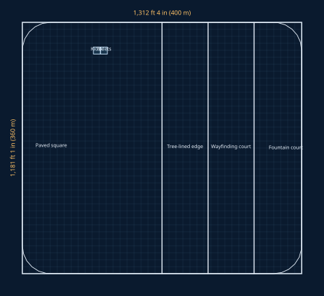

# P5-09 Terminal Plaza: plan

Footprint 1,312 ft 4 in (400 m) × 1,181 ft 1 in (360 m) · structural grid 32 ft 10 in (10 m)

## Levels

| Level | Floor above deck | Height | Floor area |
|---|---|---|---|
| Level 1 · Ground | 0 ft (0 mm) | 13 ft 1 in (4,000 mm) | 2,153 sq ft (200 m²) |

## Elements

| ID | Designation | Type | Name | Level(s) | Size / length | Area | Status |
|---|---|---|---|---|---|---|---|
| E001 | D5F3P5B4A2R1 | zone | Paved square | L1 | 656 ft 2 in (200 m) × 1,180 ft 5 in (360 m) | 765,983 sq ft (71,162 m²) | proposed |
| E002 | D5F3P5B4A2R2 | room | Kiosk | L1 | 32 ft 10 in (10 m) × 32 ft 10 in (10 m) | 1,076 sq ft (100 m²) | proposed |
| E003 | D5F3P5B4A2R3 | room | Toilets | L1 | 32 ft 10 in (10 m) × 32 ft 10 in (10 m) | 1,076 sq ft (100 m²) | proposed |
| E004 | D5F3P5B4A2R4 | zone | Tree-lined edge | L1 | 216 ft 6 in (66 m) × 1,180 ft 1 in (360 m) | 255,466 sq ft (23,734 m²) | proposed |
| E005 | D5F3P5B4A2R5 | zone | Wayfinding court | L1 | 216 ft 2 in (66 m) × 1,180 ft 1 in (360 m) | 255,079 sq ft (23,698 m²) | proposed |
| E006 | D5F3P5B4A2R6 | zone | Fountain court | L1 | 223 ft 5 in (68 m) × 1,179 ft 9 in (360 m) | 255,431 sq ft (23,730 m²) | proposed |

## Drawings

### Level 1 · Ground

