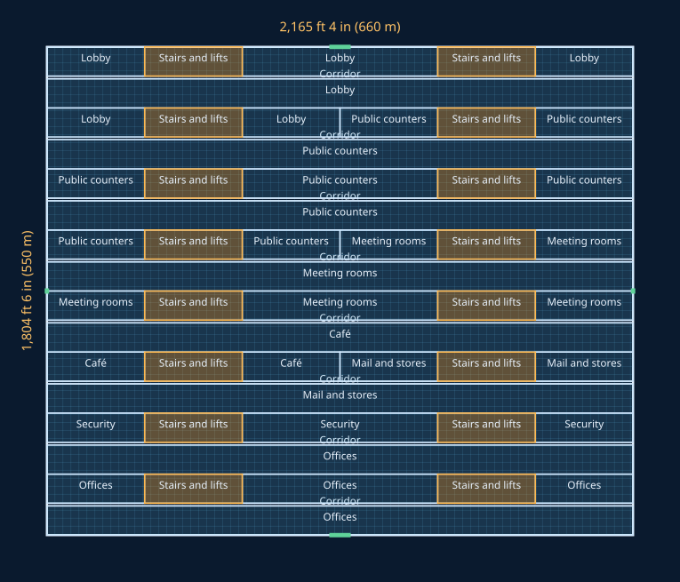
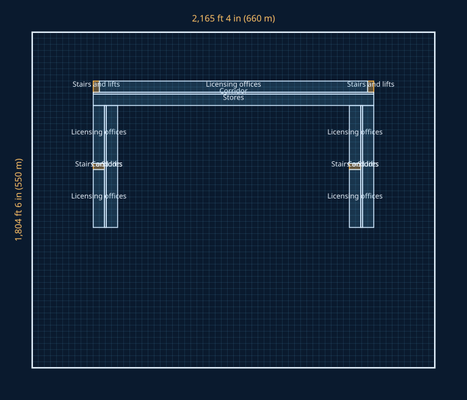

# P5-10 Licensing & Permits: plan

Footprint 2,165 ft 4 in (660 m) × 1,804 ft 6 in (550 m) · structural grid 32 ft 10 in (10 m)

## Levels

| Level | Floor above deck | Height | Floor area |
|---|---|---|---|
| Level 1 · Ground floor | 0 ft (0 mm) | 19 ft 8 in (6,000 mm) | 703,960 sq ft (65,400 m²) |
| Level 2 · Level 2 | 19 ft 8 in (6,000 mm) | 13 ft 1 in (4,000 mm) | 334,542 sq ft (31,080 m²) |
| Level 3 · Level 3 | 32 ft 10 in (10 m) | 13 ft 1 in (4,000 mm) | 334,542 sq ft (31,080 m²) |
| Level 4 · Level 4 | 45 ft 11 in (14 m) | 13 ft 1 in (4,000 mm) | 334,542 sq ft (31,080 m²) |

## Elements

| ID | Designation | Type | Name | Level(s) | Size / length | Area | Status |
|---|---|---|---|---|---|---|---|
| E001 | D5F3P5B4A3L1R1 | core | Stairs and lifts | L1 | 32 ft 10 in (10 m) × 170 ft 7 in (52 m) | 5,597 sq ft (520 m²) | proposed |
| E002 | D5F3P5B4A3L1R2 | core | Stairs and lifts | L1 | 32 ft 10 in (10 m) × 170 ft 7 in (52 m) | 5,597 sq ft (520 m²) | proposed |
| E003 | D5F3P5B4A3L1R3 | zone | Service hall | L1 | 1,115 ft 6 in (340 m) × 52 ft 6 in (16 m) | 58,556 sq ft (5,440 m²) | proposed |
| E004 | D5F3P5B4A3L1R4 | room | Ticket and queue area | L1 | 1,049 ft 10 in (320 m) × 170 ft 7 in (52 m) | 179,111 sq ft (16,640 m²) | proposed |
| E005 | D5F3P5B4A3L1R5 | room | Service counters | L1 | 2 ft 7 in (800 mm) × 170 ft 7 in (52 m) | 448 sq ft (42 m²) | proposed |
| E006 | D5F3P5B4A3L1R6 | room | Service counters | L1 | 2 ft 4 in (700 mm) × 170 ft 7 in (52 m) | 392 sq ft (36 m²) | proposed |
| E007 | D5F3P5B4A3L1R7 | room | Service counters | L1 | 2 ft 7 in (800 mm) × 170 ft 7 in (52 m) | 448 sq ft (42 m²) | proposed |
| E008 | D5F3P5B4A3L1R8 | room | Service counters | L1 | 2 ft 7 in (800 mm) × 170 ft 7 in (52 m) | 448 sq ft (42 m²) | proposed |
| E009 | D5F3P5B4A3L1R9 | room | Service counters | L1 | 2 ft 4 in (700 mm) × 170 ft 7 in (52 m) | 392 sq ft (36 m²) | proposed |
| E010 | D5F3P5B4A3L1R10 | room | Service counters | L1 | 2 ft 7 in (800 mm) × 170 ft 7 in (52 m) | 448 sq ft (42 m²) | proposed |
| E011 | D5F3P5B4A3L1R11 | room | Service counters | L1 | 2 ft 7 in (800 mm) × 170 ft 7 in (52 m) | 448 sq ft (42 m²) | proposed |
| E012 | D5F3P5B4A3L1R12 | room | Service counters | L1 | 2 ft 7 in (800 mm) × 170 ft 7 in (52 m) | 448 sq ft (42 m²) | proposed |
| E013 | D5F3P5B4A3L1R13 | room | Service counters | L1 | 2 ft 4 in (700 mm) × 170 ft 7 in (52 m) | 392 sq ft (36 m²) | proposed |
| E014 | D5F3P5B4A3L1R14 | room | Service counters | L1 | 2 ft 7 in (800 mm) × 170 ft 7 in (52 m) | 448 sq ft (42 m²) | proposed |
| E015 | D5F3P5B4A3L1R15 | room | Service counters | L1 | 2 ft 7 in (800 mm) × 170 ft 7 in (52 m) | 448 sq ft (42 m²) | proposed |
| E016 | D5F3P5B4A3L1R16 | room | Service counters | L1 | 2 ft 4 in (700 mm) × 170 ft 7 in (52 m) | 392 sq ft (36 m²) | proposed |
| E017 | D5F3P5B4A3L1R17 | room | Service counters | L1 | 2 ft 7 in (800 mm) × 170 ft 7 in (52 m) | 448 sq ft (42 m²) | proposed |
| E018 | D5F3P5B4A3L1R18 | room | Service counters | L1 | 2 ft 7 in (800 mm) × 170 ft 7 in (52 m) | 448 sq ft (42 m²) | proposed |
| E019 | D5F3P5B4A3L1R19 | room | Service counters | L1 | 2 ft 4 in (700 mm) × 170 ft 7 in (52 m) | 392 sq ft (36 m²) | proposed |
| E020 | D5F3P5B4A3L1R20 | room | Service counters | L1 | 2 ft 7 in (800 mm) × 170 ft 7 in (52 m) | 448 sq ft (42 m²) | proposed |
| E021 | D5F3P5B4A3L1R21 | room | Service counters | L1 | 2 ft 7 in (800 mm) × 170 ft 7 in (52 m) | 448 sq ft (42 m²) | proposed |
| E022 | D5F3P5B4A3L1R22 | room | Service counters | L1 | 2 ft 4 in (700 mm) × 170 ft 7 in (52 m) | 392 sq ft (36 m²) | proposed |
| E023 | D5F3P5B4A3L1R23 | room | Service counters | L1 | 2 ft 7 in (800 mm) × 170 ft 7 in (52 m) | 448 sq ft (42 m²) | proposed |
| E024 | D5F3P5B4A3L1R24 | room | Service counters | L1 | 2 ft 7 in (800 mm) × 170 ft 7 in (52 m) | 448 sq ft (42 m²) | proposed |
| E025 | D5F3P5B4A3L1R25 | room | Service counters | L1 | 2 ft 7 in (800 mm) × 170 ft 7 in (52 m) | 448 sq ft (42 m²) | proposed |
| E026 | D5F3P5B4A3L1R26 | room | Service counters | L1 | 2 ft 4 in (700 mm) × 170 ft 7 in (52 m) | 392 sq ft (36 m²) | proposed |
| E027 | D5F3P5B4A3L1R27 | room | Service counters | L1 | 2 ft 7 in (800 mm) × 170 ft 7 in (52 m) | 448 sq ft (42 m²) | proposed |
| E028 | D5F3P5B4A3L1R28 | room | Service counters | L1 | 2 ft 7 in (800 mm) × 170 ft 7 in (52 m) | 448 sq ft (42 m²) | proposed |
| E029 | D5F3P5B4A3L1R29 | room | Service counters | L1 | 2 ft 4 in (700 mm) × 170 ft 7 in (52 m) | 392 sq ft (36 m²) | proposed |
| E030 | D5F3P5B4A3L1R30 | room | Service counters | L1 | 2 ft 7 in (800 mm) × 170 ft 7 in (52 m) | 448 sq ft (42 m²) | proposed |
| E031 | D5F3P5B4A3L1R31 | room | Service counters | L1 | 2 ft 7 in (800 mm) × 170 ft 7 in (52 m) | 448 sq ft (42 m²) | proposed |
| E032 | D5F3P5B4A3L1R32 | room | Service counters | L1 | 2 ft 4 in (700 mm) × 170 ft 7 in (52 m) | 392 sq ft (36 m²) | proposed |
| E033 | D5F3P5B4A3L1R33 | room | Service counters | L1 | 2 ft 7 in (800 mm) × 170 ft 7 in (52 m) | 448 sq ft (42 m²) | proposed |
| E034 | D5F3P5B4A3L1R34 | room | Service counters | L1 | 2 ft 7 in (800 mm) × 170 ft 7 in (52 m) | 448 sq ft (42 m²) | proposed |
| E035 | D5F3P5B4A3L1R35 | room | Interview rooms | L1 | 1 ft 4 in (400 mm) × 170 ft 7 in (52 m) | 224 sq ft (21 m²) | proposed |
| E036 | D5F3P5B4A3L1R36 | room | Interview rooms | L1 | 1 ft (300 mm) × 170 ft 7 in (52 m) | 168 sq ft (16 m²) | proposed |
| E037 | D5F3P5B4A3L1R37 | room | Interview rooms | L1 | 1 ft 4 in (400 mm) × 170 ft 7 in (52 m) | 224 sq ft (21 m²) | proposed |
| E038 | D5F3P5B4A3L1R38 | room | Interview rooms | L1 | 1 ft 4 in (400 mm) × 170 ft 7 in (52 m) | 224 sq ft (21 m²) | proposed |
| E039 | D5F3P5B4A3L1R39 | room | Interview rooms | L1 | 1 ft 4 in (400 mm) × 170 ft 7 in (52 m) | 224 sq ft (21 m²) | proposed |
| E040 | D5F3P5B4A3L1R40 | room | Interview rooms | L1 | 1 ft 4 in (400 mm) × 170 ft 7 in (52 m) | 224 sq ft (21 m²) | proposed |
| E041 | D5F3P5B4A3L1R41 | room | Interview rooms | L1 | 1 ft 4 in (400 mm) × 170 ft 7 in (52 m) | 224 sq ft (21 m²) | proposed |
| E042 | D5F3P5B4A3L1R42 | room | Interview rooms | L1 | 1 ft 4 in (400 mm) × 170 ft 7 in (52 m) | 224 sq ft (21 m²) | proposed |
| E043 | D5F3P5B4A3L1R43 | room | Interview rooms | L1 | 1 ft (300 mm) × 170 ft 7 in (52 m) | 168 sq ft (16 m²) | proposed |
| E044 | D5F3P5B4A3L1R44 | room | Interview rooms | L1 | 1 ft 4 in (400 mm) × 170 ft 7 in (52 m) | 224 sq ft (21 m²) | proposed |
| E045 | D5F3P5B4A3L1R45 | room | Cashier | L1 | 25 ft 3 in (7,700 mm) × 170 ft 7 in (52 m) | 4,310 sq ft (400 m²) | proposed |
| E046 | D5F3P5B4A3L1R46 | room | Toilets | L1 | 1,002 ft (305 m) × 170 ft 7 in (52 m) | 170,940 sq ft (15,881 m²) | proposed |
| E047 | D5F3P5B4A3L1R47, D5F3P5B4A3L2R1, D5F3P5B4A3L3R1, D5F3P5B4A3L4R1 | core | Stairs and lifts | L1, L2, L3, L4 | 32 ft 10 in (10 m) × 60 ft 8 in (18 m) | 1,991 sq ft (185 m²) | proposed |
| E048 | D5F3P5B4A3L1R48, D5F3P5B4A3L2R2, D5F3P5B4A3L3R2, D5F3P5B4A3L4R2 | core | Stairs and lifts | L1, L2, L3, L4 | 32 ft 10 in (10 m) × 60 ft 8 in (18 m) | 1,991 sq ft (185 m²) | proposed |
| E049 | D5F3P5B4A3L1R49 | zone | Corridor | L1 | 1,509 ft 2 in (460 m) × 9 ft 10 in (3,000 mm) | 14,854 sq ft (1,380 m²) | proposed |
| E050 | D5F3P5B4A3L1R50 | room | Flight permits office | L1 | 1,443 ft 7 in (440 m) × 60 ft 8 in (18 m) | 87,618 sq ft (8,140 m²) | proposed |
| E051 | D5F3P5B4A3L1R51 | room | Stores | L1 | 1,509 ft 2 in (460 m) × 60 ft 8 in (18 m) | 91,601 sq ft (8,510 m²) | proposed |
| E052 | D5F3P5B4A3L2R3, D5F3P5B4A3L3R3, D5F3P5B4A3L4R3 | zone | Corridor | L2, L3, L4 | 1,509 ft 2 in (460 m) × 9 ft 10 in (3,000 mm) | 14,854 sq ft (1,380 m²) | proposed |
| E053 | D5F3P5B4A3L2R4, D5F3P5B4A3L3R4, D5F3P5B4A3L4R4 | room | Licensing offices | L2, L3, L4 | 1,443 ft 7 in (440 m) × 60 ft 8 in (18 m) | 87,618 sq ft (8,140 m²) | proposed |
| E054 | D5F3P5B4A3L2R5, D5F3P5B4A3L3R5, D5F3P5B4A3L4R5 | room | Stores | L2, L3, L4 | 1,509 ft 2 in (460 m) × 60 ft 8 in (18 m) | 91,601 sq ft (8,510 m²) | proposed |
| E055 | D5F3P5B4A3L1R52, D5F3P5B4A3L2R6, D5F3P5B4A3L3R6, D5F3P5B4A3L4R6 | core | Stairs and lifts | L1, L2, L3, L4 | 60 ft 8 in (18 m) × 32 ft 10 in (10 m) | 1,991 sq ft (185 m²) | proposed |
| E056 | D5F3P5B4A3L1R53 | zone | Corridor | L1 | 9 ft 10 in (3,000 mm) × 656 ft 2 in (200 m) | 6,458 sq ft (600 m²) | proposed |
| E057 | D5F3P5B4A3L1R54 | room | Cargo permits office | L1 | 60 ft 8 in (18 m) × 311 ft 8 in (95 m) | 18,918 sq ft (1,758 m²) | proposed |
| E058 | D5F3P5B4A3L1R55 | room | Cargo permits office | L1 | 60 ft 8 in (18 m) × 311 ft 8 in (95 m) | 18,918 sq ft (1,758 m²) | proposed |
| E059 | D5F3P5B4A3L1R56 | room | Stores | L1 | 60 ft 8 in (18 m) × 656 ft 2 in (200 m) | 39,826 sq ft (3,700 m²) | proposed |
| E060 | D5F3P5B4A3L2R7, D5F3P5B4A3L3R7, D5F3P5B4A3L4R7 | zone | Corridor | L2, L3, L4 | 9 ft 10 in (3,000 mm) × 656 ft 2 in (200 m) | 6,458 sq ft (600 m²) | proposed |
| E061 | D5F3P5B4A3L2R8, D5F3P5B4A3L3R8, D5F3P5B4A3L4R8 | room | Licensing offices | L2, L3, L4 | 60 ft 8 in (18 m) × 311 ft 8 in (95 m) | 18,918 sq ft (1,758 m²) | proposed |
| E062 | D5F3P5B4A3L2R9, D5F3P5B4A3L3R9, D5F3P5B4A3L4R9 | room | Licensing offices | L2, L3, L4 | 60 ft 8 in (18 m) × 311 ft 8 in (95 m) | 18,918 sq ft (1,758 m²) | proposed |
| E063 | D5F3P5B4A3L2R10, D5F3P5B4A3L3R10, D5F3P5B4A3L4R10 | room | Stores | L2, L3, L4 | 60 ft 8 in (18 m) × 656 ft 2 in (200 m) | 39,826 sq ft (3,700 m²) | proposed |
| E064 | D5F3P5B4A3L1R57, D5F3P5B4A3L2R11, D5F3P5B4A3L3R11, D5F3P5B4A3L4R11 | core | Stairs and lifts | L1, L2, L3, L4 | 60 ft 8 in (18 m) × 32 ft 10 in (10 m) | 1,991 sq ft (185 m²) | proposed |
| E065 | D5F3P5B4A3L1R58 | zone | Corridor | L1 | 9 ft 10 in (3,000 mm) × 656 ft 2 in (200 m) | 6,458 sq ft (600 m²) | proposed |
| E066 | D5F3P5B4A3L1R59 | room | Travel permits office | L1 | 60 ft 8 in (18 m) × 311 ft 8 in (95 m) | 18,918 sq ft (1,758 m²) | proposed |
| E067 | D5F3P5B4A3L1R60 | room | Travel permits office | L1 | 60 ft 8 in (18 m) × 311 ft 8 in (95 m) | 18,918 sq ft (1,758 m²) | proposed |
| E068 | D5F3P5B4A3L1R61 | room | Stores | L1 | 60 ft 8 in (18 m) × 656 ft 2 in (200 m) | 39,826 sq ft (3,700 m²) | proposed |
| E069 | D5F3P5B4A3L2R12, D5F3P5B4A3L3R12, D5F3P5B4A3L4R12 | zone | Corridor | L2, L3, L4 | 9 ft 10 in (3,000 mm) × 656 ft 2 in (200 m) | 6,458 sq ft (600 m²) | proposed |
| E070 | D5F3P5B4A3L2R13, D5F3P5B4A3L3R13, D5F3P5B4A3L4R13 | room | Licensing offices | L2, L3, L4 | 60 ft 8 in (18 m) × 311 ft 8 in (95 m) | 18,918 sq ft (1,758 m²) | proposed |
| E071 | D5F3P5B4A3L2R14, D5F3P5B4A3L3R14, D5F3P5B4A3L4R14 | room | Licensing offices | L2, L3, L4 | 60 ft 8 in (18 m) × 311 ft 8 in (95 m) | 18,918 sq ft (1,758 m²) | proposed |
| E072 | D5F3P5B4A3L2R15, D5F3P5B4A3L3R15, D5F3P5B4A3L4R15 | room | Stores | L2, L3, L4 | 60 ft 8 in (18 m) × 656 ft 2 in (200 m) | 39,826 sq ft (3,700 m²) | proposed |
| E073 | D5F3P5B4A3L1R62 | zone | Courtyard | L1 | 1,246 ft 9 in (380 m) × 656 ft 2 in (200 m) | 818,057 sq ft (76,000 m²) | proposed |
| E074 | D5F3P5B4A3L1R63 | zone | Entrance plaza | L1 | 1,509 ft 2 in (460 m) × 262 ft 6 in (80 m) | 396,112 sq ft (36,800 m²) | proposed |
| E075 |  | door | Public entrance | L1 | 65 ft 7 in (20 m), 65 ft 7 in (20 m) wide | — | proposed |

## Drawings

### Level 1 · Ground floor

### Level 2 · Level 2

### Level 3 · Level 3

### Level 4 · Level 4

