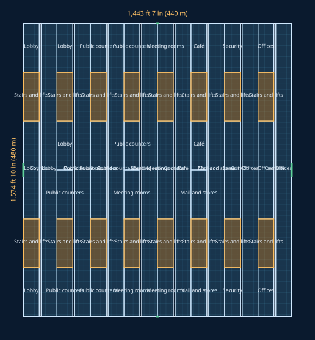
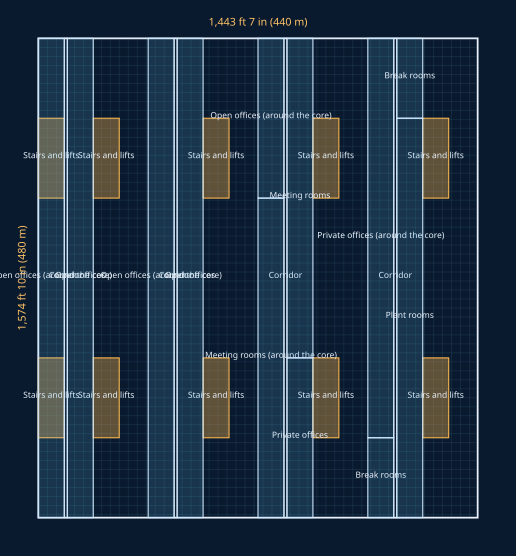
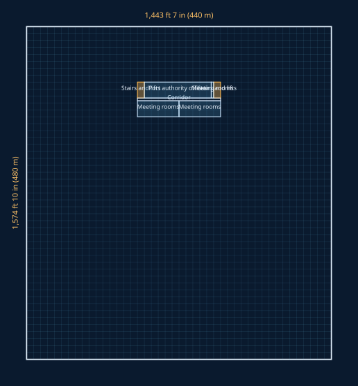
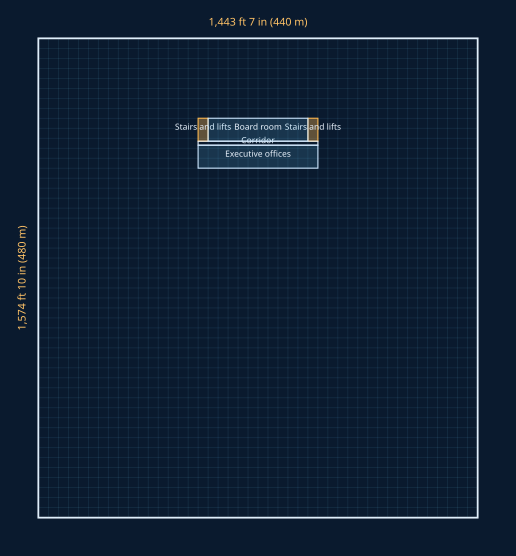

# P5-11 Terminal Admin: plan

Footprint 1,443 ft 7 in (440 m) × 1,574 ft 10 in (480 m) · structural grid 32 ft 10 in (10 m)

## Levels

| Level | Floor above deck | Height | Floor area |
|---|---|---|---|
| Level 1 · Ground floor | 0 ft (0 mm) | 19 ft 8 in (6,000 mm) | 367,049 sq ft (34,100 m²) |
| Level 2 · Podium | 19 ft 8 in (6,000 mm) | 16 ft 5 in (5,000 mm) | 367,049 sq ft (34,100 m²) |
| Level 3 · Tower | 36 ft 1 in (11 m) | 13 ft 1 in (4,000 mm) | 54,465 sq ft (5,060 m²) |
| Level 4 · Tower | 49 ft 3 in (15 m) | 13 ft 1 in (4,000 mm) | 54,465 sq ft (5,060 m²) |
| Level 5 · Tower | 62 ft 4 in (19 m) | 13 ft 1 in (4,000 mm) | 54,465 sq ft (5,060 m²) |
| Level 6 · Tower | 75 ft 6 in (23 m) | 13 ft 1 in (4,000 mm) | 54,465 sq ft (5,060 m²) |
| Level 7 · Tower | 88 ft 7 in (27 m) | 13 ft 1 in (4,000 mm) | 54,465 sq ft (5,060 m²) |
| Level 8 · Tower | 101 ft 8 in (31 m) | 13 ft 1 in (4,000 mm) | 54,465 sq ft (5,060 m²) |
| Level 9 · Tower | 114 ft 10 in (35 m) | 13 ft 1 in (4,000 mm) | 54,465 sq ft (5,060 m²) |
| Level 10 · Tower | 127 ft 11 in (39 m) | 13 ft 1 in (4,000 mm) | 54,465 sq ft (5,060 m²) |
| Level 11 · Tower | 141 ft 1 in (43 m) | 13 ft 1 in (4,000 mm) | 54,465 sq ft (5,060 m²) |
| Level 12 · Board floor | 154 ft 2 in (47 m) | 16 ft 5 in (5,000 mm) | 54,465 sq ft (5,060 m²) |

## Elements

| ID | Designation | Type | Name | Level(s) | Size / length | Area | Status |
|---|---|---|---|---|---|---|---|
| E001 | D5F3P5B7A1L1R1, D5F3P5B7A1L2R1 | core | Stairs and lifts | L1, L2 | 32 ft 10 in (10 m) × 180 ft 5 in (55 m) | 5,920 sq ft (550 m²) | proposed |
| E002 | D5F3P5B7A1L1R2, D5F3P5B7A1L2R2 | core | Stairs and lifts | L1, L2 | 32 ft 10 in (10 m) × 180 ft 5 in (55 m) | 5,920 sq ft (550 m²) | proposed |
| E003 | D5F3P5B7A1L1R3 | zone | Atrium | L1 | 1,049 ft 10 in (320 m) × 32 ft 10 in (10 m) | 34,445 sq ft (3,200 m²) | proposed |
| E004 | D5F3P5B7A1L1R4 | room | Port authority reception | L1 | 984 ft 3 in (300 m) × 180 ft 5 in (55 m) | 177,605 sq ft (16,500 m²) | proposed |
| E005 | D5F3P5B7A1L1R5 | room | Exhibition hall | L1 | 238 ft 6 in (73 m) × 180 ft 5 in (55 m) | 43,039 sq ft (3,998 m²) | proposed |
| E006 | D5F3P5B7A1L1R6 | room | Café | L1 | 89 ft 7 in (27 m) × 180 ft 5 in (55 m) | 16,162 sq ft (1,502 m²) | proposed |
| E007 | D5F3P5B7A1L1R7 | room | Mail room | L1 | 47 ft 7 in (14 m) × 180 ft 5 in (55 m) | 8,584 sq ft (798 m²) | proposed |
| E008 | D5F3P5B7A1L1R8 | room | Toilets | L1 | 674 ft 3 in (206 m) × 180 ft 5 in (55 m) | 121,659 sq ft (11,302 m²) | proposed |
| E009 | D5F3P5B7A1L2R3 | zone | Atrium | L2 | 1,049 ft 10 in (320 m) × 32 ft 10 in (10 m) | 34,445 sq ft (3,200 m²) | proposed |
| E010 | D5F3P5B7A1L2R4 | room | Conference hall | L2 | 984 ft 3 in (300 m) × 180 ft 5 in (55 m) | 177,605 sq ft (16,500 m²) | proposed |
| E011 | D5F3P5B7A1L2R5 | room | Meeting rooms | L2 | 7 ft 3 in (2,200 mm) × 180 ft 5 in (55 m) | 1,302 sq ft (121 m²) | proposed |
| E012 | D5F3P5B7A1L2R6 | room | Meeting rooms | L2 | 7 ft 3 in (2,200 mm) × 180 ft 5 in (55 m) | 1,302 sq ft (121 m²) | proposed |
| E013 | D5F3P5B7A1L2R7 | room | Meeting rooms | L2 | 6 ft 11 in (2,100 mm) × 180 ft 5 in (55 m) | 1,243 sq ft (115 m²) | proposed |
| E014 | D5F3P5B7A1L2R8 | room | Meeting rooms | L2 | 7 ft 3 in (2,200 mm) × 180 ft 5 in (55 m) | 1,302 sq ft (121 m²) | proposed |
| E015 | D5F3P5B7A1L2R9 | room | Meeting rooms | L2 | 7 ft 3 in (2,200 mm) × 180 ft 5 in (55 m) | 1,302 sq ft (121 m²) | proposed |
| E016 | D5F3P5B7A1L2R10 | room | Meeting rooms | L2 | 7 ft 3 in (2,200 mm) × 180 ft 5 in (55 m) | 1,302 sq ft (121 m²) | proposed |
| E017 | D5F3P5B7A1L2R11 | room | Meeting rooms | L2 | 7 ft 3 in (2,200 mm) × 180 ft 5 in (55 m) | 1,302 sq ft (121 m²) | proposed |
| E018 | D5F3P5B7A1L2R12 | room | Meeting rooms | L2 | 7 ft 3 in (2,200 mm) × 180 ft 5 in (55 m) | 1,302 sq ft (121 m²) | proposed |
| E019 | D5F3P5B7A1L2R13 | room | Offices | L2 | 992 ft 5 in (302 m) × 180 ft 5 in (55 m) | 179,085 sq ft (16,638 m²) | proposed |
| E020 | D5F3P5B7A1L3R1, D5F3P5B7A1L4R1, D5F3P5B7A1L5R1, D5F3P5B7A1L6R1, D5F3P5B7A1L7R1, D5F3P5B7A1L8R1, D5F3P5B7A1L9R1, D5F3P5B7A1L10R1, D5F3P5B7A1L11R1, D5F3P5B7A1L12R1 | core | Stairs and lifts | L3, L4, L5, L6, L7, L8, L9, L10, L11, L12 | 32 ft 10 in (10 m) × 75 ft 6 in (23 m) | 2,476 sq ft (230 m²) | proposed |
| E021 | D5F3P5B7A1L3R2, D5F3P5B7A1L4R2, D5F3P5B7A1L5R2, D5F3P5B7A1L6R2, D5F3P5B7A1L7R2, D5F3P5B7A1L8R2, D5F3P5B7A1L9R2, D5F3P5B7A1L10R2, D5F3P5B7A1L11R2, D5F3P5B7A1L12R2 | core | Stairs and lifts | L3, L4, L5, L6, L7, L8, L9, L10, L11, L12 | 32 ft 10 in (10 m) × 75 ft 6 in (23 m) | 2,476 sq ft (230 m²) | proposed |
| E022 | D5F3P5B7A1L3R3, D5F3P5B7A1L4R3, D5F3P5B7A1L5R3, D5F3P5B7A1L6R3, D5F3P5B7A1L7R3, D5F3P5B7A1L8R3, D5F3P5B7A1L9R3, D5F3P5B7A1L10R3, D5F3P5B7A1L11R3 | zone | Corridor | L3, L4, L5, L6, L7, L8, L9, L10, L11 | 393 ft 8 in (120 m) × 13 ft 1 in (4,000 mm) | 5,167 sq ft (480 m²) | proposed |
| E023 | D5F3P5B7A1L3R4, D5F3P5B7A1L4R4, D5F3P5B7A1L5R4, D5F3P5B7A1L6R4, D5F3P5B7A1L7R4, D5F3P5B7A1L8R4, D5F3P5B7A1L9R4, D5F3P5B7A1L10R4, D5F3P5B7A1L11R4 | room | Port authority offices | L3, L4, L5, L6, L7, L8, L9, L10, L11 | 316 ft 7 in (96 m) × 75 ft 6 in (23 m) | 23,891 sq ft (2,220 m²) | proposed |
| E024 | D5F3P5B7A1L3R5, D5F3P5B7A1L4R5, D5F3P5B7A1L5R5, D5F3P5B7A1L6R5, D5F3P5B7A1L7R5, D5F3P5B7A1L8R5, D5F3P5B7A1L9R5, D5F3P5B7A1L10R5, D5F3P5B7A1L11R5 | room | Meeting rooms | L3, L4, L5, L6, L7, L8, L9, L10, L11 | 11 ft 6 in (3,500 mm) × 75 ft 6 in (23 m) | 866 sq ft (80 m²) | proposed |
| E025 | D5F3P5B7A1L3R6, D5F3P5B7A1L4R6, D5F3P5B7A1L5R6, D5F3P5B7A1L6R6, D5F3P5B7A1L7R6, D5F3P5B7A1L8R6, D5F3P5B7A1L9R6, D5F3P5B7A1L10R6, D5F3P5B7A1L11R6 | room | Meeting rooms | L3, L4, L5, L6, L7, L8, L9, L10, L11 | 196 ft 10 in (60 m) × 75 ft 6 in (23 m) | 14,854 sq ft (1,380 m²) | proposed |
| E026 | D5F3P5B7A1L3R7, D5F3P5B7A1L4R7, D5F3P5B7A1L5R7, D5F3P5B7A1L6R7, D5F3P5B7A1L7R7, D5F3P5B7A1L8R7, D5F3P5B7A1L9R7, D5F3P5B7A1L10R7, D5F3P5B7A1L11R7 | room | Meeting rooms | L3, L4, L5, L6, L7, L8, L9, L10, L11 | 196 ft 10 in (60 m) × 75 ft 6 in (23 m) | 14,854 sq ft (1,380 m²) | proposed |
| E027 | D5F3P5B7A1L12R3 | zone | Corridor | L12 | 393 ft 8 in (120 m) × 13 ft 1 in (4,000 mm) | 5,167 sq ft (480 m²) | proposed |
| E028 | D5F3P5B7A1L12R4 | room | Board room | L12 | 328 ft 1 in (100 m) × 75 ft 6 in (23 m) | 24,757 sq ft (2,300 m²) | proposed |
| E029 | D5F3P5B7A1L12R5 | room | Executive offices | L12 | 393 ft 8 in (120 m) × 75 ft 6 in (23 m) | 29,708 sq ft (2,760 m²) | proposed |
| E030 | D5F3P5B7A1L1R9 | zone | Authority garden | L1 | 1,049 ft 10 in (320 m) × 853 ft (260 m) | 895,557 sq ft (83,200 m²) | proposed |
| E031 |  | door | Main entrance | L1 | 65 ft 7 in (20 m), 65 ft 7 in (20 m) wide | — | proposed |

## Drawings

### Level 1 · Ground floor

### Level 2 · Podium

### Level 3 · Tower

### Level 4 · Tower

### Level 5 · Tower

### Level 6 · Tower

### Level 7 · Tower

### Level 8 · Tower

### Level 9 · Tower

### Level 10 · Tower

### Level 11 · Tower

### Level 12 · Board floor

