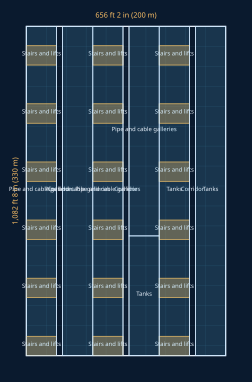

# P5-12 Terminals Utility Plant: plan

Footprint 656 ft 2 in (200 m) × 1,082 ft 8 in (330 m) · structural grid 65 ft 7 in (20 m)

## Levels

| Level | Floor above deck | Height | Floor area |
|---|---|---|---|
| Level B1 · Plant level | −19 ft 8 in (6,000 mm) | 19 ft 8 in (6,000 mm) | 646,481 sq ft (60,060 m²) |
| Level 1 · Ground floor | 0 ft (0 mm) | 26 ft 3 in (8,000 mm) | 532,367 sq ft (49,459 m²) |
| Level 2 · Upper floor | 26 ft 3 in (8,000 mm) | 26 ft 3 in (8,000 mm) | 646,481 sq ft (60,060 m²) |

## Elements

| ID | Designation | Type | Name | Level(s) | Size / length | Area | Status |
|---|---|---|---|---|---|---|---|
| L1-001 | D5F3P5B7A2L1R1 | zone | Corridor | L1 | 19 ft 8 in (6,000 mm) × 1,082 ft 8 in (330 m) | 21,313 sq ft (1,980 m²) | proposed |
| L1-002 | D5F3P5B7A2L1R2 | zone | Corridor | L1 | 19 ft 8 in (6,000 mm) × 1,082 ft 8 in (330 m) | 21,313 sq ft (1,980 m²) | proposed |
| L1-003 | D5F3P5B7A2L1R3 | zone | Corridor | L1 | 19 ft 8 in (6,000 mm) × 1,082 ft 8 in (330 m) | 21,313 sq ft (1,980 m²) | proposed |
| L1-004 | D5F3P5B7A2L1R4 | room | Substation | L1 | 99 ft 5 in (30 m) × 63 ft 8 in (19 m) | 6,327 sq ft (588 m²) | proposed |
| L1-005 | D5F3P5B7A2L1R5 | room | Substation | L1 | 99 ft 5 in (30 m) × 127 ft 4 in (39 m) | 12,654 sq ft (1,176 m²) | proposed |
| L1-006 | D5F3P5B7A2L1R6 | room | Substation | L1 | 99 ft 5 in (30 m) × 127 ft 4 in (39 m) | 12,654 sq ft (1,176 m²) | proposed |
| L1-007 | D5F3P5B7A2L1R7 | room | Substation | L1 | 99 ft 5 in (30 m) × 127 ft 4 in (39 m) | 12,654 sq ft (1,176 m²) | proposed |
| L1-008 | D5F3P5B7A2L1R8 | room | Substation | L1 | 99 ft 5 in (30 m) × 127 ft 7 in (39 m) | 12,687 sq ft (1,179 m²) | proposed |
| L1-009 | D5F3P5B7A2L1R9 | room | Substation | L1 | 99 ft 5 in (30 m) × 127 ft 4 in (39 m) | 12,654 sq ft (1,176 m²) | proposed |
| L1-010 | D5F3P5B7A2L1R10 | room | Substation | L1 | 99 ft 9 in (30 m) × 636 ft 10 in (194 m) | 63,514 sq ft (5,901 m²) | proposed |
| L1-011 | D5F3P5B7A2L1R11 | room | Air handling | L1 | 99 ft 9 in (30 m) × 445 ft 10 in (136 m) | 44,470 sq ft (4,131 m²) | proposed |
| L1-012 | D5F3P5B7A2L1R12 | room | Air handling | L1 | 99 ft 5 in (30 m) × 63 ft 8 in (19 m) | 6,327 sq ft (588 m²) | proposed |
| L1-013 | D5F3P5B7A2L1R13 | room | Air handling | L1 | 99 ft 5 in (30 m) × 127 ft 4 in (39 m) | 12,654 sq ft (1,176 m²) | proposed |
| L1-014 | D5F3P5B7A2L1R14 | room | Air handling | L1 | 99 ft 5 in (30 m) × 127 ft 4 in (39 m) | 12,654 sq ft (1,176 m²) | proposed |
| L1-015 | D5F3P5B7A2L1R15 | room | Air handling | L1 | 99 ft 5 in (30 m) × 127 ft 4 in (39 m) | 12,654 sq ft (1,176 m²) | proposed |
| L1-016 | D5F3P5B7A2L1R16 | room | Air handling | L1 | 99 ft 5 in (30 m) × 127 ft 7 in (39 m) | 12,687 sq ft (1,179 m²) | proposed |
| L1-017 | D5F3P5B7A2L1R17 | room | Air handling | L1 | 99 ft 5 in (30 m) × 127 ft 4 in (39 m) | 12,654 sq ft (1,176 m²) | proposed |
| L1-018 | D5F3P5B7A2L1R18 | room | Air handling | L1 | 99 ft 5 in (30 m) × 190 ft 11 in (58 m) | 18,982 sq ft (1,763 m²) | proposed |
| L1-019 | D5F3P5B7A2L1R19 | room | Water pumps and tanks | L1 | 99 ft 5 in (30 m) × 891 ft 9 in (272 m) | 88,647 sq ft (8,236 m²) | proposed |
| L1-020 | D5F3P5B7A2L1R20 | room | Water pumps and tanks | L1 | 99 ft 9 in (30 m) × 63 ft 8 in (19 m) | 6,348 sq ft (590 m²) | proposed |
| L1-021 | D5F3P5B7A2L1R21 | room | Water pumps and tanks | L1 | 99 ft 9 in (30 m) × 127 ft 4 in (39 m) | 12,696 sq ft (1,180 m²) | proposed |
| L1-022 | D5F3P5B7A2L1R22 | room | Water pumps and tanks | L1 | 99 ft 9 in (30 m) × 127 ft 4 in (39 m) | 12,696 sq ft (1,180 m²) | proposed |
| L1-023 | D5F3P5B7A2L1R23 | room | Water pumps and tanks | L1 | 99 ft 9 in (30 m) × 127 ft 4 in (39 m) | 12,696 sq ft (1,180 m²) | proposed |
| L1-024 | D5F3P5B7A2L1R24 | room | Control room | L1 | 99 ft 9 in (30 m) × 127 ft 7 in (39 m) | 12,729 sq ft (1,183 m²) | proposed |
| L1-025 | D5F3P5B7A2L1R25 | room | Control room | L1 | 99 ft 9 in (30 m) × 127 ft 4 in (39 m) | 12,696 sq ft (1,180 m²) | proposed |
| L1-026 | D5F3P5B7A2L1R26 | room | Workshop and stores | L1 | 99 ft 5 in (30 m) × 1,082 ft 8 in (330 m) | 107,628 sq ft (9,999 m²) | proposed |
| L1-027 | D5F3P5B7A2LB1R1, D5F3P5B7A2L1R27, D5F3P5B7A2L2R1 | core | Stairs and lifts | LB1, L1, L2 | 99 ft 5 in (30 m) × 63 ft 8 in (19 m) | 6,327 sq ft (588 m²) | proposed |
| L1-028 | D5F3P5B7A2LB1R2, D5F3P5B7A2L1R28, D5F3P5B7A2L2R2 | core | Stairs and lifts | LB1, L1, L2 | 99 ft 5 in (30 m) × 64 ft (20 m) | 6,360 sq ft (591 m²) | proposed |
| L1-029 | D5F3P5B7A2LB1R3, D5F3P5B7A2L1R29, D5F3P5B7A2L2R3 | core | Stairs and lifts | LB1, L1, L2 | 99 ft 5 in (30 m) × 63 ft 8 in (19 m) | 6,327 sq ft (588 m²) | proposed |
| L1-030 | D5F3P5B7A2LB1R4, D5F3P5B7A2L1R30, D5F3P5B7A2L2R4 | core | Stairs and lifts | LB1, L1, L2 | 99 ft 5 in (30 m) × 63 ft 8 in (19 m) | 6,327 sq ft (588 m²) | proposed |
| L1-031 | D5F3P5B7A2LB1R5, D5F3P5B7A2L1R31, D5F3P5B7A2L2R5 | core | Stairs and lifts | LB1, L1, L2 | 99 ft 5 in (30 m) × 63 ft 8 in (19 m) | 6,327 sq ft (588 m²) | proposed |
| L1-032 | D5F3P5B7A2LB1R6, D5F3P5B7A2L1R32, D5F3P5B7A2L2R6 | core | Stairs and lifts | LB1, L1, L2 | 99 ft 5 in (30 m) × 63 ft 8 in (19 m) | 6,327 sq ft (588 m²) | proposed |
| L1-033 | D5F3P5B7A2LB1R7, D5F3P5B7A2L1R33, D5F3P5B7A2L2R7 | core | Stairs and lifts | LB1, L1, L2 | 99 ft 5 in (30 m) × 63 ft 8 in (19 m) | 6,327 sq ft (588 m²) | proposed |
| L1-034 | D5F3P5B7A2LB1R8, D5F3P5B7A2L1R34, D5F3P5B7A2L2R8 | core | Stairs and lifts | LB1, L1, L2 | 99 ft 5 in (30 m) × 64 ft (20 m) | 6,360 sq ft (591 m²) | proposed |
| L1-035 | D5F3P5B7A2LB1R9, D5F3P5B7A2L1R35, D5F3P5B7A2L2R9 | core | Stairs and lifts | LB1, L1, L2 | 99 ft 5 in (30 m) × 63 ft 8 in (19 m) | 6,327 sq ft (588 m²) | proposed |
| L1-036 | D5F3P5B7A2LB1R10, D5F3P5B7A2L1R36, D5F3P5B7A2L2R10 | core | Stairs and lifts | LB1, L1, L2 | 99 ft 5 in (30 m) × 63 ft 8 in (19 m) | 6,327 sq ft (588 m²) | proposed |
| L1-037 | D5F3P5B7A2LB1R11, D5F3P5B7A2L1R37, D5F3P5B7A2L2R11 | core | Stairs and lifts | LB1, L1, L2 | 99 ft 5 in (30 m) × 63 ft 8 in (19 m) | 6,327 sq ft (588 m²) | proposed |
| L1-038 | D5F3P5B7A2LB1R12, D5F3P5B7A2L1R38, D5F3P5B7A2L2R12 | core | Stairs and lifts | LB1, L1, L2 | 99 ft 5 in (30 m) × 63 ft 8 in (19 m) | 6,327 sq ft (588 m²) | proposed |
| L1-039 | D5F3P5B7A2LB1R13, D5F3P5B7A2L1R39, D5F3P5B7A2L2R13 | core | Stairs and lifts | LB1, L1, L2 | 99 ft 9 in (30 m) × 63 ft 8 in (19 m) | 6,348 sq ft (590 m²) | proposed |
| L1-040 | D5F3P5B7A2LB1R14, D5F3P5B7A2L1R40, D5F3P5B7A2L2R14 | core | Stairs and lifts | LB1, L1, L2 | 99 ft 9 in (30 m) × 64 ft (20 m) | 6,381 sq ft (593 m²) | proposed |
| L1-041 | D5F3P5B7A2LB1R15, D5F3P5B7A2L1R41, D5F3P5B7A2L2R15 | core | Stairs and lifts | LB1, L1, L2 | 99 ft 9 in (30 m) × 63 ft 8 in (19 m) | 6,348 sq ft (590 m²) | proposed |
| L1-042 | D5F3P5B7A2LB1R16, D5F3P5B7A2L1R42, D5F3P5B7A2L2R16 | core | Stairs and lifts | LB1, L1, L2 | 99 ft 9 in (30 m) × 63 ft 8 in (19 m) | 6,348 sq ft (590 m²) | proposed |
| L1-043 | D5F3P5B7A2LB1R17, D5F3P5B7A2L1R43, D5F3P5B7A2L2R17 | core | Stairs and lifts | LB1, L1, L2 | 99 ft 9 in (30 m) × 63 ft 8 in (19 m) | 6,348 sq ft (590 m²) | proposed |
| L1-044 | D5F3P5B7A2LB1R18, D5F3P5B7A2L1R44, D5F3P5B7A2L2R18 | core | Stairs and lifts | LB1, L1, L2 | 99 ft 9 in (30 m) × 63 ft 8 in (19 m) | 6,348 sq ft (590 m²) | proposed |
| LT-001 | D5F3P5B7A2L2R19 | zone | Corridor | L2 | 19 ft 8 in (6,000 mm) × 1,082 ft 8 in (330 m) | 21,313 sq ft (1,980 m²) | proposed |
| LT-002 | D5F3P5B7A2L2R20 | zone | Corridor | L2 | 19 ft 8 in (6,000 mm) × 1,082 ft 8 in (330 m) | 21,313 sq ft (1,980 m²) | proposed |
| LT-003 | D5F3P5B7A2L2R21 | zone | Corridor | L2 | 19 ft 8 in (6,000 mm) × 1,082 ft 8 in (330 m) | 21,313 sq ft (1,980 m²) | proposed |
| LT-004 | D5F3P5B7A2L2R22 | room | Air handling (around the core) | L2 | 99 ft 5 in (30 m) × 1,082 ft 8 in (330 m) | 107,628 sq ft (9,999 m²) | proposed |
| LT-005 | D5F3P5B7A2L2R23 | room | Air handling | L2 | 99 ft 9 in (30 m) × 1,082 ft 8 in (330 m) | 107,984 sq ft (10,032 m²) | proposed |
| LT-006 | D5F3P5B7A2L2R24 | room | Air handling (around the core) | L2 | 99 ft 5 in (30 m) × 1,082 ft 8 in (330 m) | 107,628 sq ft (9,999 m²) | proposed |
| LT-007 | D5F3P5B7A2L2R25 | room | Switch rooms | L2 | 99 ft 5 in (30 m) × 1,082 ft 8 in (330 m) | 107,628 sq ft (9,999 m²) | proposed |
| LT-008 | D5F3P5B7A2L2R26 | room | Switch rooms (around the core) | L2 | 99 ft 9 in (30 m) × 891 ft 9 in (272 m) | 88,939 sq ft (8,263 m²) | proposed |
| LT-009 | D5F3P5B7A2L2R27 | room | Offices (around the core) | L2 | 99 ft 9 in (30 m) × 190 ft 11 in (58 m) | 19,044 sq ft (1,769 m²) | proposed |
| LT-010 | D5F3P5B7A2L2R28 | room | Offices | L2 | 99 ft 5 in (30 m) × 1,082 ft 8 in (330 m) | 107,628 sq ft (9,999 m²) | proposed |
| BB1-001 | D5F3P5B7A2LB1R19 | zone | Corridor | LB1 | 19 ft 8 in (6,000 mm) × 1,082 ft 8 in (330 m) | 21,313 sq ft (1,980 m²) | proposed |
| BB1-002 | D5F3P5B7A2LB1R20 | zone | Corridor | LB1 | 19 ft 8 in (6,000 mm) × 1,082 ft 8 in (330 m) | 21,313 sq ft (1,980 m²) | proposed |
| BB1-003 | D5F3P5B7A2LB1R21 | zone | Corridor | LB1 | 19 ft 8 in (6,000 mm) × 1,082 ft 8 in (330 m) | 21,313 sq ft (1,980 m²) | proposed |
| BB1-004 | D5F3P5B7A2LB1R22 | room | Pipe and cable galleries | LB1 | 99 ft 5 in (30 m) × 1,082 ft 8 in (330 m) | 107,628 sq ft (9,999 m²) | proposed |
| BB1-005 | D5F3P5B7A2LB1R23 | room | Pipe and cable galleries | LB1 | 99 ft 9 in (30 m) × 1,082 ft 8 in (330 m) | 107,984 sq ft (10,032 m²) | proposed |
| BB1-006 | D5F3P5B7A2LB1R24 | room | Pipe and cable galleries | LB1 | 99 ft 5 in (30 m) × 1,082 ft 8 in (330 m) | 107,628 sq ft (9,999 m²) | proposed |
| BB1-007 | D5F3P5B7A2LB1R25 | room | Pipe and cable galleries | LB1 | 99 ft 5 in (30 m) × 689 ft (210 m) | 68,491 sq ft (6,363 m²) | proposed |
| BB1-008 | D5F3P5B7A2LB1R26 | room | Tanks | LB1 | 99 ft 5 in (30 m) × 393 ft 8 in (120 m) | 39,138 sq ft (3,636 m²) | proposed |
| BB1-009 | D5F3P5B7A2LB1R27 | room | Tanks | LB1 | 99 ft 9 in (30 m) × 1,082 ft 8 in (330 m) | 107,984 sq ft (10,032 m²) | proposed |
| BB1-010 | D5F3P5B7A2LB1R28 | room | Tanks | LB1 | 99 ft 5 in (30 m) × 1,082 ft 8 in (330 m) | 107,628 sq ft (9,999 m²) | proposed |
| D-65 |  | door | Main entrance | L1 | 78 ft 9 in (24 m), 78 ft 9 in (24 m) wide | — | proposed |
| D-66 |  | door | Second entrance | L1 | 78 ft 9 in (24 m), 78 ft 9 in (24 m) wide | — | proposed |
| D-67 |  | door | Side door | L1 | 19 ft 8 in (6,000 mm), 19 ft 8 in (6,000 mm) wide | — | proposed |
| D-68 |  | door | Side door | L1 | 19 ft 8 in (6,000 mm), 19 ft 8 in (6,000 mm) wide | — | proposed |

## Drawings

### Level B1 · Plant level

### Level 1 · Ground floor

### Level 2 · Upper floor

