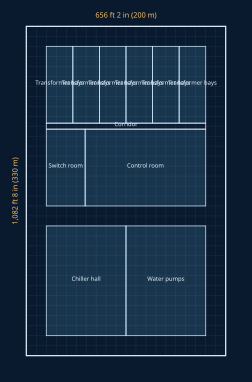
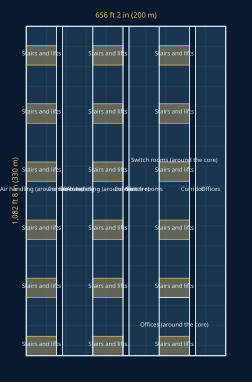

# P5-12 Terminals Utility Plant: plan

Footprint 656 ft 2 in (200 m) × 1,082 ft 8 in (330 m) · structural grid 32 ft 10 in (10 m)

## Levels

| Level | Floor above deck | Height | Floor area |
|---|---|---|---|
| Level 1 · Ground floor | 0 ft (0 mm) | 26 ft 3 in (8,000 mm) | 454,668 sq ft (42,240 m²) |
| Level 2 · Upper plant | 26 ft 3 in (8,000 mm) | 19 ft 8 in (6,000 mm) | 454,668 sq ft (42,240 m²) |

## Elements

| ID | Designation | Type | Name | Level(s) | Size / length | Area | Status |
|---|---|---|---|---|---|---|---|
| E001 | D5F3P5B7A2L1R1 | zone | Corridor | L1 | 524 ft 11 in (160 m) × 19 ft 8 in (6,000 mm) | 10,333 sq ft (960 m²) | proposed |
| E002 | D5F3P5B7A2L1R2 | room | Transformer bays | L1 | 87 ft 7 in (27 m) × 252 ft 7 in (77 m) | 22,130 sq ft (2,056 m²) | proposed |
| E003 | D5F3P5B7A2L1R3 | room | Transformer bays | L1 | 87 ft 3 in (27 m) × 252 ft 7 in (77 m) | 22,047 sq ft (2,048 m²) | proposed |
| E004 | D5F3P5B7A2L1R4 | room | Transformer bays | L1 | 87 ft 7 in (27 m) × 252 ft 7 in (77 m) | 22,130 sq ft (2,056 m²) | proposed |
| E005 | D5F3P5B7A2L1R5 | room | Transformer bays | L1 | 87 ft 7 in (27 m) × 252 ft 7 in (77 m) | 22,130 sq ft (2,056 m²) | proposed |
| E006 | D5F3P5B7A2L1R6 | room | Transformer bays | L1 | 87 ft 3 in (27 m) × 252 ft 7 in (77 m) | 22,047 sq ft (2,048 m²) | proposed |
| E007 | D5F3P5B7A2L1R7 | room | Transformer bays | L1 | 87 ft 7 in (27 m) × 252 ft 7 in (77 m) | 22,130 sq ft (2,056 m²) | proposed |
| E008 | D5F3P5B7A2L1R8 | room | Switch room | L1 | 127 ft 11 in (39 m) × 252 ft 7 in (77 m) | 32,324 sq ft (3,003 m²) | proposed |
| E009 | D5F3P5B7A2L1R9 | room | Control room | L1 | 397 ft (121 m) × 252 ft 7 in (77 m) | 100,287 sq ft (9,317 m²) | proposed |
| E010 | D5F3P5B7A2L2R1 | zone | Corridor | L2 | 524 ft 11 in (160 m) × 19 ft 8 in (6,000 mm) | 10,333 sq ft (960 m²) | proposed |
| E011 | D5F3P5B7A2L2R2 | room | Air handling | L2 | 524 ft 11 in (160 m) × 252 ft 7 in (77 m) | 132,611 sq ft (12,320 m²) | proposed |
| E012 | D5F3P5B7A2L2R3 | room | Stores | L2 | 524 ft 11 in (160 m) × 252 ft 7 in (77 m) | 132,611 sq ft (12,320 m²) | proposed |
| E013 | D5F3P5B7A2L1R10, D5F3P5B7A2L2R4 | room | Chiller hall | L1, L2 | 262 ft 6 in (80 m) × 360 ft 11 in (110 m) | 94,722 sq ft (8,800 m²) | proposed |
| E014 | D5F3P5B7A2L1R11, D5F3P5B7A2L2R5 | room | Water pumps | L1, L2 | 262 ft 6 in (80 m) × 360 ft 11 in (110 m) | 94,722 sq ft (8,800 m²) | proposed |

## Drawings

### Level 1 · Ground floor

### Level 2 · Upper plant

