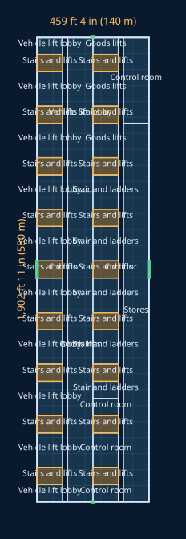
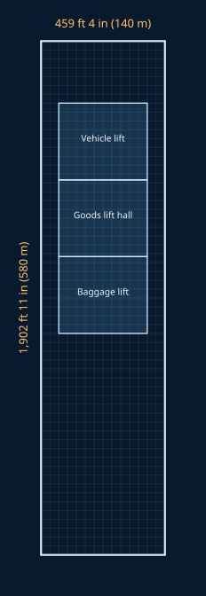

# P5-13 Terminals Service Shaft: plan

Footprint 459 ft 4 in (140 m) × 1,902 ft 11 in (580 m) · structural grid 32 ft 10 in (10 m)

## Levels

| Level | Floor above deck | Height | Floor area |
|---|---|---|---|
| Level B1 · Shaft head | −32 ft 10 in (10 m) | 32 ft 10 in (10 m) | 279,862 sq ft (26,000 m²) |
| Level 1 · Ground floor | 0 ft (0 mm) | 23 ft (7,000 mm) | 308,924 sq ft (28,700 m²) |
| Level 2 · Lift machine level | 23 ft (7,000 mm) | 19 ft 8 in (6,000 mm) | 279,862 sq ft (26,000 m²) |

## Elements

| ID | Designation | Type | Name | Level(s) | Size / length | Area | Status |
|---|---|---|---|---|---|---|---|
| E001 | D5F3P5B7A3L1R1 | zone | Corridor | L1 | 328 ft 1 in (100 m) × 9 ft 10 in (3,000 mm) | 3,229 sq ft (300 m²) | proposed |
| E002 | D5F3P5B7A3L1R2 | room | Shaft control room | L1 | 328 ft 1 in (100 m) × 44 ft 3 in (14 m) | 14,531 sq ft (1,350 m²) | proposed |
| E003 | D5F3P5B7A3L1R3 | room | Crew room | L1 | 328 ft 1 in (100 m) × 44 ft 3 in (14 m) | 14,531 sq ft (1,350 m²) | proposed |
| E004 | D5F3P5B7A3LB1R1, D5F3P5B7A3L1R4, D5F3P5B7A3L2R1 | room | Vehicle lift | LB1, L1, L2 | 328 ft 1 in (100 m) × 284 ft 5 in (87 m) | 93,323 sq ft (8,670 m²) | proposed |
| E005 | D5F3P5B7A3LB1R2, D5F3P5B7A3L1R5, D5F3P5B7A3L2R2 | room | Goods lift hall | LB1, L1, L2 | 328 ft 1 in (100 m) × 284 ft 1 in (87 m) | 93,215 sq ft (8,660 m²) | proposed |
| E006 | D5F3P5B7A3LB1R3, D5F3P5B7A3L1R6, D5F3P5B7A3L2R3 | room | Baggage lift | LB1, L1, L2 | 328 ft 1 in (100 m) × 284 ft 5 in (87 m) | 93,323 sq ft (8,670 m²) | proposed |
| E007 | D5F3P5B7A3L1R7 | zone | Vehicle queue | L1 | 328 ft 1 in (100 m) × 754 ft 7 in (230 m) | 247,570 sq ft (23,000 m²) | proposed |

## Drawings

### Level B1 · Shaft head

### Level 1 · Ground floor

### Level 2 · Lift machine level

