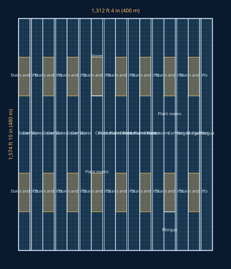
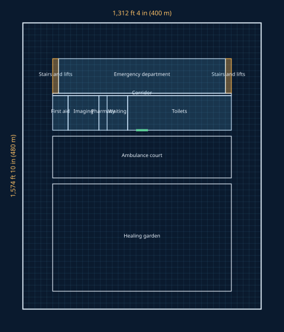
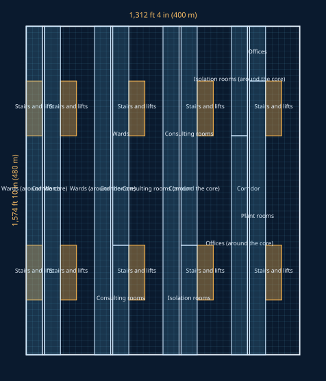
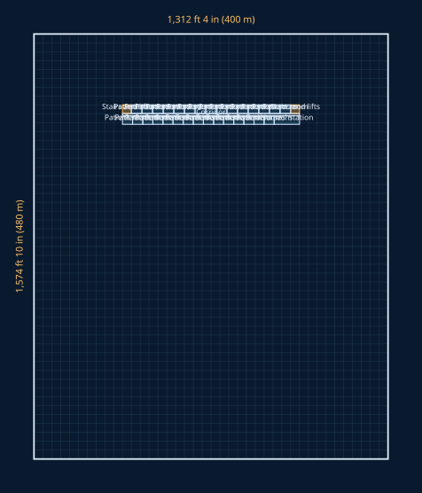

# P5-14 Medical Centre: plan

Footprint 1,312 ft 4 in (400 m) × 1,574 ft 10 in (480 m) · structural grid 32 ft 10 in (10 m)

## Levels

| Level | Floor above deck | Height | Floor area |
|---|---|---|---|
| Level B1 · Service level | −16 ft 5 in (5,000 mm) | 16 ft 5 in (5,000 mm) | 387,501 sq ft (36,000 m²) |
| Level 1 · Ground floor | 0 ft (0 mm) | 16 ft 5 in (5,000 mm) | 362,098 sq ft (33,640 m²) |
| Level 2 · Level 2 | 16 ft 5 in (5,000 mm) | 14 ft 9 in (4,500 mm) | 362,098 sq ft (33,640 m²) |
| Level 3 · Ward tower | 31 ft 2 in (9,500 mm) | 13 ft 1 in (4,000 mm) | 40,085 sq ft (3,724 m²) |
| Level 4 · Ward tower | 44 ft 3 in (14 m) | 13 ft 1 in (4,000 mm) | 40,085 sq ft (3,724 m²) |
| Level 5 · Ward tower | 57 ft 5 in (18 m) | 13 ft 1 in (4,000 mm) | 40,085 sq ft (3,724 m²) |
| Level 6 · Ward tower | 70 ft 6 in (22 m) | 13 ft 1 in (4,000 mm) | 40,085 sq ft (3,724 m²) |

## Elements

| ID | Designation | Type | Name | Level(s) | Size / length | Area | Status |
|---|---|---|---|---|---|---|---|
| E001 | D5F3P5B9A1L1R1, D5F3P5B9A1L2R1 | core | Stairs and lifts | L1, L2 | 32 ft 10 in (10 m) × 190 ft 3 in (58 m) | 6,243 sq ft (580 m²) | proposed |
| E002 | D5F3P5B9A1L1R2, D5F3P5B9A1L2R2 | core | Stairs and lifts | L1, L2 | 32 ft 10 in (10 m) × 190 ft 3 in (58 m) | 6,243 sq ft (580 m²) | proposed |
| E003 | D5F3P5B9A1L1R3 | zone | Corridor | L1 | 984 ft 3 in (300 m) × 13 ft 1 in (4,000 mm) | 12,917 sq ft (1,200 m²) | proposed |
| E004 | D5F3P5B9A1L1R4 | room | Emergency department | L1 | 918 ft 8 in (280 m) × 190 ft 3 in (58 m) | 174,806 sq ft (16,240 m²) | proposed |
| E005 | D5F3P5B9A1L1R5 | room | First aid | L1 | 85 ft (26 m) × 190 ft 3 in (58 m) | 16,170 sq ft (1,502 m²) | proposed |
| E006 | D5F3P5B9A1L1R6 | room | Imaging | L1 | 169 ft 7 in (52 m) × 190 ft 3 in (58 m) | 32,277 sq ft (2,999 m²) | proposed |
| E007 | D5F3P5B9A1L1R7 | room | Pharmacy | L1 | 45 ft 3 in (14 m) × 190 ft 3 in (58 m) | 8,615 sq ft (800 m²) | proposed |
| E008 | D5F3P5B9A1L1R8 | room | Waiting | L1 | 113 ft 2 in (34 m) × 190 ft 3 in (58 m) | 21,539 sq ft (2,001 m²) | proposed |
| E009 | D5F3P5B9A1L1R9 | room | Toilets | L1 | 571 ft 2 in (174 m) × 190 ft 3 in (58 m) | 108,692 sq ft (10,098 m²) | proposed |
| E010 | D5F3P5B9A1L2R3 | zone | Corridor | L2 | 984 ft 3 in (300 m) × 13 ft 1 in (4,000 mm) | 12,917 sq ft (1,200 m²) | proposed |
| E011 | D5F3P5B9A1L2R4 | room | Operating theatres | L2 | 118 ft 5 in (36 m) × 190 ft 3 in (58 m) | 22,537 sq ft (2,094 m²) | proposed |
| E012 | D5F3P5B9A1L2R5 | room | Operating theatres | L2 | 118 ft 9 in (36 m) × 190 ft 3 in (58 m) | 22,600 sq ft (2,100 m²) | proposed |
| E013 | D5F3P5B9A1L2R6 | room | Operating theatres | L2 | 118 ft 5 in (36 m) × 190 ft 3 in (58 m) | 22,537 sq ft (2,094 m²) | proposed |
| E014 | D5F3P5B9A1L2R7 | room | Operating theatres | L2 | 118 ft 5 in (36 m) × 190 ft 3 in (58 m) | 22,537 sq ft (2,094 m²) | proposed |
| E015 | D5F3P5B9A1L2R8 | room | Recovery | L2 | 444 ft 7 in (136 m) × 190 ft 3 in (58 m) | 84,594 sq ft (7,859 m²) | proposed |
| E016 | D5F3P5B9A1L2R9 | room | Outpatient clinics | L2 | 2 ft 4 in (700 mm) × 190 ft 3 in (58 m) | 437 sq ft (41 m²) | proposed |
| E017 | D5F3P5B9A1L2R10 | room | Outpatient clinics | L2 | 2 ft 4 in (700 mm) × 190 ft 3 in (58 m) | 437 sq ft (41 m²) | proposed |
| E018 | D5F3P5B9A1L2R11 | room | Outpatient clinics | L2 | 2 ft 4 in (700 mm) × 190 ft 3 in (58 m) | 437 sq ft (41 m²) | proposed |
| E019 | D5F3P5B9A1L2R12 | room | Outpatient clinics | L2 | 2 ft 4 in (700 mm) × 190 ft 3 in (58 m) | 437 sq ft (41 m²) | proposed |
| E020 | D5F3P5B9A1L2R13 | room | Outpatient clinics | L2 | 2 ft (600 mm) × 190 ft 3 in (58 m) | 375 sq ft (35 m²) | proposed |
| E021 | D5F3P5B9A1L2R14 | room | Outpatient clinics | L2 | 2 ft 4 in (700 mm) × 190 ft 3 in (58 m) | 437 sq ft (41 m²) | proposed |
| E022 | D5F3P5B9A1L2R15 | room | Outpatient clinics | L2 | 2 ft 4 in (700 mm) × 190 ft 3 in (58 m) | 437 sq ft (41 m²) | proposed |
| E023 | D5F3P5B9A1L2R16 | room | Outpatient clinics | L2 | 2 ft 4 in (700 mm) × 190 ft 3 in (58 m) | 437 sq ft (41 m²) | proposed |
| E024 | D5F3P5B9A1L2R17 | room | Outpatient clinics | L2 | 2 ft 4 in (700 mm) × 190 ft 3 in (58 m) | 437 sq ft (41 m²) | proposed |
| E025 | D5F3P5B9A1L2R18 | room | Outpatient clinics | L2 | 2 ft 4 in (700 mm) × 190 ft 3 in (58 m) | 437 sq ft (41 m²) | proposed |
| E026 | D5F3P5B9A1L2R19 | room | Outpatient clinics | L2 | 2 ft 4 in (700 mm) × 190 ft 3 in (58 m) | 437 sq ft (41 m²) | proposed |
| E027 | D5F3P5B9A1L2R20 | room | Outpatient clinics | L2 | 2 ft 4 in (700 mm) × 190 ft 3 in (58 m) | 437 sq ft (41 m²) | proposed |
| E028 | D5F3P5B9A1L2R21 | room | Outpatient clinics | L2 | 2 ft 4 in (700 mm) × 190 ft 3 in (58 m) | 437 sq ft (41 m²) | proposed |
| E029 | D5F3P5B9A1L2R22 | room | Outpatient clinics | L2 | 2 ft 4 in (700 mm) × 190 ft 3 in (58 m) | 437 sq ft (41 m²) | proposed |
| E030 | D5F3P5B9A1L2R23 | room | Outpatient clinics | L2 | 2 ft (600 mm) × 190 ft 3 in (58 m) | 375 sq ft (35 m²) | proposed |
| E031 | D5F3P5B9A1L2R24 | room | Outpatient clinics | L2 | 2 ft 4 in (700 mm) × 190 ft 3 in (58 m) | 437 sq ft (41 m²) | proposed |
| E032 | D5F3P5B9A1L2R25 | room | Outpatient clinics | L2 | 2 ft 4 in (700 mm) × 190 ft 3 in (58 m) | 437 sq ft (41 m²) | proposed |
| E033 | D5F3P5B9A1L2R26 | room | Outpatient clinics | L2 | 2 ft 4 in (700 mm) × 190 ft 3 in (58 m) | 437 sq ft (41 m²) | proposed |
| E034 | D5F3P5B9A1L2R27 | room | Outpatient clinics | L2 | 2 ft 4 in (700 mm) × 190 ft 3 in (58 m) | 437 sq ft (41 m²) | proposed |
| E035 | D5F3P5B9A1L2R28 | room | Outpatient clinics | L2 | 2 ft 4 in (700 mm) × 190 ft 3 in (58 m) | 437 sq ft (41 m²) | proposed |
| E036 | D5F3P5B9A1L2R29 | room | Lab | L2 | 67 ft 11 in (21 m) × 190 ft 3 in (58 m) | 12,923 sq ft (1,201 m²) | proposed |
| E037 | D5F3P5B9A1L2R30 | room | Staff | L2 | 871 ft 1 in (266 m) × 190 ft 3 in (58 m) | 165,753 sq ft (15,399 m²) | proposed |
| E038 | D5F3P5B9A1L3R1, D5F3P5B9A1L4R1, D5F3P5B9A1L5R1, D5F3P5B9A1L6R1 | core | Stairs and lifts | L3, L4, L5, L6 | 32 ft 10 in (10 m) × 32 ft 2 in (9,800 mm) | 1,055 sq ft (98 m²) | proposed |
| E039 | D5F3P5B9A1L3R2, D5F3P5B9A1L4R2, D5F3P5B9A1L5R2, D5F3P5B9A1L6R2 | core | Stairs and lifts | L3, L4, L5, L6 | 32 ft 10 in (10 m) × 32 ft 2 in (9,800 mm) | 1,055 sq ft (98 m²) | proposed |
| E040 | D5F3P5B9A1L3R3, D5F3P5B9A1L4R3, D5F3P5B9A1L5R3, D5F3P5B9A1L6R3 | zone | Corridor | L3, L4, L5, L6 | 656 ft 2 in (200 m) × 7 ft 10 in (2,400 mm) | 5,167 sq ft (480 m²) | proposed |
| E041 | D5F3P5B9A1L3R4, D5F3P5B9A1L4R4, D5F3P5B9A1L5R4, D5F3P5B9A1L6R4 | room | Patient room | L3, L4, L5, L6 | 39 ft 4 in (12 m) × 32 ft 2 in (9,800 mm) | 1,266 sq ft (118 m²) | proposed |
| E042 | D5F3P5B9A1L3R5, D5F3P5B9A1L4R5, D5F3P5B9A1L5R5, D5F3P5B9A1L6R5 | room | Patient room | L3, L4, L5, L6 | 39 ft 4 in (12 m) × 32 ft 2 in (9,800 mm) | 1,266 sq ft (118 m²) | proposed |
| E043 | D5F3P5B9A1L3R6, D5F3P5B9A1L4R6, D5F3P5B9A1L5R6, D5F3P5B9A1L6R6 | room | Patient room | L3, L4, L5, L6 | 39 ft 4 in (12 m) × 32 ft 2 in (9,800 mm) | 1,266 sq ft (118 m²) | proposed |
| E044 | D5F3P5B9A1L3R7, D5F3P5B9A1L4R7, D5F3P5B9A1L5R7, D5F3P5B9A1L6R7 | room | Patient room | L3, L4, L5, L6 | 39 ft 4 in (12 m) × 32 ft 2 in (9,800 mm) | 1,266 sq ft (118 m²) | proposed |
| E045 | D5F3P5B9A1L3R8, D5F3P5B9A1L4R8, D5F3P5B9A1L5R8, D5F3P5B9A1L6R8 | room | Patient room | L3, L4, L5, L6 | 39 ft 4 in (12 m) × 32 ft 2 in (9,800 mm) | 1,266 sq ft (118 m²) | proposed |
| E046 | D5F3P5B9A1L3R9, D5F3P5B9A1L4R9, D5F3P5B9A1L5R9, D5F3P5B9A1L6R9 | room | Patient room | L3, L4, L5, L6 | 39 ft 4 in (12 m) × 32 ft 2 in (9,800 mm) | 1,266 sq ft (118 m²) | proposed |
| E047 | D5F3P5B9A1L3R10, D5F3P5B9A1L4R10, D5F3P5B9A1L5R10, D5F3P5B9A1L6R10 | room | Patient room | L3, L4, L5, L6 | 39 ft 4 in (12 m) × 32 ft 2 in (9,800 mm) | 1,266 sq ft (118 m²) | proposed |
| E048 | D5F3P5B9A1L3R11, D5F3P5B9A1L4R11, D5F3P5B9A1L5R11, D5F3P5B9A1L6R11 | room | Patient room | L3, L4, L5, L6 | 39 ft 4 in (12 m) × 32 ft 2 in (9,800 mm) | 1,266 sq ft (118 m²) | proposed |
| E049 | D5F3P5B9A1L3R12, D5F3P5B9A1L4R12, D5F3P5B9A1L5R12, D5F3P5B9A1L6R12 | room | Patient room | L3, L4, L5, L6 | 39 ft 4 in (12 m) × 32 ft 2 in (9,800 mm) | 1,266 sq ft (118 m²) | proposed |
| E050 | D5F3P5B9A1L3R13, D5F3P5B9A1L4R13, D5F3P5B9A1L5R13, D5F3P5B9A1L6R13 | room | Patient room | L3, L4, L5, L6 | 39 ft 4 in (12 m) × 32 ft 2 in (9,800 mm) | 1,266 sq ft (118 m²) | proposed |
| E051 | D5F3P5B9A1L3R14, D5F3P5B9A1L4R14, D5F3P5B9A1L5R14, D5F3P5B9A1L6R14 | room | Patient room | L3, L4, L5, L6 | 39 ft 4 in (12 m) × 32 ft 2 in (9,800 mm) | 1,266 sq ft (118 m²) | proposed |
| E052 | D5F3P5B9A1L3R15, D5F3P5B9A1L4R15, D5F3P5B9A1L5R15, D5F3P5B9A1L6R15 | room | Patient room | L3, L4, L5, L6 | 39 ft 4 in (12 m) × 32 ft 2 in (9,800 mm) | 1,266 sq ft (118 m²) | proposed |
| E053 | D5F3P5B9A1L3R16, D5F3P5B9A1L4R16, D5F3P5B9A1L5R16, D5F3P5B9A1L6R16 | room | Patient room | L3, L4, L5, L6 | 39 ft 4 in (12 m) × 32 ft 2 in (9,800 mm) | 1,266 sq ft (118 m²) | proposed |
| E054 | D5F3P5B9A1L3R17, D5F3P5B9A1L4R17, D5F3P5B9A1L5R17, D5F3P5B9A1L6R17 | room | Patient room | L3, L4, L5, L6 | 39 ft 4 in (12 m) × 32 ft 2 in (9,800 mm) | 1,266 sq ft (118 m²) | proposed |
| E055 | D5F3P5B9A1L3R18, D5F3P5B9A1L4R18, D5F3P5B9A1L5R18, D5F3P5B9A1L6R18 | room | Patient room | L3, L4, L5, L6 | 39 ft 4 in (12 m) × 32 ft 2 in (9,800 mm) | 1,266 sq ft (118 m²) | proposed |
| E056 | D5F3P5B9A1L3R19, D5F3P5B9A1L4R19, D5F3P5B9A1L5R19, D5F3P5B9A1L6R19 | room | Patient room | L3, L4, L5, L6 | 37 ft 5 in (11 m) × 32 ft 2 in (9,800 mm) | 1,203 sq ft (112 m²) | proposed |
| E057 | D5F3P5B9A1L3R20, D5F3P5B9A1L4R20, D5F3P5B9A1L5R20, D5F3P5B9A1L6R20 | room | Patient room | L3, L4, L5, L6 | 37 ft 9 in (12 m) × 32 ft 2 in (9,800 mm) | 1,213 sq ft (113 m²) | proposed |
| E058 | D5F3P5B9A1L3R21, D5F3P5B9A1L4R21, D5F3P5B9A1L5R21, D5F3P5B9A1L6R21 | room | Patient room | L3, L4, L5, L6 | 37 ft 5 in (11 m) × 32 ft 2 in (9,800 mm) | 1,203 sq ft (112 m²) | proposed |
| E059 | D5F3P5B9A1L3R22, D5F3P5B9A1L4R22, D5F3P5B9A1L5R22, D5F3P5B9A1L6R22 | room | Patient room | L3, L4, L5, L6 | 37 ft 5 in (11 m) × 32 ft 2 in (9,800 mm) | 1,203 sq ft (112 m²) | proposed |
| E060 | D5F3P5B9A1L3R23, D5F3P5B9A1L4R23, D5F3P5B9A1L5R23, D5F3P5B9A1L6R23 | room | Patient room | L3, L4, L5, L6 | 37 ft 5 in (11 m) × 32 ft 2 in (9,800 mm) | 1,203 sq ft (112 m²) | proposed |
| E061 | D5F3P5B9A1L3R24, D5F3P5B9A1L4R24, D5F3P5B9A1L5R24, D5F3P5B9A1L6R24 | room | Patient room | L3, L4, L5, L6 | 37 ft 9 in (12 m) × 32 ft 2 in (9,800 mm) | 1,213 sq ft (113 m²) | proposed |
| E062 | D5F3P5B9A1L3R25, D5F3P5B9A1L4R25, D5F3P5B9A1L5R25, D5F3P5B9A1L6R25 | room | Patient room | L3, L4, L5, L6 | 37 ft 5 in (11 m) × 32 ft 2 in (9,800 mm) | 1,203 sq ft (112 m²) | proposed |
| E063 | D5F3P5B9A1L3R26, D5F3P5B9A1L4R26, D5F3P5B9A1L5R26, D5F3P5B9A1L6R26 | room | Patient room | L3, L4, L5, L6 | 37 ft 5 in (11 m) × 32 ft 2 in (9,800 mm) | 1,203 sq ft (112 m²) | proposed |
| E064 | D5F3P5B9A1L3R27, D5F3P5B9A1L4R27, D5F3P5B9A1L5R27, D5F3P5B9A1L6R27 | room | Patient room | L3, L4, L5, L6 | 37 ft 9 in (12 m) × 32 ft 2 in (9,800 mm) | 1,213 sq ft (113 m²) | proposed |
| E065 | D5F3P5B9A1L3R28, D5F3P5B9A1L4R28, D5F3P5B9A1L5R28, D5F3P5B9A1L6R28 | room | Patient room | L3, L4, L5, L6 | 37 ft 5 in (11 m) × 32 ft 2 in (9,800 mm) | 1,203 sq ft (112 m²) | proposed |
| E066 | D5F3P5B9A1L3R29, D5F3P5B9A1L4R29, D5F3P5B9A1L5R29, D5F3P5B9A1L6R29 | room | Patient room | L3, L4, L5, L6 | 37 ft 5 in (11 m) × 32 ft 2 in (9,800 mm) | 1,203 sq ft (112 m²) | proposed |
| E067 | D5F3P5B9A1L3R30, D5F3P5B9A1L4R30, D5F3P5B9A1L5R30, D5F3P5B9A1L6R30 | room | Patient room | L3, L4, L5, L6 | 37 ft 5 in (11 m) × 32 ft 2 in (9,800 mm) | 1,203 sq ft (112 m²) | proposed |
| E068 | D5F3P5B9A1L3R31, D5F3P5B9A1L4R31, D5F3P5B9A1L5R31, D5F3P5B9A1L6R31 | room | Patient room | L3, L4, L5, L6 | 37 ft 9 in (12 m) × 32 ft 2 in (9,800 mm) | 1,213 sq ft (113 m²) | proposed |
| E069 | D5F3P5B9A1L3R32, D5F3P5B9A1L4R32, D5F3P5B9A1L5R32, D5F3P5B9A1L6R32 | room | Patient room | L3, L4, L5, L6 | 37 ft 5 in (11 m) × 32 ft 2 in (9,800 mm) | 1,203 sq ft (112 m²) | proposed |
| E070 | D5F3P5B9A1L3R33, D5F3P5B9A1L4R33, D5F3P5B9A1L5R33, D5F3P5B9A1L6R33 | room | Patient room | L3, L4, L5, L6 | 37 ft 5 in (11 m) × 32 ft 2 in (9,800 mm) | 1,203 sq ft (112 m²) | proposed |
| E071 | D5F3P5B9A1L3R34, D5F3P5B9A1L4R34, D5F3P5B9A1L5R34, D5F3P5B9A1L6R34 | room | Nurses' station | L3, L4, L5, L6 | 93 ft 10 in (29 m) × 32 ft 2 in (9,800 mm) | 3,017 sq ft (280 m²) | proposed |
| E072 | D5F3P5B9A1LB1R1 | room | Central stores | LB1 | 328 ft 1 in (100 m) × 393 ft 8 in (120 m) | 129,167 sq ft (12,000 m²) | proposed |
| E073 | D5F3P5B9A1LB1R2 | room | Plant rooms | LB1 | 328 ft 1 in (100 m) × 393 ft 8 in (120 m) | 129,167 sq ft (12,000 m²) | proposed |
| E074 | D5F3P5B9A1LB1R3 | room | Morgue | LB1 | 328 ft 1 in (100 m) × 393 ft 8 in (120 m) | 129,167 sq ft (12,000 m²) | proposed |
| E075 | D5F3P5B9A1L1R10 | zone | Ambulance court | L1 | 984 ft 3 in (300 m) × 229 ft 8 in (70 m) | 226,042 sq ft (21,000 m²) | proposed |
| E076 | D5F3P5B9A1L1R11 | zone | Healing garden | L1 | 984 ft 3 in (300 m) × 590 ft 7 in (180 m) | 581,251 sq ft (54,000 m²) | proposed |
| E077 |  | door | Emergency entrance | L1 | 65 ft 7 in (20 m), 65 ft 7 in (20 m) wide | — | proposed |

## Drawings

### Level B1 · Service level

### Level 1 · Ground floor

### Level 2 · Level 2

### Level 3 · Ward tower

### Level 4 · Ward tower

### Level 5 · Ward tower

### Level 6 · Ward tower

