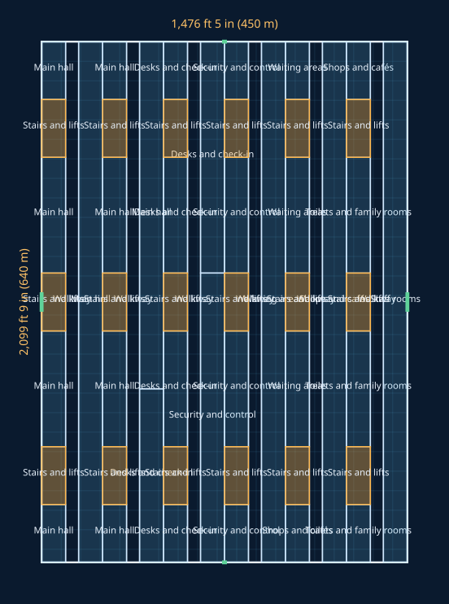
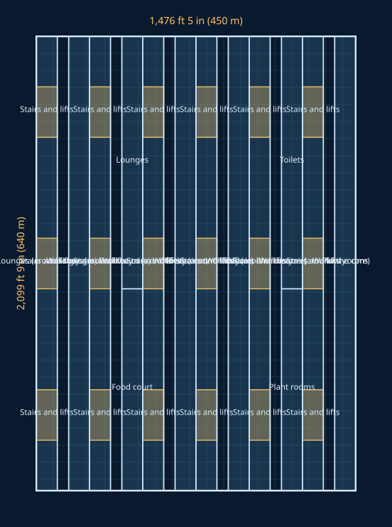

# P6-01 Greeters' Hall: plan

Footprint 1,476 ft 5 in (450 m) × 2,099 ft 9 in (640 m) · structural grid 32 ft 10 in (10 m)

## Levels

| Level | Floor above deck | Height | Floor area |
|---|---|---|---|
| Level 1 · Hall floor | 0 ft (0 mm) | 23 ft (7,000 mm) | 1,411,795 sq ft (131,160 m²) |
| Level 2 · Gallery | 23 ft (7,000 mm) | 19 ft 8 in (6,000 mm) | 1,411,795 sq ft (131,160 m²) |
| Level 3 · Hall upper | 42 ft 8 in (13 m) | 26 ft 3 in (8,000 mm) | 1,194,794 sq ft (111,000 m²) |

## Elements

| ID | Designation | Type | Name | Level(s) | Size / length | Area | Status |
|---|---|---|---|---|---|---|---|
| E001 | D5F3P6B1A1L1R1 | zone | Arrivals canopy | L1 | 1,213 ft 11 in (370 m) × 262 ft 6 in (80 m) | 318,612 sq ft (29,600 m²) | proposed |
| E002 | D5F3P6B1A1L1R2, D5F3P6B1A1L2R1, D5F3P6B1A1L3R1 | room | Greeting hall (meeting point under the light roof) | L1, L2, L3 | 1,213 ft 11 in (370 m) × 984 ft 3 in (300 m) | 1,194,794 sq ft (111,000 m²) | proposed |
| E003 | D5F3P6B1A1L1R3, D5F3P6B1A1L2R2 | core | Stairs and lifts | L1, L2 | 32 ft 10 in (10 m) × 91 ft 10 in (28 m) | 3,014 sq ft (280 m²) | proposed |
| E004 | D5F3P6B1A1L1R4, D5F3P6B1A1L2R3 | core | Stairs and lifts | L1, L2 | 32 ft 10 in (10 m) × 91 ft 10 in (28 m) | 3,014 sq ft (280 m²) | proposed |
| E005 | D5F3P6B1A1L1R5 | zone | Corridor | L1 | 1,213 ft 11 in (370 m) × 13 ft 1 in (4,000 mm) | 15,931 sq ft (1,480 m²) | proposed |
| E006 | D5F3P6B1A1L1R6 | room | Welcome desks | L1 | 717 ft 10 in (219 m) × 91 ft 10 in (28 m) | 65,944 sq ft (6,126 m²) | proposed |
| E007 | D5F3P6B1A1L1R7 | room | Flower and gift shops | L1 | 71 ft 6 in (22 m) × 91 ft 10 in (28 m) | 6,570 sq ft (610 m²) | proposed |
| E008 | D5F3P6B1A1L1R8 | room | Flower and gift shops | L1 | 71 ft 10 in (22 m) × 91 ft 10 in (28 m) | 6,600 sq ft (613 m²) | proposed |
| E009 | D5F3P6B1A1L1R9 | room | Flower and gift shops | L1 | 71 ft 10 in (22 m) × 91 ft 10 in (28 m) | 6,600 sq ft (613 m²) | proposed |
| E010 | D5F3P6B1A1L1R10 | room | Flower and gift shops | L1 | 71 ft 6 in (22 m) × 91 ft 10 in (28 m) | 6,570 sq ft (610 m²) | proposed |
| E011 | D5F3P6B1A1L1R11 | room | Flower and gift shops | L1 | 71 ft 10 in (22 m) × 91 ft 10 in (28 m) | 6,600 sq ft (613 m²) | proposed |
| E012 | D5F3P6B1A1L1R12 | room | Flower and gift shops | L1 | 71 ft 10 in (22 m) × 91 ft 10 in (28 m) | 6,600 sq ft (613 m²) | proposed |
| E013 | D5F3P6B1A1L1R13 | room | Flower and gift shops | L1 | 23 ft 4 in (7,100 mm) × 91 ft 10 in (28 m) | 2,140 sq ft (199 m²) | proposed |
| E014 | D5F3P6B1A1L1R14 | room | Flower and gift shops | L1 | 23 ft 7 in (7,200 mm) × 91 ft 10 in (28 m) | 2,170 sq ft (202 m²) | proposed |
| E015 | D5F3P6B1A1L1R15 | room | Cafés | L1 | 58 ft 5 in (18 m) × 91 ft 10 in (28 m) | 5,365 sq ft (498 m²) | proposed |
| E016 | D5F3P6B1A1L1R16 | room | Cafés | L1 | 58 ft 9 in (18 m) × 91 ft 10 in (28 m) | 5,395 sq ft (501 m²) | proposed |
| E017 | D5F3P6B1A1L1R17 | room | Cafés | L1 | 58 ft 9 in (18 m) × 91 ft 10 in (28 m) | 5,395 sq ft (501 m²) | proposed |
| E018 | D5F3P6B1A1L1R18 | room | Cafés | L1 | 58 ft 5 in (18 m) × 91 ft 10 in (28 m) | 5,365 sq ft (498 m²) | proposed |
| E019 | D5F3P6B1A1L1R19 | room | Lost and found | L1 | 70 ft 3 in (21 m) × 91 ft 10 in (28 m) | 6,450 sq ft (599 m²) | proposed |
| E020 | D5F3P6B1A1L1R20 | room | Family room | L1 | 46 ft 11 in (14 m) × 91 ft 10 in (28 m) | 4,310 sq ft (400 m²) | proposed |
| E021 | D5F3P6B1A1L1R21 | room | Toilets | L1 | 815 ft 7 in (249 m) × 91 ft 10 in (28 m) | 74,925 sq ft (6,961 m²) | proposed |
| E022 | D5F3P6B1A1L2R4 | zone | Corridor | L2 | 1,213 ft 11 in (370 m) × 13 ft 1 in (4,000 mm) | 15,931 sq ft (1,480 m²) | proposed |
| E023 | D5F3P6B1A1L2R5 | room | Gallery lounge | L2 | 1,148 ft 4 in (350 m) × 91 ft 10 in (28 m) | 105,486 sq ft (9,800 m²) | proposed |
| E024 | D5F3P6B1A1L2R6 | room | Guide office | L2 | 93 ft 10 in (29 m) × 91 ft 10 in (28 m) | 8,620 sq ft (801 m²) | proposed |
| E025 | D5F3P6B1A1L2R7 | room | Offices | L2 | 1,120 ft 1 in (341 m) × 91 ft 10 in (28 m) | 102,894 sq ft (9,559 m²) | proposed |
| E026 | D5F3P6B1A1L1R22 | zone | Waiting garden | L1 | 1,213 ft 11 in (370 m) × 459 ft 4 in (140 m) | 557,571 sq ft (51,800 m²) | proposed |
| E027 |  | door | Arrivals doors | L1 | 295 ft 3 in (90 m), 295 ft 3 in (90 m) wide | — | proposed |

## Drawings

### Level 1 · Hall floor

### Level 2 · Gallery

### Level 3 · Hall upper

