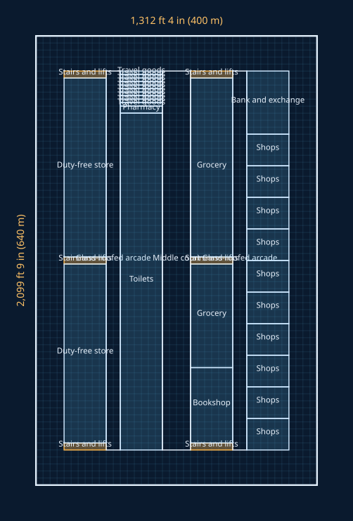
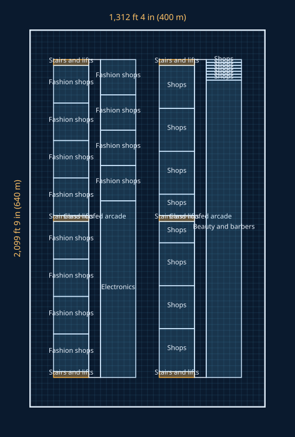
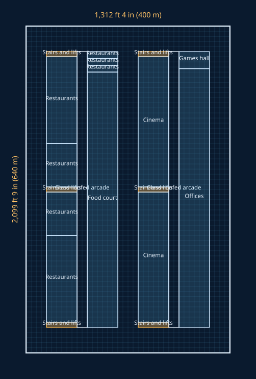

# P6-02 Shop Arcade: plan

Footprint 1,312 ft 4 in (400 m) × 2,099 ft 9 in (640 m) · structural grid 32 ft 10 in (10 m)

## Levels

| Level | Floor above deck | Height | Floor area |
|---|---|---|---|
| Level 1 · Ground floor | 0 ft (0 mm) | 18 ft 1 in (5,500 mm) | 1,356,253 sq ft (126,000 m²) |
| Level 2 · Level 2 | 18 ft 1 in (5,500 mm) | 16 ft 5 in (5,000 mm) | 1,356,253 sq ft (126,000 m²) |
| Level 3 · Level 3 | 34 ft 5 in (10 m) | 16 ft 5 in (5,000 mm) | 1,356,253 sq ft (126,000 m²) |

## Elements

| ID | Designation | Type | Name | Level(s) | Size / length | Area | Status |
|---|---|---|---|---|---|---|---|
| E001 | D5F3P6B1A2L1R1, D5F3P6B1A2L2R1, D5F3P6B1A2L3R1 | core | Stairs and lifts | L1, L2, L3 | 196 ft 10 in (60 m) × 32 ft 10 in (10 m) | 6,458 sq ft (600 m²) | proposed |
| E002 | D5F3P6B1A2L1R2, D5F3P6B1A2L2R2, D5F3P6B1A2L3R2 | core | Stairs and lifts | L1, L2, L3 | 196 ft 10 in (60 m) × 32 ft 10 in (10 m) | 6,458 sq ft (600 m²) | proposed |
| E003 | D5F3P6B1A2L1R3, D5F3P6B1A2L2R3, D5F3P6B1A2L3R3 | core | Stairs and lifts | L1, L2, L3 | 196 ft 10 in (60 m) × 32 ft 10 in (10 m) | 6,458 sq ft (600 m²) | proposed |
| E004 | D5F3P6B1A2L1R4 | zone | Glass-roofed arcade | L1 | 65 ft 7 in (20 m) × 1,771 ft 8 in (540 m) | 116,250 sq ft (10,800 m²) | proposed |
| E005 | D5F3P6B1A2L1R5 | room | Duty-free store | L1 | 196 ft 10 in (60 m) × 836 ft 7 in (255 m) | 164,688 sq ft (15,300 m²) | proposed |
| E006 | D5F3P6B1A2L1R6 | room | Duty-free store | L1 | 196 ft 10 in (60 m) × 836 ft 7 in (255 m) | 164,688 sq ft (15,300 m²) | proposed |
| E007 | D5F3P6B1A2L1R7 | room | Travel goods | L1 | 196 ft 10 in (60 m) × 16 ft 5 in (5,000 mm) | 3,229 sq ft (300 m²) | proposed |
| E008 | D5F3P6B1A2L1R8 | room | Travel goods | L1 | 196 ft 10 in (60 m) × 16 ft 5 in (5,000 mm) | 3,229 sq ft (300 m²) | proposed |
| E009 | D5F3P6B1A2L1R9 | room | Travel goods | L1 | 196 ft 10 in (60 m) × 16 ft 5 in (5,000 mm) | 3,229 sq ft (300 m²) | proposed |
| E010 | D5F3P6B1A2L1R10 | room | Travel goods | L1 | 196 ft 10 in (60 m) × 16 ft 5 in (5,000 mm) | 3,229 sq ft (300 m²) | proposed |
| E011 | D5F3P6B1A2L1R11 | room | Travel goods | L1 | 196 ft 10 in (60 m) × 16 ft 5 in (5,000 mm) | 3,229 sq ft (300 m²) | proposed |
| E012 | D5F3P6B1A2L1R12 | room | Travel goods | L1 | 196 ft 10 in (60 m) × 16 ft 5 in (5,000 mm) | 3,229 sq ft (300 m²) | proposed |
| E013 | D5F3P6B1A2L1R13 | room | Travel goods | L1 | 196 ft 10 in (60 m) × 16 ft 5 in (5,000 mm) | 3,229 sq ft (300 m²) | proposed |
| E014 | D5F3P6B1A2L1R14 | room | Travel goods | L1 | 196 ft 10 in (60 m) × 16 ft 5 in (5,000 mm) | 3,229 sq ft (300 m²) | proposed |
| E015 | D5F3P6B1A2L1R15 | room | Travel goods | L1 | 196 ft 10 in (60 m) × 16 ft 5 in (5,000 mm) | 3,229 sq ft (300 m²) | proposed |
| E016 | D5F3P6B1A2L1R16 | room | Travel goods | L1 | 196 ft 10 in (60 m) × 16 ft 5 in (5,000 mm) | 3,229 sq ft (300 m²) | proposed |
| E017 | D5F3P6B1A2L1R17 | room | Pharmacy | L1 | 196 ft 10 in (60 m) × 32 ft 10 in (10 m) | 6,458 sq ft (600 m²) | proposed |
| E018 | D5F3P6B1A2L1R18 | room | Toilets | L1 | 196 ft 10 in (60 m) × 1,574 ft 10 in (480 m) | 310,001 sq ft (28,800 m²) | proposed |
| E019 | D5F3P6B1A2L2R4 | zone | Glass-roofed arcade | L2 | 65 ft 7 in (20 m) × 1,771 ft 8 in (540 m) | 116,250 sq ft (10,800 m²) | proposed |
| E020 | D5F3P6B1A2L2R5 | room | Fashion shops | L2 | 196 ft 10 in (60 m) × 209 ft 4 in (64 m) | 41,204 sq ft (3,828 m²) | proposed |
| E021 | D5F3P6B1A2L2R6 | room | Fashion shops | L2 | 196 ft 10 in (60 m) × 209 ft (64 m) | 41,140 sq ft (3,822 m²) | proposed |
| E022 | D5F3P6B1A2L2R7 | room | Fashion shops | L2 | 196 ft 10 in (60 m) × 209 ft (64 m) | 41,140 sq ft (3,822 m²) | proposed |
| E023 | D5F3P6B1A2L2R8 | room | Fashion shops | L2 | 196 ft 10 in (60 m) × 209 ft 4 in (64 m) | 41,204 sq ft (3,828 m²) | proposed |
| E024 | D5F3P6B1A2L2R9 | room | Fashion shops | L2 | 196 ft 10 in (60 m) × 209 ft 4 in (64 m) | 41,204 sq ft (3,828 m²) | proposed |
| E025 | D5F3P6B1A2L2R10 | room | Fashion shops | L2 | 196 ft 10 in (60 m) × 209 ft (64 m) | 41,140 sq ft (3,822 m²) | proposed |
| E026 | D5F3P6B1A2L2R11 | room | Fashion shops | L2 | 196 ft 10 in (60 m) × 209 ft (64 m) | 41,140 sq ft (3,822 m²) | proposed |
| E027 | D5F3P6B1A2L2R12 | room | Fashion shops | L2 | 196 ft 10 in (60 m) × 209 ft 4 in (64 m) | 41,204 sq ft (3,828 m²) | proposed |
| E028 | D5F3P6B1A2L2R13 | room | Fashion shops | L2 | 196 ft 10 in (60 m) × 196 ft 10 in (60 m) | 38,750 sq ft (3,600 m²) | proposed |
| E029 | D5F3P6B1A2L2R14 | room | Fashion shops | L2 | 196 ft 10 in (60 m) × 196 ft 10 in (60 m) | 38,750 sq ft (3,600 m²) | proposed |
| E030 | D5F3P6B1A2L2R15 | room | Fashion shops | L2 | 196 ft 10 in (60 m) × 196 ft 10 in (60 m) | 38,750 sq ft (3,600 m²) | proposed |
| E031 | D5F3P6B1A2L2R16 | room | Fashion shops | L2 | 196 ft 10 in (60 m) × 196 ft 10 in (60 m) | 38,750 sq ft (3,600 m²) | proposed |
| E032 | D5F3P6B1A2L2R17 | room | Electronics | L2 | 196 ft 10 in (60 m) × 984 ft 3 in (300 m) | 193,750 sq ft (18,000 m²) | proposed |
| E033 | D5F3P6B1A2L3R4 | zone | Glass-roofed arcade | L3 | 65 ft 7 in (20 m) × 1,771 ft 8 in (540 m) | 116,250 sq ft (10,800 m²) | proposed |
| E034 | D5F3P6B1A2L3R5 | room | Restaurants | L3 | 196 ft 10 in (60 m) × 557 ft 9 in (170 m) | 109,792 sq ft (10,200 m²) | proposed |
| E035 | D5F3P6B1A2L3R6 | room | Restaurants | L3 | 196 ft 10 in (60 m) × 278 ft 10 in (85 m) | 54,896 sq ft (5,100 m²) | proposed |
| E036 | D5F3P6B1A2L3R7 | room | Restaurants | L3 | 196 ft 10 in (60 m) × 278 ft 10 in (85 m) | 54,896 sq ft (5,100 m²) | proposed |
| E037 | D5F3P6B1A2L3R8 | room | Restaurants | L3 | 196 ft 10 in (60 m) × 557 ft 9 in (170 m) | 109,792 sq ft (10,200 m²) | proposed |
| E038 | D5F3P6B1A2L3R9 | room | Restaurants | L3 | 196 ft 10 in (60 m) × 43 ft 8 in (13 m) | 8,590 sq ft (798 m²) | proposed |
| E039 | D5F3P6B1A2L3R10 | room | Restaurants | L3 | 196 ft 10 in (60 m) × 44 ft (13 m) | 8,654 sq ft (804 m²) | proposed |
| E040 | D5F3P6B1A2L3R11 | room | Restaurants | L3 | 196 ft 10 in (60 m) × 43 ft 8 in (13 m) | 8,590 sq ft (798 m²) | proposed |
| E041 | D5F3P6B1A2L3R12 | room | Food court | L3 | 196 ft 10 in (60 m) × 1,640 ft 5 in (500 m) | 322,917 sq ft (30,000 m²) | proposed |
| E042 | D5F3P6B1A2L1R19, D5F3P6B1A2L2R18, D5F3P6B1A2L3R13 | core | Stairs and lifts | L1, L2, L3 | 196 ft 10 in (60 m) × 32 ft 10 in (10 m) | 6,458 sq ft (600 m²) | proposed |
| E043 | D5F3P6B1A2L1R20, D5F3P6B1A2L2R19, D5F3P6B1A2L3R14 | core | Stairs and lifts | L1, L2, L3 | 196 ft 10 in (60 m) × 32 ft 10 in (10 m) | 6,458 sq ft (600 m²) | proposed |
| E044 | D5F3P6B1A2L1R21, D5F3P6B1A2L2R20, D5F3P6B1A2L3R15 | core | Stairs and lifts | L1, L2, L3 | 196 ft 10 in (60 m) × 32 ft 10 in (10 m) | 6,458 sq ft (600 m²) | proposed |
| E045 | D5F3P6B1A2L1R22 | zone | Glass-roofed arcade | L1 | 65 ft 7 in (20 m) × 1,771 ft 8 in (540 m) | 116,250 sq ft (10,800 m²) | proposed |
| E046 | D5F3P6B1A2L1R23 | room | Grocery | L1 | 196 ft 10 in (60 m) × 836 ft 7 in (255 m) | 164,688 sq ft (15,300 m²) | proposed |
| E047 | D5F3P6B1A2L1R24 | room | Grocery | L1 | 196 ft 10 in (60 m) × 484 ft 3 in (148 m) | 95,325 sq ft (8,856 m²) | proposed |
| E048 | D5F3P6B1A2L1R25 | room | Bookshop | L1 | 196 ft 10 in (60 m) × 352 ft 4 in (107 m) | 69,363 sq ft (6,444 m²) | proposed |
| E049 | D5F3P6B1A2L1R26 | room | Bank and exchange | L1 | 196 ft 10 in (60 m) × 295 ft 3 in (90 m) | 58,125 sq ft (5,400 m²) | proposed |
| E050 | D5F3P6B1A2L1R27 | room | Shops | L1 | 196 ft 10 in (60 m) × 147 ft 8 in (45 m) | 29,063 sq ft (2,700 m²) | proposed |
| E051 | D5F3P6B1A2L1R28 | room | Shops | L1 | 196 ft 10 in (60 m) × 147 ft 8 in (45 m) | 29,063 sq ft (2,700 m²) | proposed |
| E052 | D5F3P6B1A2L1R29 | room | Shops | L1 | 196 ft 10 in (60 m) × 147 ft 8 in (45 m) | 29,063 sq ft (2,700 m²) | proposed |
| E053 | D5F3P6B1A2L1R30 | room | Shops | L1 | 196 ft 10 in (60 m) × 147 ft 8 in (45 m) | 29,063 sq ft (2,700 m²) | proposed |
| E054 | D5F3P6B1A2L1R31 | room | Shops | L1 | 196 ft 10 in (60 m) × 147 ft 8 in (45 m) | 29,063 sq ft (2,700 m²) | proposed |
| E055 | D5F3P6B1A2L1R32 | room | Shops | L1 | 196 ft 10 in (60 m) × 147 ft 8 in (45 m) | 29,063 sq ft (2,700 m²) | proposed |
| E056 | D5F3P6B1A2L1R33 | room | Shops | L1 | 196 ft 10 in (60 m) × 147 ft 8 in (45 m) | 29,063 sq ft (2,700 m²) | proposed |
| E057 | D5F3P6B1A2L1R34 | room | Shops | L1 | 196 ft 10 in (60 m) × 147 ft 8 in (45 m) | 29,063 sq ft (2,700 m²) | proposed |
| E058 | D5F3P6B1A2L1R35 | room | Shops | L1 | 196 ft 10 in (60 m) × 147 ft 8 in (45 m) | 29,063 sq ft (2,700 m²) | proposed |
| E059 | D5F3P6B1A2L1R36 | room | Shops | L1 | 196 ft 10 in (60 m) × 147 ft 8 in (45 m) | 29,063 sq ft (2,700 m²) | proposed |
| E060 | D5F3P6B1A2L2R21 | zone | Glass-roofed arcade | L2 | 65 ft 7 in (20 m) × 1,771 ft 8 in (540 m) | 116,250 sq ft (10,800 m²) | proposed |
| E061 | D5F3P6B1A2L2R22 | room | Shops | L2 | 196 ft 10 in (60 m) × 239 ft 2 in (73 m) | 47,081 sq ft (4,374 m²) | proposed |
| E062 | D5F3P6B1A2L2R23 | room | Shops | L2 | 196 ft 10 in (60 m) × 238 ft 10 in (73 m) | 47,017 sq ft (4,368 m²) | proposed |
| E063 | D5F3P6B1A2L2R24 | room | Shops | L2 | 196 ft 10 in (60 m) × 239 ft 2 in (73 m) | 47,081 sq ft (4,374 m²) | proposed |
| E064 | D5F3P6B1A2L2R25 | room | Shops | L2 | 196 ft 10 in (60 m) × 119 ft 5 in (36 m) | 23,508 sq ft (2,184 m²) | proposed |
| E065 | D5F3P6B1A2L2R26 | room | Shops | L2 | 196 ft 10 in (60 m) × 119 ft 5 in (36 m) | 23,508 sq ft (2,184 m²) | proposed |
| E066 | D5F3P6B1A2L2R27 | room | Shops | L2 | 196 ft 10 in (60 m) × 239 ft 2 in (73 m) | 47,081 sq ft (4,374 m²) | proposed |
| E067 | D5F3P6B1A2L2R28 | room | Shops | L2 | 196 ft 10 in (60 m) × 238 ft 10 in (73 m) | 47,017 sq ft (4,368 m²) | proposed |
| E068 | D5F3P6B1A2L2R29 | room | Shops | L2 | 196 ft 10 in (60 m) × 239 ft 2 in (73 m) | 47,081 sq ft (4,374 m²) | proposed |
| E069 | D5F3P6B1A2L2R30 | room | Shops | L2 | 196 ft 10 in (60 m) × 16 ft 5 in (5,000 mm) | 3,229 sq ft (300 m²) | proposed |
| E070 | D5F3P6B1A2L2R31 | room | Shops | L2 | 196 ft 10 in (60 m) × 16 ft 5 in (5,000 mm) | 3,229 sq ft (300 m²) | proposed |
| E071 | D5F3P6B1A2L2R32 | room | Shops | L2 | 196 ft 10 in (60 m) × 16 ft 5 in (5,000 mm) | 3,229 sq ft (300 m²) | proposed |
| E072 | D5F3P6B1A2L2R33 | room | Shops | L2 | 196 ft 10 in (60 m) × 16 ft 5 in (5,000 mm) | 3,229 sq ft (300 m²) | proposed |
| E073 | D5F3P6B1A2L2R34 | room | Shops | L2 | 196 ft 10 in (60 m) × 16 ft 5 in (5,000 mm) | 3,229 sq ft (300 m²) | proposed |
| E074 | D5F3P6B1A2L2R35 | room | Shops | L2 | 196 ft 10 in (60 m) × 16 ft 5 in (5,000 mm) | 3,229 sq ft (300 m²) | proposed |
| E075 | D5F3P6B1A2L2R36 | room | Shops | L2 | 196 ft 10 in (60 m) × 16 ft 5 in (5,000 mm) | 3,229 sq ft (300 m²) | proposed |
| E076 | D5F3P6B1A2L2R37 | room | Beauty and barbers | L2 | 196 ft 10 in (60 m) × 1,656 ft 10 in (505 m) | 326,147 sq ft (30,300 m²) | proposed |
| E077 | D5F3P6B1A2L3R16 | zone | Glass-roofed arcade | L3 | 65 ft 7 in (20 m) × 1,771 ft 8 in (540 m) | 116,250 sq ft (10,800 m²) | proposed |
| E078 | D5F3P6B1A2L3R17 | room | Cinema | L3 | 196 ft 10 in (60 m) × 836 ft 7 in (255 m) | 164,688 sq ft (15,300 m²) | proposed |
| E079 | D5F3P6B1A2L3R18 | room | Cinema | L3 | 196 ft 10 in (60 m) × 836 ft 7 in (255 m) | 164,688 sq ft (15,300 m²) | proposed |
| E080 | D5F3P6B1A2L3R19 | room | Games hall | L3 | 196 ft 10 in (60 m) × 109 ft 3 in (33 m) | 21,506 sq ft (1,998 m²) | proposed |
| E081 | D5F3P6B1A2L3R20 | room | Offices | L3 | 196 ft 10 in (60 m) × 1,662 ft 5 in (507 m) | 327,244 sq ft (30,402 m²) | proposed |
| E082 | D5F3P6B1A2L1R37 | zone | Middle court | L1 | 131 ft 3 in (40 m) × 1,771 ft 8 in (540 m) | 232,500 sq ft (21,600 m²) | proposed |

## Drawings

### Level 1 · Ground floor

### Level 2 · Level 2

### Level 3 · Level 3

