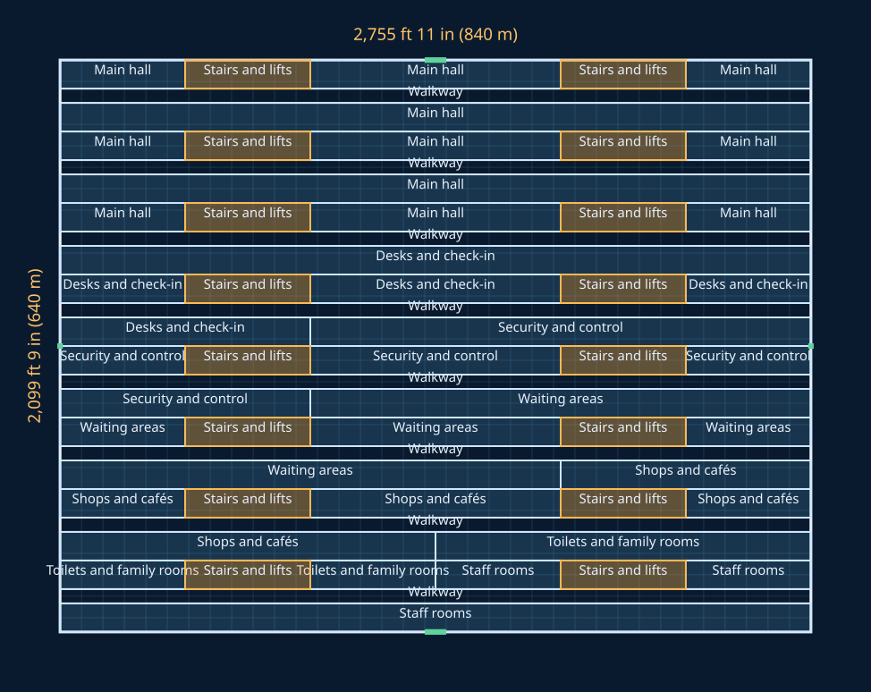
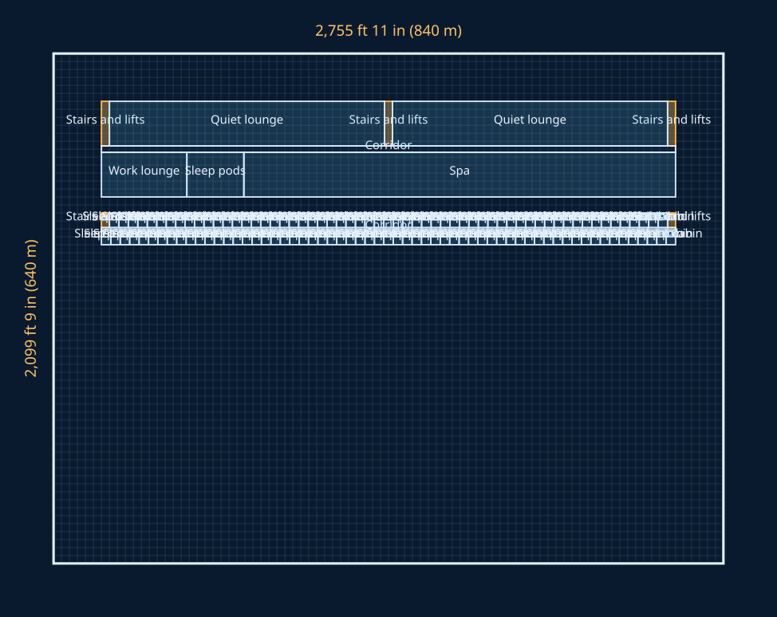
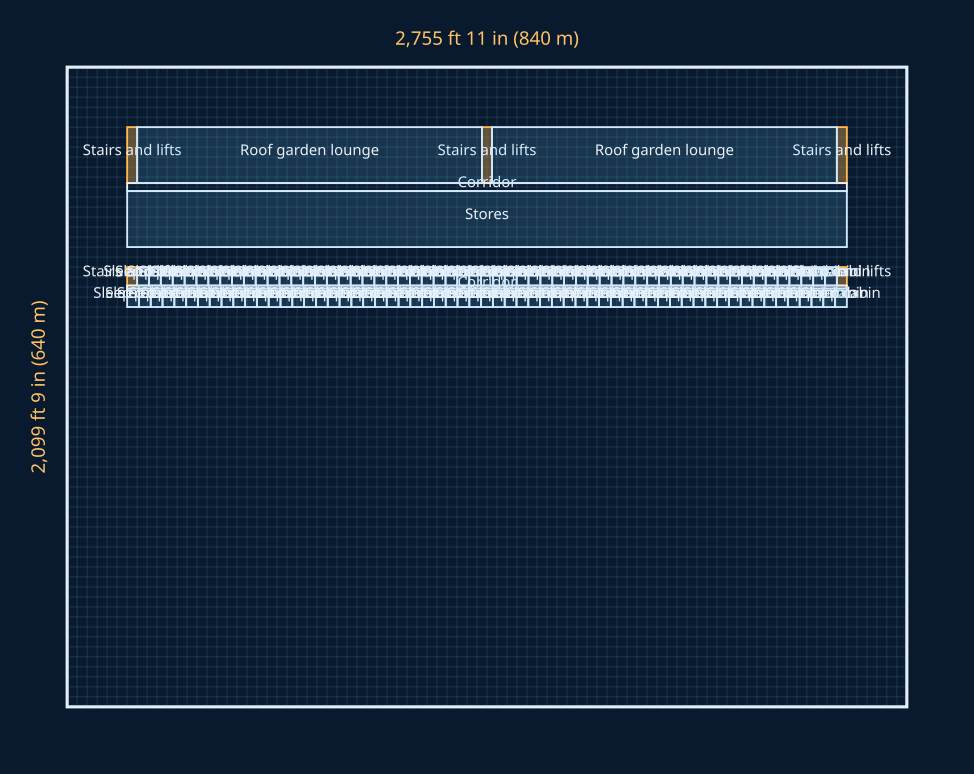

# P6-03 Transit Lounges: plan

Footprint 2,755 ft 11 in (840 m) × 2,099 ft 9 in (640 m) · structural grid 32 ft 10 in (10 m)

## Levels

| Level | Floor above deck | Height | Floor area |
|---|---|---|---|
| Level 1 · Ground floor | 0 ft (0 mm) | 16 ft 5 in (5,000 mm) | 1,132,686 sq ft (105,230 m²) |
| Level 2 · Level 2 | 16 ft 5 in (5,000 mm) | 13 ft 1 in (4,000 mm) | 1,132,686 sq ft (105,230 m²) |
| Level 3 · Level 3 | 29 ft 6 in (9,000 mm) | 13 ft 1 in (4,000 mm) | 1,132,686 sq ft (105,230 m²) |

## Elements

| ID | Designation | Type | Name | Level(s) | Size / length | Area | Status |
|---|---|---|---|---|---|---|---|
| E001 | D5F3P6B3A1L1R1, D5F3P6B3A1L2R1, D5F3P6B3A1L3R1 | core | Stairs and lifts | L1, L2, L3 | 32 ft 10 in (10 m) × 183 ft 9 in (56 m) | 6,028 sq ft (560 m²) | proposed |
| E002 | D5F3P6B3A1L1R2, D5F3P6B3A1L2R2, D5F3P6B3A1L3R2 | core | Stairs and lifts | L1, L2, L3 | 32 ft 10 in (10 m) × 183 ft 9 in (56 m) | 6,028 sq ft (560 m²) | proposed |
| E003 | D5F3P6B3A1L1R3, D5F3P6B3A1L2R3, D5F3P6B3A1L3R3 | core | Stairs and lifts | L1, L2, L3 | 32 ft 10 in (10 m) × 183 ft 9 in (56 m) | 6,028 sq ft (560 m²) | proposed |
| E004 | D5F3P6B3A1L1R4 | zone | Corridor | L1 | 2,362 ft 2 in (720 m) × 26 ft 3 in (8,000 mm) | 62,000 sq ft (5,760 m²) | proposed |
| E005 | D5F3P6B3A1L1R5 | room | Main transit lounge | L1 | 1,131 ft 11 in (345 m) × 183 ft 9 in (56 m) | 207,959 sq ft (19,320 m²) | proposed |
| E006 | D5F3P6B3A1L1R6 | room | Main transit lounge | L1 | 1,131 ft 11 in (345 m) × 183 ft 9 in (56 m) | 207,959 sq ft (19,320 m²) | proposed |
| E007 | D5F3P6B3A1L1R7 | room | Showers | L1 | 87 ft 11 in (27 m) × 183 ft 9 in (56 m) | 16,154 sq ft (1,501 m²) | proposed |
| E008 | D5F3P6B3A1L1R8 | room | Family lounge | L1 | 234 ft 3 in (71 m) × 183 ft 9 in (56 m) | 43,038 sq ft (3,998 m²) | proposed |
| E009 | D5F3P6B3A1L1R9 | room | Prayer rooms | L1 | 8 ft 10 in (2,700 mm) × 183 ft 9 in (56 m) | 1,628 sq ft (151 m²) | proposed |
| E010 | D5F3P6B3A1L1R10 | room | Prayer rooms | L1 | 8 ft 10 in (2,700 mm) × 183 ft 9 in (56 m) | 1,628 sq ft (151 m²) | proposed |
| E011 | D5F3P6B3A1L1R11 | room | Prayer rooms | L1 | 8 ft 10 in (2,700 mm) × 183 ft 9 in (56 m) | 1,628 sq ft (151 m²) | proposed |
| E012 | D5F3P6B3A1L1R12 | room | Prayer rooms | L1 | 8 ft 6 in (2,600 mm) × 183 ft 9 in (56 m) | 1,567 sq ft (146 m²) | proposed |
| E013 | D5F3P6B3A1L1R13 | room | Cafés | L1 | 35 ft 1 in (11 m) × 183 ft 9 in (56 m) | 6,450 sq ft (599 m²) | proposed |
| E014 | D5F3P6B3A1L1R14 | room | Cafés | L1 | 35 ft 5 in (11 m) × 183 ft 9 in (56 m) | 6,510 sq ft (605 m²) | proposed |
| E015 | D5F3P6B3A1L1R15 | room | Cafés | L1 | 35 ft 1 in (11 m) × 183 ft 9 in (56 m) | 6,450 sq ft (599 m²) | proposed |
| E016 | D5F3P6B3A1L1R16 | room | Cafés | L1 | 35 ft 1 in (11 m) × 183 ft 9 in (56 m) | 6,450 sq ft (599 m²) | proposed |
| E017 | D5F3P6B3A1L1R17 | room | Cafés | L1 | 35 ft 1 in (11 m) × 183 ft 9 in (56 m) | 6,450 sq ft (599 m²) | proposed |
| E018 | D5F3P6B3A1L1R18 | room | Cafés | L1 | 35 ft 1 in (11 m) × 183 ft 9 in (56 m) | 6,450 sq ft (599 m²) | proposed |
| E019 | D5F3P6B3A1L1R19 | room | Toilets | L1 | 1,794 ft (547 m) × 183 ft 9 in (56 m) | 329,600 sq ft (30,621 m²) | proposed |
| E020 | D5F3P6B3A1L2R4 | zone | Corridor | L2 | 2,362 ft 2 in (720 m) × 26 ft 3 in (8,000 mm) | 62,000 sq ft (5,760 m²) | proposed |
| E021 | D5F3P6B3A1L2R5 | room | Quiet lounge | L2 | 1,131 ft 11 in (345 m) × 183 ft 9 in (56 m) | 207,959 sq ft (19,320 m²) | proposed |
| E022 | D5F3P6B3A1L2R6 | room | Quiet lounge | L2 | 1,131 ft 11 in (345 m) × 183 ft 9 in (56 m) | 207,959 sq ft (19,320 m²) | proposed |
| E023 | D5F3P6B3A1L2R7 | room | Work lounge | L2 | 351 ft 5 in (107 m) × 183 ft 9 in (56 m) | 64,558 sq ft (5,998 m²) | proposed |
| E024 | D5F3P6B3A1L2R8 | room | Sleep pods | L2 | 234 ft 7 in (72 m) × 183 ft 9 in (56 m) | 43,099 sq ft (4,004 m²) | proposed |
| E025 | D5F3P6B3A1L2R9 | room | Spa | L2 | 1,776 ft 3 in (541 m) × 183 ft 9 in (56 m) | 326,345 sq ft (30,318 m²) | proposed |
| E026 | D5F3P6B3A1L3R4 | zone | Corridor | L3 | 2,362 ft 2 in (720 m) × 26 ft 3 in (8,000 mm) | 62,000 sq ft (5,760 m²) | proposed |
| E027 | D5F3P6B3A1L3R5 | room | Roof garden lounge | L3 | 1,131 ft 11 in (345 m) × 183 ft 9 in (56 m) | 207,959 sq ft (19,320 m²) | proposed |
| E028 | D5F3P6B3A1L3R6 | room | Roof garden lounge | L3 | 1,131 ft 11 in (345 m) × 183 ft 9 in (56 m) | 207,959 sq ft (19,320 m²) | proposed |
| E029 | D5F3P6B3A1L3R7 | room | Stores | L3 | 2,362 ft 2 in (720 m) × 183 ft 9 in (56 m) | 434,001 sq ft (40,320 m²) | proposed |
| E030 | D5F3P6B3A1L1R20, D5F3P6B3A1L2R10, D5F3P6B3A1L3R8 | core | Stairs and lifts | L1, L2, L3 | 32 ft 10 in (10 m) × 60 ft 8 in (18 m) | 1,991 sq ft (185 m²) | proposed |
| E031 | D5F3P6B3A1L1R21, D5F3P6B3A1L2R11, D5F3P6B3A1L3R9 | core | Stairs and lifts | L1, L2, L3 | 32 ft 10 in (10 m) × 60 ft 8 in (18 m) | 1,991 sq ft (185 m²) | proposed |
| E032 | D5F3P6B3A1L1R22, D5F3P6B3A1L2R12, D5F3P6B3A1L3R10 | zone | Corridor | L1, L2, L3 | 2,362 ft 2 in (720 m) × 9 ft 10 in (3,000 mm) | 23,250 sq ft (2,160 m²) | proposed |
| E033 | D5F3P6B3A1L1R23, D5F3P6B3A1L2R13, D5F3P6B3A1L3R11 | room | Sleep cabin | L1, L2, L3 | 39 ft 1 in (12 m) × 60 ft 8 in (18 m) | 2,370 sq ft (220 m²) | proposed |
| E034 | D5F3P6B3A1L1R24, D5F3P6B3A1L2R14, D5F3P6B3A1L3R12 | room | Sleep cabin | L1, L2, L3 | 38 ft 9 in (12 m) × 60 ft 8 in (18 m) | 2,350 sq ft (218 m²) | proposed |
| E035 | D5F3P6B3A1L1R25, D5F3P6B3A1L2R15, D5F3P6B3A1L3R13 | room | Sleep cabin | L1, L2, L3 | 39 ft 1 in (12 m) × 60 ft 8 in (18 m) | 2,370 sq ft (220 m²) | proposed |
| E036 | D5F3P6B3A1L1R26, D5F3P6B3A1L2R16, D5F3P6B3A1L3R14 | room | Sleep cabin | L1, L2, L3 | 39 ft 1 in (12 m) × 60 ft 8 in (18 m) | 2,370 sq ft (220 m²) | proposed |
| E037 | D5F3P6B3A1L1R27, D5F3P6B3A1L2R17, D5F3P6B3A1L3R15 | room | Sleep cabin | L1, L2, L3 | 38 ft 9 in (12 m) × 60 ft 8 in (18 m) | 2,350 sq ft (218 m²) | proposed |
| E038 | D5F3P6B3A1L1R28, D5F3P6B3A1L2R18, D5F3P6B3A1L3R16 | room | Sleep cabin | L1, L2, L3 | 39 ft 1 in (12 m) × 60 ft 8 in (18 m) | 2,370 sq ft (220 m²) | proposed |
| E039 | D5F3P6B3A1L1R29, D5F3P6B3A1L2R19, D5F3P6B3A1L3R17 | room | Sleep cabin | L1, L2, L3 | 39 ft 1 in (12 m) × 60 ft 8 in (18 m) | 2,370 sq ft (220 m²) | proposed |
| E040 | D5F3P6B3A1L1R30, D5F3P6B3A1L2R20, D5F3P6B3A1L3R18 | room | Sleep cabin | L1, L2, L3 | 38 ft 9 in (12 m) × 60 ft 8 in (18 m) | 2,350 sq ft (218 m²) | proposed |
| E041 | D5F3P6B3A1L1R31, D5F3P6B3A1L2R21, D5F3P6B3A1L3R19 | room | Sleep cabin | L1, L2, L3 | 39 ft 1 in (12 m) × 60 ft 8 in (18 m) | 2,370 sq ft (220 m²) | proposed |
| E042 | D5F3P6B3A1L1R32, D5F3P6B3A1L2R22, D5F3P6B3A1L3R20 | room | Sleep cabin | L1, L2, L3 | 38 ft 9 in (12 m) × 60 ft 8 in (18 m) | 2,350 sq ft (218 m²) | proposed |
| E043 | D5F3P6B3A1L1R33, D5F3P6B3A1L2R23, D5F3P6B3A1L3R21 | room | Sleep cabin | L1, L2, L3 | 39 ft 1 in (12 m) × 60 ft 8 in (18 m) | 2,370 sq ft (220 m²) | proposed |
| E044 | D5F3P6B3A1L1R34, D5F3P6B3A1L2R24, D5F3P6B3A1L3R22 | room | Sleep cabin | L1, L2, L3 | 39 ft 1 in (12 m) × 60 ft 8 in (18 m) | 2,370 sq ft (220 m²) | proposed |
| E045 | D5F3P6B3A1L1R35, D5F3P6B3A1L2R25, D5F3P6B3A1L3R23 | room | Sleep cabin | L1, L2, L3 | 38 ft 9 in (12 m) × 60 ft 8 in (18 m) | 2,350 sq ft (218 m²) | proposed |
| E046 | D5F3P6B3A1L1R36, D5F3P6B3A1L2R26, D5F3P6B3A1L3R24 | room | Sleep cabin | L1, L2, L3 | 39 ft 1 in (12 m) × 60 ft 8 in (18 m) | 2,370 sq ft (220 m²) | proposed |
| E047 | D5F3P6B3A1L1R37, D5F3P6B3A1L2R27, D5F3P6B3A1L3R25 | room | Sleep cabin | L1, L2, L3 | 39 ft 1 in (12 m) × 60 ft 8 in (18 m) | 2,370 sq ft (220 m²) | proposed |
| E048 | D5F3P6B3A1L1R38, D5F3P6B3A1L2R28, D5F3P6B3A1L3R26 | room | Sleep cabin | L1, L2, L3 | 38 ft 9 in (12 m) × 60 ft 8 in (18 m) | 2,350 sq ft (218 m²) | proposed |
| E049 | D5F3P6B3A1L1R39, D5F3P6B3A1L2R29, D5F3P6B3A1L3R27 | room | Sleep cabin | L1, L2, L3 | 39 ft 1 in (12 m) × 60 ft 8 in (18 m) | 2,370 sq ft (220 m²) | proposed |
| E050 | D5F3P6B3A1L1R40, D5F3P6B3A1L2R30, D5F3P6B3A1L3R28 | room | Sleep cabin | L1, L2, L3 | 39 ft 1 in (12 m) × 60 ft 8 in (18 m) | 2,370 sq ft (220 m²) | proposed |
| E051 | D5F3P6B3A1L1R41, D5F3P6B3A1L2R31, D5F3P6B3A1L3R29 | room | Sleep cabin | L1, L2, L3 | 38 ft 9 in (12 m) × 60 ft 8 in (18 m) | 2,350 sq ft (218 m²) | proposed |
| E052 | D5F3P6B3A1L1R42, D5F3P6B3A1L2R32, D5F3P6B3A1L3R30 | room | Sleep cabin | L1, L2, L3 | 39 ft 1 in (12 m) × 60 ft 8 in (18 m) | 2,370 sq ft (220 m²) | proposed |
| E053 | D5F3P6B3A1L1R43, D5F3P6B3A1L2R33, D5F3P6B3A1L3R31 | room | Sleep cabin | L1, L2, L3 | 39 ft 1 in (12 m) × 60 ft 8 in (18 m) | 2,370 sq ft (220 m²) | proposed |
| E054 | D5F3P6B3A1L1R44, D5F3P6B3A1L2R34, D5F3P6B3A1L3R32 | room | Sleep cabin | L1, L2, L3 | 38 ft 9 in (12 m) × 60 ft 8 in (18 m) | 2,350 sq ft (218 m²) | proposed |
| E055 | D5F3P6B3A1L1R45, D5F3P6B3A1L2R35, D5F3P6B3A1L3R33 | room | Sleep cabin | L1, L2, L3 | 39 ft 1 in (12 m) × 60 ft 8 in (18 m) | 2,370 sq ft (220 m²) | proposed |
| E056 | D5F3P6B3A1L1R46, D5F3P6B3A1L2R36, D5F3P6B3A1L3R34 | room | Sleep cabin | L1, L2, L3 | 38 ft 9 in (12 m) × 60 ft 8 in (18 m) | 2,350 sq ft (218 m²) | proposed |
| E057 | D5F3P6B3A1L1R47, D5F3P6B3A1L2R37, D5F3P6B3A1L3R35 | room | Sleep cabin | L1, L2, L3 | 39 ft 1 in (12 m) × 60 ft 8 in (18 m) | 2,370 sq ft (220 m²) | proposed |
| E058 | D5F3P6B3A1L1R48, D5F3P6B3A1L2R38, D5F3P6B3A1L3R36 | room | Sleep cabin | L1, L2, L3 | 39 ft 1 in (12 m) × 60 ft 8 in (18 m) | 2,370 sq ft (220 m²) | proposed |
| E059 | D5F3P6B3A1L1R49, D5F3P6B3A1L2R39, D5F3P6B3A1L3R37 | room | Sleep cabin | L1, L2, L3 | 38 ft 9 in (12 m) × 60 ft 8 in (18 m) | 2,350 sq ft (218 m²) | proposed |
| E060 | D5F3P6B3A1L1R50, D5F3P6B3A1L2R40, D5F3P6B3A1L3R38 | room | Sleep cabin | L1, L2, L3 | 39 ft 1 in (12 m) × 60 ft 8 in (18 m) | 2,370 sq ft (220 m²) | proposed |
| E061 | D5F3P6B3A1L1R51, D5F3P6B3A1L2R41, D5F3P6B3A1L3R39 | room | Sleep cabin | L1, L2, L3 | 39 ft 1 in (12 m) × 60 ft 8 in (18 m) | 2,370 sq ft (220 m²) | proposed |
| E062 | D5F3P6B3A1L1R52, D5F3P6B3A1L2R42, D5F3P6B3A1L3R40 | room | Sleep cabin | L1, L2, L3 | 38 ft 9 in (12 m) × 60 ft 8 in (18 m) | 2,350 sq ft (218 m²) | proposed |
| E063 | D5F3P6B3A1L1R53, D5F3P6B3A1L2R43, D5F3P6B3A1L3R41 | room | Sleep cabin | L1, L2, L3 | 39 ft 1 in (12 m) × 60 ft 8 in (18 m) | 2,370 sq ft (220 m²) | proposed |
| E064 | D5F3P6B3A1L1R54, D5F3P6B3A1L2R44, D5F3P6B3A1L3R42 | room | Sleep cabin | L1, L2, L3 | 39 ft 1 in (12 m) × 60 ft 8 in (18 m) | 2,370 sq ft (220 m²) | proposed |
| E065 | D5F3P6B3A1L1R55, D5F3P6B3A1L2R45, D5F3P6B3A1L3R43 | room | Sleep cabin | L1, L2, L3 | 38 ft 9 in (12 m) × 60 ft 8 in (18 m) | 2,350 sq ft (218 m²) | proposed |
| E066 | D5F3P6B3A1L1R56, D5F3P6B3A1L2R46, D5F3P6B3A1L3R44 | room | Sleep cabin | L1, L2, L3 | 39 ft 1 in (12 m) × 60 ft 8 in (18 m) | 2,370 sq ft (220 m²) | proposed |
| E067 | D5F3P6B3A1L1R57, D5F3P6B3A1L2R47, D5F3P6B3A1L3R45 | room | Sleep cabin | L1, L2, L3 | 39 ft 1 in (12 m) × 60 ft 8 in (18 m) | 2,370 sq ft (220 m²) | proposed |
| E068 | D5F3P6B3A1L1R58, D5F3P6B3A1L2R48, D5F3P6B3A1L3R46 | room | Sleep cabin | L1, L2, L3 | 38 ft 9 in (12 m) × 60 ft 8 in (18 m) | 2,350 sq ft (218 m²) | proposed |
| E069 | D5F3P6B3A1L1R59, D5F3P6B3A1L2R49, D5F3P6B3A1L3R47 | room | Sleep cabin | L1, L2, L3 | 39 ft 1 in (12 m) × 60 ft 8 in (18 m) | 2,370 sq ft (220 m²) | proposed |
| E070 | D5F3P6B3A1L1R60, D5F3P6B3A1L2R50, D5F3P6B3A1L3R48 | room | Sleep cabin | L1, L2, L3 | 38 ft 9 in (12 m) × 60 ft 8 in (18 m) | 2,350 sq ft (218 m²) | proposed |
| E071 | D5F3P6B3A1L1R61, D5F3P6B3A1L2R51, D5F3P6B3A1L3R49 | room | Sleep cabin | L1, L2, L3 | 39 ft 1 in (12 m) × 60 ft 8 in (18 m) | 2,370 sq ft (220 m²) | proposed |
| E072 | D5F3P6B3A1L1R62, D5F3P6B3A1L2R52, D5F3P6B3A1L3R50 | room | Sleep cabin | L1, L2, L3 | 39 ft 1 in (12 m) × 60 ft 8 in (18 m) | 2,370 sq ft (220 m²) | proposed |
| E073 | D5F3P6B3A1L1R63, D5F3P6B3A1L2R53, D5F3P6B3A1L3R51 | room | Sleep cabin | L1, L2, L3 | 38 ft 9 in (12 m) × 60 ft 8 in (18 m) | 2,350 sq ft (218 m²) | proposed |
| E074 | D5F3P6B3A1L1R64, D5F3P6B3A1L2R54, D5F3P6B3A1L3R52 | room | Sleep cabin | L1, L2, L3 | 39 ft 1 in (12 m) × 60 ft 8 in (18 m) | 2,370 sq ft (220 m²) | proposed |
| E075 | D5F3P6B3A1L1R65, D5F3P6B3A1L2R55, D5F3P6B3A1L3R53 | room | Sleep cabin | L1, L2, L3 | 39 ft 1 in (12 m) × 60 ft 8 in (18 m) | 2,370 sq ft (220 m²) | proposed |
| E076 | D5F3P6B3A1L1R66, D5F3P6B3A1L2R56, D5F3P6B3A1L3R54 | room | Sleep cabin | L1, L2, L3 | 38 ft 9 in (12 m) × 60 ft 8 in (18 m) | 2,350 sq ft (218 m²) | proposed |
| E077 | D5F3P6B3A1L1R67, D5F3P6B3A1L2R57, D5F3P6B3A1L3R55 | room | Sleep cabin | L1, L2, L3 | 39 ft 1 in (12 m) × 60 ft 8 in (18 m) | 2,370 sq ft (220 m²) | proposed |
| E078 | D5F3P6B3A1L1R68, D5F3P6B3A1L2R58, D5F3P6B3A1L3R56 | room | Sleep cabin | L1, L2, L3 | 39 ft 1 in (12 m) × 60 ft 8 in (18 m) | 2,370 sq ft (220 m²) | proposed |
| E079 | D5F3P6B3A1L1R69, D5F3P6B3A1L2R59, D5F3P6B3A1L3R57 | room | Sleep cabin | L1, L2, L3 | 38 ft 9 in (12 m) × 60 ft 8 in (18 m) | 2,350 sq ft (218 m²) | proposed |
| E080 | D5F3P6B3A1L1R70, D5F3P6B3A1L2R60, D5F3P6B3A1L3R58 | room | Sleep cabin | L1, L2, L3 | 39 ft 1 in (12 m) × 60 ft 8 in (18 m) | 2,370 sq ft (220 m²) | proposed |
| E081 | D5F3P6B3A1L1R71, D5F3P6B3A1L2R61, D5F3P6B3A1L3R59 | room | Sleep cabin | L1, L2, L3 | 39 ft 1 in (12 m) × 60 ft 8 in (18 m) | 2,370 sq ft (220 m²) | proposed |
| E082 | D5F3P6B3A1L1R72, D5F3P6B3A1L2R62, D5F3P6B3A1L3R60 | room | Sleep cabin | L1, L2, L3 | 38 ft 9 in (12 m) × 60 ft 8 in (18 m) | 2,350 sq ft (218 m²) | proposed |
| E083 | D5F3P6B3A1L1R73, D5F3P6B3A1L2R63, D5F3P6B3A1L3R61 | room | Sleep cabin | L1, L2, L3 | 39 ft 1 in (12 m) × 60 ft 8 in (18 m) | 2,370 sq ft (220 m²) | proposed |
| E084 | D5F3P6B3A1L1R74, D5F3P6B3A1L2R64, D5F3P6B3A1L3R62 | room | Sleep cabin | L1, L2, L3 | 38 ft 9 in (12 m) × 60 ft 8 in (18 m) | 2,350 sq ft (218 m²) | proposed |
| E085 | D5F3P6B3A1L1R75, D5F3P6B3A1L2R65, D5F3P6B3A1L3R63 | room | Sleep cabin | L1, L2, L3 | 39 ft 1 in (12 m) × 60 ft 8 in (18 m) | 2,370 sq ft (220 m²) | proposed |
| E086 | D5F3P6B3A1L1R76, D5F3P6B3A1L2R66, D5F3P6B3A1L3R64 | room | Sleep cabin | L1, L2, L3 | 39 ft 1 in (12 m) × 60 ft 8 in (18 m) | 2,370 sq ft (220 m²) | proposed |
| E087 | D5F3P6B3A1L1R77, D5F3P6B3A1L2R67, D5F3P6B3A1L3R65 | room | Sleep cabin | L1, L2, L3 | 38 ft 9 in (12 m) × 60 ft 8 in (18 m) | 2,350 sq ft (218 m²) | proposed |
| E088 | D5F3P6B3A1L1R78, D5F3P6B3A1L2R68, D5F3P6B3A1L3R66 | room | Sleep cabin | L1, L2, L3 | 39 ft 1 in (12 m) × 60 ft 8 in (18 m) | 2,370 sq ft (220 m²) | proposed |
| E089 | D5F3P6B3A1L1R79, D5F3P6B3A1L2R69, D5F3P6B3A1L3R67 | room | Sleep cabin | L1, L2, L3 | 39 ft 1 in (12 m) × 60 ft 8 in (18 m) | 2,370 sq ft (220 m²) | proposed |
| E090 | D5F3P6B3A1L1R80, D5F3P6B3A1L2R70, D5F3P6B3A1L3R68 | room | Sleep cabin | L1, L2, L3 | 38 ft 9 in (12 m) × 60 ft 8 in (18 m) | 2,350 sq ft (218 m²) | proposed |
| E091 | D5F3P6B3A1L1R81, D5F3P6B3A1L2R71, D5F3P6B3A1L3R69 | room | Sleep cabin | L1, L2, L3 | 39 ft 1 in (12 m) × 60 ft 8 in (18 m) | 2,370 sq ft (220 m²) | proposed |
| E092 | D5F3P6B3A1L1R82, D5F3P6B3A1L2R72, D5F3P6B3A1L3R70 | room | Sleep cabin | L1, L2, L3 | 38 ft 9 in (12 m) × 60 ft 8 in (18 m) | 2,350 sq ft (218 m²) | proposed |
| E093 | D5F3P6B3A1L1R83, D5F3P6B3A1L2R73, D5F3P6B3A1L3R71 | room | Sleep cabin | L1, L2, L3 | 38 ft 9 in (12 m) × 60 ft 8 in (18 m) | 2,350 sq ft (218 m²) | proposed |
| E094 | D5F3P6B3A1L1R84, D5F3P6B3A1L2R74, D5F3P6B3A1L3R72 | room | Sleep cabin | L1, L2, L3 | 38 ft 9 in (12 m) × 60 ft 8 in (18 m) | 2,350 sq ft (218 m²) | proposed |
| E095 | D5F3P6B3A1L1R85, D5F3P6B3A1L2R75, D5F3P6B3A1L3R73 | room | Sleep cabin | L1, L2, L3 | 38 ft 9 in (12 m) × 60 ft 8 in (18 m) | 2,350 sq ft (218 m²) | proposed |
| E096 | D5F3P6B3A1L1R86, D5F3P6B3A1L2R76, D5F3P6B3A1L3R74 | room | Sleep cabin | L1, L2, L3 | 38 ft 9 in (12 m) × 60 ft 8 in (18 m) | 2,350 sq ft (218 m²) | proposed |
| E097 | D5F3P6B3A1L1R87, D5F3P6B3A1L2R77, D5F3P6B3A1L3R75 | room | Sleep cabin | L1, L2, L3 | 38 ft 9 in (12 m) × 60 ft 8 in (18 m) | 2,350 sq ft (218 m²) | proposed |
| E098 | D5F3P6B3A1L1R88, D5F3P6B3A1L2R78, D5F3P6B3A1L3R76 | room | Sleep cabin | L1, L2, L3 | 38 ft 9 in (12 m) × 60 ft 8 in (18 m) | 2,350 sq ft (218 m²) | proposed |
| E099 | D5F3P6B3A1L1R89, D5F3P6B3A1L2R79, D5F3P6B3A1L3R77 | room | Sleep cabin | L1, L2, L3 | 38 ft 9 in (12 m) × 60 ft 8 in (18 m) | 2,350 sq ft (218 m²) | proposed |
| E100 | D5F3P6B3A1L1R90, D5F3P6B3A1L2R80, D5F3P6B3A1L3R78 | room | Sleep cabin | L1, L2, L3 | 38 ft 9 in (12 m) × 60 ft 8 in (18 m) | 2,350 sq ft (218 m²) | proposed |
| E101 | D5F3P6B3A1L1R91, D5F3P6B3A1L2R81, D5F3P6B3A1L3R79 | room | Sleep cabin | L1, L2, L3 | 38 ft 9 in (12 m) × 60 ft 8 in (18 m) | 2,350 sq ft (218 m²) | proposed |
| E102 | D5F3P6B3A1L1R92, D5F3P6B3A1L2R82, D5F3P6B3A1L3R80 | room | Sleep cabin | L1, L2, L3 | 38 ft 9 in (12 m) × 60 ft 8 in (18 m) | 2,350 sq ft (218 m²) | proposed |
| E103 | D5F3P6B3A1L1R93, D5F3P6B3A1L2R83, D5F3P6B3A1L3R81 | room | Sleep cabin | L1, L2, L3 | 38 ft 9 in (12 m) × 60 ft 8 in (18 m) | 2,350 sq ft (218 m²) | proposed |
| E104 | D5F3P6B3A1L1R94, D5F3P6B3A1L2R84, D5F3P6B3A1L3R82 | room | Sleep cabin | L1, L2, L3 | 38 ft 9 in (12 m) × 60 ft 8 in (18 m) | 2,350 sq ft (218 m²) | proposed |
| E105 | D5F3P6B3A1L1R95, D5F3P6B3A1L2R85, D5F3P6B3A1L3R83 | room | Sleep cabin | L1, L2, L3 | 38 ft 9 in (12 m) × 60 ft 8 in (18 m) | 2,350 sq ft (218 m²) | proposed |
| E106 | D5F3P6B3A1L1R96, D5F3P6B3A1L2R86, D5F3P6B3A1L3R84 | room | Sleep cabin | L1, L2, L3 | 38 ft 9 in (12 m) × 60 ft 8 in (18 m) | 2,350 sq ft (218 m²) | proposed |
| E107 | D5F3P6B3A1L1R97, D5F3P6B3A1L2R87, D5F3P6B3A1L3R85 | room | Sleep cabin | L1, L2, L3 | 39 ft 1 in (12 m) × 60 ft 8 in (18 m) | 2,370 sq ft (220 m²) | proposed |
| E108 | D5F3P6B3A1L1R98, D5F3P6B3A1L2R88, D5F3P6B3A1L3R86 | room | Sleep cabin | L1, L2, L3 | 38 ft 9 in (12 m) × 60 ft 8 in (18 m) | 2,350 sq ft (218 m²) | proposed |
| E109 | D5F3P6B3A1L1R99, D5F3P6B3A1L2R89, D5F3P6B3A1L3R87 | room | Sleep cabin | L1, L2, L3 | 38 ft 9 in (12 m) × 60 ft 8 in (18 m) | 2,350 sq ft (218 m²) | proposed |
| E110 | D5F3P6B3A1L1R100, D5F3P6B3A1L2R90, D5F3P6B3A1L3R88 | room | Sleep cabin | L1, L2, L3 | 38 ft 9 in (12 m) × 60 ft 8 in (18 m) | 2,350 sq ft (218 m²) | proposed |
| E111 | D5F3P6B3A1L1R101, D5F3P6B3A1L2R91, D5F3P6B3A1L3R89 | room | Sleep cabin | L1, L2, L3 | 38 ft 9 in (12 m) × 60 ft 8 in (18 m) | 2,350 sq ft (218 m²) | proposed |
| E112 | D5F3P6B3A1L1R102, D5F3P6B3A1L2R92, D5F3P6B3A1L3R90 | room | Sleep cabin | L1, L2, L3 | 38 ft 9 in (12 m) × 60 ft 8 in (18 m) | 2,350 sq ft (218 m²) | proposed |
| E113 | D5F3P6B3A1L1R103, D5F3P6B3A1L2R93, D5F3P6B3A1L3R91 | room | Sleep cabin | L1, L2, L3 | 38 ft 9 in (12 m) × 60 ft 8 in (18 m) | 2,350 sq ft (218 m²) | proposed |
| E114 | D5F3P6B3A1L1R104, D5F3P6B3A1L2R94, D5F3P6B3A1L3R92 | room | Sleep cabin | L1, L2, L3 | 38 ft 9 in (12 m) × 60 ft 8 in (18 m) | 2,350 sq ft (218 m²) | proposed |
| E115 | D5F3P6B3A1L1R105, D5F3P6B3A1L2R95, D5F3P6B3A1L3R93 | room | Sleep cabin | L1, L2, L3 | 38 ft 9 in (12 m) × 60 ft 8 in (18 m) | 2,350 sq ft (218 m²) | proposed |
| E116 | D5F3P6B3A1L1R106, D5F3P6B3A1L2R96, D5F3P6B3A1L3R94 | room | Sleep cabin | L1, L2, L3 | 38 ft 9 in (12 m) × 60 ft 8 in (18 m) | 2,350 sq ft (218 m²) | proposed |
| E117 | D5F3P6B3A1L1R107, D5F3P6B3A1L2R97, D5F3P6B3A1L3R95 | room | Sleep cabin | L1, L2, L3 | 38 ft 9 in (12 m) × 60 ft 8 in (18 m) | 2,350 sq ft (218 m²) | proposed |
| E118 | D5F3P6B3A1L1R108, D5F3P6B3A1L2R98, D5F3P6B3A1L3R96 | room | Sleep cabin | L1, L2, L3 | 38 ft 9 in (12 m) × 60 ft 8 in (18 m) | 2,350 sq ft (218 m²) | proposed |
| E119 | D5F3P6B3A1L1R109, D5F3P6B3A1L2R99, D5F3P6B3A1L3R97 | room | Sleep cabin | L1, L2, L3 | 38 ft 9 in (12 m) × 60 ft 8 in (18 m) | 2,350 sq ft (218 m²) | proposed |
| E120 | D5F3P6B3A1L1R110, D5F3P6B3A1L2R100, D5F3P6B3A1L3R98 | room | Sleep cabin | L1, L2, L3 | 38 ft 9 in (12 m) × 60 ft 8 in (18 m) | 2,350 sq ft (218 m²) | proposed |
| E121 | D5F3P6B3A1L1R111, D5F3P6B3A1L2R101, D5F3P6B3A1L3R99 | room | Sleep cabin | L1, L2, L3 | 38 ft 9 in (12 m) × 60 ft 8 in (18 m) | 2,350 sq ft (218 m²) | proposed |
| E122 | D5F3P6B3A1L1R112, D5F3P6B3A1L2R102, D5F3P6B3A1L3R100 | room | Sleep cabin | L1, L2, L3 | 38 ft 9 in (12 m) × 60 ft 8 in (18 m) | 2,350 sq ft (218 m²) | proposed |
| E123 | D5F3P6B3A1L1R113, D5F3P6B3A1L2R103, D5F3P6B3A1L3R101 | room | Sleep cabin | L1, L2, L3 | 38 ft 9 in (12 m) × 60 ft 8 in (18 m) | 2,350 sq ft (218 m²) | proposed |
| E124 | D5F3P6B3A1L1R114, D5F3P6B3A1L2R104, D5F3P6B3A1L3R102 | room | Sleep cabin | L1, L2, L3 | 38 ft 9 in (12 m) × 60 ft 8 in (18 m) | 2,350 sq ft (218 m²) | proposed |
| E125 | D5F3P6B3A1L1R115, D5F3P6B3A1L2R105, D5F3P6B3A1L3R103 | room | Sleep cabin | L1, L2, L3 | 38 ft 9 in (12 m) × 60 ft 8 in (18 m) | 2,350 sq ft (218 m²) | proposed |
| E126 | D5F3P6B3A1L1R116, D5F3P6B3A1L2R106, D5F3P6B3A1L3R104 | room | Sleep cabin | L1, L2, L3 | 38 ft 9 in (12 m) × 60 ft 8 in (18 m) | 2,350 sq ft (218 m²) | proposed |
| E127 | D5F3P6B3A1L1R117, D5F3P6B3A1L2R107, D5F3P6B3A1L3R105 | room | Sleep cabin | L1, L2, L3 | 38 ft 9 in (12 m) × 60 ft 8 in (18 m) | 2,350 sq ft (218 m²) | proposed |
| E128 | D5F3P6B3A1L1R118, D5F3P6B3A1L2R108, D5F3P6B3A1L3R106 | room | Sleep cabin | L1, L2, L3 | 38 ft 9 in (12 m) × 60 ft 8 in (18 m) | 2,350 sq ft (218 m²) | proposed |
| E129 | D5F3P6B3A1L1R119, D5F3P6B3A1L2R109, D5F3P6B3A1L3R107 | room | Sleep cabin | L1, L2, L3 | 38 ft 9 in (12 m) × 60 ft 8 in (18 m) | 2,350 sq ft (218 m²) | proposed |
| E130 | D5F3P6B3A1L1R120, D5F3P6B3A1L2R110, D5F3P6B3A1L3R108 | room | Sleep cabin | L1, L2, L3 | 38 ft 9 in (12 m) × 60 ft 8 in (18 m) | 2,350 sq ft (218 m²) | proposed |
| E131 | D5F3P6B3A1L1R121, D5F3P6B3A1L2R111, D5F3P6B3A1L3R109 | room | Sleep cabin | L1, L2, L3 | 38 ft 9 in (12 m) × 60 ft 8 in (18 m) | 2,350 sq ft (218 m²) | proposed |
| E132 | D5F3P6B3A1L1R122, D5F3P6B3A1L2R112, D5F3P6B3A1L3R110 | room | Sleep cabin | L1, L2, L3 | 38 ft 9 in (12 m) × 60 ft 8 in (18 m) | 2,350 sq ft (218 m²) | proposed |
| E133 | D5F3P6B3A1L1R123, D5F3P6B3A1L2R113, D5F3P6B3A1L3R111 | room | Sleep cabin | L1, L2, L3 | 38 ft 9 in (12 m) × 60 ft 8 in (18 m) | 2,350 sq ft (218 m²) | proposed |
| E134 | D5F3P6B3A1L1R124, D5F3P6B3A1L2R114, D5F3P6B3A1L3R112 | room | Sleep cabin | L1, L2, L3 | 38 ft 9 in (12 m) × 60 ft 8 in (18 m) | 2,350 sq ft (218 m²) | proposed |
| E135 | D5F3P6B3A1L1R125, D5F3P6B3A1L2R115, D5F3P6B3A1L3R113 | room | Sleep cabin | L1, L2, L3 | 38 ft 9 in (12 m) × 60 ft 8 in (18 m) | 2,350 sq ft (218 m²) | proposed |
| E136 | D5F3P6B3A1L1R126, D5F3P6B3A1L2R116, D5F3P6B3A1L3R114 | room | Sleep cabin | L1, L2, L3 | 38 ft 9 in (12 m) × 60 ft 8 in (18 m) | 2,350 sq ft (218 m²) | proposed |
| E137 | D5F3P6B3A1L1R127, D5F3P6B3A1L2R117, D5F3P6B3A1L3R115 | room | Sleep cabin | L1, L2, L3 | 39 ft 1 in (12 m) × 60 ft 8 in (18 m) | 2,370 sq ft (220 m²) | proposed |
| E138 | D5F3P6B3A1L1R128, D5F3P6B3A1L2R118, D5F3P6B3A1L3R116 | room | Sleep cabin | L1, L2, L3 | 38 ft 9 in (12 m) × 60 ft 8 in (18 m) | 2,350 sq ft (218 m²) | proposed |
| E139 | D5F3P6B3A1L1R129, D5F3P6B3A1L2R119, D5F3P6B3A1L3R117 | room | Sleep cabin | L1, L2, L3 | 38 ft 9 in (12 m) × 60 ft 8 in (18 m) | 2,350 sq ft (218 m²) | proposed |
| E140 | D5F3P6B3A1L1R130, D5F3P6B3A1L2R120, D5F3P6B3A1L3R118 | room | Sleep cabin | L1, L2, L3 | 38 ft 9 in (12 m) × 60 ft 8 in (18 m) | 2,350 sq ft (218 m²) | proposed |
| E141 | D5F3P6B3A1L1R131, D5F3P6B3A1L2R121, D5F3P6B3A1L3R119 | room | Sleep cabin | L1, L2, L3 | 38 ft 9 in (12 m) × 60 ft 8 in (18 m) | 2,350 sq ft (218 m²) | proposed |
| E142 | D5F3P6B3A1L1R132, D5F3P6B3A1L2R122, D5F3P6B3A1L3R120 | room | Sleep cabin | L1, L2, L3 | 38 ft 9 in (12 m) × 60 ft 8 in (18 m) | 2,350 sq ft (218 m²) | proposed |
| E143 | D5F3P6B3A1L1R133, D5F3P6B3A1L2R123, D5F3P6B3A1L3R121 | room | Sleep cabin | L1, L2, L3 | 38 ft 9 in (12 m) × 60 ft 8 in (18 m) | 2,350 sq ft (218 m²) | proposed |
| E144 | D5F3P6B3A1L1R134, D5F3P6B3A1L2R124, D5F3P6B3A1L3R122 | room | Sleep cabin | L1, L2, L3 | 38 ft 9 in (12 m) × 60 ft 8 in (18 m) | 2,350 sq ft (218 m²) | proposed |
| E145 | D5F3P6B3A1L1R135, D5F3P6B3A1L2R125, D5F3P6B3A1L3R123 | room | Sleep cabin | L1, L2, L3 | 38 ft 9 in (12 m) × 60 ft 8 in (18 m) | 2,350 sq ft (218 m²) | proposed |
| E146 | D5F3P6B3A1L1R136, D5F3P6B3A1L2R126, D5F3P6B3A1L3R124 | room | Sleep cabin | L1, L2, L3 | 38 ft 9 in (12 m) × 60 ft 8 in (18 m) | 2,350 sq ft (218 m²) | proposed |
| E147 | D5F3P6B3A1L1R137, D5F3P6B3A1L2R127, D5F3P6B3A1L3R125 | room | Sleep cabin | L1, L2, L3 | 38 ft 9 in (12 m) × 60 ft 8 in (18 m) | 2,350 sq ft (218 m²) | proposed |
| E148 | D5F3P6B3A1L1R138, D5F3P6B3A1L2R128, D5F3P6B3A1L3R126 | room | Sleep cabin | L1, L2, L3 | 38 ft 9 in (12 m) × 60 ft 8 in (18 m) | 2,350 sq ft (218 m²) | proposed |
| E149 | D5F3P6B3A1L1R139, D5F3P6B3A1L2R129, D5F3P6B3A1L3R127 | room | Sleep cabin | L1, L2, L3 | 38 ft 9 in (12 m) × 60 ft 8 in (18 m) | 2,350 sq ft (218 m²) | proposed |
| E150 | D5F3P6B3A1L1R140, D5F3P6B3A1L2R130, D5F3P6B3A1L3R128 | room | Sleep cabin | L1, L2, L3 | 38 ft 9 in (12 m) × 60 ft 8 in (18 m) | 2,350 sq ft (218 m²) | proposed |
| E151 | D5F3P6B3A1L1R141, D5F3P6B3A1L2R131, D5F3P6B3A1L3R129 | room | Sleep cabin | L1, L2, L3 | 38 ft 9 in (12 m) × 60 ft 8 in (18 m) | 2,350 sq ft (218 m²) | proposed |
| E152 | D5F3P6B3A1L1R142, D5F3P6B3A1L2R132, D5F3P6B3A1L3R130 | room | Sleep cabin | L1, L2, L3 | 38 ft 9 in (12 m) × 60 ft 8 in (18 m) | 2,350 sq ft (218 m²) | proposed |
| E153 | D5F3P6B3A1L1R143 | zone | Garden courts | L1 | 2,362 ft 2 in (720 m) × 984 ft 3 in (300 m) | 2,325,005 sq ft (216,000 m²) | proposed |
| E154 | D5F3P6B3A1L1R144 | zone | Promenade terrace | L1 | 196 ft 10 in (60 m) × 1,640 ft 5 in (500 m) | 322,917 sq ft (30,000 m²) | proposed |

## Drawings

### Level 1 · Ground floor

### Level 2 · Level 2

### Level 3 · Level 3

