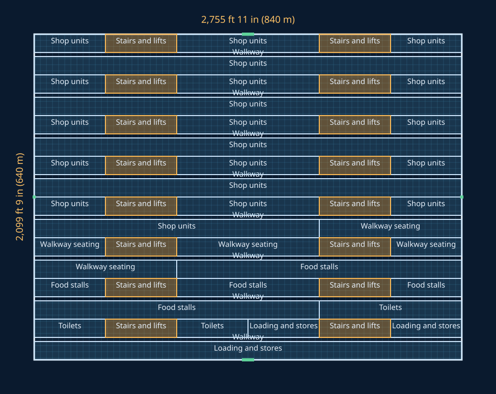
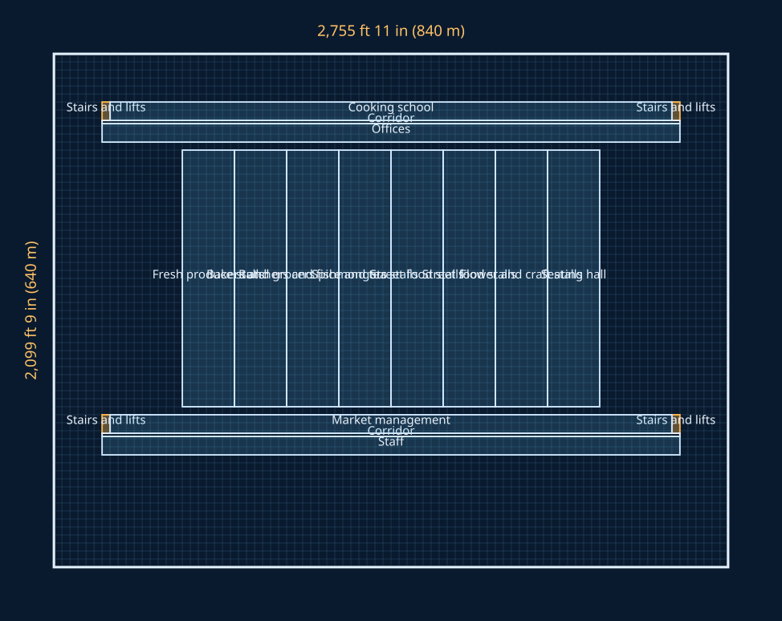
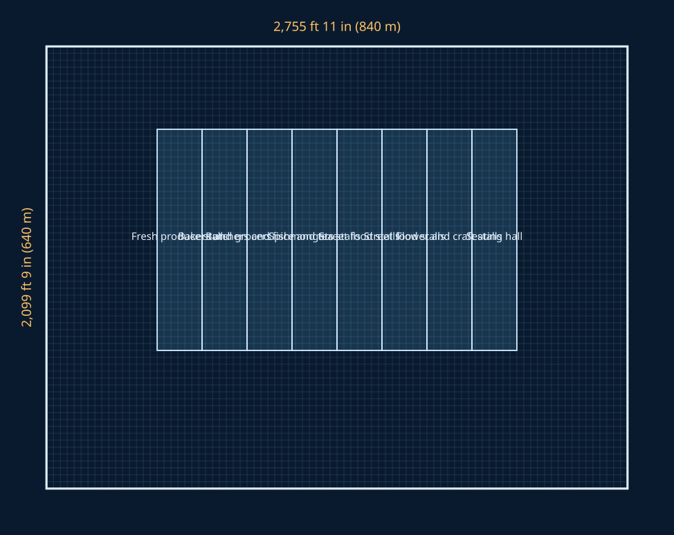

# P6-04 Market Hall: plan

Footprint 2,755 ft 11 in (840 m) × 2,099 ft 9 in (640 m) · structural grid 32 ft 10 in (10 m)

## Levels

| Level | Floor above deck | Height | Floor area |
|---|---|---|---|
| Level 1 · Market floor | 0 ft (0 mm) | 23 ft (7,000 mm) | 2,494,213 sq ft (231,720 m²) |
| Level 2 · Gallery | 23 ft (7,000 mm) | 19 ft 8 in (6,000 mm) | 2,494,213 sq ft (231,720 m²) |
| Level 3 · Vault | 42 ft 8 in (13 m) | 26 ft 3 in (8,000 mm) | 1,791,115 sq ft (166,400 m²) |

## Elements

| ID | Designation | Type | Name | Level(s) | Size / length | Area | Status |
|---|---|---|---|---|---|---|---|
| E001 | D5F3P6B5A1L1R1, D5F3P6B5A1L2R1, D5F3P6B5A1L3R1 | room | Fresh produce stalls | L1, L2, L3 | 213 ft 3 in (65 m) × 1,049 ft 10 in (320 m) | 223,889 sq ft (20,800 m²) | proposed |
| E002 | D5F3P6B5A1L1R2, D5F3P6B5A1L2R2, D5F3P6B5A1L3R2 | room | Bakers and grocers | L1, L2, L3 | 213 ft 3 in (65 m) × 1,049 ft 10 in (320 m) | 223,889 sq ft (20,800 m²) | proposed |
| E003 | D5F3P6B5A1L1R3, D5F3P6B5A1L2R3, D5F3P6B5A1L3R3 | room | Butchers and fishmongers | L1, L2, L3 | 213 ft 3 in (65 m) × 1,049 ft 10 in (320 m) | 223,889 sq ft (20,800 m²) | proposed |
| E004 | D5F3P6B5A1L1R4, D5F3P6B5A1L2R4, D5F3P6B5A1L3R4 | room | Spice and tea stalls | L1, L2, L3 | 213 ft 3 in (65 m) × 1,049 ft 10 in (320 m) | 223,889 sq ft (20,800 m²) | proposed |
| E005 | D5F3P6B5A1L1R5, D5F3P6B5A1L2R5, D5F3P6B5A1L3R5 | room | Street food stalls | L1, L2, L3 | 213 ft 3 in (65 m) × 1,049 ft 10 in (320 m) | 223,889 sq ft (20,800 m²) | proposed |
| E006 | D5F3P6B5A1L1R6, D5F3P6B5A1L2R6, D5F3P6B5A1L3R6 | room | Street food stalls | L1, L2, L3 | 213 ft 3 in (65 m) × 1,049 ft 10 in (320 m) | 223,889 sq ft (20,800 m²) | proposed |
| E007 | D5F3P6B5A1L1R7, D5F3P6B5A1L2R7, D5F3P6B5A1L3R7 | room | Flower and craft stalls | L1, L2, L3 | 213 ft 3 in (65 m) × 1,049 ft 10 in (320 m) | 223,889 sq ft (20,800 m²) | proposed |
| E008 | D5F3P6B5A1L1R8, D5F3P6B5A1L2R8, D5F3P6B5A1L3R8 | room | Seating hall | L1, L2, L3 | 213 ft 3 in (65 m) × 1,049 ft 10 in (320 m) | 223,889 sq ft (20,800 m²) | proposed |
| E009 | D5F3P6B5A1L1R9, D5F3P6B5A1L2R9 | core | Stairs and lifts | L1, L2 | 32 ft 10 in (10 m) × 75 ft 6 in (23 m) | 2,476 sq ft (230 m²) | proposed |
| E010 | D5F3P6B5A1L1R10, D5F3P6B5A1L2R10 | core | Stairs and lifts | L1, L2 | 32 ft 10 in (10 m) × 75 ft 6 in (23 m) | 2,476 sq ft (230 m²) | proposed |
| E011 | D5F3P6B5A1L1R11 | zone | Corridor | L1 | 2,362 ft 2 in (720 m) × 13 ft 1 in (4,000 mm) | 31,000 sq ft (2,880 m²) | proposed |
| E012 | D5F3P6B5A1L1R12 | room | Shops | L1 | 191 ft 3 in (58 m) × 75 ft 6 in (23 m) | 14,433 sq ft (1,341 m²) | proposed |
| E013 | D5F3P6B5A1L1R13 | room | Shops | L1 | 191 ft 7 in (58 m) × 75 ft 6 in (23 m) | 14,458 sq ft (1,343 m²) | proposed |
| E014 | D5F3P6B5A1L1R14 | room | Shops | L1 | 191 ft 3 in (58 m) × 75 ft 6 in (23 m) | 14,433 sq ft (1,341 m²) | proposed |
| E015 | D5F3P6B5A1L1R15 | room | Shops | L1 | 191 ft 3 in (58 m) × 75 ft 6 in (23 m) | 14,433 sq ft (1,341 m²) | proposed |
| E016 | D5F3P6B5A1L1R16 | room | Shops | L1 | 191 ft 7 in (58 m) × 75 ft 6 in (23 m) | 14,458 sq ft (1,343 m²) | proposed |
| E017 | D5F3P6B5A1L1R17 | room | Shops | L1 | 191 ft 3 in (58 m) × 75 ft 6 in (23 m) | 14,433 sq ft (1,341 m²) | proposed |
| E018 | D5F3P6B5A1L1R18 | room | Shops | L1 | 191 ft 3 in (58 m) × 75 ft 6 in (23 m) | 14,433 sq ft (1,341 m²) | proposed |
| E019 | D5F3P6B5A1L1R19 | room | Shops | L1 | 191 ft 7 in (58 m) × 75 ft 6 in (23 m) | 14,458 sq ft (1,343 m²) | proposed |
| E020 | D5F3P6B5A1L1R20 | room | Shops | L1 | 191 ft 3 in (58 m) × 75 ft 6 in (23 m) | 14,433 sq ft (1,341 m²) | proposed |
| E021 | D5F3P6B5A1L1R21 | room | Shops | L1 | 191 ft 3 in (58 m) × 75 ft 6 in (23 m) | 14,433 sq ft (1,341 m²) | proposed |
| E022 | D5F3P6B5A1L1R22 | room | Shops | L1 | 191 ft 7 in (58 m) × 75 ft 6 in (23 m) | 14,458 sq ft (1,343 m²) | proposed |
| E023 | D5F3P6B5A1L1R23 | room | Shops | L1 | 191 ft 3 in (58 m) × 75 ft 6 in (23 m) | 14,433 sq ft (1,341 m²) | proposed |
| E024 | D5F3P6B5A1L1R24 | room | Shops | L1 | 35 ft 9 in (11 m) × 75 ft 6 in (23 m) | 2,699 sq ft (251 m²) | proposed |
| E025 | D5F3P6B5A1L1R25 | room | Shops | L1 | 35 ft 5 in (11 m) × 75 ft 6 in (23 m) | 2,674 sq ft (248 m²) | proposed |
| E026 | D5F3P6B5A1L1R26 | room | Shops | L1 | 35 ft 9 in (11 m) × 75 ft 6 in (23 m) | 2,699 sq ft (251 m²) | proposed |
| E027 | D5F3P6B5A1L1R27 | room | Shops | L1 | 35 ft 9 in (11 m) × 75 ft 6 in (23 m) | 2,699 sq ft (251 m²) | proposed |
| E028 | D5F3P6B5A1L1R28 | room | Shops | L1 | 35 ft 5 in (11 m) × 75 ft 6 in (23 m) | 2,674 sq ft (248 m²) | proposed |
| E029 | D5F3P6B5A1L1R29 | room | Shops | L1 | 35 ft 9 in (11 m) × 75 ft 6 in (23 m) | 2,699 sq ft (251 m²) | proposed |
| E030 | D5F3P6B5A1L1R30 | room | Shops | L1 | 35 ft 9 in (11 m) × 75 ft 6 in (23 m) | 2,699 sq ft (251 m²) | proposed |
| E031 | D5F3P6B5A1L1R31 | room | Shops | L1 | 35 ft 9 in (11 m) × 75 ft 6 in (23 m) | 2,699 sq ft (251 m²) | proposed |
| E032 | D5F3P6B5A1L1R32 | room | Shops | L1 | 35 ft 5 in (11 m) × 75 ft 6 in (23 m) | 2,674 sq ft (248 m²) | proposed |
| E033 | D5F3P6B5A1L1R33 | room | Shops | L1 | 35 ft 9 in (11 m) × 75 ft 6 in (23 m) | 2,699 sq ft (251 m²) | proposed |
| E034 | D5F3P6B5A1L1R34 | room | Shops | L1 | 35 ft 9 in (11 m) × 75 ft 6 in (23 m) | 2,699 sq ft (251 m²) | proposed |
| E035 | D5F3P6B5A1L1R35 | room | Shops | L1 | 35 ft 5 in (11 m) × 75 ft 6 in (23 m) | 2,674 sq ft (248 m²) | proposed |
| E036 | D5F3P6B5A1L1R36 | room | Toilets | L1 | 1,934 ft 5 in (590 m) × 75 ft 6 in (23 m) | 145,967 sq ft (13,561 m²) | proposed |
| E037 | D5F3P6B5A1L2R11 | zone | Corridor | L2 | 2,362 ft 2 in (720 m) × 13 ft 1 in (4,000 mm) | 31,000 sq ft (2,880 m²) | proposed |
| E038 | D5F3P6B5A1L2R12 | room | Cooking school | L2 | 2,296 ft 7 in (700 m) × 75 ft 6 in (23 m) | 173,299 sq ft (16,100 m²) | proposed |
| E039 | D5F3P6B5A1L2R13 | room | Offices | L2 | 2,362 ft 2 in (720 m) × 75 ft 6 in (23 m) | 178,250 sq ft (16,560 m²) | proposed |
| E040 | D5F3P6B5A1L1R37, D5F3P6B5A1L2R14 | core | Stairs and lifts | L1, L2 | 32 ft 10 in (10 m) × 75 ft 6 in (23 m) | 2,476 sq ft (230 m²) | proposed |
| E041 | D5F3P6B5A1L1R38, D5F3P6B5A1L2R15 | core | Stairs and lifts | L1, L2 | 32 ft 10 in (10 m) × 75 ft 6 in (23 m) | 2,476 sq ft (230 m²) | proposed |
| E042 | D5F3P6B5A1L1R39 | zone | Corridor | L1 | 2,362 ft 2 in (720 m) × 13 ft 1 in (4,000 mm) | 31,000 sq ft (2,880 m²) | proposed |
| E043 | D5F3P6B5A1L1R40 | room | Shops | L1 | 191 ft 3 in (58 m) × 75 ft 6 in (23 m) | 14,433 sq ft (1,341 m²) | proposed |
| E044 | D5F3P6B5A1L1R41 | room | Shops | L1 | 191 ft 7 in (58 m) × 75 ft 6 in (23 m) | 14,458 sq ft (1,343 m²) | proposed |
| E045 | D5F3P6B5A1L1R42 | room | Shops | L1 | 191 ft 3 in (58 m) × 75 ft 6 in (23 m) | 14,433 sq ft (1,341 m²) | proposed |
| E046 | D5F3P6B5A1L1R43 | room | Shops | L1 | 191 ft 3 in (58 m) × 75 ft 6 in (23 m) | 14,433 sq ft (1,341 m²) | proposed |
| E047 | D5F3P6B5A1L1R44 | room | Shops | L1 | 191 ft 7 in (58 m) × 75 ft 6 in (23 m) | 14,458 sq ft (1,343 m²) | proposed |
| E048 | D5F3P6B5A1L1R45 | room | Shops | L1 | 191 ft 3 in (58 m) × 75 ft 6 in (23 m) | 14,433 sq ft (1,341 m²) | proposed |
| E049 | D5F3P6B5A1L1R46 | room | Shops | L1 | 191 ft 3 in (58 m) × 75 ft 6 in (23 m) | 14,433 sq ft (1,341 m²) | proposed |
| E050 | D5F3P6B5A1L1R47 | room | Shops | L1 | 191 ft 7 in (58 m) × 75 ft 6 in (23 m) | 14,458 sq ft (1,343 m²) | proposed |
| E051 | D5F3P6B5A1L1R48 | room | Shops | L1 | 191 ft 3 in (58 m) × 75 ft 6 in (23 m) | 14,433 sq ft (1,341 m²) | proposed |
| E052 | D5F3P6B5A1L1R49 | room | Shops | L1 | 191 ft 3 in (58 m) × 75 ft 6 in (23 m) | 14,433 sq ft (1,341 m²) | proposed |
| E053 | D5F3P6B5A1L1R50 | room | Shops | L1 | 191 ft 7 in (58 m) × 75 ft 6 in (23 m) | 14,458 sq ft (1,343 m²) | proposed |
| E054 | D5F3P6B5A1L1R51 | room | Shops | L1 | 191 ft 3 in (58 m) × 75 ft 6 in (23 m) | 14,433 sq ft (1,341 m²) | proposed |
| E055 | D5F3P6B5A1L1R52 | room | Shops | L1 | 35 ft 9 in (11 m) × 75 ft 6 in (23 m) | 2,699 sq ft (251 m²) | proposed |
| E056 | D5F3P6B5A1L1R53 | room | Shops | L1 | 35 ft 5 in (11 m) × 75 ft 6 in (23 m) | 2,674 sq ft (248 m²) | proposed |
| E057 | D5F3P6B5A1L1R54 | room | Shops | L1 | 35 ft 9 in (11 m) × 75 ft 6 in (23 m) | 2,699 sq ft (251 m²) | proposed |
| E058 | D5F3P6B5A1L1R55 | room | Shops | L1 | 35 ft 9 in (11 m) × 75 ft 6 in (23 m) | 2,699 sq ft (251 m²) | proposed |
| E059 | D5F3P6B5A1L1R56 | room | Shops | L1 | 35 ft 5 in (11 m) × 75 ft 6 in (23 m) | 2,674 sq ft (248 m²) | proposed |
| E060 | D5F3P6B5A1L1R57 | room | Shops | L1 | 35 ft 9 in (11 m) × 75 ft 6 in (23 m) | 2,699 sq ft (251 m²) | proposed |
| E061 | D5F3P6B5A1L1R58 | room | Shops | L1 | 35 ft 9 in (11 m) × 75 ft 6 in (23 m) | 2,699 sq ft (251 m²) | proposed |
| E062 | D5F3P6B5A1L1R59 | room | Shops | L1 | 35 ft 9 in (11 m) × 75 ft 6 in (23 m) | 2,699 sq ft (251 m²) | proposed |
| E063 | D5F3P6B5A1L1R60 | room | Shops | L1 | 35 ft 5 in (11 m) × 75 ft 6 in (23 m) | 2,674 sq ft (248 m²) | proposed |
| E064 | D5F3P6B5A1L1R61 | room | Shops | L1 | 35 ft 9 in (11 m) × 75 ft 6 in (23 m) | 2,699 sq ft (251 m²) | proposed |
| E065 | D5F3P6B5A1L1R62 | room | Shops | L1 | 35 ft 9 in (11 m) × 75 ft 6 in (23 m) | 2,699 sq ft (251 m²) | proposed |
| E066 | D5F3P6B5A1L1R63 | room | Shops | L1 | 35 ft 5 in (11 m) × 75 ft 6 in (23 m) | 2,674 sq ft (248 m²) | proposed |
| E067 | D5F3P6B5A1L1R64 | room | Loading and cold rooms | L1 | 1,934 ft 5 in (590 m) × 75 ft 6 in (23 m) | 145,967 sq ft (13,561 m²) | proposed |
| E068 | D5F3P6B5A1L2R16 | zone | Corridor | L2 | 2,362 ft 2 in (720 m) × 13 ft 1 in (4,000 mm) | 31,000 sq ft (2,880 m²) | proposed |
| E069 | D5F3P6B5A1L2R17 | room | Market management | L2 | 2,296 ft 7 in (700 m) × 75 ft 6 in (23 m) | 173,299 sq ft (16,100 m²) | proposed |
| E070 | D5F3P6B5A1L2R18 | room | Staff | L2 | 2,362 ft 2 in (720 m) × 75 ft 6 in (23 m) | 178,250 sq ft (16,560 m²) | proposed |
| E071 | D5F3P6B5A1L1R65 | zone | Market square (bow) | L1 | 295 ft 3 in (90 m) × 1,049 ft 10 in (320 m) | 310,001 sq ft (28,800 m²) | proposed |
| E072 | D5F3P6B5A1L1R66 | zone | Market square (stern) | L1 | 295 ft 3 in (90 m) × 1,049 ft 10 in (320 m) | 310,001 sq ft (28,800 m²) | proposed |
| E073 | D5F3P6B5A1L1R67 | zone | Delivery yard | L1 | 2,362 ft 2 in (720 m) × 328 ft 1 in (100 m) | 775,002 sq ft (72,000 m²) | proposed |

## Drawings

### Level 1 · Market floor

### Level 2 · Gallery

### Level 3 · Vault

