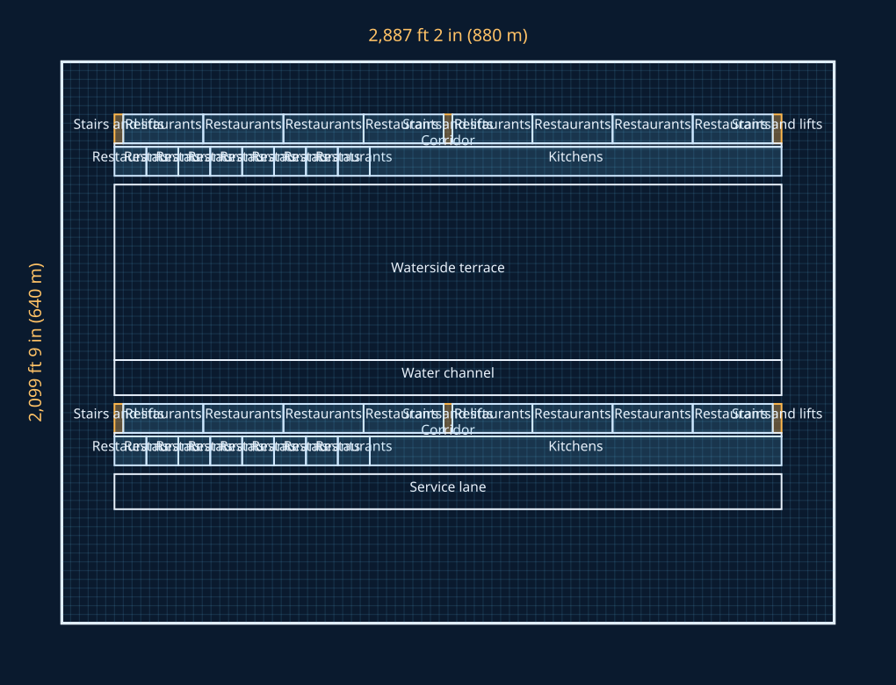
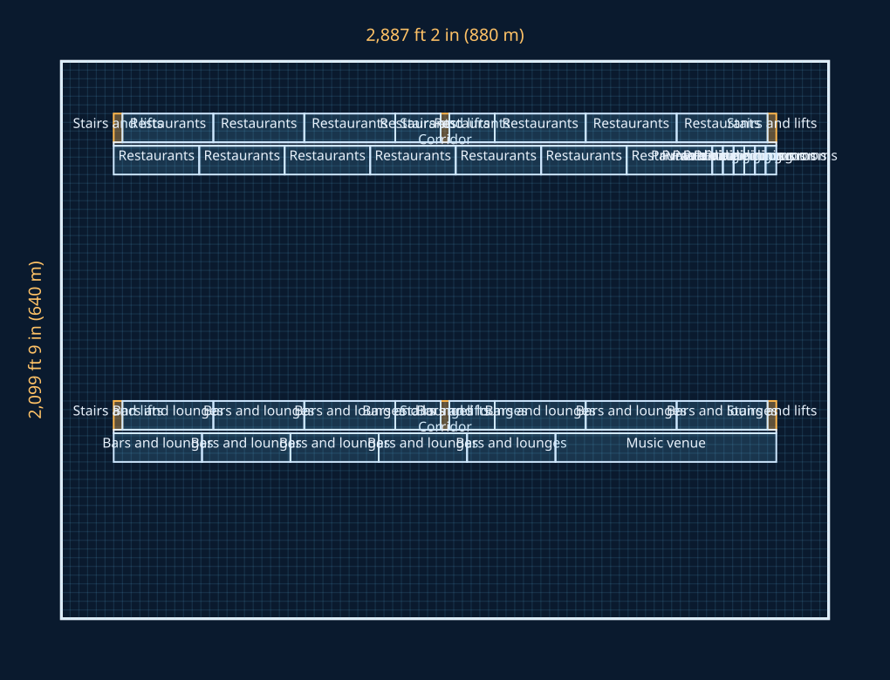
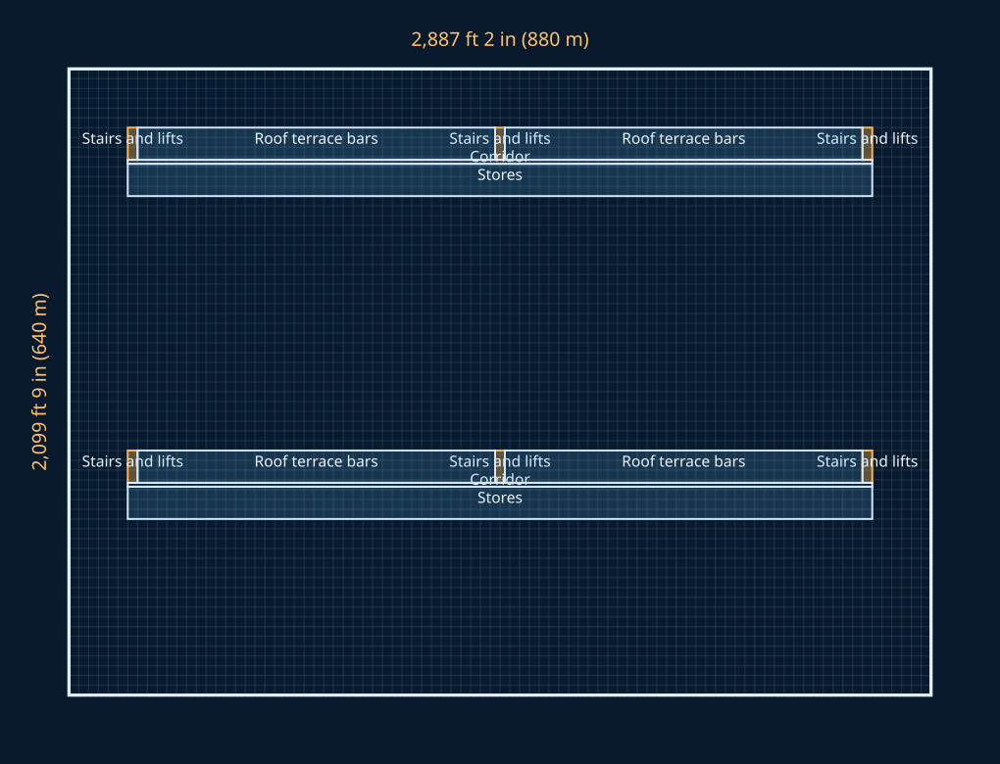

# P6-05 Restaurant Row: plan

Footprint 2,887 ft 2 in (880 m) × 2,099 ft 9 in (640 m) · structural grid 32 ft 10 in (10 m)

## Levels

| Level | Floor above deck | Height | Floor area |
|---|---|---|---|
| Level 1 · Ground floor | 0 ft (0 mm) | 16 ft 5 in (5,000 mm) | 1,058,523 sq ft (98,340 m²) |
| Level 2 · Level 2 | 16 ft 5 in (5,000 mm) | 14 ft 9 in (4,500 mm) | 1,058,523 sq ft (98,340 m²) |
| Level 3 · Roof terraces | 31 ft 2 in (9,500 mm) | 13 ft 1 in (4,000 mm) | 1,058,523 sq ft (98,340 m²) |

## Elements

| ID | Designation | Type | Name | Level(s) | Size / length | Area | Status |
|---|---|---|---|---|---|---|---|
| E001 | D5F3P6B7A1L1R1, D5F3P6B7A1L2R1, D5F3P6B7A1L3R1 | core | Stairs and lifts | L1, L2, L3 | 32 ft 10 in (10 m) × 108 ft 3 in (33 m) | 3,552 sq ft (330 m²) | proposed |
| E002 | D5F3P6B7A1L1R2, D5F3P6B7A1L2R2, D5F3P6B7A1L3R2 | core | Stairs and lifts | L1, L2, L3 | 32 ft 10 in (10 m) × 108 ft 3 in (33 m) | 3,552 sq ft (330 m²) | proposed |
| E003 | D5F3P6B7A1L1R3, D5F3P6B7A1L2R3, D5F3P6B7A1L3R3 | core | Stairs and lifts | L1, L2, L3 | 32 ft 10 in (10 m) × 108 ft 3 in (33 m) | 3,552 sq ft (330 m²) | proposed |
| E004 | D5F3P6B7A1L1R4 | zone | Corridor | L1 | 2,493 ft 5 in (760 m) × 13 ft 1 in (4,000 mm) | 32,722 sq ft (3,040 m²) | proposed |
| E005 | D5F3P6B7A1L1R5 | room | Restaurants | L1 | 299 ft 3 in (91 m) × 108 ft 3 in (33 m) | 32,395 sq ft (3,010 m²) | proposed |
| E006 | D5F3P6B7A1L1R6 | room | Restaurants | L1 | 299 ft 6 in (91 m) × 108 ft 3 in (33 m) | 32,431 sq ft (3,013 m²) | proposed |
| E007 | D5F3P6B7A1L1R7 | room | Restaurants | L1 | 299 ft 6 in (91 m) × 108 ft 3 in (33 m) | 32,431 sq ft (3,013 m²) | proposed |
| E008 | D5F3P6B7A1L1R8 | room | Restaurants | L1 | 299 ft 3 in (91 m) × 108 ft 3 in (33 m) | 32,395 sq ft (3,010 m²) | proposed |
| E009 | D5F3P6B7A1L1R9 | room | Restaurants | L1 | 299 ft 3 in (91 m) × 108 ft 3 in (33 m) | 32,395 sq ft (3,010 m²) | proposed |
| E010 | D5F3P6B7A1L1R10 | room | Restaurants | L1 | 299 ft 6 in (91 m) × 108 ft 3 in (33 m) | 32,431 sq ft (3,013 m²) | proposed |
| E011 | D5F3P6B7A1L1R11 | room | Restaurants | L1 | 299 ft 6 in (91 m) × 108 ft 3 in (33 m) | 32,431 sq ft (3,013 m²) | proposed |
| E012 | D5F3P6B7A1L1R12 | room | Restaurants | L1 | 299 ft 3 in (91 m) × 108 ft 3 in (33 m) | 32,395 sq ft (3,010 m²) | proposed |
| E013 | D5F3P6B7A1L1R13 | room | Restaurants | L1 | 119 ft 5 in (36 m) × 108 ft 3 in (33 m) | 12,930 sq ft (1,201 m²) | proposed |
| E014 | D5F3P6B7A1L1R14 | room | Restaurants | L1 | 119 ft 1 in (36 m) × 108 ft 3 in (33 m) | 12,894 sq ft (1,198 m²) | proposed |
| E015 | D5F3P6B7A1L1R15 | room | Restaurants | L1 | 119 ft 5 in (36 m) × 108 ft 3 in (33 m) | 12,930 sq ft (1,201 m²) | proposed |
| E016 | D5F3P6B7A1L1R16 | room | Restaurants | L1 | 119 ft 5 in (36 m) × 108 ft 3 in (33 m) | 12,930 sq ft (1,201 m²) | proposed |
| E017 | D5F3P6B7A1L1R17 | room | Restaurants | L1 | 119 ft 1 in (36 m) × 108 ft 3 in (33 m) | 12,894 sq ft (1,198 m²) | proposed |
| E018 | D5F3P6B7A1L1R18 | room | Restaurants | L1 | 119 ft 5 in (36 m) × 108 ft 3 in (33 m) | 12,930 sq ft (1,201 m²) | proposed |
| E019 | D5F3P6B7A1L1R19 | room | Restaurants | L1 | 119 ft 1 in (36 m) × 108 ft 3 in (33 m) | 12,894 sq ft (1,198 m²) | proposed |
| E020 | D5F3P6B7A1L1R20 | room | Restaurants | L1 | 119 ft 5 in (36 m) × 108 ft 3 in (33 m) | 12,930 sq ft (1,201 m²) | proposed |
| E021 | D5F3P6B7A1L1R21 | room | Kitchens | L1 | 1,539 ft 1 in (469 m) × 108 ft 3 in (33 m) | 166,629 sq ft (15,480 m²) | proposed |
| E022 | D5F3P6B7A1L2R4 | zone | Corridor | L2 | 2,493 ft 5 in (760 m) × 13 ft 1 in (4,000 mm) | 32,722 sq ft (3,040 m²) | proposed |
| E023 | D5F3P6B7A1L2R5 | room | Restaurants | L2 | 342 ft 2 in (104 m) × 108 ft 3 in (33 m) | 37,048 sq ft (3,442 m²) | proposed |
| E024 | D5F3P6B7A1L2R6 | room | Restaurants | L2 | 342 ft 2 in (104 m) × 108 ft 3 in (33 m) | 37,048 sq ft (3,442 m²) | proposed |
| E025 | D5F3P6B7A1L2R7 | room | Restaurants | L2 | 342 ft 2 in (104 m) × 108 ft 3 in (33 m) | 37,048 sq ft (3,442 m²) | proposed |
| E026 | D5F3P6B7A1L2R8 | room | Restaurants | L2 | 170 ft 11 in (52 m) × 108 ft 3 in (33 m) | 18,506 sq ft (1,719 m²) | proposed |
| E027 | D5F3P6B7A1L2R9 | room | Restaurants | L2 | 170 ft 11 in (52 m) × 108 ft 3 in (33 m) | 18,506 sq ft (1,719 m²) | proposed |
| E028 | D5F3P6B7A1L2R10 | room | Restaurants | L2 | 342 ft 2 in (104 m) × 108 ft 3 in (33 m) | 37,048 sq ft (3,442 m²) | proposed |
| E029 | D5F3P6B7A1L2R11 | room | Restaurants | L2 | 342 ft 2 in (104 m) × 108 ft 3 in (33 m) | 37,048 sq ft (3,442 m²) | proposed |
| E030 | D5F3P6B7A1L2R12 | room | Restaurants | L2 | 342 ft 2 in (104 m) × 108 ft 3 in (33 m) | 37,048 sq ft (3,442 m²) | proposed |
| E031 | D5F3P6B7A1L2R13 | room | Restaurants | L2 | 321 ft 10 in (98 m) × 108 ft 3 in (33 m) | 34,846 sq ft (3,237 m²) | proposed |
| E032 | D5F3P6B7A1L2R14 | room | Restaurants | L2 | 321 ft 6 in (98 m) × 108 ft 3 in (33 m) | 34,810 sq ft (3,234 m²) | proposed |
| E033 | D5F3P6B7A1L2R15 | room | Restaurants | L2 | 321 ft 10 in (98 m) × 108 ft 3 in (33 m) | 34,846 sq ft (3,237 m²) | proposed |
| E034 | D5F3P6B7A1L2R16 | room | Restaurants | L2 | 321 ft 10 in (98 m) × 108 ft 3 in (33 m) | 34,846 sq ft (3,237 m²) | proposed |
| E035 | D5F3P6B7A1L2R17 | room | Restaurants | L2 | 321 ft 6 in (98 m) × 108 ft 3 in (33 m) | 34,810 sq ft (3,234 m²) | proposed |
| E036 | D5F3P6B7A1L2R18 | room | Restaurants | L2 | 321 ft 10 in (98 m) × 108 ft 3 in (33 m) | 34,846 sq ft (3,237 m²) | proposed |
| E037 | D5F3P6B7A1L2R19 | room | Restaurants | L2 | 321 ft 10 in (98 m) × 108 ft 3 in (33 m) | 34,846 sq ft (3,237 m²) | proposed |
| E038 | D5F3P6B7A1L2R20 | room | Private dining rooms | L2 | 40 ft (12 m) × 108 ft 3 in (33 m) | 4,334 sq ft (403 m²) | proposed |
| E039 | D5F3P6B7A1L2R21 | room | Private dining rooms | L2 | 40 ft 4 in (12 m) × 108 ft 3 in (33 m) | 4,369 sq ft (406 m²) | proposed |
| E040 | D5F3P6B7A1L2R22 | room | Private dining rooms | L2 | 40 ft (12 m) × 108 ft 3 in (33 m) | 4,334 sq ft (403 m²) | proposed |
| E041 | D5F3P6B7A1L2R23 | room | Private dining rooms | L2 | 40 ft 4 in (12 m) × 108 ft 3 in (33 m) | 4,369 sq ft (406 m²) | proposed |
| E042 | D5F3P6B7A1L2R24 | room | Private dining rooms | L2 | 40 ft (12 m) × 108 ft 3 in (33 m) | 4,334 sq ft (403 m²) | proposed |
| E043 | D5F3P6B7A1L2R25 | room | Private dining rooms | L2 | 40 ft 4 in (12 m) × 108 ft 3 in (33 m) | 4,369 sq ft (406 m²) | proposed |
| E044 | D5F3P6B7A1L3R4 | zone | Corridor | L3 | 2,493 ft 5 in (760 m) × 13 ft 1 in (4,000 mm) | 32,722 sq ft (3,040 m²) | proposed |
| E045 | D5F3P6B7A1L3R5 | room | Roof terrace bars | L3 | 1,197 ft 6 in (365 m) × 108 ft 3 in (33 m) | 129,651 sq ft (12,045 m²) | proposed |
| E046 | D5F3P6B7A1L3R6 | room | Roof terrace bars | L3 | 1,197 ft 6 in (365 m) × 108 ft 3 in (33 m) | 129,651 sq ft (12,045 m²) | proposed |
| E047 | D5F3P6B7A1L3R7 | room | Stores | L3 | 2,493 ft 5 in (760 m) × 108 ft 3 in (33 m) | 269,959 sq ft (25,080 m²) | proposed |
| E048 | D5F3P6B7A1L1R22 | zone | Waterside terrace | L1 | 2,493 ft 5 in (760 m) × 656 ft 2 in (200 m) | 1,636,114 sq ft (152,000 m²) | proposed |
| E049 | D5F3P6B7A1L1R23 | zone | Water channel | L1 | 2,493 ft 5 in (760 m) × 131 ft 3 in (40 m) | 327,223 sq ft (30,400 m²) | proposed |
| E050 | D5F3P6B7A1L1R24, D5F3P6B7A1L2R26, D5F3P6B7A1L3R8 | core | Stairs and lifts | L1, L2, L3 | 32 ft 10 in (10 m) × 108 ft 3 in (33 m) | 3,552 sq ft (330 m²) | proposed |
| E051 | D5F3P6B7A1L1R25, D5F3P6B7A1L2R27, D5F3P6B7A1L3R9 | core | Stairs and lifts | L1, L2, L3 | 32 ft 10 in (10 m) × 108 ft 3 in (33 m) | 3,552 sq ft (330 m²) | proposed |
| E052 | D5F3P6B7A1L1R26, D5F3P6B7A1L2R28, D5F3P6B7A1L3R10 | core | Stairs and lifts | L1, L2, L3 | 32 ft 10 in (10 m) × 108 ft 3 in (33 m) | 3,552 sq ft (330 m²) | proposed |
| E053 | D5F3P6B7A1L1R27 | zone | Corridor | L1 | 2,493 ft 5 in (760 m) × 13 ft 1 in (4,000 mm) | 32,722 sq ft (3,040 m²) | proposed |
| E054 | D5F3P6B7A1L1R28 | room | Restaurants | L1 | 299 ft 3 in (91 m) × 108 ft 3 in (33 m) | 32,395 sq ft (3,010 m²) | proposed |
| E055 | D5F3P6B7A1L1R29 | room | Restaurants | L1 | 299 ft 6 in (91 m) × 108 ft 3 in (33 m) | 32,431 sq ft (3,013 m²) | proposed |
| E056 | D5F3P6B7A1L1R30 | room | Restaurants | L1 | 299 ft 6 in (91 m) × 108 ft 3 in (33 m) | 32,431 sq ft (3,013 m²) | proposed |
| E057 | D5F3P6B7A1L1R31 | room | Restaurants | L1 | 299 ft 3 in (91 m) × 108 ft 3 in (33 m) | 32,395 sq ft (3,010 m²) | proposed |
| E058 | D5F3P6B7A1L1R32 | room | Restaurants | L1 | 299 ft 3 in (91 m) × 108 ft 3 in (33 m) | 32,395 sq ft (3,010 m²) | proposed |
| E059 | D5F3P6B7A1L1R33 | room | Restaurants | L1 | 299 ft 6 in (91 m) × 108 ft 3 in (33 m) | 32,431 sq ft (3,013 m²) | proposed |
| E060 | D5F3P6B7A1L1R34 | room | Restaurants | L1 | 299 ft 6 in (91 m) × 108 ft 3 in (33 m) | 32,431 sq ft (3,013 m²) | proposed |
| E061 | D5F3P6B7A1L1R35 | room | Restaurants | L1 | 299 ft 3 in (91 m) × 108 ft 3 in (33 m) | 32,395 sq ft (3,010 m²) | proposed |
| E062 | D5F3P6B7A1L1R36 | room | Restaurants | L1 | 119 ft 5 in (36 m) × 108 ft 3 in (33 m) | 12,930 sq ft (1,201 m²) | proposed |
| E063 | D5F3P6B7A1L1R37 | room | Restaurants | L1 | 119 ft 1 in (36 m) × 108 ft 3 in (33 m) | 12,894 sq ft (1,198 m²) | proposed |
| E064 | D5F3P6B7A1L1R38 | room | Restaurants | L1 | 119 ft 5 in (36 m) × 108 ft 3 in (33 m) | 12,930 sq ft (1,201 m²) | proposed |
| E065 | D5F3P6B7A1L1R39 | room | Restaurants | L1 | 119 ft 5 in (36 m) × 108 ft 3 in (33 m) | 12,930 sq ft (1,201 m²) | proposed |
| E066 | D5F3P6B7A1L1R40 | room | Restaurants | L1 | 119 ft 1 in (36 m) × 108 ft 3 in (33 m) | 12,894 sq ft (1,198 m²) | proposed |
| E067 | D5F3P6B7A1L1R41 | room | Restaurants | L1 | 119 ft 5 in (36 m) × 108 ft 3 in (33 m) | 12,930 sq ft (1,201 m²) | proposed |
| E068 | D5F3P6B7A1L1R42 | room | Restaurants | L1 | 119 ft 1 in (36 m) × 108 ft 3 in (33 m) | 12,894 sq ft (1,198 m²) | proposed |
| E069 | D5F3P6B7A1L1R43 | room | Restaurants | L1 | 119 ft 5 in (36 m) × 108 ft 3 in (33 m) | 12,930 sq ft (1,201 m²) | proposed |
| E070 | D5F3P6B7A1L1R44 | room | Kitchens | L1 | 1,539 ft 1 in (469 m) × 108 ft 3 in (33 m) | 166,629 sq ft (15,480 m²) | proposed |
| E071 | D5F3P6B7A1L2R29 | zone | Corridor | L2 | 2,493 ft 5 in (760 m) × 13 ft 1 in (4,000 mm) | 32,722 sq ft (3,040 m²) | proposed |
| E072 | D5F3P6B7A1L2R30 | room | Bars and lounges | L2 | 342 ft 2 in (104 m) × 108 ft 3 in (33 m) | 37,048 sq ft (3,442 m²) | proposed |
| E073 | D5F3P6B7A1L2R31 | room | Bars and lounges | L2 | 342 ft 2 in (104 m) × 108 ft 3 in (33 m) | 37,048 sq ft (3,442 m²) | proposed |
| E074 | D5F3P6B7A1L2R32 | room | Bars and lounges | L2 | 342 ft 2 in (104 m) × 108 ft 3 in (33 m) | 37,048 sq ft (3,442 m²) | proposed |
| E075 | D5F3P6B7A1L2R33 | room | Bars and lounges | L2 | 170 ft 11 in (52 m) × 108 ft 3 in (33 m) | 18,506 sq ft (1,719 m²) | proposed |
| E076 | D5F3P6B7A1L2R34 | room | Bars and lounges | L2 | 170 ft 11 in (52 m) × 108 ft 3 in (33 m) | 18,506 sq ft (1,719 m²) | proposed |
| E077 | D5F3P6B7A1L2R35 | room | Bars and lounges | L2 | 342 ft 2 in (104 m) × 108 ft 3 in (33 m) | 37,048 sq ft (3,442 m²) | proposed |
| E078 | D5F3P6B7A1L2R36 | room | Bars and lounges | L2 | 342 ft 2 in (104 m) × 108 ft 3 in (33 m) | 37,048 sq ft (3,442 m²) | proposed |
| E079 | D5F3P6B7A1L2R37 | room | Bars and lounges | L2 | 342 ft 2 in (104 m) × 108 ft 3 in (33 m) | 37,048 sq ft (3,442 m²) | proposed |
| E080 | D5F3P6B7A1L2R38 | room | Bars and lounges | L2 | 332 ft 4 in (101 m) × 108 ft 3 in (33 m) | 35,983 sq ft (3,343 m²) | proposed |
| E081 | D5F3P6B7A1L2R39 | room | Bars and lounges | L2 | 332 ft 8 in (101 m) × 108 ft 3 in (33 m) | 36,018 sq ft (3,346 m²) | proposed |
| E082 | D5F3P6B7A1L2R40 | room | Bars and lounges | L2 | 332 ft 4 in (101 m) × 108 ft 3 in (33 m) | 35,983 sq ft (3,343 m²) | proposed |
| E083 | D5F3P6B7A1L2R41 | room | Bars and lounges | L2 | 332 ft 4 in (101 m) × 108 ft 3 in (33 m) | 35,983 sq ft (3,343 m²) | proposed |
| E084 | D5F3P6B7A1L2R42 | room | Bars and lounges | L2 | 332 ft 8 in (101 m) × 108 ft 3 in (33 m) | 36,018 sq ft (3,346 m²) | proposed |
| E085 | D5F3P6B7A1L2R43 | room | Music venue | L2 | 831 ft (253 m) × 108 ft 3 in (33 m) | 89,974 sq ft (8,359 m²) | proposed |
| E086 | D5F3P6B7A1L3R11 | zone | Corridor | L3 | 2,493 ft 5 in (760 m) × 13 ft 1 in (4,000 mm) | 32,722 sq ft (3,040 m²) | proposed |
| E087 | D5F3P6B7A1L3R12 | room | Roof terrace bars | L3 | 1,197 ft 6 in (365 m) × 108 ft 3 in (33 m) | 129,651 sq ft (12,045 m²) | proposed |
| E088 | D5F3P6B7A1L3R13 | room | Roof terrace bars | L3 | 1,197 ft 6 in (365 m) × 108 ft 3 in (33 m) | 129,651 sq ft (12,045 m²) | proposed |
| E089 | D5F3P6B7A1L3R14 | room | Stores | L3 | 2,493 ft 5 in (760 m) × 108 ft 3 in (33 m) | 269,959 sq ft (25,080 m²) | proposed |
| E090 | D5F3P6B7A1L1R45 | zone | Service lane | L1 | 2,493 ft 5 in (760 m) × 131 ft 3 in (40 m) | 327,223 sq ft (30,400 m²) | proposed |

## Drawings

### Level 1 · Ground floor

### Level 2 · Level 2

### Level 3 · Roof terraces

