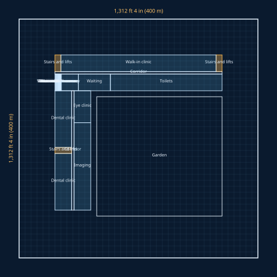
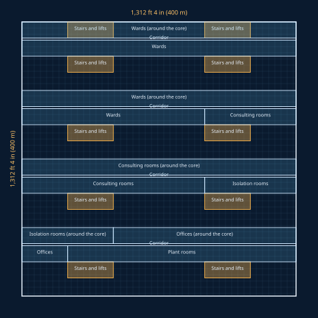

# P6-06 Travellers' Clinic: plan

Footprint 1,312 ft 4 in (400 m) × 1,312 ft 4 in (400 m) · structural grid 32 ft 10 in (10 m)

## Levels

| Level | Floor above deck | Height | Floor area |
|---|---|---|---|
| Level 1 · Ground floor | 0 ft (0 mm) | 16 ft 5 in (5,000 mm) | 280,292 sq ft (26,040 m²) |
| Level 2 · Level 2 | 16 ft 5 in (5,000 mm) | 14 ft 9 in (4,500 mm) | 280,292 sq ft (26,040 m²) |
| Level 3 · Level 3 | 31 ft 2 in (9,500 mm) | 14 ft 9 in (4,500 mm) | 162,750 sq ft (15,120 m²) |

## Elements

| ID | Designation | Type | Name | Level(s) | Size / length | Area | Status |
|---|---|---|---|---|---|---|---|
| E001 | D5F3P6B9A1L1R1, D5F3P6B9A1L2R1, D5F3P6B9A1L3R1 | core | Stairs and lifts | L1, L2, L3 | 32 ft 10 in (10 m) × 91 ft 10 in (28 m) | 3,014 sq ft (280 m²) | proposed |
| E002 | D5F3P6B9A1L1R2, D5F3P6B9A1L2R2, D5F3P6B9A1L3R2 | core | Stairs and lifts | L1, L2, L3 | 32 ft 10 in (10 m) × 91 ft 10 in (28 m) | 3,014 sq ft (280 m²) | proposed |
| E003 | D5F3P6B9A1L1R3 | zone | Corridor | L1 | 918 ft 8 in (280 m) × 13 ft 1 in (4,000 mm) | 12,056 sq ft (1,120 m²) | proposed |
| E004 | D5F3P6B9A1L1R4 | room | Walk-in clinic | L1 | 853 ft (260 m) × 91 ft 10 in (28 m) | 78,361 sq ft (7,280 m²) | proposed |
| E005 | D5F3P6B9A1L1R5 | room | Vaccination rooms | L1 | 3 ft 7 in (1,100 mm) × 91 ft 10 in (28 m) | 332 sq ft (31 m²) | proposed |
| E006 | D5F3P6B9A1L1R6 | room | Vaccination rooms | L1 | 3 ft 3 in (1,000 mm) × 91 ft 10 in (28 m) | 301 sq ft (28 m²) | proposed |
| E007 | D5F3P6B9A1L1R7 | room | Vaccination rooms | L1 | 3 ft 7 in (1,100 mm) × 91 ft 10 in (28 m) | 332 sq ft (31 m²) | proposed |
| E008 | D5F3P6B9A1L1R8 | room | Vaccination rooms | L1 | 3 ft 7 in (1,100 mm) × 91 ft 10 in (28 m) | 332 sq ft (31 m²) | proposed |
| E009 | D5F3P6B9A1L1R9 | room | Vaccination rooms | L1 | 3 ft 7 in (1,100 mm) × 91 ft 10 in (28 m) | 332 sq ft (31 m²) | proposed |
| E010 | D5F3P6B9A1L1R10 | room | Vaccination rooms | L1 | 3 ft 3 in (1,000 mm) × 91 ft 10 in (28 m) | 301 sq ft (28 m²) | proposed |
| E011 | D5F3P6B9A1L1R11 | room | Vaccination rooms | L1 | 3 ft 7 in (1,100 mm) × 91 ft 10 in (28 m) | 332 sq ft (31 m²) | proposed |
| E012 | D5F3P6B9A1L1R12 | room | Vaccination rooms | L1 | 3 ft 7 in (1,100 mm) × 91 ft 10 in (28 m) | 332 sq ft (31 m²) | proposed |
| E013 | D5F3P6B9A1L1R13 | room | Vaccination rooms | L1 | 3 ft 3 in (1,000 mm) × 91 ft 10 in (28 m) | 301 sq ft (28 m²) | proposed |
| E014 | D5F3P6B9A1L1R14 | room | Vaccination rooms | L1 | 3 ft 7 in (1,100 mm) × 91 ft 10 in (28 m) | 332 sq ft (31 m²) | proposed |
| E015 | D5F3P6B9A1L1R15 | room | Pharmacy | L1 | 93 ft 10 in (29 m) × 91 ft 10 in (28 m) | 8,620 sq ft (801 m²) | proposed |
| E016 | D5F3P6B9A1L1R16 | room | Waiting | L1 | 175 ft 10 in (54 m) × 91 ft 10 in (28 m) | 16,154 sq ft (1,501 m²) | proposed |
| E017 | D5F3P6B9A1L1R17 | room | Toilets | L1 | 613 ft 10 in (187 m) × 91 ft 10 in (28 m) | 56,390 sq ft (5,239 m²) | proposed |
| E018 | D5F3P6B9A1L2R3 | zone | Corridor | L2 | 918 ft 8 in (280 m) × 13 ft 1 in (4,000 mm) | 12,056 sq ft (1,120 m²) | proposed |
| E019 | D5F3P6B9A1L2R4 | room | Consulting rooms | L2 | 53 ft 2 in (16 m) × 91 ft 10 in (28 m) | 4,883 sq ft (454 m²) | proposed |
| E020 | D5F3P6B9A1L2R5 | room | Consulting rooms | L2 | 53 ft 6 in (16 m) × 91 ft 10 in (28 m) | 4,913 sq ft (456 m²) | proposed |
| E021 | D5F3P6B9A1L2R6 | room | Consulting rooms | L2 | 53 ft 6 in (16 m) × 91 ft 10 in (28 m) | 4,913 sq ft (456 m²) | proposed |
| E022 | D5F3P6B9A1L2R7 | room | Consulting rooms | L2 | 53 ft 2 in (16 m) × 91 ft 10 in (28 m) | 4,883 sq ft (454 m²) | proposed |
| E023 | D5F3P6B9A1L2R8 | room | Consulting rooms | L2 | 53 ft 2 in (16 m) × 91 ft 10 in (28 m) | 4,883 sq ft (454 m²) | proposed |
| E024 | D5F3P6B9A1L2R9 | room | Consulting rooms | L2 | 53 ft 6 in (16 m) × 91 ft 10 in (28 m) | 4,913 sq ft (456 m²) | proposed |
| E025 | D5F3P6B9A1L2R10 | room | Consulting rooms | L2 | 53 ft 6 in (16 m) × 91 ft 10 in (28 m) | 4,913 sq ft (456 m²) | proposed |
| E026 | D5F3P6B9A1L2R11 | room | Consulting rooms | L2 | 53 ft 2 in (16 m) × 91 ft 10 in (28 m) | 4,883 sq ft (454 m²) | proposed |
| E027 | D5F3P6B9A1L2R12 | room | Consulting rooms | L2 | 53 ft 2 in (16 m) × 91 ft 10 in (28 m) | 4,883 sq ft (454 m²) | proposed |
| E028 | D5F3P6B9A1L2R13 | room | Consulting rooms | L2 | 53 ft 6 in (16 m) × 91 ft 10 in (28 m) | 4,913 sq ft (456 m²) | proposed |
| E029 | D5F3P6B9A1L2R14 | room | Consulting rooms | L2 | 53 ft 6 in (16 m) × 91 ft 10 in (28 m) | 4,913 sq ft (456 m²) | proposed |
| E030 | D5F3P6B9A1L2R15 | room | Consulting rooms | L2 | 53 ft 2 in (16 m) × 91 ft 10 in (28 m) | 4,883 sq ft (454 m²) | proposed |
| E031 | D5F3P6B9A1L2R16 | room | Consulting rooms | L2 | 53 ft 2 in (16 m) × 91 ft 10 in (28 m) | 4,883 sq ft (454 m²) | proposed |
| E032 | D5F3P6B9A1L2R17 | room | Consulting rooms | L2 | 53 ft 6 in (16 m) × 91 ft 10 in (28 m) | 4,913 sq ft (456 m²) | proposed |
| E033 | D5F3P6B9A1L2R18 | room | Consulting rooms | L2 | 53 ft 6 in (16 m) × 91 ft 10 in (28 m) | 4,913 sq ft (456 m²) | proposed |
| E034 | D5F3P6B9A1L2R19 | room | Consulting rooms | L2 | 53 ft 2 in (16 m) × 91 ft 10 in (28 m) | 4,883 sq ft (454 m²) | proposed |
| E035 | D5F3P6B9A1L2R20 | room | Travel health lab | L2 | 918 ft 8 in (280 m) × 91 ft 10 in (28 m) | 84,389 sq ft (7,840 m²) | proposed |
| E036 | D5F3P6B9A1L3R3 | zone | Corridor | L3 | 918 ft 8 in (280 m) × 13 ft 1 in (4,000 mm) | 12,056 sq ft (1,120 m²) | proposed |
| E037 | D5F3P6B9A1L3R4 | room | Short-stay ward | L3 | 853 ft (260 m) × 91 ft 10 in (28 m) | 78,361 sq ft (7,280 m²) | proposed |
| E038 | D5F3P6B9A1L3R5 | room | Staff | L3 | 918 ft 8 in (280 m) × 91 ft 10 in (28 m) | 84,389 sq ft (7,840 m²) | proposed |
| E039 | D5F3P6B9A1L1R18, D5F3P6B9A1L2R21 | core | Stairs and lifts | L1, L2 | 91 ft 10 in (28 m) × 32 ft 10 in (10 m) | 3,014 sq ft (280 m²) | proposed |
| E040 | D5F3P6B9A1L1R19 | zone | Corridor | L1 | 13 ft 1 in (4,000 mm) × 656 ft 2 in (200 m) | 8,611 sq ft (800 m²) | proposed |
| E041 | D5F3P6B9A1L1R20 | room | Dental clinic | L1 | 91 ft 10 in (28 m) × 311 ft 8 in (95 m) | 28,632 sq ft (2,660 m²) | proposed |
| E042 | D5F3P6B9A1L1R21 | room | Dental clinic | L1 | 91 ft 10 in (28 m) × 311 ft 8 in (95 m) | 28,632 sq ft (2,660 m²) | proposed |
| E043 | D5F3P6B9A1L1R22 | room | Eye clinic | L1 | 91 ft 10 in (28 m) × 175 ft 10 in (54 m) | 16,154 sq ft (1,501 m²) | proposed |
| E044 | D5F3P6B9A1L1R23 | room | Imaging | L1 | 91 ft 10 in (28 m) × 480 ft 4 in (146 m) | 44,123 sq ft (4,099 m²) | proposed |
| E045 | D5F3P6B9A1L2R22 | zone | Corridor | L2 | 13 ft 1 in (4,000 mm) × 656 ft 2 in (200 m) | 8,611 sq ft (800 m²) | proposed |
| E046 | D5F3P6B9A1L2R23 | room | Physio and rehab | L2 | 91 ft 10 in (28 m) × 311 ft 8 in (95 m) | 28,632 sq ft (2,660 m²) | proposed |
| E047 | D5F3P6B9A1L2R24 | room | Physio and rehab | L2 | 91 ft 10 in (28 m) × 311 ft 8 in (95 m) | 28,632 sq ft (2,660 m²) | proposed |
| E048 | D5F3P6B9A1L2R25 | room | Stores | L2 | 91 ft 10 in (28 m) × 656 ft 2 in (200 m) | 60,278 sq ft (5,600 m²) | proposed |
| E049 | D5F3P6B9A1L1R24 | zone | Garden | L1 | 689 ft (210 m) × 656 ft 2 in (200 m) | 452,084 sq ft (42,000 m²) | proposed |

## Drawings

### Level 1 · Ground floor

### Level 2 · Level 2

### Level 3 · Level 3

