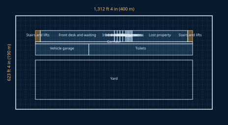
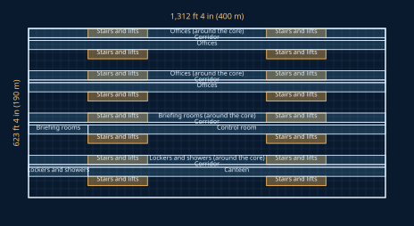

# P6-07 Concourse Police Post: plan

Footprint 1,312 ft 4 in (400 m) × 623 ft 4 in (190 m) · structural grid 32 ft 10 in (10 m)

## Levels

| Level | Floor above deck | Height | Floor area |
|---|---|---|---|
| Level 1 · Ground floor | 0 ft (0 mm) | 13 ft 9 in (4,200 mm) | 153,493 sq ft (14,260 m²) |
| Level 2 · Upper floor | 13 ft 9 in (4,200 mm) | 13 ft 9 in (4,200 mm) | 153,493 sq ft (14,260 m²) |

## Elements

| ID | Designation | Type | Name | Level(s) | Size / length | Area | Status |
|---|---|---|---|---|---|---|---|
| E001 | D5F3P6B9A2L1R1, D5F3P6B9A2L2R1 | core | Stairs and lifts | L1, L2 | 32 ft 10 in (10 m) × 75 ft 6 in (23 m) | 2,476 sq ft (230 m²) | proposed |
| E002 | D5F3P6B9A2L1R2, D5F3P6B9A2L2R2 | core | Stairs and lifts | L1, L2 | 32 ft 10 in (10 m) × 75 ft 6 in (23 m) | 2,476 sq ft (230 m²) | proposed |
| E003 | D5F3P6B9A2L1R3 | zone | Corridor | L1 | 1,049 ft 10 in (320 m) × 13 ft 1 in (4,000 mm) | 13,778 sq ft (1,280 m²) | proposed |
| E004 | D5F3P6B9A2L1R4 | room | Front desk and waiting | L1 | 494 ft 9 in (151 m) × 75 ft 6 in (23 m) | 37,334 sq ft (3,468 m²) | proposed |
| E005 | D5F3P6B9A2L1R5 | room | Interview rooms | L1 | 18 ft 4 in (5,600 mm) × 75 ft 6 in (23 m) | 1,386 sq ft (129 m²) | proposed |
| E006 | D5F3P6B9A2L1R6 | room | Interview rooms | L1 | 18 ft 8 in (5,700 mm) × 75 ft 6 in (23 m) | 1,411 sq ft (131 m²) | proposed |
| E007 | D5F3P6B9A2L1R7 | room | Interview rooms | L1 | 18 ft 4 in (5,600 mm) × 75 ft 6 in (23 m) | 1,386 sq ft (129 m²) | proposed |
| E008 | D5F3P6B9A2L1R8 | room | Interview rooms | L1 | 18 ft 8 in (5,700 mm) × 75 ft 6 in (23 m) | 1,411 sq ft (131 m²) | proposed |
| E009 | D5F3P6B9A2L1R9 | room | Holding rooms | L1 | 7 ft 3 in (2,200 mm) × 75 ft 6 in (23 m) | 545 sq ft (51 m²) | proposed |
| E010 | D5F3P6B9A2L1R10 | room | Holding rooms | L1 | 7 ft 7 in (2,300 mm) × 75 ft 6 in (23 m) | 569 sq ft (53 m²) | proposed |
| E011 | D5F3P6B9A2L1R11 | room | Holding rooms | L1 | 7 ft 7 in (2,300 mm) × 75 ft 6 in (23 m) | 569 sq ft (53 m²) | proposed |
| E012 | D5F3P6B9A2L1R12 | room | Holding rooms | L1 | 7 ft 3 in (2,200 mm) × 75 ft 6 in (23 m) | 545 sq ft (51 m²) | proposed |
| E013 | D5F3P6B9A2L1R13 | room | Holding rooms | L1 | 7 ft 7 in (2,300 mm) × 75 ft 6 in (23 m) | 569 sq ft (53 m²) | proposed |
| E014 | D5F3P6B9A2L1R14 | room | Holding rooms | L1 | 7 ft 3 in (2,200 mm) × 75 ft 6 in (23 m) | 545 sq ft (51 m²) | proposed |
| E015 | D5F3P6B9A2L1R15 | room | Lost property | L1 | 371 ft 1 in (113 m) × 75 ft 6 in (23 m) | 28,000 sq ft (2,601 m²) | proposed |
| E016 | D5F3P6B9A2L1R16 | room | Vehicle garage | L1 | 356 ft 8 in (109 m) × 75 ft 6 in (23 m) | 26,911 sq ft (2,500 m²) | proposed |
| E017 | D5F3P6B9A2L1R17 | room | Toilets | L1 | 693 ft 3 in (211 m) × 75 ft 6 in (23 m) | 52,312 sq ft (4,860 m²) | proposed |
| E018 | D5F3P6B9A2L2R3 | zone | Corridor | L2 | 1,049 ft 10 in (320 m) × 13 ft 1 in (4,000 mm) | 13,778 sq ft (1,280 m²) | proposed |
| E019 | D5F3P6B9A2L2R4 | room | Open office | L2 | 984 ft 3 in (300 m) × 75 ft 6 in (23 m) | 74,271 sq ft (6,900 m²) | proposed |
| E020 | D5F3P6B9A2L2R5 | room | CCTV room | L2 | 114 ft 2 in (35 m) × 75 ft 6 in (23 m) | 8,615 sq ft (800 m²) | proposed |
| E021 | D5F3P6B9A2L2R6 | room | Briefing room | L2 | 42 ft 8 in (13 m) × 75 ft 6 in (23 m) | 3,218 sq ft (299 m²) | proposed |
| E022 | D5F3P6B9A2L2R7 | room | Lockers | L2 | 893 ft 1 in (272 m) × 75 ft 6 in (23 m) | 67,389 sq ft (6,261 m²) | proposed |
| E023 | D5F3P6B9A2L1R18 | zone | Yard | L1 | 1,049 ft 10 in (320 m) × 262 ft 6 in (80 m) | 275,556 sq ft (25,600 m²) | proposed |

## Drawings

### Level 1 · Ground floor

### Level 2 · Upper floor

