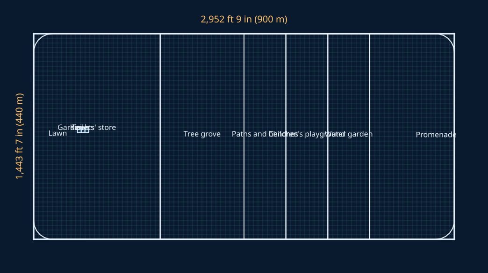

# P6-08 Promenade Park: plan

Footprint 2,952 ft 9 in (900 m) × 1,443 ft 7 in (440 m) · structural grid 32 ft 10 in (10 m)

## Levels

| Level | Floor above deck | Height | Floor area |
|---|---|---|---|
| Level 1 · Ground | 0 ft (0 mm) | 13 ft 1 in (4,000 mm) | 3,100 sq ft (288 m²) |

## Elements

| ID | Designation | Type | Name | Level(s) | Size / length | Area | Status |
|---|---|---|---|---|---|---|---|
| E001 | D5F3P6B2A1R1 | zone | Lawn | L1 | 888 ft 1 in (271 m) × 1,442 ft 7 in (440 m) | 1,272,569 sq ft (118,226 m²) | proposed |
| E002 | D5F3P6B2A1R2 | room | Kiosk | L1 | 26 ft 3 in (8,000 mm) × 39 ft 4 in (12 m) | 1,033 sq ft (96 m²) | proposed |
| E003 | D5F3P6B2A1R3 | room | Toilets | L1 | 26 ft 3 in (8,000 mm) × 39 ft 4 in (12 m) | 1,033 sq ft (96 m²) | proposed |
| E004 | D5F3P6B2A1R4 | room | Gardeners' store | L1 | 26 ft 3 in (8,000 mm) × 39 ft 4 in (12 m) | 1,033 sq ft (96 m²) | proposed |
| E005 | D5F3P6B2A1R5 | zone | Tree grove | L1 | 588 ft 3 in (179 m) × 1,442 ft 7 in (440 m) | 848,414 sq ft (78,820 m²) | proposed |
| E006 | D5F3P6B2A1R6 | zone | Paths and benches | L1 | 294 ft (90 m) × 1,442 ft 3 in (440 m) | 423,971 sq ft (39,388 m²) | proposed |
| E007 | D5F3P6B2A1R7 | zone | Children's playground | L1 | 294 ft 3 in (90 m) × 1,442 ft 7 in (440 m) | 424,444 sq ft (39,432 m²) | proposed |
| E008 | D5F3P6B2A1R8 | zone | Water garden | L1 | 294 ft (90 m) × 1,442 ft 3 in (440 m) | 423,971 sq ft (39,388 m²) | proposed |
| E009 | D5F3P6B2A1R9 | zone | Promenade | L1 | 594 ft 2 in (181 m) × 1,442 ft 7 in (440 m) | 848,599 sq ft (78,837 m²) | proposed |

## Drawings

### Level 1 · Ground

