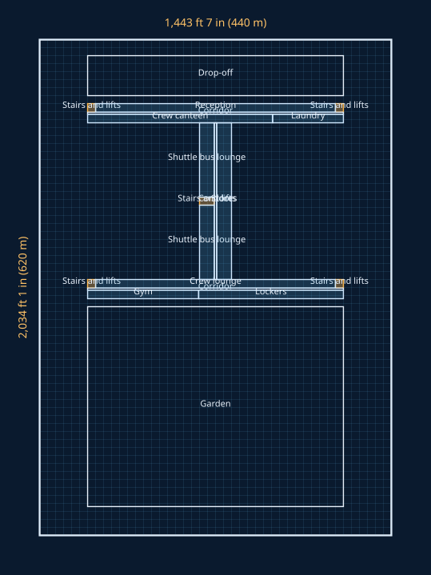
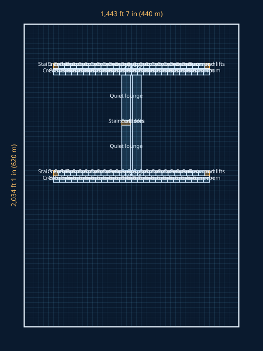
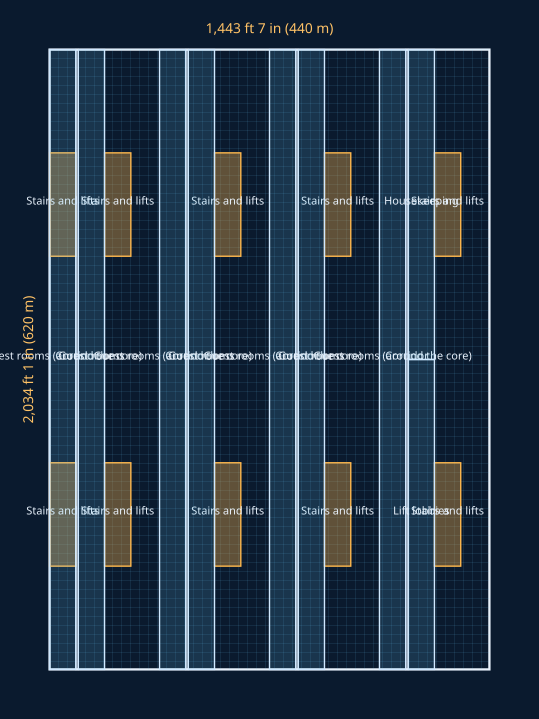

# P6-12 Crew Hotel: plan

Footprint 1,443 ft 7 in (440 m) × 2,034 ft 1 in (620 m) · structural grid 32 ft 10 in (10 m)

## Levels

| Level | Floor above deck | Height | Floor area |
|---|---|---|---|
| Level 1 · Ground floor | 0 ft (0 mm) | 16 ft 5 in (5,000 mm) | 220,219 sq ft (20,459 m²) |
| Level 2 · Guest floors | 16 ft 5 in (5,000 mm) | 11 ft 2 in (3,400 mm) | 220,219 sq ft (20,459 m²) |
| Level 3 · Guest floors | 27 ft 7 in (8,400 mm) | 11 ft 2 in (3,400 mm) | 144,150 sq ft (13,392 m²) |
| Level 4 · Guest floors | 38 ft 9 in (12 m) | 11 ft 2 in (3,400 mm) | 144,150 sq ft (13,392 m²) |
| Level 5 · Guest floors | 49 ft 10 in (15 m) | 11 ft 2 in (3,400 mm) | 144,150 sq ft (13,392 m²) |
| Level 6 · Guest floors | 61 ft (19 m) | 11 ft 2 in (3,400 mm) | 144,150 sq ft (13,392 m²) |
| Level 7 · Guest floors | 72 ft 2 in (22 m) | 11 ft 2 in (3,400 mm) | 144,150 sq ft (13,392 m²) |
| Level 8 · Guest floors | 83 ft 4 in (25 m) | 11 ft 2 in (3,400 mm) | 144,150 sq ft (13,392 m²) |
| Level 9 · Guest floors | 94 ft 6 in (29 m) | 11 ft 2 in (3,400 mm) | 144,150 sq ft (13,392 m²) |
| Level 10 · Guest floors | 105 ft 8 in (32 m) | 11 ft 2 in (3,400 mm) | 144,150 sq ft (13,392 m²) |

## Elements

| ID | Designation | Type | Name | Level(s) | Size / length | Area | Status |
|---|---|---|---|---|---|---|---|
| E001 | D5F3P6B8A1L1R1, D5F3P6B8A1L2R1, D5F3P6B8A1L3R1, D5F3P6B8A1L4R1, D5F3P6B8A1L5R1, D5F3P6B8A1L6R1, D5F3P6B8A1L7R1, D5F3P6B8A1L8R1, D5F3P6B8A1L9R1, D5F3P6B8A1L10R1 | core | Stairs and lifts | L1, L2, L3, L4, L5, L6, L7, L8, L9, L10 | 32 ft 10 in (10 m) × 35 ft 5 in (11 m) | 1,163 sq ft (108 m²) | proposed |
| E002 | D5F3P6B8A1L1R2, D5F3P6B8A1L2R2, D5F3P6B8A1L3R2, D5F3P6B8A1L4R2, D5F3P6B8A1L5R2, D5F3P6B8A1L6R2, D5F3P6B8A1L7R2, D5F3P6B8A1L8R2, D5F3P6B8A1L9R2, D5F3P6B8A1L10R2 | core | Stairs and lifts | L1, L2, L3, L4, L5, L6, L7, L8, L9, L10 | 32 ft 10 in (10 m) × 35 ft 5 in (11 m) | 1,163 sq ft (108 m²) | proposed |
| E003 | D5F3P6B8A1L1R3 | zone | Corridor | L1 | 1,049 ft 10 in (320 m) × 7 ft 10 in (2,400 mm) | 8,267 sq ft (768 m²) | proposed |
| E004 | D5F3P6B8A1L1R4 | room | Reception | L1 | 984 ft 3 in (300 m) × 35 ft 5 in (11 m) | 34,875 sq ft (3,240 m²) | proposed |
| E005 | D5F3P6B8A1L1R5 | room | Crew canteen | L1 | 759 ft 6 in (232 m) × 35 ft 5 in (11 m) | 26,912 sq ft (2,500 m²) | proposed |
| E006 | D5F3P6B8A1L1R6 | room | Laundry | L1 | 290 ft 4 in (88 m) × 35 ft 5 in (11 m) | 10,288 sq ft (956 m²) | proposed |
| E007 | D5F3P6B8A1L2R3, D5F3P6B8A1L3R3, D5F3P6B8A1L4R3, D5F3P6B8A1L5R3, D5F3P6B8A1L6R3, D5F3P6B8A1L7R3, D5F3P6B8A1L8R3, D5F3P6B8A1L9R3, D5F3P6B8A1L10R3 | zone | Corridor | L2, L3, L4, L5, L6, L7, L8, L9, L10 | 1,049 ft 10 in (320 m) × 7 ft 10 in (2,400 mm) | 8,267 sq ft (768 m²) | proposed |
| E008 | D5F3P6B8A1L2R4, D5F3P6B8A1L3R4, D5F3P6B8A1L4R4, D5F3P6B8A1L5R4, D5F3P6B8A1L6R4, D5F3P6B8A1L7R4, D5F3P6B8A1L8R4, D5F3P6B8A1L9R4, D5F3P6B8A1L10R4 | room | Crew room | L2, L3, L4, L5, L6, L7, L8, L9, L10 | 41 ft (12 m) × 35 ft 5 in (11 m) | 1,453 sq ft (135 m²) | proposed |
| E009 | D5F3P6B8A1L2R5, D5F3P6B8A1L3R5, D5F3P6B8A1L4R5, D5F3P6B8A1L5R5, D5F3P6B8A1L6R5, D5F3P6B8A1L7R5, D5F3P6B8A1L8R5, D5F3P6B8A1L9R5, D5F3P6B8A1L10R5 | room | Crew room | L2, L3, L4, L5, L6, L7, L8, L9, L10 | 41 ft (12 m) × 35 ft 5 in (11 m) | 1,453 sq ft (135 m²) | proposed |
| E010 | D5F3P6B8A1L2R6, D5F3P6B8A1L3R6, D5F3P6B8A1L4R6, D5F3P6B8A1L5R6, D5F3P6B8A1L6R6, D5F3P6B8A1L7R6, D5F3P6B8A1L8R6, D5F3P6B8A1L9R6, D5F3P6B8A1L10R6 | room | Crew room | L2, L3, L4, L5, L6, L7, L8, L9, L10 | 41 ft (12 m) × 35 ft 5 in (11 m) | 1,453 sq ft (135 m²) | proposed |
| E011 | D5F3P6B8A1L2R7, D5F3P6B8A1L3R7, D5F3P6B8A1L4R7, D5F3P6B8A1L5R7, D5F3P6B8A1L6R7, D5F3P6B8A1L7R7, D5F3P6B8A1L8R7, D5F3P6B8A1L9R7, D5F3P6B8A1L10R7 | room | Crew room | L2, L3, L4, L5, L6, L7, L8, L9, L10 | 41 ft (12 m) × 35 ft 5 in (11 m) | 1,453 sq ft (135 m²) | proposed |
| E012 | D5F3P6B8A1L2R8, D5F3P6B8A1L3R8, D5F3P6B8A1L4R8, D5F3P6B8A1L5R8, D5F3P6B8A1L6R8, D5F3P6B8A1L7R8, D5F3P6B8A1L8R8, D5F3P6B8A1L9R8, D5F3P6B8A1L10R8 | room | Crew room | L2, L3, L4, L5, L6, L7, L8, L9, L10 | 41 ft (12 m) × 35 ft 5 in (11 m) | 1,453 sq ft (135 m²) | proposed |
| E013 | D5F3P6B8A1L2R9, D5F3P6B8A1L3R9, D5F3P6B8A1L4R9, D5F3P6B8A1L5R9, D5F3P6B8A1L6R9, D5F3P6B8A1L7R9, D5F3P6B8A1L8R9, D5F3P6B8A1L9R9, D5F3P6B8A1L10R9 | room | Crew room | L2, L3, L4, L5, L6, L7, L8, L9, L10 | 41 ft (12 m) × 35 ft 5 in (11 m) | 1,453 sq ft (135 m²) | proposed |
| E014 | D5F3P6B8A1L2R10, D5F3P6B8A1L3R10, D5F3P6B8A1L4R10, D5F3P6B8A1L5R10, D5F3P6B8A1L6R10, D5F3P6B8A1L7R10, D5F3P6B8A1L8R10, D5F3P6B8A1L9R10, D5F3P6B8A1L10R10 | room | Crew room | L2, L3, L4, L5, L6, L7, L8, L9, L10 | 41 ft (12 m) × 35 ft 5 in (11 m) | 1,453 sq ft (135 m²) | proposed |
| E015 | D5F3P6B8A1L2R11, D5F3P6B8A1L3R11, D5F3P6B8A1L4R11, D5F3P6B8A1L5R11, D5F3P6B8A1L6R11, D5F3P6B8A1L7R11, D5F3P6B8A1L8R11, D5F3P6B8A1L9R11, D5F3P6B8A1L10R11 | room | Crew room | L2, L3, L4, L5, L6, L7, L8, L9, L10 | 41 ft (12 m) × 35 ft 5 in (11 m) | 1,453 sq ft (135 m²) | proposed |
| E016 | D5F3P6B8A1L2R12, D5F3P6B8A1L3R12, D5F3P6B8A1L4R12, D5F3P6B8A1L5R12, D5F3P6B8A1L6R12, D5F3P6B8A1L7R12, D5F3P6B8A1L8R12, D5F3P6B8A1L9R12, D5F3P6B8A1L10R12 | room | Crew room | L2, L3, L4, L5, L6, L7, L8, L9, L10 | 41 ft (12 m) × 35 ft 5 in (11 m) | 1,453 sq ft (135 m²) | proposed |
| E017 | D5F3P6B8A1L2R13, D5F3P6B8A1L3R13, D5F3P6B8A1L4R13, D5F3P6B8A1L5R13, D5F3P6B8A1L6R13, D5F3P6B8A1L7R13, D5F3P6B8A1L8R13, D5F3P6B8A1L9R13, D5F3P6B8A1L10R13 | room | Crew room | L2, L3, L4, L5, L6, L7, L8, L9, L10 | 41 ft (12 m) × 35 ft 5 in (11 m) | 1,453 sq ft (135 m²) | proposed |
| E018 | D5F3P6B8A1L2R14, D5F3P6B8A1L3R14, D5F3P6B8A1L4R14, D5F3P6B8A1L5R14, D5F3P6B8A1L6R14, D5F3P6B8A1L7R14, D5F3P6B8A1L8R14, D5F3P6B8A1L9R14, D5F3P6B8A1L10R14 | room | Crew room | L2, L3, L4, L5, L6, L7, L8, L9, L10 | 41 ft (12 m) × 35 ft 5 in (11 m) | 1,453 sq ft (135 m²) | proposed |
| E019 | D5F3P6B8A1L2R15, D5F3P6B8A1L3R15, D5F3P6B8A1L4R15, D5F3P6B8A1L5R15, D5F3P6B8A1L6R15, D5F3P6B8A1L7R15, D5F3P6B8A1L8R15, D5F3P6B8A1L9R15, D5F3P6B8A1L10R15 | room | Crew room | L2, L3, L4, L5, L6, L7, L8, L9, L10 | 41 ft (12 m) × 35 ft 5 in (11 m) | 1,453 sq ft (135 m²) | proposed |
| E020 | D5F3P6B8A1L2R16, D5F3P6B8A1L3R16, D5F3P6B8A1L4R16, D5F3P6B8A1L5R16, D5F3P6B8A1L6R16, D5F3P6B8A1L7R16, D5F3P6B8A1L8R16, D5F3P6B8A1L9R16, D5F3P6B8A1L10R16 | room | Crew room | L2, L3, L4, L5, L6, L7, L8, L9, L10 | 41 ft (12 m) × 35 ft 5 in (11 m) | 1,453 sq ft (135 m²) | proposed |
| E021 | D5F3P6B8A1L2R17, D5F3P6B8A1L3R17, D5F3P6B8A1L4R17, D5F3P6B8A1L5R17, D5F3P6B8A1L6R17, D5F3P6B8A1L7R17, D5F3P6B8A1L8R17, D5F3P6B8A1L9R17, D5F3P6B8A1L10R17 | room | Crew room | L2, L3, L4, L5, L6, L7, L8, L9, L10 | 41 ft (12 m) × 35 ft 5 in (11 m) | 1,453 sq ft (135 m²) | proposed |
| E022 | D5F3P6B8A1L2R18, D5F3P6B8A1L3R18, D5F3P6B8A1L4R18, D5F3P6B8A1L5R18, D5F3P6B8A1L6R18, D5F3P6B8A1L7R18, D5F3P6B8A1L8R18, D5F3P6B8A1L9R18, D5F3P6B8A1L10R18 | room | Crew room | L2, L3, L4, L5, L6, L7, L8, L9, L10 | 41 ft (12 m) × 35 ft 5 in (11 m) | 1,453 sq ft (135 m²) | proposed |
| E023 | D5F3P6B8A1L2R19, D5F3P6B8A1L3R19, D5F3P6B8A1L4R19, D5F3P6B8A1L5R19, D5F3P6B8A1L6R19, D5F3P6B8A1L7R19, D5F3P6B8A1L8R19, D5F3P6B8A1L9R19, D5F3P6B8A1L10R19 | room | Crew room | L2, L3, L4, L5, L6, L7, L8, L9, L10 | 41 ft (12 m) × 35 ft 5 in (11 m) | 1,453 sq ft (135 m²) | proposed |
| E024 | D5F3P6B8A1L2R20, D5F3P6B8A1L3R20, D5F3P6B8A1L4R20, D5F3P6B8A1L5R20, D5F3P6B8A1L6R20, D5F3P6B8A1L7R20, D5F3P6B8A1L8R20, D5F3P6B8A1L9R20, D5F3P6B8A1L10R20 | room | Crew room | L2, L3, L4, L5, L6, L7, L8, L9, L10 | 41 ft (12 m) × 35 ft 5 in (11 m) | 1,453 sq ft (135 m²) | proposed |
| E025 | D5F3P6B8A1L2R21, D5F3P6B8A1L3R21, D5F3P6B8A1L4R21, D5F3P6B8A1L5R21, D5F3P6B8A1L6R21, D5F3P6B8A1L7R21, D5F3P6B8A1L8R21, D5F3P6B8A1L9R21, D5F3P6B8A1L10R21 | room | Crew room | L2, L3, L4, L5, L6, L7, L8, L9, L10 | 41 ft (12 m) × 35 ft 5 in (11 m) | 1,453 sq ft (135 m²) | proposed |
| E026 | D5F3P6B8A1L2R22, D5F3P6B8A1L3R22, D5F3P6B8A1L4R22, D5F3P6B8A1L5R22, D5F3P6B8A1L6R22, D5F3P6B8A1L7R22, D5F3P6B8A1L8R22, D5F3P6B8A1L9R22, D5F3P6B8A1L10R22 | room | Crew room | L2, L3, L4, L5, L6, L7, L8, L9, L10 | 41 ft (12 m) × 35 ft 5 in (11 m) | 1,453 sq ft (135 m²) | proposed |
| E027 | D5F3P6B8A1L2R23, D5F3P6B8A1L3R23, D5F3P6B8A1L4R23, D5F3P6B8A1L5R23, D5F3P6B8A1L6R23, D5F3P6B8A1L7R23, D5F3P6B8A1L8R23, D5F3P6B8A1L9R23, D5F3P6B8A1L10R23 | room | Crew room | L2, L3, L4, L5, L6, L7, L8, L9, L10 | 41 ft (12 m) × 35 ft 5 in (11 m) | 1,453 sq ft (135 m²) | proposed |
| E028 | D5F3P6B8A1L2R24, D5F3P6B8A1L3R24, D5F3P6B8A1L4R24, D5F3P6B8A1L5R24, D5F3P6B8A1L6R24, D5F3P6B8A1L7R24, D5F3P6B8A1L8R24, D5F3P6B8A1L9R24, D5F3P6B8A1L10R24 | room | Crew room | L2, L3, L4, L5, L6, L7, L8, L9, L10 | 41 ft (12 m) × 35 ft 5 in (11 m) | 1,453 sq ft (135 m²) | proposed |
| E029 | D5F3P6B8A1L2R25, D5F3P6B8A1L3R25, D5F3P6B8A1L4R25, D5F3P6B8A1L5R25, D5F3P6B8A1L6R25, D5F3P6B8A1L7R25, D5F3P6B8A1L8R25, D5F3P6B8A1L9R25, D5F3P6B8A1L10R25 | room | Crew room | L2, L3, L4, L5, L6, L7, L8, L9, L10 | 41 ft (12 m) × 35 ft 5 in (11 m) | 1,453 sq ft (135 m²) | proposed |
| E030 | D5F3P6B8A1L2R26, D5F3P6B8A1L3R26, D5F3P6B8A1L4R26, D5F3P6B8A1L5R26, D5F3P6B8A1L6R26, D5F3P6B8A1L7R26, D5F3P6B8A1L8R26, D5F3P6B8A1L9R26, D5F3P6B8A1L10R26 | room | Crew room | L2, L3, L4, L5, L6, L7, L8, L9, L10 | 41 ft (12 m) × 35 ft 5 in (11 m) | 1,453 sq ft (135 m²) | proposed |
| E031 | D5F3P6B8A1L2R27, D5F3P6B8A1L3R27, D5F3P6B8A1L4R27, D5F3P6B8A1L5R27, D5F3P6B8A1L6R27, D5F3P6B8A1L7R27, D5F3P6B8A1L8R27, D5F3P6B8A1L9R27, D5F3P6B8A1L10R27 | room | Crew room | L2, L3, L4, L5, L6, L7, L8, L9, L10 | 41 ft (12 m) × 35 ft 5 in (11 m) | 1,453 sq ft (135 m²) | proposed |
| E032 | D5F3P6B8A1L2R28, D5F3P6B8A1L3R28, D5F3P6B8A1L4R28, D5F3P6B8A1L5R28, D5F3P6B8A1L6R28, D5F3P6B8A1L7R28, D5F3P6B8A1L8R28, D5F3P6B8A1L9R28, D5F3P6B8A1L10R28 | room | Crew room | L2, L3, L4, L5, L6, L7, L8, L9, L10 | 40 ft 4 in (12 m) × 35 ft 5 in (11 m) | 1,430 sq ft (133 m²) | proposed |
| E033 | D5F3P6B8A1L2R29, D5F3P6B8A1L3R29, D5F3P6B8A1L4R29, D5F3P6B8A1L5R29, D5F3P6B8A1L6R29, D5F3P6B8A1L7R29, D5F3P6B8A1L8R29, D5F3P6B8A1L9R29, D5F3P6B8A1L10R29 | room | Crew room | L2, L3, L4, L5, L6, L7, L8, L9, L10 | 40 ft 4 in (12 m) × 35 ft 5 in (11 m) | 1,430 sq ft (133 m²) | proposed |
| E034 | D5F3P6B8A1L2R30, D5F3P6B8A1L3R30, D5F3P6B8A1L4R30, D5F3P6B8A1L5R30, D5F3P6B8A1L6R30, D5F3P6B8A1L7R30, D5F3P6B8A1L8R30, D5F3P6B8A1L9R30, D5F3P6B8A1L10R30 | room | Crew room | L2, L3, L4, L5, L6, L7, L8, L9, L10 | 40 ft 4 in (12 m) × 35 ft 5 in (11 m) | 1,430 sq ft (133 m²) | proposed |
| E035 | D5F3P6B8A1L2R31, D5F3P6B8A1L3R31, D5F3P6B8A1L4R31, D5F3P6B8A1L5R31, D5F3P6B8A1L6R31, D5F3P6B8A1L7R31, D5F3P6B8A1L8R31, D5F3P6B8A1L9R31, D5F3P6B8A1L10R31 | room | Crew room | L2, L3, L4, L5, L6, L7, L8, L9, L10 | 40 ft 4 in (12 m) × 35 ft 5 in (11 m) | 1,430 sq ft (133 m²) | proposed |
| E036 | D5F3P6B8A1L2R32, D5F3P6B8A1L3R32, D5F3P6B8A1L4R32, D5F3P6B8A1L5R32, D5F3P6B8A1L6R32, D5F3P6B8A1L7R32, D5F3P6B8A1L8R32, D5F3P6B8A1L9R32, D5F3P6B8A1L10R32 | room | Crew room | L2, L3, L4, L5, L6, L7, L8, L9, L10 | 40 ft 4 in (12 m) × 35 ft 5 in (11 m) | 1,430 sq ft (133 m²) | proposed |
| E037 | D5F3P6B8A1L2R33, D5F3P6B8A1L3R33, D5F3P6B8A1L4R33, D5F3P6B8A1L5R33, D5F3P6B8A1L6R33, D5F3P6B8A1L7R33, D5F3P6B8A1L8R33, D5F3P6B8A1L9R33, D5F3P6B8A1L10R33 | room | Crew room | L2, L3, L4, L5, L6, L7, L8, L9, L10 | 40 ft 4 in (12 m) × 35 ft 5 in (11 m) | 1,430 sq ft (133 m²) | proposed |
| E038 | D5F3P6B8A1L2R34, D5F3P6B8A1L3R34, D5F3P6B8A1L4R34, D5F3P6B8A1L5R34, D5F3P6B8A1L6R34, D5F3P6B8A1L7R34, D5F3P6B8A1L8R34, D5F3P6B8A1L9R34, D5F3P6B8A1L10R34 | room | Crew room | L2, L3, L4, L5, L6, L7, L8, L9, L10 | 40 ft 8 in (12 m) × 35 ft 5 in (11 m) | 1,442 sq ft (134 m²) | proposed |
| E039 | D5F3P6B8A1L2R35, D5F3P6B8A1L3R35, D5F3P6B8A1L4R35, D5F3P6B8A1L5R35, D5F3P6B8A1L6R35, D5F3P6B8A1L7R35, D5F3P6B8A1L8R35, D5F3P6B8A1L9R35, D5F3P6B8A1L10R35 | room | Crew room | L2, L3, L4, L5, L6, L7, L8, L9, L10 | 40 ft 4 in (12 m) × 35 ft 5 in (11 m) | 1,430 sq ft (133 m²) | proposed |
| E040 | D5F3P6B8A1L2R36, D5F3P6B8A1L3R36, D5F3P6B8A1L4R36, D5F3P6B8A1L5R36, D5F3P6B8A1L6R36, D5F3P6B8A1L7R36, D5F3P6B8A1L8R36, D5F3P6B8A1L9R36, D5F3P6B8A1L10R36 | room | Crew room | L2, L3, L4, L5, L6, L7, L8, L9, L10 | 40 ft 4 in (12 m) × 35 ft 5 in (11 m) | 1,430 sq ft (133 m²) | proposed |
| E041 | D5F3P6B8A1L2R37, D5F3P6B8A1L3R37, D5F3P6B8A1L4R37, D5F3P6B8A1L5R37, D5F3P6B8A1L6R37, D5F3P6B8A1L7R37, D5F3P6B8A1L8R37, D5F3P6B8A1L9R37, D5F3P6B8A1L10R37 | room | Crew room | L2, L3, L4, L5, L6, L7, L8, L9, L10 | 40 ft 4 in (12 m) × 35 ft 5 in (11 m) | 1,430 sq ft (133 m²) | proposed |
| E042 | D5F3P6B8A1L2R38, D5F3P6B8A1L3R38, D5F3P6B8A1L4R38, D5F3P6B8A1L5R38, D5F3P6B8A1L6R38, D5F3P6B8A1L7R38, D5F3P6B8A1L8R38, D5F3P6B8A1L9R38, D5F3P6B8A1L10R38 | room | Crew room | L2, L3, L4, L5, L6, L7, L8, L9, L10 | 40 ft 4 in (12 m) × 35 ft 5 in (11 m) | 1,430 sq ft (133 m²) | proposed |
| E043 | D5F3P6B8A1L2R39, D5F3P6B8A1L3R39, D5F3P6B8A1L4R39, D5F3P6B8A1L5R39, D5F3P6B8A1L6R39, D5F3P6B8A1L7R39, D5F3P6B8A1L8R39, D5F3P6B8A1L9R39, D5F3P6B8A1L10R39 | room | Crew room | L2, L3, L4, L5, L6, L7, L8, L9, L10 | 40 ft 4 in (12 m) × 35 ft 5 in (11 m) | 1,430 sq ft (133 m²) | proposed |
| E044 | D5F3P6B8A1L2R40, D5F3P6B8A1L3R40, D5F3P6B8A1L4R40, D5F3P6B8A1L5R40, D5F3P6B8A1L6R40, D5F3P6B8A1L7R40, D5F3P6B8A1L8R40, D5F3P6B8A1L9R40, D5F3P6B8A1L10R40 | room | Crew room | L2, L3, L4, L5, L6, L7, L8, L9, L10 | 40 ft 4 in (12 m) × 35 ft 5 in (11 m) | 1,430 sq ft (133 m²) | proposed |
| E045 | D5F3P6B8A1L2R41, D5F3P6B8A1L3R41, D5F3P6B8A1L4R41, D5F3P6B8A1L5R41, D5F3P6B8A1L6R41, D5F3P6B8A1L7R41, D5F3P6B8A1L8R41, D5F3P6B8A1L9R41, D5F3P6B8A1L10R41 | room | Crew room | L2, L3, L4, L5, L6, L7, L8, L9, L10 | 40 ft 4 in (12 m) × 35 ft 5 in (11 m) | 1,430 sq ft (133 m²) | proposed |
| E046 | D5F3P6B8A1L2R42, D5F3P6B8A1L3R42, D5F3P6B8A1L4R42, D5F3P6B8A1L5R42, D5F3P6B8A1L6R42, D5F3P6B8A1L7R42, D5F3P6B8A1L8R42, D5F3P6B8A1L9R42, D5F3P6B8A1L10R42 | room | Crew room | L2, L3, L4, L5, L6, L7, L8, L9, L10 | 40 ft 4 in (12 m) × 35 ft 5 in (11 m) | 1,430 sq ft (133 m²) | proposed |
| E047 | D5F3P6B8A1L2R43, D5F3P6B8A1L3R43, D5F3P6B8A1L4R43, D5F3P6B8A1L5R43, D5F3P6B8A1L6R43, D5F3P6B8A1L7R43, D5F3P6B8A1L8R43, D5F3P6B8A1L9R43, D5F3P6B8A1L10R43 | room | Crew room | L2, L3, L4, L5, L6, L7, L8, L9, L10 | 40 ft 4 in (12 m) × 35 ft 5 in (11 m) | 1,430 sq ft (133 m²) | proposed |
| E048 | D5F3P6B8A1L2R44, D5F3P6B8A1L3R44, D5F3P6B8A1L4R44, D5F3P6B8A1L5R44, D5F3P6B8A1L6R44, D5F3P6B8A1L7R44, D5F3P6B8A1L8R44, D5F3P6B8A1L9R44, D5F3P6B8A1L10R44 | room | Crew room | L2, L3, L4, L5, L6, L7, L8, L9, L10 | 40 ft 4 in (12 m) × 35 ft 5 in (11 m) | 1,430 sq ft (133 m²) | proposed |
| E049 | D5F3P6B8A1L2R45, D5F3P6B8A1L3R45, D5F3P6B8A1L4R45, D5F3P6B8A1L5R45, D5F3P6B8A1L6R45, D5F3P6B8A1L7R45, D5F3P6B8A1L8R45, D5F3P6B8A1L9R45, D5F3P6B8A1L10R45 | room | Crew room | L2, L3, L4, L5, L6, L7, L8, L9, L10 | 40 ft 4 in (12 m) × 35 ft 5 in (11 m) | 1,430 sq ft (133 m²) | proposed |
| E050 | D5F3P6B8A1L2R46, D5F3P6B8A1L3R46, D5F3P6B8A1L4R46, D5F3P6B8A1L5R46, D5F3P6B8A1L6R46, D5F3P6B8A1L7R46, D5F3P6B8A1L8R46, D5F3P6B8A1L9R46, D5F3P6B8A1L10R46 | room | Crew room | L2, L3, L4, L5, L6, L7, L8, L9, L10 | 40 ft 4 in (12 m) × 35 ft 5 in (11 m) | 1,430 sq ft (133 m²) | proposed |
| E051 | D5F3P6B8A1L2R47, D5F3P6B8A1L3R47, D5F3P6B8A1L4R47, D5F3P6B8A1L5R47, D5F3P6B8A1L6R47, D5F3P6B8A1L7R47, D5F3P6B8A1L8R47, D5F3P6B8A1L9R47, D5F3P6B8A1L10R47 | room | Crew room | L2, L3, L4, L5, L6, L7, L8, L9, L10 | 40 ft 8 in (12 m) × 35 ft 5 in (11 m) | 1,442 sq ft (134 m²) | proposed |
| E052 | D5F3P6B8A1L2R48, D5F3P6B8A1L3R48, D5F3P6B8A1L4R48, D5F3P6B8A1L5R48, D5F3P6B8A1L6R48, D5F3P6B8A1L7R48, D5F3P6B8A1L8R48, D5F3P6B8A1L9R48, D5F3P6B8A1L10R48 | room | Crew room | L2, L3, L4, L5, L6, L7, L8, L9, L10 | 40 ft 4 in (12 m) × 35 ft 5 in (11 m) | 1,430 sq ft (133 m²) | proposed |
| E053 | D5F3P6B8A1L2R49, D5F3P6B8A1L3R49, D5F3P6B8A1L4R49, D5F3P6B8A1L5R49, D5F3P6B8A1L6R49, D5F3P6B8A1L7R49, D5F3P6B8A1L8R49, D5F3P6B8A1L9R49, D5F3P6B8A1L10R49 | room | Crew room | L2, L3, L4, L5, L6, L7, L8, L9, L10 | 40 ft 4 in (12 m) × 35 ft 5 in (11 m) | 1,430 sq ft (133 m²) | proposed |
| E054 | D5F3P6B8A1L2R50, D5F3P6B8A1L3R50, D5F3P6B8A1L4R50, D5F3P6B8A1L5R50, D5F3P6B8A1L6R50, D5F3P6B8A1L7R50, D5F3P6B8A1L8R50, D5F3P6B8A1L9R50, D5F3P6B8A1L10R50 | room | Crew room | L2, L3, L4, L5, L6, L7, L8, L9, L10 | 40 ft 4 in (12 m) × 35 ft 5 in (11 m) | 1,430 sq ft (133 m²) | proposed |
| E055 | D5F3P6B8A1L2R51, D5F3P6B8A1L3R51, D5F3P6B8A1L4R51, D5F3P6B8A1L5R51, D5F3P6B8A1L6R51, D5F3P6B8A1L7R51, D5F3P6B8A1L8R51, D5F3P6B8A1L9R51, D5F3P6B8A1L10R51 | room | Crew room | L2, L3, L4, L5, L6, L7, L8, L9, L10 | 40 ft 4 in (12 m) × 35 ft 5 in (11 m) | 1,430 sq ft (133 m²) | proposed |
| E056 | D5F3P6B8A1L2R52, D5F3P6B8A1L3R52, D5F3P6B8A1L4R52, D5F3P6B8A1L5R52, D5F3P6B8A1L6R52, D5F3P6B8A1L7R52, D5F3P6B8A1L8R52, D5F3P6B8A1L9R52, D5F3P6B8A1L10R52 | room | Crew room | L2, L3, L4, L5, L6, L7, L8, L9, L10 | 40 ft 4 in (12 m) × 35 ft 5 in (11 m) | 1,430 sq ft (133 m²) | proposed |
| E057 | D5F3P6B8A1L2R53, D5F3P6B8A1L3R53, D5F3P6B8A1L4R53, D5F3P6B8A1L5R53, D5F3P6B8A1L6R53, D5F3P6B8A1L7R53, D5F3P6B8A1L8R53, D5F3P6B8A1L9R53, D5F3P6B8A1L10R53 | room | Crew room | L2, L3, L4, L5, L6, L7, L8, L9, L10 | 40 ft 4 in (12 m) × 35 ft 5 in (11 m) | 1,430 sq ft (133 m²) | proposed |
| E058 | D5F3P6B8A1L1R7, D5F3P6B8A1L2R54, D5F3P6B8A1L3R54, D5F3P6B8A1L4R54, D5F3P6B8A1L5R54, D5F3P6B8A1L6R54, D5F3P6B8A1L7R54, D5F3P6B8A1L8R54, D5F3P6B8A1L9R54, D5F3P6B8A1L10R54 | core | Stairs and lifts | L1, L2, L3, L4, L5, L6, L7, L8, L9, L10 | 32 ft 10 in (10 m) × 35 ft 5 in (11 m) | 1,163 sq ft (108 m²) | proposed |
| E059 | D5F3P6B8A1L1R8, D5F3P6B8A1L2R55, D5F3P6B8A1L3R55, D5F3P6B8A1L4R55, D5F3P6B8A1L5R55, D5F3P6B8A1L6R55, D5F3P6B8A1L7R55, D5F3P6B8A1L8R55, D5F3P6B8A1L9R55, D5F3P6B8A1L10R55 | core | Stairs and lifts | L1, L2, L3, L4, L5, L6, L7, L8, L9, L10 | 32 ft 10 in (10 m) × 35 ft 5 in (11 m) | 1,163 sq ft (108 m²) | proposed |
| E060 | D5F3P6B8A1L1R9 | zone | Corridor | L1 | 1,049 ft 10 in (320 m) × 7 ft 10 in (2,400 mm) | 8,267 sq ft (768 m²) | proposed |
| E061 | D5F3P6B8A1L1R10 | room | Crew lounge | L1 | 984 ft 3 in (300 m) × 35 ft 5 in (11 m) | 34,875 sq ft (3,240 m²) | proposed |
| E062 | D5F3P6B8A1L1R11 | room | Gym | L1 | 455 ft 9 in (139 m) × 35 ft 5 in (11 m) | 16,147 sq ft (1,500 m²) | proposed |
| E063 | D5F3P6B8A1L1R12 | room | Lockers | L1 | 594 ft 2 in (181 m) × 35 ft 5 in (11 m) | 21,053 sq ft (1,956 m²) | proposed |
| E064 | D5F3P6B8A1L2R56, D5F3P6B8A1L3R56, D5F3P6B8A1L4R56, D5F3P6B8A1L5R56, D5F3P6B8A1L6R56, D5F3P6B8A1L7R56, D5F3P6B8A1L8R56, D5F3P6B8A1L9R56, D5F3P6B8A1L10R56 | zone | Corridor | L2, L3, L4, L5, L6, L7, L8, L9, L10 | 1,049 ft 10 in (320 m) × 7 ft 10 in (2,400 mm) | 8,267 sq ft (768 m²) | proposed |
| E065 | D5F3P6B8A1L2R57, D5F3P6B8A1L3R57, D5F3P6B8A1L4R57, D5F3P6B8A1L5R57, D5F3P6B8A1L6R57, D5F3P6B8A1L7R57, D5F3P6B8A1L8R57, D5F3P6B8A1L9R57, D5F3P6B8A1L10R57 | room | Crew room | L2, L3, L4, L5, L6, L7, L8, L9, L10 | 41 ft (12 m) × 35 ft 5 in (11 m) | 1,453 sq ft (135 m²) | proposed |
| E066 | D5F3P6B8A1L2R58, D5F3P6B8A1L3R58, D5F3P6B8A1L4R58, D5F3P6B8A1L5R58, D5F3P6B8A1L6R58, D5F3P6B8A1L7R58, D5F3P6B8A1L8R58, D5F3P6B8A1L9R58, D5F3P6B8A1L10R58 | room | Crew room | L2, L3, L4, L5, L6, L7, L8, L9, L10 | 41 ft (12 m) × 35 ft 5 in (11 m) | 1,453 sq ft (135 m²) | proposed |
| E067 | D5F3P6B8A1L2R59, D5F3P6B8A1L3R59, D5F3P6B8A1L4R59, D5F3P6B8A1L5R59, D5F3P6B8A1L6R59, D5F3P6B8A1L7R59, D5F3P6B8A1L8R59, D5F3P6B8A1L9R59, D5F3P6B8A1L10R59 | room | Crew room | L2, L3, L4, L5, L6, L7, L8, L9, L10 | 41 ft (12 m) × 35 ft 5 in (11 m) | 1,453 sq ft (135 m²) | proposed |
| E068 | D5F3P6B8A1L2R60, D5F3P6B8A1L3R60, D5F3P6B8A1L4R60, D5F3P6B8A1L5R60, D5F3P6B8A1L6R60, D5F3P6B8A1L7R60, D5F3P6B8A1L8R60, D5F3P6B8A1L9R60, D5F3P6B8A1L10R60 | room | Crew room | L2, L3, L4, L5, L6, L7, L8, L9, L10 | 41 ft (12 m) × 35 ft 5 in (11 m) | 1,453 sq ft (135 m²) | proposed |
| E069 | D5F3P6B8A1L2R61, D5F3P6B8A1L3R61, D5F3P6B8A1L4R61, D5F3P6B8A1L5R61, D5F3P6B8A1L6R61, D5F3P6B8A1L7R61, D5F3P6B8A1L8R61, D5F3P6B8A1L9R61, D5F3P6B8A1L10R61 | room | Crew room | L2, L3, L4, L5, L6, L7, L8, L9, L10 | 41 ft (12 m) × 35 ft 5 in (11 m) | 1,453 sq ft (135 m²) | proposed |
| E070 | D5F3P6B8A1L2R62, D5F3P6B8A1L3R62, D5F3P6B8A1L4R62, D5F3P6B8A1L5R62, D5F3P6B8A1L6R62, D5F3P6B8A1L7R62, D5F3P6B8A1L8R62, D5F3P6B8A1L9R62, D5F3P6B8A1L10R62 | room | Crew room | L2, L3, L4, L5, L6, L7, L8, L9, L10 | 41 ft (12 m) × 35 ft 5 in (11 m) | 1,453 sq ft (135 m²) | proposed |
| E071 | D5F3P6B8A1L2R63, D5F3P6B8A1L3R63, D5F3P6B8A1L4R63, D5F3P6B8A1L5R63, D5F3P6B8A1L6R63, D5F3P6B8A1L7R63, D5F3P6B8A1L8R63, D5F3P6B8A1L9R63, D5F3P6B8A1L10R63 | room | Crew room | L2, L3, L4, L5, L6, L7, L8, L9, L10 | 41 ft (12 m) × 35 ft 5 in (11 m) | 1,453 sq ft (135 m²) | proposed |
| E072 | D5F3P6B8A1L2R64, D5F3P6B8A1L3R64, D5F3P6B8A1L4R64, D5F3P6B8A1L5R64, D5F3P6B8A1L6R64, D5F3P6B8A1L7R64, D5F3P6B8A1L8R64, D5F3P6B8A1L9R64, D5F3P6B8A1L10R64 | room | Crew room | L2, L3, L4, L5, L6, L7, L8, L9, L10 | 41 ft (12 m) × 35 ft 5 in (11 m) | 1,453 sq ft (135 m²) | proposed |
| E073 | D5F3P6B8A1L2R65, D5F3P6B8A1L3R65, D5F3P6B8A1L4R65, D5F3P6B8A1L5R65, D5F3P6B8A1L6R65, D5F3P6B8A1L7R65, D5F3P6B8A1L8R65, D5F3P6B8A1L9R65, D5F3P6B8A1L10R65 | room | Crew room | L2, L3, L4, L5, L6, L7, L8, L9, L10 | 41 ft (12 m) × 35 ft 5 in (11 m) | 1,453 sq ft (135 m²) | proposed |
| E074 | D5F3P6B8A1L2R66, D5F3P6B8A1L3R66, D5F3P6B8A1L4R66, D5F3P6B8A1L5R66, D5F3P6B8A1L6R66, D5F3P6B8A1L7R66, D5F3P6B8A1L8R66, D5F3P6B8A1L9R66, D5F3P6B8A1L10R66 | room | Crew room | L2, L3, L4, L5, L6, L7, L8, L9, L10 | 41 ft (12 m) × 35 ft 5 in (11 m) | 1,453 sq ft (135 m²) | proposed |
| E075 | D5F3P6B8A1L2R67, D5F3P6B8A1L3R67, D5F3P6B8A1L4R67, D5F3P6B8A1L5R67, D5F3P6B8A1L6R67, D5F3P6B8A1L7R67, D5F3P6B8A1L8R67, D5F3P6B8A1L9R67, D5F3P6B8A1L10R67 | room | Crew room | L2, L3, L4, L5, L6, L7, L8, L9, L10 | 41 ft (12 m) × 35 ft 5 in (11 m) | 1,453 sq ft (135 m²) | proposed |
| E076 | D5F3P6B8A1L2R68, D5F3P6B8A1L3R68, D5F3P6B8A1L4R68, D5F3P6B8A1L5R68, D5F3P6B8A1L6R68, D5F3P6B8A1L7R68, D5F3P6B8A1L8R68, D5F3P6B8A1L9R68, D5F3P6B8A1L10R68 | room | Crew room | L2, L3, L4, L5, L6, L7, L8, L9, L10 | 41 ft (12 m) × 35 ft 5 in (11 m) | 1,453 sq ft (135 m²) | proposed |
| E077 | D5F3P6B8A1L2R69, D5F3P6B8A1L3R69, D5F3P6B8A1L4R69, D5F3P6B8A1L5R69, D5F3P6B8A1L6R69, D5F3P6B8A1L7R69, D5F3P6B8A1L8R69, D5F3P6B8A1L9R69, D5F3P6B8A1L10R69 | room | Crew room | L2, L3, L4, L5, L6, L7, L8, L9, L10 | 41 ft (12 m) × 35 ft 5 in (11 m) | 1,453 sq ft (135 m²) | proposed |
| E078 | D5F3P6B8A1L2R70, D5F3P6B8A1L3R70, D5F3P6B8A1L4R70, D5F3P6B8A1L5R70, D5F3P6B8A1L6R70, D5F3P6B8A1L7R70, D5F3P6B8A1L8R70, D5F3P6B8A1L9R70, D5F3P6B8A1L10R70 | room | Crew room | L2, L3, L4, L5, L6, L7, L8, L9, L10 | 41 ft (12 m) × 35 ft 5 in (11 m) | 1,453 sq ft (135 m²) | proposed |
| E079 | D5F3P6B8A1L2R71, D5F3P6B8A1L3R71, D5F3P6B8A1L4R71, D5F3P6B8A1L5R71, D5F3P6B8A1L6R71, D5F3P6B8A1L7R71, D5F3P6B8A1L8R71, D5F3P6B8A1L9R71, D5F3P6B8A1L10R71 | room | Crew room | L2, L3, L4, L5, L6, L7, L8, L9, L10 | 41 ft (12 m) × 35 ft 5 in (11 m) | 1,453 sq ft (135 m²) | proposed |
| E080 | D5F3P6B8A1L2R72, D5F3P6B8A1L3R72, D5F3P6B8A1L4R72, D5F3P6B8A1L5R72, D5F3P6B8A1L6R72, D5F3P6B8A1L7R72, D5F3P6B8A1L8R72, D5F3P6B8A1L9R72, D5F3P6B8A1L10R72 | room | Crew room | L2, L3, L4, L5, L6, L7, L8, L9, L10 | 41 ft (12 m) × 35 ft 5 in (11 m) | 1,453 sq ft (135 m²) | proposed |
| E081 | D5F3P6B8A1L2R73, D5F3P6B8A1L3R73, D5F3P6B8A1L4R73, D5F3P6B8A1L5R73, D5F3P6B8A1L6R73, D5F3P6B8A1L7R73, D5F3P6B8A1L8R73, D5F3P6B8A1L9R73, D5F3P6B8A1L10R73 | room | Crew room | L2, L3, L4, L5, L6, L7, L8, L9, L10 | 41 ft (12 m) × 35 ft 5 in (11 m) | 1,453 sq ft (135 m²) | proposed |
| E082 | D5F3P6B8A1L2R74, D5F3P6B8A1L3R74, D5F3P6B8A1L4R74, D5F3P6B8A1L5R74, D5F3P6B8A1L6R74, D5F3P6B8A1L7R74, D5F3P6B8A1L8R74, D5F3P6B8A1L9R74, D5F3P6B8A1L10R74 | room | Crew room | L2, L3, L4, L5, L6, L7, L8, L9, L10 | 41 ft (12 m) × 35 ft 5 in (11 m) | 1,453 sq ft (135 m²) | proposed |
| E083 | D5F3P6B8A1L2R75, D5F3P6B8A1L3R75, D5F3P6B8A1L4R75, D5F3P6B8A1L5R75, D5F3P6B8A1L6R75, D5F3P6B8A1L7R75, D5F3P6B8A1L8R75, D5F3P6B8A1L9R75, D5F3P6B8A1L10R75 | room | Crew room | L2, L3, L4, L5, L6, L7, L8, L9, L10 | 41 ft (12 m) × 35 ft 5 in (11 m) | 1,453 sq ft (135 m²) | proposed |
| E084 | D5F3P6B8A1L2R76, D5F3P6B8A1L3R76, D5F3P6B8A1L4R76, D5F3P6B8A1L5R76, D5F3P6B8A1L6R76, D5F3P6B8A1L7R76, D5F3P6B8A1L8R76, D5F3P6B8A1L9R76, D5F3P6B8A1L10R76 | room | Crew room | L2, L3, L4, L5, L6, L7, L8, L9, L10 | 41 ft (12 m) × 35 ft 5 in (11 m) | 1,453 sq ft (135 m²) | proposed |
| E085 | D5F3P6B8A1L2R77, D5F3P6B8A1L3R77, D5F3P6B8A1L4R77, D5F3P6B8A1L5R77, D5F3P6B8A1L6R77, D5F3P6B8A1L7R77, D5F3P6B8A1L8R77, D5F3P6B8A1L9R77, D5F3P6B8A1L10R77 | room | Crew room | L2, L3, L4, L5, L6, L7, L8, L9, L10 | 41 ft (12 m) × 35 ft 5 in (11 m) | 1,453 sq ft (135 m²) | proposed |
| E086 | D5F3P6B8A1L2R78, D5F3P6B8A1L3R78, D5F3P6B8A1L4R78, D5F3P6B8A1L5R78, D5F3P6B8A1L6R78, D5F3P6B8A1L7R78, D5F3P6B8A1L8R78, D5F3P6B8A1L9R78, D5F3P6B8A1L10R78 | room | Crew room | L2, L3, L4, L5, L6, L7, L8, L9, L10 | 41 ft (12 m) × 35 ft 5 in (11 m) | 1,453 sq ft (135 m²) | proposed |
| E087 | D5F3P6B8A1L2R79, D5F3P6B8A1L3R79, D5F3P6B8A1L4R79, D5F3P6B8A1L5R79, D5F3P6B8A1L6R79, D5F3P6B8A1L7R79, D5F3P6B8A1L8R79, D5F3P6B8A1L9R79, D5F3P6B8A1L10R79 | room | Crew room | L2, L3, L4, L5, L6, L7, L8, L9, L10 | 41 ft (12 m) × 35 ft 5 in (11 m) | 1,453 sq ft (135 m²) | proposed |
| E088 | D5F3P6B8A1L2R80, D5F3P6B8A1L3R80, D5F3P6B8A1L4R80, D5F3P6B8A1L5R80, D5F3P6B8A1L6R80, D5F3P6B8A1L7R80, D5F3P6B8A1L8R80, D5F3P6B8A1L9R80, D5F3P6B8A1L10R80 | room | Crew room | L2, L3, L4, L5, L6, L7, L8, L9, L10 | 41 ft (12 m) × 35 ft 5 in (11 m) | 1,453 sq ft (135 m²) | proposed |
| E089 | D5F3P6B8A1L2R81, D5F3P6B8A1L3R81, D5F3P6B8A1L4R81, D5F3P6B8A1L5R81, D5F3P6B8A1L6R81, D5F3P6B8A1L7R81, D5F3P6B8A1L8R81, D5F3P6B8A1L9R81, D5F3P6B8A1L10R81 | room | Crew room | L2, L3, L4, L5, L6, L7, L8, L9, L10 | 40 ft 4 in (12 m) × 35 ft 5 in (11 m) | 1,430 sq ft (133 m²) | proposed |
| E090 | D5F3P6B8A1L2R82, D5F3P6B8A1L3R82, D5F3P6B8A1L4R82, D5F3P6B8A1L5R82, D5F3P6B8A1L6R82, D5F3P6B8A1L7R82, D5F3P6B8A1L8R82, D5F3P6B8A1L9R82, D5F3P6B8A1L10R82 | room | Crew room | L2, L3, L4, L5, L6, L7, L8, L9, L10 | 40 ft 4 in (12 m) × 35 ft 5 in (11 m) | 1,430 sq ft (133 m²) | proposed |
| E091 | D5F3P6B8A1L2R83, D5F3P6B8A1L3R83, D5F3P6B8A1L4R83, D5F3P6B8A1L5R83, D5F3P6B8A1L6R83, D5F3P6B8A1L7R83, D5F3P6B8A1L8R83, D5F3P6B8A1L9R83, D5F3P6B8A1L10R83 | room | Crew room | L2, L3, L4, L5, L6, L7, L8, L9, L10 | 40 ft 4 in (12 m) × 35 ft 5 in (11 m) | 1,430 sq ft (133 m²) | proposed |
| E092 | D5F3P6B8A1L2R84, D5F3P6B8A1L3R84, D5F3P6B8A1L4R84, D5F3P6B8A1L5R84, D5F3P6B8A1L6R84, D5F3P6B8A1L7R84, D5F3P6B8A1L8R84, D5F3P6B8A1L9R84, D5F3P6B8A1L10R84 | room | Crew room | L2, L3, L4, L5, L6, L7, L8, L9, L10 | 40 ft 4 in (12 m) × 35 ft 5 in (11 m) | 1,430 sq ft (133 m²) | proposed |
| E093 | D5F3P6B8A1L2R85, D5F3P6B8A1L3R85, D5F3P6B8A1L4R85, D5F3P6B8A1L5R85, D5F3P6B8A1L6R85, D5F3P6B8A1L7R85, D5F3P6B8A1L8R85, D5F3P6B8A1L9R85, D5F3P6B8A1L10R85 | room | Crew room | L2, L3, L4, L5, L6, L7, L8, L9, L10 | 40 ft 4 in (12 m) × 35 ft 5 in (11 m) | 1,430 sq ft (133 m²) | proposed |
| E094 | D5F3P6B8A1L2R86, D5F3P6B8A1L3R86, D5F3P6B8A1L4R86, D5F3P6B8A1L5R86, D5F3P6B8A1L6R86, D5F3P6B8A1L7R86, D5F3P6B8A1L8R86, D5F3P6B8A1L9R86, D5F3P6B8A1L10R86 | room | Crew room | L2, L3, L4, L5, L6, L7, L8, L9, L10 | 40 ft 4 in (12 m) × 35 ft 5 in (11 m) | 1,430 sq ft (133 m²) | proposed |
| E095 | D5F3P6B8A1L2R87, D5F3P6B8A1L3R87, D5F3P6B8A1L4R87, D5F3P6B8A1L5R87, D5F3P6B8A1L6R87, D5F3P6B8A1L7R87, D5F3P6B8A1L8R87, D5F3P6B8A1L9R87, D5F3P6B8A1L10R87 | room | Crew room | L2, L3, L4, L5, L6, L7, L8, L9, L10 | 40 ft 8 in (12 m) × 35 ft 5 in (11 m) | 1,442 sq ft (134 m²) | proposed |
| E096 | D5F3P6B8A1L2R88, D5F3P6B8A1L3R88, D5F3P6B8A1L4R88, D5F3P6B8A1L5R88, D5F3P6B8A1L6R88, D5F3P6B8A1L7R88, D5F3P6B8A1L8R88, D5F3P6B8A1L9R88, D5F3P6B8A1L10R88 | room | Crew room | L2, L3, L4, L5, L6, L7, L8, L9, L10 | 40 ft 4 in (12 m) × 35 ft 5 in (11 m) | 1,430 sq ft (133 m²) | proposed |
| E097 | D5F3P6B8A1L2R89, D5F3P6B8A1L3R89, D5F3P6B8A1L4R89, D5F3P6B8A1L5R89, D5F3P6B8A1L6R89, D5F3P6B8A1L7R89, D5F3P6B8A1L8R89, D5F3P6B8A1L9R89, D5F3P6B8A1L10R89 | room | Crew room | L2, L3, L4, L5, L6, L7, L8, L9, L10 | 40 ft 4 in (12 m) × 35 ft 5 in (11 m) | 1,430 sq ft (133 m²) | proposed |
| E098 | D5F3P6B8A1L2R90, D5F3P6B8A1L3R90, D5F3P6B8A1L4R90, D5F3P6B8A1L5R90, D5F3P6B8A1L6R90, D5F3P6B8A1L7R90, D5F3P6B8A1L8R90, D5F3P6B8A1L9R90, D5F3P6B8A1L10R90 | room | Crew room | L2, L3, L4, L5, L6, L7, L8, L9, L10 | 40 ft 4 in (12 m) × 35 ft 5 in (11 m) | 1,430 sq ft (133 m²) | proposed |
| E099 | D5F3P6B8A1L2R91, D5F3P6B8A1L3R91, D5F3P6B8A1L4R91, D5F3P6B8A1L5R91, D5F3P6B8A1L6R91, D5F3P6B8A1L7R91, D5F3P6B8A1L8R91, D5F3P6B8A1L9R91, D5F3P6B8A1L10R91 | room | Crew room | L2, L3, L4, L5, L6, L7, L8, L9, L10 | 40 ft 4 in (12 m) × 35 ft 5 in (11 m) | 1,430 sq ft (133 m²) | proposed |
| E100 | D5F3P6B8A1L2R92, D5F3P6B8A1L3R92, D5F3P6B8A1L4R92, D5F3P6B8A1L5R92, D5F3P6B8A1L6R92, D5F3P6B8A1L7R92, D5F3P6B8A1L8R92, D5F3P6B8A1L9R92, D5F3P6B8A1L10R92 | room | Crew room | L2, L3, L4, L5, L6, L7, L8, L9, L10 | 40 ft 4 in (12 m) × 35 ft 5 in (11 m) | 1,430 sq ft (133 m²) | proposed |
| E101 | D5F3P6B8A1L2R93, D5F3P6B8A1L3R93, D5F3P6B8A1L4R93, D5F3P6B8A1L5R93, D5F3P6B8A1L6R93, D5F3P6B8A1L7R93, D5F3P6B8A1L8R93, D5F3P6B8A1L9R93, D5F3P6B8A1L10R93 | room | Crew room | L2, L3, L4, L5, L6, L7, L8, L9, L10 | 40 ft 4 in (12 m) × 35 ft 5 in (11 m) | 1,430 sq ft (133 m²) | proposed |
| E102 | D5F3P6B8A1L2R94, D5F3P6B8A1L3R94, D5F3P6B8A1L4R94, D5F3P6B8A1L5R94, D5F3P6B8A1L6R94, D5F3P6B8A1L7R94, D5F3P6B8A1L8R94, D5F3P6B8A1L9R94, D5F3P6B8A1L10R94 | room | Crew room | L2, L3, L4, L5, L6, L7, L8, L9, L10 | 40 ft 4 in (12 m) × 35 ft 5 in (11 m) | 1,430 sq ft (133 m²) | proposed |
| E103 | D5F3P6B8A1L2R95, D5F3P6B8A1L3R95, D5F3P6B8A1L4R95, D5F3P6B8A1L5R95, D5F3P6B8A1L6R95, D5F3P6B8A1L7R95, D5F3P6B8A1L8R95, D5F3P6B8A1L9R95, D5F3P6B8A1L10R95 | room | Crew room | L2, L3, L4, L5, L6, L7, L8, L9, L10 | 40 ft 4 in (12 m) × 35 ft 5 in (11 m) | 1,430 sq ft (133 m²) | proposed |
| E104 | D5F3P6B8A1L2R96, D5F3P6B8A1L3R96, D5F3P6B8A1L4R96, D5F3P6B8A1L5R96, D5F3P6B8A1L6R96, D5F3P6B8A1L7R96, D5F3P6B8A1L8R96, D5F3P6B8A1L9R96, D5F3P6B8A1L10R96 | room | Crew room | L2, L3, L4, L5, L6, L7, L8, L9, L10 | 40 ft 4 in (12 m) × 35 ft 5 in (11 m) | 1,430 sq ft (133 m²) | proposed |
| E105 | D5F3P6B8A1L2R97, D5F3P6B8A1L3R97, D5F3P6B8A1L4R97, D5F3P6B8A1L5R97, D5F3P6B8A1L6R97, D5F3P6B8A1L7R97, D5F3P6B8A1L8R97, D5F3P6B8A1L9R97, D5F3P6B8A1L10R97 | room | Crew room | L2, L3, L4, L5, L6, L7, L8, L9, L10 | 40 ft 4 in (12 m) × 35 ft 5 in (11 m) | 1,430 sq ft (133 m²) | proposed |
| E106 | D5F3P6B8A1L2R98, D5F3P6B8A1L3R98, D5F3P6B8A1L4R98, D5F3P6B8A1L5R98, D5F3P6B8A1L6R98, D5F3P6B8A1L7R98, D5F3P6B8A1L8R98, D5F3P6B8A1L9R98, D5F3P6B8A1L10R98 | room | Crew room | L2, L3, L4, L5, L6, L7, L8, L9, L10 | 40 ft 4 in (12 m) × 35 ft 5 in (11 m) | 1,430 sq ft (133 m²) | proposed |
| E107 | D5F3P6B8A1L2R99, D5F3P6B8A1L3R99, D5F3P6B8A1L4R99, D5F3P6B8A1L5R99, D5F3P6B8A1L6R99, D5F3P6B8A1L7R99, D5F3P6B8A1L8R99, D5F3P6B8A1L9R99, D5F3P6B8A1L10R99 | room | Crew room | L2, L3, L4, L5, L6, L7, L8, L9, L10 | 40 ft 4 in (12 m) × 35 ft 5 in (11 m) | 1,430 sq ft (133 m²) | proposed |
| E108 | D5F3P6B8A1L2R100, D5F3P6B8A1L3R100, D5F3P6B8A1L4R100, D5F3P6B8A1L5R100, D5F3P6B8A1L6R100, D5F3P6B8A1L7R100, D5F3P6B8A1L8R100, D5F3P6B8A1L9R100, D5F3P6B8A1L10R100 | room | Crew room | L2, L3, L4, L5, L6, L7, L8, L9, L10 | 40 ft 8 in (12 m) × 35 ft 5 in (11 m) | 1,442 sq ft (134 m²) | proposed |
| E109 | D5F3P6B8A1L2R101, D5F3P6B8A1L3R101, D5F3P6B8A1L4R101, D5F3P6B8A1L5R101, D5F3P6B8A1L6R101, D5F3P6B8A1L7R101, D5F3P6B8A1L8R101, D5F3P6B8A1L9R101, D5F3P6B8A1L10R101 | room | Crew room | L2, L3, L4, L5, L6, L7, L8, L9, L10 | 40 ft 4 in (12 m) × 35 ft 5 in (11 m) | 1,430 sq ft (133 m²) | proposed |
| E110 | D5F3P6B8A1L2R102, D5F3P6B8A1L3R102, D5F3P6B8A1L4R102, D5F3P6B8A1L5R102, D5F3P6B8A1L6R102, D5F3P6B8A1L7R102, D5F3P6B8A1L8R102, D5F3P6B8A1L9R102, D5F3P6B8A1L10R102 | room | Crew room | L2, L3, L4, L5, L6, L7, L8, L9, L10 | 40 ft 4 in (12 m) × 35 ft 5 in (11 m) | 1,430 sq ft (133 m²) | proposed |
| E111 | D5F3P6B8A1L2R103, D5F3P6B8A1L3R103, D5F3P6B8A1L4R103, D5F3P6B8A1L5R103, D5F3P6B8A1L6R103, D5F3P6B8A1L7R103, D5F3P6B8A1L8R103, D5F3P6B8A1L9R103, D5F3P6B8A1L10R103 | room | Crew room | L2, L3, L4, L5, L6, L7, L8, L9, L10 | 40 ft 4 in (12 m) × 35 ft 5 in (11 m) | 1,430 sq ft (133 m²) | proposed |
| E112 | D5F3P6B8A1L2R104, D5F3P6B8A1L3R104, D5F3P6B8A1L4R104, D5F3P6B8A1L5R104, D5F3P6B8A1L6R104, D5F3P6B8A1L7R104, D5F3P6B8A1L8R104, D5F3P6B8A1L9R104, D5F3P6B8A1L10R104 | room | Crew room | L2, L3, L4, L5, L6, L7, L8, L9, L10 | 40 ft 4 in (12 m) × 35 ft 5 in (11 m) | 1,430 sq ft (133 m²) | proposed |
| E113 | D5F3P6B8A1L2R105, D5F3P6B8A1L3R105, D5F3P6B8A1L4R105, D5F3P6B8A1L5R105, D5F3P6B8A1L6R105, D5F3P6B8A1L7R105, D5F3P6B8A1L8R105, D5F3P6B8A1L9R105, D5F3P6B8A1L10R105 | room | Crew room | L2, L3, L4, L5, L6, L7, L8, L9, L10 | 40 ft 4 in (12 m) × 35 ft 5 in (11 m) | 1,430 sq ft (133 m²) | proposed |
| E114 | D5F3P6B8A1L2R106, D5F3P6B8A1L3R106, D5F3P6B8A1L4R106, D5F3P6B8A1L5R106, D5F3P6B8A1L6R106, D5F3P6B8A1L7R106, D5F3P6B8A1L8R106, D5F3P6B8A1L9R106, D5F3P6B8A1L10R106 | room | Crew room | L2, L3, L4, L5, L6, L7, L8, L9, L10 | 40 ft 4 in (12 m) × 35 ft 5 in (11 m) | 1,430 sq ft (133 m²) | proposed |
| E115 | D5F3P6B8A1L1R13, D5F3P6B8A1L2R107 | core | Stairs and lifts | L1, L2 | 60 ft 8 in (18 m) × 32 ft 10 in (10 m) | 1,991 sq ft (185 m²) | proposed |
| E116 | D5F3P6B8A1L1R14 | zone | Corridor | L1 | 9 ft 10 in (3,000 mm) × 643 ft 1 in (196 m) | 6,329 sq ft (588 m²) | proposed |
| E117 | D5F3P6B8A1L1R15 | room | Shuttle bus lounge | L1 | 60 ft 8 in (18 m) × 305 ft 1 in (93 m) | 18,519 sq ft (1,720 m²) | proposed |
| E118 | D5F3P6B8A1L1R16 | room | Shuttle bus lounge | L1 | 60 ft 8 in (18 m) × 305 ft 1 in (93 m) | 18,519 sq ft (1,720 m²) | proposed |
| E119 | D5F3P6B8A1L1R17 | room | Stores | L1 | 60 ft 8 in (18 m) × 643 ft 1 in (196 m) | 39,030 sq ft (3,626 m²) | proposed |
| E120 | D5F3P6B8A1L2R108 | zone | Corridor | L2 | 9 ft 10 in (3,000 mm) × 643 ft 1 in (196 m) | 6,329 sq ft (588 m²) | proposed |
| E121 | D5F3P6B8A1L2R109 | room | Quiet lounge | L2 | 60 ft 8 in (18 m) × 305 ft 1 in (93 m) | 18,519 sq ft (1,720 m²) | proposed |
| E122 | D5F3P6B8A1L2R110 | room | Quiet lounge | L2 | 60 ft 8 in (18 m) × 305 ft 1 in (93 m) | 18,519 sq ft (1,720 m²) | proposed |
| E123 | D5F3P6B8A1L2R111 | room | Stores | L2 | 60 ft 8 in (18 m) × 643 ft 1 in (196 m) | 39,030 sq ft (3,626 m²) | proposed |
| E124 | D5F3P6B8A1L1R18 | zone | Garden | L1 | 1,049 ft 10 in (320 m) × 820 ft 3 in (250 m) | 861,113 sq ft (80,000 m²) | proposed |
| E125 | D5F3P6B8A1L1R19 | zone | Drop-off | L1 | 1,049 ft 10 in (320 m) × 164 ft 1 in (50 m) | 172,223 sq ft (16,000 m²) | proposed |

## Drawings

### Level 1 · Ground floor

### Level 2 · Guest floors

### Level 3 · Guest floors

### Level 4 · Guest floors

### Level 5 · Guest floors

### Level 6 · Guest floors

### Level 7 · Guest floors

### Level 8 · Guest floors

### Level 9 · Guest floors

### Level 10 · Guest floors

