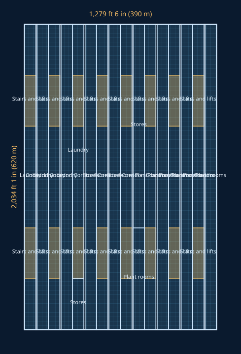
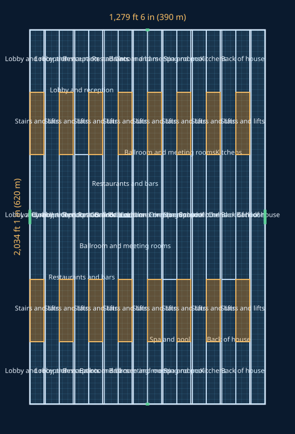
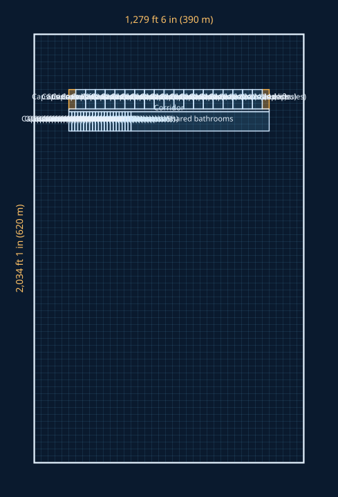
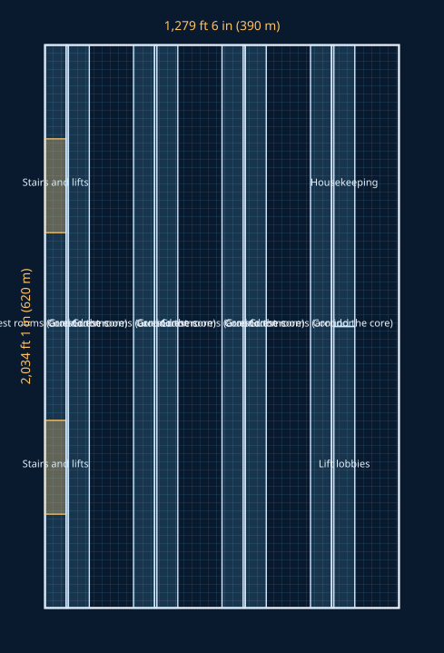

# P6-13 Port Hostel: plan

Footprint 1,279 ft 6 in (390 m) × 2,034 ft 1 in (620 m) · structural grid 29 ft 6 in (9,000 mm)

## Levels

| Level | Floor above deck | Height | Floor area |
|---|---|---|---|
| Level B1 · Service level | −16 ft 5 in (5,000 mm) | 16 ft 5 in (5,000 mm) | 2,474,580 sq ft (229,896 m²) |
| Level 1 · Ground floor | 0 ft (0 mm) | 19 ft 8 in (6,000 mm) | 2,062,329 sq ft (191,597 m²) |
| Level 2 · Podium | 19 ft 8 in (6,000 mm) | 19 ft 8 in (6,000 mm) | 2,062,329 sq ft (191,597 m²) |
| Level 3 · Upper floor | 39 ft 4 in (12 m) | 11 ft 10 in (3,600 mm) | 1,238,625 sq ft (115,072 m²) |
| Level 4 · Upper floor | 51 ft 2 in (16 m) | 11 ft 10 in (3,600 mm) | 1,238,625 sq ft (115,072 m²) |
| Level 5 · Upper floor | 63 ft (19 m) | 11 ft 10 in (3,600 mm) | 1,238,625 sq ft (115,072 m²) |
| Level 6 · Upper floor | 74 ft 10 in (23 m) | 11 ft 10 in (3,600 mm) | 1,238,625 sq ft (115,072 m²) |
| Level 7 · Upper floor | 86 ft 7 in (26 m) | 11 ft 10 in (3,600 mm) | 1,238,625 sq ft (115,072 m²) |
| Level 8 · Upper floor | 98 ft 5 in (30 m) | 11 ft 10 in (3,600 mm) | 1,238,625 sq ft (115,072 m²) |
| Level 9 · Upper floor | 110 ft 3 in (34 m) | 11 ft 10 in (3,600 mm) | 1,238,625 sq ft (115,072 m²) |
| Level 10 · Upper floor | 122 ft 1 in (37 m) | 11 ft 10 in (3,600 mm) | 1,238,625 sq ft (115,072 m²) |
| Level 11 · Upper floor | 133 ft 10 in (41 m) | 11 ft 10 in (3,600 mm) | 1,238,625 sq ft (115,072 m²) |
| Level 12 · Upper floor | 145 ft 8 in (44 m) | 11 ft 10 in (3,600 mm) | 1,238,625 sq ft (115,072 m²) |
| Level 13 · Upper floor | 157 ft 6 in (48 m) | 11 ft 10 in (3,600 mm) | 1,238,625 sq ft (115,072 m²) |
| Level 14 · Upper floor | 169 ft 3 in (52 m) | 11 ft 10 in (3,600 mm) | 1,238,625 sq ft (115,072 m²) |

## Elements

| ID | Designation | Type | Name | Level(s) | Size / length | Area | Status |
|---|---|---|---|---|---|---|---|
| L1-001 | D5F3P6B8A2L1R1, D5F3P6B8A2L2R1 | zone | Corridor | L1, L2 | 7 ft 10 in (2,400 mm) × 2,034 ft 1 in (620 m) | 16,017 sq ft (1,488 m²) | proposed |
| L1-002 | D5F3P6B8A2L1R2, D5F3P6B8A2L2R2 | zone | Corridor | L1, L2 | 7 ft 10 in (2,400 mm) × 2,034 ft 1 in (620 m) | 16,017 sq ft (1,488 m²) | proposed |
| L1-003 | D5F3P6B8A2L1R3, D5F3P6B8A2L2R3 | zone | Corridor | L1, L2 | 7 ft 10 in (2,400 mm) × 2,034 ft 1 in (620 m) | 16,017 sq ft (1,488 m²) | proposed |
| L1-004 | D5F3P6B8A2L1R4, D5F3P6B8A2L2R4 | zone | Corridor | L1, L2 | 7 ft 10 in (2,400 mm) × 2,034 ft 1 in (620 m) | 16,017 sq ft (1,488 m²) | proposed |
| L1-005 | D5F3P6B8A2L1R5, D5F3P6B8A2L2R5 | zone | Corridor | L1, L2 | 7 ft 10 in (2,400 mm) × 2,034 ft 1 in (620 m) | 16,017 sq ft (1,488 m²) | proposed |
| L1-006 | D5F3P6B8A2L1R6, D5F3P6B8A2L2R6 | zone | Corridor | L1, L2 | 7 ft 10 in (2,400 mm) × 2,034 ft 1 in (620 m) | 16,017 sq ft (1,488 m²) | proposed |
| L1-007 | D5F3P6B8A2L1R7, D5F3P6B8A2L2R7 | zone | Corridor | L1, L2 | 7 ft 10 in (2,400 mm) × 2,034 ft 1 in (620 m) | 16,017 sq ft (1,488 m²) | proposed |
| L1-008 | D5F3P6B8A2L1R8, D5F3P6B8A2L2R8 | zone | Corridor | L1, L2 | 7 ft 10 in (2,400 mm) × 2,034 ft 1 in (620 m) | 16,017 sq ft (1,488 m²) | proposed |
| L1-009 | D5F3P6B8A2L1R9, D5F3P6B8A2L2R9 | room | Lobby and reception | L1, L2 | 76 ft 1 in (23 m) × 338 ft 11 in (103 m) | 25,796 sq ft (2,397 m²) | proposed |
| L1-010 | D5F3P6B8A2L1R10, D5F3P6B8A2L2R10 | room | Lobby and reception | L1, L2 | 76 ft 1 in (23 m) × 677 ft 10 in (207 m) | 51,593 sq ft (4,793 m²) | proposed |
| L1-011 | D5F3P6B8A2L1R11, D5F3P6B8A2L2R11 | room | Lobby and reception | L1, L2 | 76 ft 1 in (23 m) × 338 ft 11 in (103 m) | 25,796 sq ft (2,397 m²) | proposed |
| L1-012 | D5F3P6B8A2L1R12, D5F3P6B8A2L2R12 | room | Lobby and reception | L1, L2 | 76 ft 1 in (23 m) × 2,034 ft 1 in (620 m) | 154,828 sq ft (14,384 m²) | proposed |
| L1-013 | D5F3P6B8A2L1R13, D5F3P6B8A2L2R13 | room | Lobby and reception | L1, L2 | 75 ft 9 in (23 m) × 338 ft 11 in (103 m) | 25,685 sq ft (2,386 m²) | proposed |
| L1-014 | D5F3P6B8A2L1R14, D5F3P6B8A2L2R14 | room | Lobby and reception | L1, L2 | 75 ft 9 in (23 m) × 677 ft 10 in (207 m) | 51,370 sq ft (4,772 m²) | proposed |
| L1-015 | D5F3P6B8A2L1R15, D5F3P6B8A2L2R15 | room | Lobby and reception | L1, L2 | 75 ft 9 in (23 m) × 338 ft 11 in (103 m) | 25,685 sq ft (2,386 m²) | proposed |
| L1-016 | D5F3P6B8A2L1R16, D5F3P6B8A2L2R16 | room | Lobby and reception | L1, L2 | 76 ft 1 in (23 m) × 678 ft 2 in (207 m) | 51,618 sq ft (4,795 m²) | proposed |
| L1-017 | D5F3P6B8A2L1R17, D5F3P6B8A2L2R17 | room | Restaurants and bars | L1, L2 | 76 ft 1 in (23 m) × 1,356 ft (413 m) | 103,210 sq ft (9,589 m²) | proposed |
| L1-018 | D5F3P6B8A2L1R18, D5F3P6B8A2L2R18 | room | Restaurants and bars | L1, L2 | 76 ft 1 in (23 m) × 338 ft 11 in (103 m) | 25,796 sq ft (2,397 m²) | proposed |
| L1-019 | D5F3P6B8A2L1R19, D5F3P6B8A2L2R19 | room | Restaurants and bars | L1, L2 | 76 ft 1 in (23 m) × 677 ft 10 in (207 m) | 51,593 sq ft (4,793 m²) | proposed |
| L1-020 | D5F3P6B8A2L1R20, D5F3P6B8A2L2R20 | room | Restaurants and bars | L1, L2 | 76 ft 1 in (23 m) × 338 ft 11 in (103 m) | 25,796 sq ft (2,397 m²) | proposed |
| L1-021 | D5F3P6B8A2L1R21, D5F3P6B8A2L2R21 | room | Restaurants and bars | L1, L2 | 76 ft 1 in (23 m) × 2,034 ft 1 in (620 m) | 154,828 sq ft (14,384 m²) | proposed |
| L1-022 | D5F3P6B8A2L1R22, D5F3P6B8A2L2R22 | room | Restaurants and bars | L1, L2 | 75 ft 9 in (23 m) × 338 ft 11 in (103 m) | 25,685 sq ft (2,386 m²) | proposed |
| L1-023 | D5F3P6B8A2L1R23, D5F3P6B8A2L2R23 | room | Restaurants and bars | L1, L2 | 75 ft 9 in (23 m) × 338 ft 11 in (103 m) | 25,685 sq ft (2,386 m²) | proposed |
| L1-024 | D5F3P6B8A2L1R24, D5F3P6B8A2L2R24 | room | Ballroom and meeting rooms | L1, L2 | 75 ft 9 in (23 m) × 338 ft 11 in (103 m) | 25,685 sq ft (2,386 m²) | proposed |
| L1-025 | D5F3P6B8A2L1R25, D5F3P6B8A2L2R25 | room | Ballroom and meeting rooms | L1, L2 | 75 ft 9 in (23 m) × 338 ft 11 in (103 m) | 25,685 sq ft (2,386 m²) | proposed |
| L1-026 | D5F3P6B8A2L1R26, D5F3P6B8A2L2R26 | room | Ballroom and meeting rooms | L1, L2 | 76 ft 1 in (23 m) × 2,034 ft 1 in (620 m) | 154,828 sq ft (14,384 m²) | proposed |
| L1-027 | D5F3P6B8A2L1R27, D5F3P6B8A2L2R27 | room | Ballroom and meeting rooms | L1, L2 | 76 ft 1 in (23 m) × 338 ft 11 in (103 m) | 25,796 sq ft (2,397 m²) | proposed |
| L1-028 | D5F3P6B8A2L1R28, D5F3P6B8A2L2R28 | room | Ballroom and meeting rooms | L1, L2 | 76 ft 1 in (23 m) × 677 ft 10 in (207 m) | 51,593 sq ft (4,793 m²) | proposed |
| L1-029 | D5F3P6B8A2L1R29, D5F3P6B8A2L2R29 | room | Ballroom and meeting rooms | L1, L2 | 76 ft 1 in (23 m) × 338 ft 11 in (103 m) | 25,796 sq ft (2,397 m²) | proposed |
| L1-030 | D5F3P6B8A2L1R30, D5F3P6B8A2L2R30 | room | Ballroom and meeting rooms | L1, L2 | 76 ft 1 in (23 m) × 1,356 ft (413 m) | 103,210 sq ft (9,589 m²) | proposed |
| L1-031 | D5F3P6B8A2L1R31, D5F3P6B8A2L2R31 | room | Spa and pool | L1, L2 | 76 ft 1 in (23 m) × 678 ft 2 in (207 m) | 51,618 sq ft (4,795 m²) | proposed |
| L1-032 | D5F3P6B8A2L1R32, D5F3P6B8A2L2R32 | room | Spa and pool | L1, L2 | 75 ft 9 in (23 m) × 338 ft 11 in (103 m) | 25,685 sq ft (2,386 m²) | proposed |
| L1-033 | D5F3P6B8A2L1R33, D5F3P6B8A2L2R33 | room | Spa and pool | L1, L2 | 75 ft 9 in (23 m) × 677 ft 10 in (207 m) | 51,370 sq ft (4,772 m²) | proposed |
| L1-034 | D5F3P6B8A2L1R34, D5F3P6B8A2L2R34 | room | Spa and pool | L1, L2 | 75 ft 9 in (23 m) × 338 ft 11 in (103 m) | 25,685 sq ft (2,386 m²) | proposed |
| L1-035 | D5F3P6B8A2L1R35, D5F3P6B8A2L2R35 | room | Spa and pool | L1, L2 | 76 ft 1 in (23 m) × 2,034 ft 1 in (620 m) | 154,828 sq ft (14,384 m²) | proposed |
| L1-036 | D5F3P6B8A2L1R36, D5F3P6B8A2L2R36 | room | Kitchens | L1, L2 | 76 ft 1 in (23 m) × 338 ft 11 in (103 m) | 25,796 sq ft (2,397 m²) | proposed |
| L1-037 | D5F3P6B8A2L1R37, D5F3P6B8A2L2R37 | room | Kitchens | L1, L2 | 76 ft 1 in (23 m) × 677 ft 10 in (207 m) | 51,593 sq ft (4,793 m²) | proposed |
| L1-038 | D5F3P6B8A2L1R38, D5F3P6B8A2L2R38 | room | Kitchens | L1, L2 | 76 ft 1 in (23 m) × 338 ft 11 in (103 m) | 25,796 sq ft (2,397 m²) | proposed |
| L1-039 | D5F3P6B8A2L1R39, D5F3P6B8A2L2R39 | room | Kitchens | L1, L2 | 76 ft 1 in (23 m) × 1,356 ft (413 m) | 103,210 sq ft (9,589 m²) | proposed |
| L1-040 | D5F3P6B8A2L1R40, D5F3P6B8A2L2R40 | room | Back of house | L1, L2 | 76 ft 1 in (23 m) × 678 ft 2 in (207 m) | 51,618 sq ft (4,795 m²) | proposed |
| L1-041 | D5F3P6B8A2L1R41, D5F3P6B8A2L2R41 | room | Back of house | L1, L2 | 75 ft 9 in (23 m) × 338 ft 11 in (103 m) | 25,685 sq ft (2,386 m²) | proposed |
| L1-042 | D5F3P6B8A2L1R42, D5F3P6B8A2L2R42 | room | Back of house | L1, L2 | 75 ft 9 in (23 m) × 677 ft 10 in (207 m) | 51,370 sq ft (4,772 m²) | proposed |
| L1-043 | D5F3P6B8A2L1R43, D5F3P6B8A2L2R43 | room | Back of house | L1, L2 | 75 ft 9 in (23 m) × 338 ft 11 in (103 m) | 25,685 sq ft (2,386 m²) | proposed |
| L1-044 | D5F3P6B8A2L1R44, D5F3P6B8A2L2R44 | room | Back of house | L1, L2 | 76 ft 1 in (23 m) × 2,034 ft 1 in (620 m) | 154,828 sq ft (14,384 m²) | proposed |
| L1-045 | D5F3P6B8A2LB1R1, D5F3P6B8A2L1R45, D5F3P6B8A2L2R45, D5F3P6B8A2L3R1, D5F3P6B8A2L4R1, D5F3P6B8A2L5R1, D5F3P6B8A2L6R1, D5F3P6B8A2L7R1, D5F3P6B8A2L8R1, D5F3P6B8A2L9R1, D5F3P6B8A2L10R1, D5F3P6B8A2L11R1, D5F3P6B8A2L12R1, D5F3P6B8A2L13R1, D5F3P6B8A2L14R1 | core | Stairs and lifts | LB1, L1, L2, L3, L4, L5, L6, L7, L8, L9, L10, L11, L12, L13, L14 | 76 ft 1 in (23 m) × 339 ft 3 in (103 m) | 25,821 sq ft (2,399 m²) | proposed |
| L1-046 | D5F3P6B8A2LB1R2, D5F3P6B8A2L1R46, D5F3P6B8A2L2R46, D5F3P6B8A2L3R2, D5F3P6B8A2L4R2, D5F3P6B8A2L5R2, D5F3P6B8A2L6R2, D5F3P6B8A2L7R2, D5F3P6B8A2L8R2, D5F3P6B8A2L9R2, D5F3P6B8A2L10R2, D5F3P6B8A2L11R2, D5F3P6B8A2L12R2, D5F3P6B8A2L13R2, D5F3P6B8A2L14R2 | core | Stairs and lifts | LB1, L1, L2, L3, L4, L5, L6, L7, L8, L9, L10, L11, L12, L13, L14 | 76 ft 1 in (23 m) × 339 ft 3 in (103 m) | 25,821 sq ft (2,399 m²) | proposed |
| L1-047 | D5F3P6B8A2LB1R3, D5F3P6B8A2L1R47, D5F3P6B8A2L2R47 | core | Stairs and lifts | LB1, L1, L2 | 75 ft 9 in (23 m) × 339 ft 3 in (103 m) | 25,710 sq ft (2,389 m²) | proposed |
| L1-048 | D5F3P6B8A2LB1R4, D5F3P6B8A2L1R48, D5F3P6B8A2L2R48 | core | Stairs and lifts | LB1, L1, L2 | 75 ft 9 in (23 m) × 339 ft 3 in (103 m) | 25,710 sq ft (2,389 m²) | proposed |
| L1-049 | D5F3P6B8A2LB1R5, D5F3P6B8A2L1R49, D5F3P6B8A2L2R49 | core | Stairs and lifts | LB1, L1, L2 | 76 ft 1 in (23 m) × 339 ft 3 in (103 m) | 25,821 sq ft (2,399 m²) | proposed |
| L1-050 | D5F3P6B8A2LB1R6, D5F3P6B8A2L1R50, D5F3P6B8A2L2R50 | core | Stairs and lifts | LB1, L1, L2 | 76 ft 1 in (23 m) × 339 ft 3 in (103 m) | 25,821 sq ft (2,399 m²) | proposed |
| L1-051 | D5F3P6B8A2LB1R7, D5F3P6B8A2L1R51, D5F3P6B8A2L2R51 | core | Stairs and lifts | LB1, L1, L2 | 75 ft 9 in (23 m) × 339 ft 3 in (103 m) | 25,710 sq ft (2,389 m²) | proposed |
| L1-052 | D5F3P6B8A2LB1R8, D5F3P6B8A2L1R52, D5F3P6B8A2L2R52 | core | Stairs and lifts | LB1, L1, L2 | 75 ft 9 in (23 m) × 339 ft 3 in (103 m) | 25,710 sq ft (2,389 m²) | proposed |
| L1-053 | D5F3P6B8A2LB1R9, D5F3P6B8A2L1R53, D5F3P6B8A2L2R53 | core | Stairs and lifts | LB1, L1, L2 | 76 ft 1 in (23 m) × 339 ft 3 in (103 m) | 25,821 sq ft (2,399 m²) | proposed |
| L1-054 | D5F3P6B8A2LB1R10, D5F3P6B8A2L1R54, D5F3P6B8A2L2R54 | core | Stairs and lifts | LB1, L1, L2 | 76 ft 1 in (23 m) × 339 ft 3 in (103 m) | 25,821 sq ft (2,399 m²) | proposed |
| L1-055 | D5F3P6B8A2LB1R11, D5F3P6B8A2L1R55, D5F3P6B8A2L2R55 | core | Stairs and lifts | LB1, L1, L2 | 75 ft 9 in (23 m) × 339 ft 3 in (103 m) | 25,710 sq ft (2,389 m²) | proposed |
| L1-056 | D5F3P6B8A2LB1R12, D5F3P6B8A2L1R56, D5F3P6B8A2L2R56 | core | Stairs and lifts | LB1, L1, L2 | 75 ft 9 in (23 m) × 339 ft 3 in (103 m) | 25,710 sq ft (2,389 m²) | proposed |
| L1-057 | D5F3P6B8A2LB1R13, D5F3P6B8A2L1R57, D5F3P6B8A2L2R57 | core | Stairs and lifts | LB1, L1, L2 | 76 ft 1 in (23 m) × 339 ft 3 in (103 m) | 25,821 sq ft (2,399 m²) | proposed |
| L1-058 | D5F3P6B8A2LB1R14, D5F3P6B8A2L1R58, D5F3P6B8A2L2R58 | core | Stairs and lifts | LB1, L1, L2 | 76 ft 1 in (23 m) × 339 ft 3 in (103 m) | 25,821 sq ft (2,399 m²) | proposed |
| L1-059 | D5F3P6B8A2LB1R15, D5F3P6B8A2L1R59, D5F3P6B8A2L2R59 | core | Stairs and lifts | LB1, L1, L2 | 75 ft 9 in (23 m) × 339 ft 3 in (103 m) | 25,710 sq ft (2,389 m²) | proposed |
| L1-060 | D5F3P6B8A2LB1R16, D5F3P6B8A2L1R60, D5F3P6B8A2L2R60 | core | Stairs and lifts | LB1, L1, L2 | 75 ft 9 in (23 m) × 339 ft 3 in (103 m) | 25,710 sq ft (2,389 m²) | proposed |
| LT-001 | D5F3P6B8A2L3R3, D5F3P6B8A2L4R3, D5F3P6B8A2L5R3, D5F3P6B8A2L6R3, D5F3P6B8A2L7R3, D5F3P6B8A2L8R3, D5F3P6B8A2L9R3, D5F3P6B8A2L10R3, D5F3P6B8A2L11R3, D5F3P6B8A2L12R3, D5F3P6B8A2L13R3, D5F3P6B8A2L14R3 | zone | Corridor | L3, L4, L5, L6, L7, L8, L9, L10, L11, L12, L13, L14 | 7 ft 10 in (2,400 mm) × 2,034 ft 1 in (620 m) | 16,017 sq ft (1,488 m²) | proposed |
| LT-002 | D5F3P6B8A2L3R4, D5F3P6B8A2L4R4, D5F3P6B8A2L5R4, D5F3P6B8A2L6R4, D5F3P6B8A2L7R4, D5F3P6B8A2L8R4, D5F3P6B8A2L9R4, D5F3P6B8A2L10R4, D5F3P6B8A2L11R4, D5F3P6B8A2L12R4, D5F3P6B8A2L13R4, D5F3P6B8A2L14R4 | zone | Corridor | L3, L4, L5, L6, L7, L8, L9, L10, L11, L12, L13, L14 | 7 ft 10 in (2,400 mm) × 2,034 ft 1 in (620 m) | 16,017 sq ft (1,488 m²) | proposed |
| LT-003 | D5F3P6B8A2L3R5, D5F3P6B8A2L4R5, D5F3P6B8A2L5R5, D5F3P6B8A2L6R5, D5F3P6B8A2L7R5, D5F3P6B8A2L8R5, D5F3P6B8A2L9R5, D5F3P6B8A2L10R5, D5F3P6B8A2L11R5, D5F3P6B8A2L12R5, D5F3P6B8A2L13R5, D5F3P6B8A2L14R5 | zone | Corridor | L3, L4, L5, L6, L7, L8, L9, L10, L11, L12, L13, L14 | 7 ft 10 in (2,400 mm) × 2,034 ft 1 in (620 m) | 16,017 sq ft (1,488 m²) | proposed |
| LT-004 | D5F3P6B8A2L3R6, D5F3P6B8A2L4R6, D5F3P6B8A2L5R6, D5F3P6B8A2L6R6, D5F3P6B8A2L7R6, D5F3P6B8A2L8R6, D5F3P6B8A2L9R6, D5F3P6B8A2L10R6, D5F3P6B8A2L11R6, D5F3P6B8A2L12R6, D5F3P6B8A2L13R6, D5F3P6B8A2L14R6 | zone | Corridor | L3, L4, L5, L6, L7, L8, L9, L10, L11, L12, L13, L14 | 7 ft 10 in (2,400 mm) × 2,034 ft 1 in (620 m) | 16,017 sq ft (1,488 m²) | proposed |
| LT-005 | D5F3P6B8A2L3R7, D5F3P6B8A2L4R7, D5F3P6B8A2L5R7, D5F3P6B8A2L6R7, D5F3P6B8A2L7R7, D5F3P6B8A2L8R7, D5F3P6B8A2L9R7, D5F3P6B8A2L10R7, D5F3P6B8A2L11R7, D5F3P6B8A2L12R7, D5F3P6B8A2L13R7, D5F3P6B8A2L14R7 | room | Guest rooms (around the core) | L3, L4, L5, L6, L7, L8, L9, L10, L11, L12, L13, L14 | 76 ft 1 in (23 m) × 2,034 ft 1 in (620 m) | 154,828 sq ft (14,384 m²) | proposed |
| LT-006 | D5F3P6B8A2L3R8, D5F3P6B8A2L4R8, D5F3P6B8A2L5R8, D5F3P6B8A2L6R8, D5F3P6B8A2L7R8, D5F3P6B8A2L8R8, D5F3P6B8A2L9R8, D5F3P6B8A2L10R8, D5F3P6B8A2L11R8, D5F3P6B8A2L12R8, D5F3P6B8A2L13R8, D5F3P6B8A2L14R8 | room | Guest rooms | L3, L4, L5, L6, L7, L8, L9, L10, L11, L12, L13, L14 | 76 ft 1 in (23 m) × 2,034 ft 1 in (620 m) | 154,828 sq ft (14,384 m²) | proposed |
| LT-007 | D5F3P6B8A2L3R9, D5F3P6B8A2L4R9, D5F3P6B8A2L5R9, D5F3P6B8A2L6R9, D5F3P6B8A2L7R9, D5F3P6B8A2L8R9, D5F3P6B8A2L9R9, D5F3P6B8A2L10R9, D5F3P6B8A2L11R9, D5F3P6B8A2L12R9, D5F3P6B8A2L13R9, D5F3P6B8A2L14R9 | room | Guest rooms (around the core) | L3, L4, L5, L6, L7, L8, L9, L10, L11, L12, L13, L14 | 76 ft 1 in (23 m) × 2,034 ft 1 in (620 m) | 154,828 sq ft (14,384 m²) | proposed |
| LT-008 | D5F3P6B8A2L3R10, D5F3P6B8A2L4R10, D5F3P6B8A2L5R10, D5F3P6B8A2L6R10, D5F3P6B8A2L7R10, D5F3P6B8A2L8R10, D5F3P6B8A2L9R10, D5F3P6B8A2L10R10, D5F3P6B8A2L11R10, D5F3P6B8A2L12R10, D5F3P6B8A2L13R10, D5F3P6B8A2L14R10 | room | Guest rooms | L3, L4, L5, L6, L7, L8, L9, L10, L11, L12, L13, L14 | 76 ft 1 in (23 m) × 2,034 ft 1 in (620 m) | 154,828 sq ft (14,384 m²) | proposed |
| LT-009 | D5F3P6B8A2L3R11, D5F3P6B8A2L4R11, D5F3P6B8A2L5R11, D5F3P6B8A2L6R11, D5F3P6B8A2L7R11, D5F3P6B8A2L8R11, D5F3P6B8A2L9R11, D5F3P6B8A2L10R11, D5F3P6B8A2L11R11, D5F3P6B8A2L12R11, D5F3P6B8A2L13R11, D5F3P6B8A2L14R11 | room | Guest rooms (around the core) | L3, L4, L5, L6, L7, L8, L9, L10, L11, L12, L13, L14 | 76 ft 1 in (23 m) × 2,034 ft 1 in (620 m) | 154,828 sq ft (14,384 m²) | proposed |
| LT-010 | D5F3P6B8A2L3R12, D5F3P6B8A2L4R12, D5F3P6B8A2L5R12, D5F3P6B8A2L6R12, D5F3P6B8A2L7R12, D5F3P6B8A2L8R12, D5F3P6B8A2L9R12, D5F3P6B8A2L10R12, D5F3P6B8A2L11R12, D5F3P6B8A2L12R12, D5F3P6B8A2L13R12, D5F3P6B8A2L14R12 | room | Guest rooms | L3, L4, L5, L6, L7, L8, L9, L10, L11, L12, L13, L14 | 76 ft 1 in (23 m) × 2,034 ft 1 in (620 m) | 154,828 sq ft (14,384 m²) | proposed |
| LT-011 | D5F3P6B8A2L3R13, D5F3P6B8A2L4R13, D5F3P6B8A2L5R13, D5F3P6B8A2L6R13, D5F3P6B8A2L7R13, D5F3P6B8A2L8R13, D5F3P6B8A2L9R13, D5F3P6B8A2L10R13, D5F3P6B8A2L11R13, D5F3P6B8A2L12R13, D5F3P6B8A2L13R13, D5F3P6B8A2L14R13 | room | Guest rooms (around the core) | L3, L4, L5, L6, L7, L8, L9, L10, L11, L12, L13, L14 | 76 ft 1 in (23 m) × 2,034 ft 1 in (620 m) | 154,828 sq ft (14,384 m²) | proposed |
| LT-012 | D5F3P6B8A2L3R14, D5F3P6B8A2L4R14, D5F3P6B8A2L5R14, D5F3P6B8A2L6R14, D5F3P6B8A2L7R14, D5F3P6B8A2L8R14, D5F3P6B8A2L9R14, D5F3P6B8A2L10R14, D5F3P6B8A2L11R14, D5F3P6B8A2L12R14, D5F3P6B8A2L13R14, D5F3P6B8A2L14R14 | room | Housekeeping | L3, L4, L5, L6, L7, L8, L9, L10, L11, L12, L13, L14 | 76 ft 1 in (23 m) × 1,017 ft 1 in (310 m) | 77,414 sq ft (7,192 m²) | proposed |
| LT-013 | D5F3P6B8A2L3R15, D5F3P6B8A2L4R15, D5F3P6B8A2L5R15, D5F3P6B8A2L6R15, D5F3P6B8A2L7R15, D5F3P6B8A2L8R15, D5F3P6B8A2L9R15, D5F3P6B8A2L10R15, D5F3P6B8A2L11R15, D5F3P6B8A2L12R15, D5F3P6B8A2L13R15, D5F3P6B8A2L14R15 | room | Lift lobbies | L3, L4, L5, L6, L7, L8, L9, L10, L11, L12, L13, L14 | 76 ft 1 in (23 m) × 1,017 ft 1 in (310 m) | 77,414 sq ft (7,192 m²) | proposed |
| BB1-001 | D5F3P6B8A2LB1R17 | zone | Corridor | LB1 | 7 ft 10 in (2,400 mm) × 2,034 ft 1 in (620 m) | 16,017 sq ft (1,488 m²) | proposed |
| BB1-002 | D5F3P6B8A2LB1R18 | zone | Corridor | LB1 | 7 ft 10 in (2,400 mm) × 2,034 ft 1 in (620 m) | 16,017 sq ft (1,488 m²) | proposed |
| BB1-003 | D5F3P6B8A2LB1R19 | zone | Corridor | LB1 | 7 ft 10 in (2,400 mm) × 2,034 ft 1 in (620 m) | 16,017 sq ft (1,488 m²) | proposed |
| BB1-004 | D5F3P6B8A2LB1R20 | zone | Corridor | LB1 | 7 ft 10 in (2,400 mm) × 2,034 ft 1 in (620 m) | 16,017 sq ft (1,488 m²) | proposed |
| BB1-005 | D5F3P6B8A2LB1R21 | zone | Corridor | LB1 | 7 ft 10 in (2,400 mm) × 2,034 ft 1 in (620 m) | 16,017 sq ft (1,488 m²) | proposed |
| BB1-006 | D5F3P6B8A2LB1R22 | zone | Corridor | LB1 | 7 ft 10 in (2,400 mm) × 2,034 ft 1 in (620 m) | 16,017 sq ft (1,488 m²) | proposed |
| BB1-007 | D5F3P6B8A2LB1R23 | zone | Corridor | LB1 | 7 ft 10 in (2,400 mm) × 2,034 ft 1 in (620 m) | 16,017 sq ft (1,488 m²) | proposed |
| BB1-008 | D5F3P6B8A2LB1R24 | zone | Corridor | LB1 | 7 ft 10 in (2,400 mm) × 2,034 ft 1 in (620 m) | 16,017 sq ft (1,488 m²) | proposed |
| BB1-009 | D5F3P6B8A2LB1R25 | room | Laundry | LB1 | 76 ft 1 in (23 m) × 2,034 ft 1 in (620 m) | 154,828 sq ft (14,384 m²) | proposed |
| BB1-010 | D5F3P6B8A2LB1R26 | room | Laundry | LB1 | 76 ft 1 in (23 m) × 2,034 ft 1 in (620 m) | 154,828 sq ft (14,384 m²) | proposed |
| BB1-011 | D5F3P6B8A2LB1R27 | room | Laundry | LB1 | 75 ft 9 in (23 m) × 2,034 ft 1 in (620 m) | 154,161 sq ft (14,322 m²) | proposed |
| BB1-012 | D5F3P6B8A2LB1R28 | room | Laundry | LB1 | 76 ft 1 in (23 m) × 2,034 ft 1 in (620 m) | 154,828 sq ft (14,384 m²) | proposed |
| BB1-013 | D5F3P6B8A2LB1R29 | room | Laundry | LB1 | 76 ft 1 in (23 m) × 1,695 ft 3 in (517 m) | 129,032 sq ft (11,987 m²) | proposed |
| BB1-014 | D5F3P6B8A2LB1R30 | room | Stores | LB1 | 76 ft 1 in (23 m) × 338 ft 11 in (103 m) | 25,796 sq ft (2,397 m²) | proposed |
| BB1-015 | D5F3P6B8A2LB1R31 | room | Stores | LB1 | 76 ft 1 in (23 m) × 2,034 ft 1 in (620 m) | 154,828 sq ft (14,384 m²) | proposed |
| BB1-016 | D5F3P6B8A2LB1R32 | room | Stores | LB1 | 75 ft 9 in (23 m) × 2,034 ft 1 in (620 m) | 154,161 sq ft (14,322 m²) | proposed |
| BB1-017 | D5F3P6B8A2LB1R33 | room | Stores | LB1 | 76 ft 1 in (23 m) × 2,034 ft 1 in (620 m) | 154,828 sq ft (14,384 m²) | proposed |
| BB1-018 | D5F3P6B8A2LB1R34 | room | Stores | LB1 | 76 ft 1 in (23 m) × 2,034 ft 1 in (620 m) | 154,828 sq ft (14,384 m²) | proposed |
| BB1-019 | D5F3P6B8A2LB1R35 | room | Stores | LB1 | 76 ft 1 in (23 m) × 1,356 ft (413 m) | 103,210 sq ft (9,589 m²) | proposed |
| BB1-020 | D5F3P6B8A2LB1R36 | room | Plant rooms | LB1 | 76 ft 1 in (23 m) × 678 ft 2 in (207 m) | 51,618 sq ft (4,795 m²) | proposed |
| BB1-021 | D5F3P6B8A2LB1R37 | room | Plant rooms | LB1 | 75 ft 9 in (23 m) × 2,034 ft 1 in (620 m) | 154,161 sq ft (14,322 m²) | proposed |
| BB1-022 | D5F3P6B8A2LB1R38 | room | Plant rooms | LB1 | 76 ft 1 in (23 m) × 2,034 ft 1 in (620 m) | 154,828 sq ft (14,384 m²) | proposed |
| BB1-023 | D5F3P6B8A2LB1R39 | room | Plant rooms | LB1 | 76 ft 1 in (23 m) × 2,034 ft 1 in (620 m) | 154,828 sq ft (14,384 m²) | proposed |
| BB1-024 | D5F3P6B8A2LB1R40 | room | Plant rooms | LB1 | 76 ft 1 in (23 m) × 2,034 ft 1 in (620 m) | 154,828 sq ft (14,384 m²) | proposed |
| BB1-025 | D5F3P6B8A2LB1R41 | room | Plant rooms | LB1 | 75 ft 9 in (23 m) × 2,034 ft 1 in (620 m) | 154,161 sq ft (14,322 m²) | proposed |
| BB1-026 | D5F3P6B8A2LB1R42 | room | Plant rooms | LB1 | 76 ft 1 in (23 m) × 2,034 ft 1 in (620 m) | 154,828 sq ft (14,384 m²) | proposed |
| D-100 |  | door | Main entrance | L1 | 78 ft 9 in (24 m), 78 ft 9 in (24 m) wide | — | proposed |
| D-101 |  | door | Second entrance | L1 | 78 ft 9 in (24 m), 78 ft 9 in (24 m) wide | — | proposed |
| D-102 |  | door | Side door | L1 | 19 ft 8 in (6,000 mm), 19 ft 8 in (6,000 mm) wide | — | proposed |
| D-103 |  | door | Side door | L1 | 19 ft 8 in (6,000 mm), 19 ft 8 in (6,000 mm) wide | — | proposed |

## Drawings

### Level B1 · Service level

### Level 1 · Ground floor

### Level 2 · Podium

### Level 3 · Upper floor

### Level 4 · Upper floor

### Level 5 · Upper floor

### Level 6 · Upper floor

### Level 7 · Upper floor

### Level 8 · Upper floor

### Level 9 · Upper floor

### Level 10 · Upper floor

### Level 11 · Upper floor

### Level 12 · Upper floor

### Level 13 · Upper floor

### Level 14 · Upper floor

