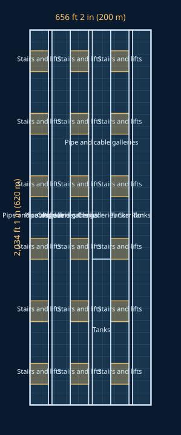
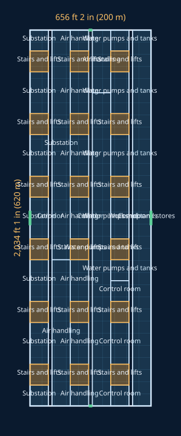
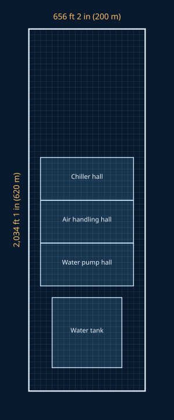

# P6-14 Concourse Utility Plant: plan

Footprint 656 ft 2 in (200 m) × 2,034 ft 1 in (620 m) · structural grid 65 ft 7 in (20 m)

## Levels

| Level | Floor above deck | Height | Floor area |
|---|---|---|---|
| Level B1 · Plant level | −19 ft 8 in (6,000 mm) | 19 ft 8 in (6,000 mm) | 1,214,600 sq ft (112,840 m²) |
| Level 1 · Ground floor | 0 ft (0 mm) | 26 ft 3 in (8,000 mm) | 1,012,036 sq ft (94,021 m²) |
| Level 2 · Upper floor | 26 ft 3 in (8,000 mm) | 26 ft 3 in (8,000 mm) | 1,214,600 sq ft (112,840 m²) |

## Elements

| ID | Designation | Type | Name | Level(s) | Size / length | Area | Status |
|---|---|---|---|---|---|---|---|
| L1-001 | D5F3P6B10A1L1R1 | zone | Corridor | L1 | 19 ft 8 in (6,000 mm) × 2,034 ft 1 in (620 m) | 40,042 sq ft (3,720 m²) | proposed |
| L1-002 | D5F3P6B10A1L1R2 | zone | Corridor | L1 | 19 ft 8 in (6,000 mm) × 2,034 ft 1 in (620 m) | 40,042 sq ft (3,720 m²) | proposed |
| L1-003 | D5F3P6B10A1L1R3 | zone | Corridor | L1 | 19 ft 8 in (6,000 mm) × 2,034 ft 1 in (620 m) | 40,042 sq ft (3,720 m²) | proposed |
| L1-004 | D5F3P6B10A1L1R4 | room | Substation | L1 | 99 ft 5 in (30 m) × 112 ft 10 in (34 m) | 11,219 sq ft (1,042 m²) | proposed |
| L1-005 | D5F3P6B10A1L1R5 | room | Substation | L1 | 99 ft 5 in (30 m) × 226 ft 1 in (69 m) | 22,471 sq ft (2,088 m²) | proposed |
| L1-006 | D5F3P6B10A1L1R6 | room | Substation | L1 | 99 ft 5 in (30 m) × 226 ft 1 in (69 m) | 22,471 sq ft (2,088 m²) | proposed |
| L1-007 | D5F3P6B10A1L1R7 | room | Substation | L1 | 99 ft 5 in (30 m) × 225 ft 9 in (69 m) | 22,439 sq ft (2,085 m²) | proposed |
| L1-008 | D5F3P6B10A1L1R8 | room | Substation | L1 | 99 ft 5 in (30 m) × 226 ft 1 in (69 m) | 22,471 sq ft (2,088 m²) | proposed |
| L1-009 | D5F3P6B10A1L1R9 | room | Substation | L1 | 99 ft 5 in (30 m) × 226 ft 1 in (69 m) | 22,471 sq ft (2,088 m²) | proposed |
| L1-010 | D5F3P6B10A1L1R10 | room | Substation | L1 | 99 ft 5 in (30 m) × 112 ft 10 in (34 m) | 11,219 sq ft (1,042 m²) | proposed |
| L1-011 | D5F3P6B10A1L1R11 | room | Substation | L1 | 99 ft 9 in (30 m) × 1,243 ft 1 in (379 m) | 123,985 sq ft (11,519 m²) | proposed |
| L1-012 | D5F3P6B10A1L1R12 | room | Air handling | L1 | 99 ft 9 in (30 m) × 791 ft (241 m) | 78,893 sq ft (7,329 m²) | proposed |
| L1-013 | D5F3P6B10A1L1R13 | room | Air handling | L1 | 99 ft 5 in (30 m) × 112 ft 10 in (34 m) | 11,219 sq ft (1,042 m²) | proposed |
| L1-014 | D5F3P6B10A1L1R14 | room | Air handling | L1 | 99 ft 5 in (30 m) × 226 ft 1 in (69 m) | 22,471 sq ft (2,088 m²) | proposed |
| L1-015 | D5F3P6B10A1L1R15 | room | Air handling | L1 | 99 ft 5 in (30 m) × 226 ft 1 in (69 m) | 22,471 sq ft (2,088 m²) | proposed |
| L1-016 | D5F3P6B10A1L1R16 | room | Air handling | L1 | 99 ft 5 in (30 m) × 225 ft 9 in (69 m) | 22,439 sq ft (2,085 m²) | proposed |
| L1-017 | D5F3P6B10A1L1R17 | room | Air handling | L1 | 99 ft 5 in (30 m) × 226 ft 1 in (69 m) | 22,471 sq ft (2,088 m²) | proposed |
| L1-018 | D5F3P6B10A1L1R18 | room | Air handling | L1 | 99 ft 5 in (30 m) × 226 ft 1 in (69 m) | 22,471 sq ft (2,088 m²) | proposed |
| L1-019 | D5F3P6B10A1L1R19 | room | Air handling | L1 | 99 ft 5 in (30 m) × 112 ft 10 in (34 m) | 11,219 sq ft (1,042 m²) | proposed |
| L1-020 | D5F3P6B10A1L1R20 | room | Air handling | L1 | 99 ft 5 in (30 m) × 338 ft 11 in (103 m) | 33,691 sq ft (3,130 m²) | proposed |
| L1-021 | D5F3P6B10A1L1R21 | room | Water pumps and tanks | L1 | 99 ft 5 in (30 m) × 1,695 ft 3 in (517 m) | 168,520 sq ft (15,656 m²) | proposed |
| L1-022 | D5F3P6B10A1L1R22 | room | Water pumps and tanks | L1 | 99 ft 9 in (30 m) × 112 ft 10 in (34 m) | 11,256 sq ft (1,046 m²) | proposed |
| L1-023 | D5F3P6B10A1L1R23 | room | Water pumps and tanks | L1 | 99 ft 9 in (30 m) × 226 ft 1 in (69 m) | 22,546 sq ft (2,095 m²) | proposed |
| L1-024 | D5F3P6B10A1L1R24 | room | Water pumps and tanks | L1 | 99 ft 9 in (30 m) × 226 ft 1 in (69 m) | 22,546 sq ft (2,095 m²) | proposed |
| L1-025 | D5F3P6B10A1L1R25 | room | Water pumps and tanks | L1 | 99 ft 9 in (30 m) × 225 ft 9 in (69 m) | 22,513 sq ft (2,092 m²) | proposed |
| L1-026 | D5F3P6B10A1L1R26 | room | Water pumps and tanks | L1 | 99 ft 9 in (30 m) × 112 ft 10 in (34 m) | 11,256 sq ft (1,046 m²) | proposed |
| L1-027 | D5F3P6B10A1L1R27 | room | Control room | L1 | 99 ft 9 in (30 m) × 113 ft 2 in (34 m) | 11,289 sq ft (1,049 m²) | proposed |
| L1-028 | D5F3P6B10A1L1R28 | room | Control room | L1 | 99 ft 9 in (30 m) × 226 ft 1 in (69 m) | 22,546 sq ft (2,095 m²) | proposed |
| L1-029 | D5F3P6B10A1L1R29 | room | Control room | L1 | 99 ft 9 in (30 m) × 112 ft 10 in (34 m) | 11,256 sq ft (1,046 m²) | proposed |
| L1-030 | D5F3P6B10A1L1R30 | room | Workshop and stores | L1 | 99 ft 5 in (30 m) × 2,034 ft 1 in (620 m) | 202,211 sq ft (18,786 m²) | proposed |
| L1-031 | D5F3P6B10A1LB1R1, D5F3P6B10A1L1R31, D5F3P6B10A1L2R1 | core | Stairs and lifts | LB1, L1, L2 | 99 ft 5 in (30 m) × 113 ft 2 in (35 m) | 11,252 sq ft (1,045 m²) | proposed |
| L1-032 | D5F3P6B10A1LB1R2, D5F3P6B10A1L1R32, D5F3P6B10A1L2R2 | core | Stairs and lifts | LB1, L1, L2 | 99 ft 5 in (30 m) × 112 ft 10 in (34 m) | 11,219 sq ft (1,042 m²) | proposed |
| L1-033 | D5F3P6B10A1LB1R3, D5F3P6B10A1L1R33, D5F3P6B10A1L2R3 | core | Stairs and lifts | LB1, L1, L2 | 99 ft 5 in (30 m) × 113 ft 2 in (35 m) | 11,252 sq ft (1,045 m²) | proposed |
| L1-034 | D5F3P6B10A1LB1R4, D5F3P6B10A1L1R34, D5F3P6B10A1L2R4 | core | Stairs and lifts | LB1, L1, L2 | 99 ft 5 in (30 m) × 113 ft 2 in (34 m) | 11,252 sq ft (1,045 m²) | proposed |
| L1-035 | D5F3P6B10A1LB1R5, D5F3P6B10A1L1R35, D5F3P6B10A1L2R5 | core | Stairs and lifts | LB1, L1, L2 | 99 ft 5 in (30 m) × 112 ft 10 in (34 m) | 11,219 sq ft (1,042 m²) | proposed |
| L1-036 | D5F3P6B10A1LB1R6, D5F3P6B10A1L1R36, D5F3P6B10A1L2R6 | core | Stairs and lifts | LB1, L1, L2 | 99 ft 5 in (30 m) × 113 ft 2 in (34 m) | 11,252 sq ft (1,045 m²) | proposed |
| L1-037 | D5F3P6B10A1LB1R7, D5F3P6B10A1L1R37, D5F3P6B10A1L2R7 | core | Stairs and lifts | LB1, L1, L2 | 99 ft 5 in (30 m) × 113 ft 2 in (35 m) | 11,252 sq ft (1,045 m²) | proposed |
| L1-038 | D5F3P6B10A1LB1R8, D5F3P6B10A1L1R38, D5F3P6B10A1L2R8 | core | Stairs and lifts | LB1, L1, L2 | 99 ft 5 in (30 m) × 112 ft 10 in (34 m) | 11,219 sq ft (1,042 m²) | proposed |
| L1-039 | D5F3P6B10A1LB1R9, D5F3P6B10A1L1R39, D5F3P6B10A1L2R9 | core | Stairs and lifts | LB1, L1, L2 | 99 ft 5 in (30 m) × 113 ft 2 in (35 m) | 11,252 sq ft (1,045 m²) | proposed |
| L1-040 | D5F3P6B10A1LB1R10, D5F3P6B10A1L1R40, D5F3P6B10A1L2R10 | core | Stairs and lifts | LB1, L1, L2 | 99 ft 5 in (30 m) × 113 ft 2 in (34 m) | 11,252 sq ft (1,045 m²) | proposed |
| L1-041 | D5F3P6B10A1LB1R11, D5F3P6B10A1L1R41, D5F3P6B10A1L2R11 | core | Stairs and lifts | LB1, L1, L2 | 99 ft 5 in (30 m) × 112 ft 10 in (34 m) | 11,219 sq ft (1,042 m²) | proposed |
| L1-042 | D5F3P6B10A1LB1R12, D5F3P6B10A1L1R42, D5F3P6B10A1L2R12 | core | Stairs and lifts | LB1, L1, L2 | 99 ft 5 in (30 m) × 113 ft 2 in (34 m) | 11,252 sq ft (1,045 m²) | proposed |
| L1-043 | D5F3P6B10A1LB1R13, D5F3P6B10A1L1R43, D5F3P6B10A1L2R13 | core | Stairs and lifts | LB1, L1, L2 | 99 ft 9 in (30 m) × 113 ft 2 in (35 m) | 11,289 sq ft (1,049 m²) | proposed |
| L1-044 | D5F3P6B10A1LB1R14, D5F3P6B10A1L1R44, D5F3P6B10A1L2R14 | core | Stairs and lifts | LB1, L1, L2 | 99 ft 9 in (30 m) × 112 ft 10 in (34 m) | 11,256 sq ft (1,046 m²) | proposed |
| L1-045 | D5F3P6B10A1LB1R15, D5F3P6B10A1L1R45, D5F3P6B10A1L2R15 | core | Stairs and lifts | LB1, L1, L2 | 99 ft 9 in (30 m) × 113 ft 2 in (35 m) | 11,289 sq ft (1,049 m²) | proposed |
| L1-046 | D5F3P6B10A1LB1R16, D5F3P6B10A1L1R46, D5F3P6B10A1L2R16 | core | Stairs and lifts | LB1, L1, L2 | 99 ft 9 in (30 m) × 113 ft 2 in (34 m) | 11,289 sq ft (1,049 m²) | proposed |
| L1-047 | D5F3P6B10A1LB1R17, D5F3P6B10A1L1R47, D5F3P6B10A1L2R17 | core | Stairs and lifts | LB1, L1, L2 | 99 ft 9 in (30 m) × 112 ft 10 in (34 m) | 11,256 sq ft (1,046 m²) | proposed |
| L1-048 | D5F3P6B10A1LB1R18, D5F3P6B10A1L1R48, D5F3P6B10A1L2R18 | core | Stairs and lifts | LB1, L1, L2 | 99 ft 9 in (30 m) × 113 ft 2 in (34 m) | 11,289 sq ft (1,049 m²) | proposed |
| LT-001 | D5F3P6B10A1L2R19 | zone | Corridor | L2 | 19 ft 8 in (6,000 mm) × 2,034 ft 1 in (620 m) | 40,042 sq ft (3,720 m²) | proposed |
| LT-002 | D5F3P6B10A1L2R20 | zone | Corridor | L2 | 19 ft 8 in (6,000 mm) × 2,034 ft 1 in (620 m) | 40,042 sq ft (3,720 m²) | proposed |
| LT-003 | D5F3P6B10A1L2R21 | zone | Corridor | L2 | 19 ft 8 in (6,000 mm) × 2,034 ft 1 in (620 m) | 40,042 sq ft (3,720 m²) | proposed |
| LT-004 | D5F3P6B10A1L2R22 | room | Air handling (around the core) | L2 | 99 ft 5 in (30 m) × 2,034 ft 1 in (620 m) | 202,211 sq ft (18,786 m²) | proposed |
| LT-005 | D5F3P6B10A1L2R23 | room | Air handling | L2 | 99 ft 9 in (30 m) × 2,034 ft 1 in (620 m) | 202,878 sq ft (18,848 m²) | proposed |
| LT-006 | D5F3P6B10A1L2R24 | room | Air handling (around the core) | L2 | 99 ft 5 in (30 m) × 2,034 ft 1 in (620 m) | 202,211 sq ft (18,786 m²) | proposed |
| LT-007 | D5F3P6B10A1L2R25 | room | Switch rooms | L2 | 99 ft 5 in (30 m) × 2,034 ft 1 in (620 m) | 202,211 sq ft (18,786 m²) | proposed |
| LT-008 | D5F3P6B10A1L2R26 | room | Switch rooms (around the core) | L2 | 99 ft 9 in (30 m) × 1,582 ft (482 m) | 157,787 sq ft (14,659 m²) | proposed |
| LT-009 | D5F3P6B10A1L2R27 | room | Offices (around the core) | L2 | 99 ft 9 in (30 m) × 452 ft 1 in (138 m) | 45,091 sq ft (4,189 m²) | proposed |
| LT-010 | D5F3P6B10A1L2R28 | room | Offices | L2 | 99 ft 5 in (30 m) × 2,034 ft 1 in (620 m) | 202,211 sq ft (18,786 m²) | proposed |
| BB1-001 | D5F3P6B10A1LB1R19 | zone | Corridor | LB1 | 19 ft 8 in (6,000 mm) × 2,034 ft 1 in (620 m) | 40,042 sq ft (3,720 m²) | proposed |
| BB1-002 | D5F3P6B10A1LB1R20 | zone | Corridor | LB1 | 19 ft 8 in (6,000 mm) × 2,034 ft 1 in (620 m) | 40,042 sq ft (3,720 m²) | proposed |
| BB1-003 | D5F3P6B10A1LB1R21 | zone | Corridor | LB1 | 19 ft 8 in (6,000 mm) × 2,034 ft 1 in (620 m) | 40,042 sq ft (3,720 m²) | proposed |
| BB1-004 | D5F3P6B10A1LB1R22 | room | Pipe and cable galleries | LB1 | 99 ft 5 in (30 m) × 2,034 ft 1 in (620 m) | 202,211 sq ft (18,786 m²) | proposed |
| BB1-005 | D5F3P6B10A1LB1R23 | room | Pipe and cable galleries | LB1 | 99 ft 9 in (30 m) × 2,034 ft 1 in (620 m) | 202,878 sq ft (18,848 m²) | proposed |
| BB1-006 | D5F3P6B10A1LB1R24 | room | Pipe and cable galleries | LB1 | 99 ft 5 in (30 m) × 2,034 ft 1 in (620 m) | 202,211 sq ft (18,786 m²) | proposed |
| BB1-007 | D5F3P6B10A1LB1R25 | room | Pipe and cable galleries | LB1 | 99 ft 5 in (30 m) × 1,243 ft 1 in (379 m) | 123,577 sq ft (11,481 m²) | proposed |
| BB1-008 | D5F3P6B10A1LB1R26 | room | Tanks | LB1 | 99 ft 5 in (30 m) × 791 ft (241 m) | 78,634 sq ft (7,305 m²) | proposed |
| BB1-009 | D5F3P6B10A1LB1R27 | room | Tanks | LB1 | 99 ft 9 in (30 m) × 2,034 ft 1 in (620 m) | 202,878 sq ft (18,848 m²) | proposed |
| BB1-010 | D5F3P6B10A1LB1R28 | room | Tanks | LB1 | 99 ft 5 in (30 m) × 2,034 ft 1 in (620 m) | 202,211 sq ft (18,786 m²) | proposed |
| D-69 |  | door | Main entrance | L1 | 78 ft 9 in (24 m), 78 ft 9 in (24 m) wide | — | proposed |
| D-70 |  | door | Second entrance | L1 | 78 ft 9 in (24 m), 78 ft 9 in (24 m) wide | — | proposed |
| D-71 |  | door | Side door | L1 | 19 ft 8 in (6,000 mm), 19 ft 8 in (6,000 mm) wide | — | proposed |
| D-72 |  | door | Side door | L1 | 19 ft 8 in (6,000 mm), 19 ft 8 in (6,000 mm) wide | — | proposed |

## Drawings

### Level B1 · Plant level

### Level 1 · Ground floor

### Level 2 · Upper floor

