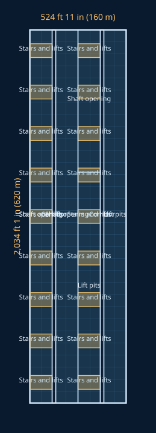
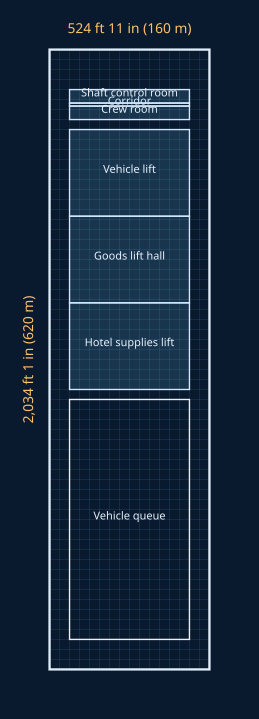
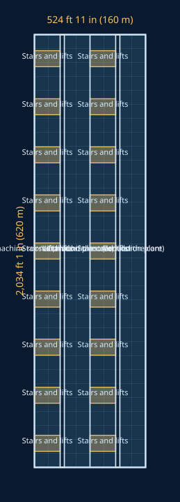

# P6-15 Concourse Service Shaft: plan

Footprint 524 ft 11 in (160 m) × 2,034 ft 1 in (620 m) · structural grid 32 ft 10 in (10 m)

## Levels

| Level | Floor above deck | Height | Floor area |
|---|---|---|---|
| Level B1 · Shaft head | −32 ft 10 in (10 m) | 32 ft 10 in (10 m) | 335,834 sq ft (31,200 m²) |
| Level 1 · Ground floor | 0 ft (0 mm) | 23 ft (7,000 mm) | 370,709 sq ft (34,440 m²) |
| Level 2 · Lift machine level | 23 ft (7,000 mm) | 19 ft 8 in (6,000 mm) | 370,709 sq ft (34,440 m²) |

## Elements

| ID | Designation | Type | Name | Level(s) | Size / length | Area | Status |
|---|---|---|---|---|---|---|---|
| E001 | D5F3P6B10A2L1R1 | zone | Corridor | L1 | 393 ft 8 in (120 m) × 9 ft 10 in (3,000 mm) | 3,875 sq ft (360 m²) | proposed |
| E002 | D5F3P6B10A2L1R2 | room | Shaft control room | L1 | 393 ft 8 in (120 m) × 44 ft 3 in (14 m) | 17,438 sq ft (1,620 m²) | proposed |
| E003 | D5F3P6B10A2L1R3 | room | Crew room | L1 | 393 ft 8 in (120 m) × 44 ft 3 in (14 m) | 17,438 sq ft (1,620 m²) | proposed |
| E004 | D5F3P6B10A2L2R1 | zone | Corridor | L2 | 393 ft 8 in (120 m) × 9 ft 10 in (3,000 mm) | 3,875 sq ft (360 m²) | proposed |
| E005 | D5F3P6B10A2L2R2 | room | Ventilation fans | L2 | 393 ft 8 in (120 m) × 44 ft 3 in (14 m) | 17,438 sq ft (1,620 m²) | proposed |
| E006 | D5F3P6B10A2L2R3 | room | Stores | L2 | 393 ft 8 in (120 m) × 44 ft 3 in (14 m) | 17,438 sq ft (1,620 m²) | proposed |
| E007 | D5F3P6B10A2LB1R1, D5F3P6B10A2L1R4, D5F3P6B10A2L2R4 | room | Vehicle lift | LB1, L1, L2 | 393 ft 8 in (120 m) × 284 ft 5 in (87 m) | 111,988 sq ft (10,404 m²) | proposed |
| E008 | D5F3P6B10A2LB1R2, D5F3P6B10A2L1R5, D5F3P6B10A2L2R5 | room | Goods lift hall | LB1, L1, L2 | 393 ft 8 in (120 m) × 284 ft 1 in (87 m) | 111,859 sq ft (10,392 m²) | proposed |
| E009 | D5F3P6B10A2LB1R3, D5F3P6B10A2L1R6, D5F3P6B10A2L2R6 | room | Hotel supplies lift | LB1, L1, L2 | 393 ft 8 in (120 m) × 284 ft 5 in (87 m) | 111,988 sq ft (10,404 m²) | proposed |
| E010 | D5F3P6B10A2L1R7 | zone | Vehicle queue | L1 | 393 ft 8 in (120 m) × 787 ft 5 in (240 m) | 310,001 sq ft (28,800 m²) | proposed |

## Drawings

### Level B1 · Shaft head

### Level 1 · Ground floor

### Level 2 · Lift machine level

