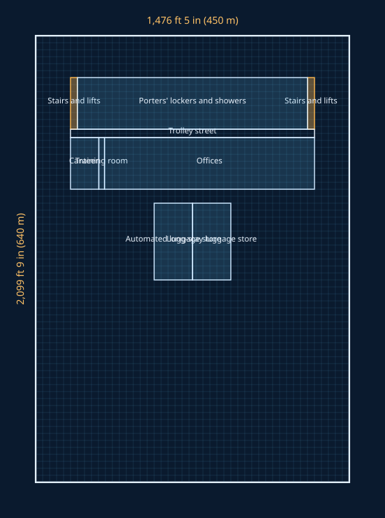

# P7-01 Porters' Hall: plan

Footprint 1,476 ft 5 in (450 m) × 2,099 ft 9 in (640 m) · structural grid 32 ft 10 in (10 m)

## Levels

| Level | Floor above deck | Height | Floor area |
|---|---|---|---|
| Level 1 · Ground floor | 0 ft (0 mm) | 19 ft 8 in (6,000 mm) | 671,883 sq ft (62,420 m²) |
| Level 2 · Level 2 | 19 ft 8 in (6,000 mm) | 14 ft 9 in (4,500 mm) | 671,883 sq ft (62,420 m²) |
| Level 3 · Level 3 | 34 ft 5 in (10 m) | 14 ft 9 in (4,500 mm) | 671,883 sq ft (62,420 m²) |

## Elements

| ID | Designation | Type | Name | Level(s) | Size / length | Area | Status |
|---|---|---|---|---|---|---|---|
| E001 | D5F3P7B1A1L1R1, D5F3P7B1A1L2R1, D5F3P7B1A1L3R1 | core | Stairs and lifts | L1, L2, L3 | 32 ft 10 in (10 m) × 242 ft 9 in (74 m) | 7,965 sq ft (740 m²) | proposed |
| E002 | D5F3P7B1A1L1R2, D5F3P7B1A1L2R2, D5F3P7B1A1L3R2 | core | Stairs and lifts | L1, L2, L3 | 32 ft 10 in (10 m) × 242 ft 9 in (74 m) | 7,965 sq ft (740 m²) | proposed |
| E003 | D5F3P7B1A1L1R3 | zone | Trolley street | L1 | 1,148 ft 4 in (350 m) × 39 ft 4 in (12 m) | 45,208 sq ft (4,200 m²) | proposed |
| E004 | D5F3P7B1A1L1R4 | room | Porter booking desks | L1 | 216 ft 6 in (66 m) × 242 ft 9 in (74 m) | 52,571 sq ft (4,884 m²) | proposed |
| E005 | D5F3P7B1A1L1R5 | room | Luggage storage | L1 | 866 ft 2 in (264 m) × 242 ft 9 in (74 m) | 210,284 sq ft (19,536 m²) | proposed |
| E006 | D5F3P7B1A1L1R6 | room | Lost and found | L1 | 110 ft 11 in (34 m) × 242 ft 9 in (74 m) | 26,923 sq ft (2,501 m²) | proposed |
| E007 | D5F3P7B1A1L1R7 | room | Trolley and cart store | L1 | 266 ft 1 in (81 m) × 242 ft 9 in (74 m) | 64,599 sq ft (6,001 m²) | proposed |
| E008 | D5F3P7B1A1L1R8 | room | Porters' room | L1 | 88 ft 7 in (27 m) × 242 ft 9 in (74 m) | 21,506 sq ft (1,998 m²) | proposed |
| E009 | D5F3P7B1A1L1R9 | room | Toilets | L1 | 682 ft 9 in (208 m) × 242 ft 9 in (74 m) | 165,758 sq ft (15,399 m²) | proposed |
| E010 | D5F3P7B1A1L2R3 | zone | Trolley street | L2 | 1,148 ft 4 in (350 m) × 39 ft 4 in (12 m) | 45,208 sq ft (4,200 m²) | proposed |
| E011 | D5F3P7B1A1L2R4 | room | Porters' lockers and showers | L2 | 1,082 ft 8 in (330 m) × 242 ft 9 in (74 m) | 262,855 sq ft (24,420 m²) | proposed |
| E012 | D5F3P7B1A1L2R5 | room | Canteen | L2 | 132 ft 10 in (40 m) × 242 ft 9 in (74 m) | 32,259 sq ft (2,997 m²) | proposed |
| E013 | D5F3P7B1A1L2R6 | room | Training room | L2 | 26 ft 7 in (8,100 mm) × 242 ft 9 in (74 m) | 6,452 sq ft (599 m²) | proposed |
| E014 | D5F3P7B1A1L2R7 | room | Offices | L2 | 988 ft 10 in (301 m) × 242 ft 9 in (74 m) | 240,074 sq ft (22,304 m²) | proposed |
| E015 | D5F3P7B1A1L3R3 | zone | Trolley street | L3 | 1,148 ft 4 in (350 m) × 39 ft 4 in (12 m) | 45,208 sq ft (4,200 m²) | proposed |
| E016 | D5F3P7B1A1L3R4 | room | Lost property archive | L3 | 1,082 ft 8 in (330 m) × 242 ft 9 in (74 m) | 262,855 sq ft (24,420 m²) | proposed |
| E017 | D5F3P7B1A1L3R5 | room | Stores | L3 | 1,148 ft 4 in (350 m) × 242 ft 9 in (74 m) | 278,785 sq ft (25,900 m²) | proposed |
| E018 | D5F3P7B1A1L1R10, D5F3P7B1A1L2R8, D5F3P7B1A1L3R6 | room | Automated luggage store | L1, L2, L3 | 180 ft 5 in (55 m) × 360 ft 11 in (110 m) | 65,122 sq ft (6,050 m²) | proposed |
| E019 | D5F3P7B1A1L1R11, D5F3P7B1A1L2R9, D5F3P7B1A1L3R7 | room | Long-stay luggage store | L1, L2, L3 | 180 ft 5 in (55 m) × 360 ft 11 in (110 m) | 65,122 sq ft (6,050 m²) | proposed |
| E020 | D5F3P7B1A1L1R12 | zone | Cart yard | L1 | 1,148 ft 4 in (350 m) × 393 ft 8 in (120 m) | 452,084 sq ft (42,000 m²) | proposed |
| E021 | D5F3P7B1A1L1R13 | zone | Drop-off | L1 | 1,148 ft 4 in (350 m) × 393 ft 8 in (120 m) | 452,084 sq ft (42,000 m²) | proposed |

## Drawings

### Level 1 · Ground floor

### Level 2 · Level 2

### Level 3 · Level 3

