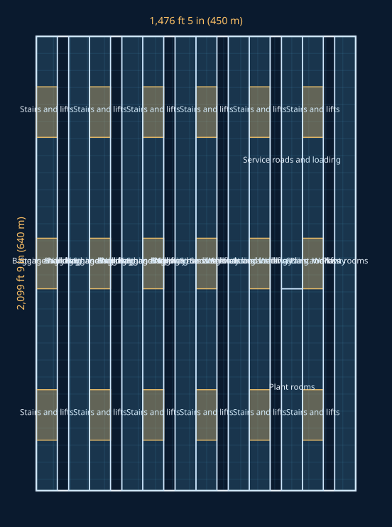
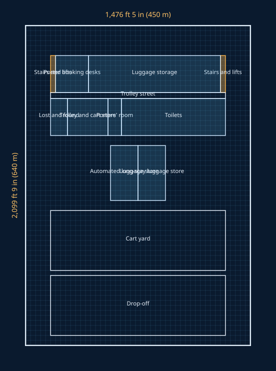
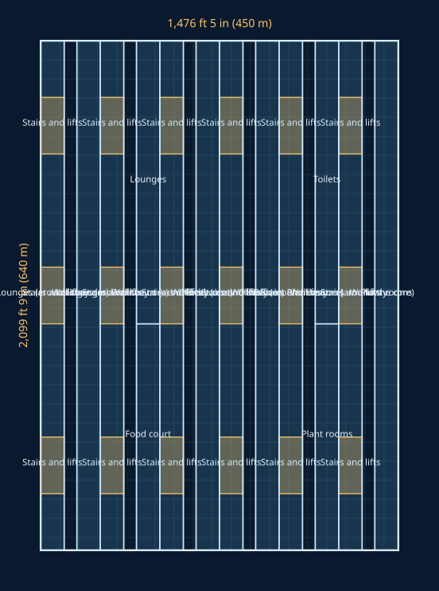

# P7-01 Porters' Hall: plan

Footprint 1,476 ft 5 in (450 m) × 2,099 ft 9 in (640 m) · structural grid 78 ft 9 in (24 m)

## Levels

| Level | Floor above deck | Height | Floor area |
|---|---|---|---|
| Level B1 · Baggage and service level | −19 ft 8 in (6,000 mm) | 19 ft 8 in (6,000 mm) | 2,438,672 sq ft (226,560 m²) |
| Level 1 · Ground floor | 0 ft (0 mm) | 26 ft 3 in (8,000 mm) | 2,032,099 sq ft (188,788 m²) |
| Level 2 · Upper floor | 26 ft 3 in (8,000 mm) | 26 ft 3 in (8,000 mm) | 2,438,672 sq ft (226,560 m²) |
| Level 3 · Upper floor | 52 ft 6 in (16 m) | 26 ft 3 in (8,000 mm) | 2,438,672 sq ft (226,560 m²) |

## Elements

| ID | Designation | Type | Name | Level(s) | Size / length | Area | Status |
|---|---|---|---|---|---|---|---|
| L1-001 | D5F3P7B1A1L1R1 | zone | Walkway | L1 | 52 ft 6 in (16 m) × 2,099 ft 9 in (640 m) | 110,222 sq ft (10,240 m²) | proposed |
| L1-002 | D5F3P7B1A1L1R2 | zone | Walkway | L1 | 52 ft 6 in (16 m) × 2,099 ft 9 in (640 m) | 110,222 sq ft (10,240 m²) | proposed |
| L1-003 | D5F3P7B1A1L1R3 | zone | Walkway | L1 | 52 ft 6 in (16 m) × 2,099 ft 9 in (640 m) | 110,222 sq ft (10,240 m²) | proposed |
| L1-004 | D5F3P7B1A1L1R4 | zone | Walkway | L1 | 52 ft 6 in (16 m) × 2,099 ft 9 in (640 m) | 110,222 sq ft (10,240 m²) | proposed |
| L1-005 | D5F3P7B1A1L1R5 | zone | Walkway | L1 | 52 ft 6 in (16 m) × 2,099 ft 9 in (640 m) | 110,222 sq ft (10,240 m²) | proposed |
| L1-006 | D5F3P7B1A1L1R6 | zone | Walkway | L1 | 52 ft 6 in (16 m) × 2,099 ft 9 in (640 m) | 110,222 sq ft (10,240 m²) | proposed |
| L1-007 | D5F3P7B1A1L1R7 | room | Main hall | L1 | 96 ft 9 in (30 m) × 233 ft 3 in (71 m) | 22,577 sq ft (2,097 m²) | proposed |
| L1-008 | D5F3P7B1A1L1R8 | room | Main hall | L1 | 96 ft 9 in (30 m) × 466 ft 6 in (142 m) | 45,154 sq ft (4,195 m²) | proposed |
| L1-009 | D5F3P7B1A1L1R9 | room | Main hall | L1 | 96 ft 9 in (30 m) × 466 ft 6 in (142 m) | 45,154 sq ft (4,195 m²) | proposed |
| L1-010 | D5F3P7B1A1L1R10 | room | Main hall | L1 | 96 ft 9 in (30 m) × 233 ft 3 in (71 m) | 22,577 sq ft (2,097 m²) | proposed |
| L1-011 | D5F3P7B1A1L1R11 | room | Main hall | L1 | 96 ft 9 in (30 m) × 2,099 ft 9 in (640 m) | 203,223 sq ft (18,880 m²) | proposed |
| L1-012 | D5F3P7B1A1L1R12 | room | Main hall | L1 | 96 ft 9 in (30 m) × 233 ft 3 in (71 m) | 22,577 sq ft (2,097 m²) | proposed |
| L1-013 | D5F3P7B1A1L1R13 | room | Main hall | L1 | 96 ft 9 in (30 m) × 466 ft 6 in (142 m) | 45,154 sq ft (4,195 m²) | proposed |
| L1-014 | D5F3P7B1A1L1R14 | room | Main hall | L1 | 96 ft 9 in (30 m) × 466 ft 6 in (142 m) | 45,154 sq ft (4,195 m²) | proposed |
| L1-015 | D5F3P7B1A1L1R15 | room | Main hall | L1 | 96 ft 9 in (30 m) × 233 ft 3 in (71 m) | 22,577 sq ft (2,097 m²) | proposed |
| L1-016 | D5F3P7B1A1L1R16 | room | Main hall | L1 | 96 ft 9 in (30 m) × 1,399 ft 11 in (427 m) | 135,492 sq ft (12,588 m²) | proposed |
| L1-017 | D5F3P7B1A1L1R17 | room | Desks and check-in | L1 | 96 ft 9 in (30 m) × 699 ft 10 in (213 m) | 67,730 sq ft (6,292 m²) | proposed |
| L1-018 | D5F3P7B1A1L1R18 | room | Desks and check-in | L1 | 96 ft 9 in (30 m) × 233 ft 3 in (71 m) | 22,577 sq ft (2,097 m²) | proposed |
| L1-019 | D5F3P7B1A1L1R19 | room | Desks and check-in | L1 | 96 ft 9 in (30 m) × 466 ft 6 in (142 m) | 45,154 sq ft (4,195 m²) | proposed |
| L1-020 | D5F3P7B1A1L1R20 | room | Desks and check-in | L1 | 96 ft 9 in (30 m) × 466 ft 6 in (142 m) | 45,154 sq ft (4,195 m²) | proposed |
| L1-021 | D5F3P7B1A1L1R21 | room | Desks and check-in | L1 | 96 ft 9 in (30 m) × 233 ft 3 in (71 m) | 22,577 sq ft (2,097 m²) | proposed |
| L1-022 | D5F3P7B1A1L1R22 | room | Desks and check-in | L1 | 96 ft 9 in (30 m) × 933 ft 1 in (284 m) | 90,307 sq ft (8,390 m²) | proposed |
| L1-023 | D5F3P7B1A1L1R23 | room | Security and control | L1 | 96 ft 9 in (30 m) × 1,166 ft 8 in (356 m) | 112,916 sq ft (10,490 m²) | proposed |
| L1-024 | D5F3P7B1A1L1R24 | room | Security and control | L1 | 96 ft 9 in (30 m) × 233 ft 3 in (71 m) | 22,577 sq ft (2,097 m²) | proposed |
| L1-025 | D5F3P7B1A1L1R25 | room | Security and control | L1 | 96 ft 9 in (30 m) × 466 ft 6 in (142 m) | 45,154 sq ft (4,195 m²) | proposed |
| L1-026 | D5F3P7B1A1L1R26 | room | Security and control | L1 | 96 ft 9 in (30 m) × 466 ft 6 in (142 m) | 45,154 sq ft (4,195 m²) | proposed |
| L1-027 | D5F3P7B1A1L1R27 | room | Security and control | L1 | 96 ft 9 in (30 m) × 233 ft 3 in (71 m) | 22,577 sq ft (2,097 m²) | proposed |
| L1-028 | D5F3P7B1A1L1R28 | room | Waiting areas | L1 | 96 ft 9 in (30 m) × 2,099 ft 9 in (640 m) | 203,223 sq ft (18,880 m²) | proposed |
| L1-029 | D5F3P7B1A1L1R29 | room | Waiting areas | L1 | 96 ft 9 in (30 m) × 233 ft 3 in (71 m) | 22,577 sq ft (2,097 m²) | proposed |
| L1-030 | D5F3P7B1A1L1R30 | room | Waiting areas | L1 | 96 ft 9 in (30 m) × 466 ft 6 in (142 m) | 45,154 sq ft (4,195 m²) | proposed |
| L1-031 | D5F3P7B1A1L1R31 | room | Waiting areas | L1 | 96 ft 9 in (30 m) × 466 ft 6 in (142 m) | 45,154 sq ft (4,195 m²) | proposed |
| L1-032 | D5F3P7B1A1L1R32 | room | Shops and cafés | L1 | 96 ft 9 in (30 m) × 233 ft 3 in (71 m) | 22,577 sq ft (2,097 m²) | proposed |
| L1-033 | D5F3P7B1A1L1R33 | room | Shops and cafés | L1 | 96 ft 9 in (30 m) × 2,099 ft 9 in (640 m) | 203,223 sq ft (18,880 m²) | proposed |
| L1-034 | D5F3P7B1A1L1R34 | room | Shops and cafés | L1 | 96 ft 9 in (30 m) × 233 ft 3 in (71 m) | 22,577 sq ft (2,097 m²) | proposed |
| L1-035 | D5F3P7B1A1L1R35 | room | Toilets and family rooms | L1 | 96 ft 9 in (30 m) × 466 ft 6 in (142 m) | 45,154 sq ft (4,195 m²) | proposed |
| L1-036 | D5F3P7B1A1L1R36 | room | Toilets and family rooms | L1 | 96 ft 9 in (30 m) × 466 ft 6 in (142 m) | 45,154 sq ft (4,195 m²) | proposed |
| L1-037 | D5F3P7B1A1L1R37 | room | Toilets and family rooms | L1 | 96 ft 9 in (30 m) × 233 ft 3 in (71 m) | 22,577 sq ft (2,097 m²) | proposed |
| L1-038 | D5F3P7B1A1L1R38 | room | Staff rooms | L1 | 96 ft 9 in (30 m) × 2,099 ft 9 in (640 m) | 203,223 sq ft (18,880 m²) | proposed |
| L1-039 | D5F3P7B1A1LB1R1, D5F3P7B1A1L1R39, D5F3P7B1A1L2R1, D5F3P7B1A1L3R1 | core | Stairs and lifts | LB1, L1, L2, L3 | 96 ft 9 in (30 m) × 233 ft 3 in (71 m) | 22,577 sq ft (2,097 m²) | proposed |
| L1-040 | D5F3P7B1A1LB1R2, D5F3P7B1A1L1R40, D5F3P7B1A1L2R2, D5F3P7B1A1L3R2 | core | Stairs and lifts | LB1, L1, L2, L3 | 96 ft 9 in (30 m) × 233 ft 7 in (71 m) | 22,609 sq ft (2,100 m²) | proposed |
| L1-041 | D5F3P7B1A1LB1R3, D5F3P7B1A1L1R41, D5F3P7B1A1L2R3, D5F3P7B1A1L3R3 | core | Stairs and lifts | LB1, L1, L2, L3 | 96 ft 9 in (30 m) × 233 ft 3 in (71 m) | 22,577 sq ft (2,097 m²) | proposed |
| L1-042 | D5F3P7B1A1LB1R4, D5F3P7B1A1L1R42, D5F3P7B1A1L2R4, D5F3P7B1A1L3R4 | core | Stairs and lifts | LB1, L1, L2, L3 | 96 ft 9 in (30 m) × 233 ft 3 in (71 m) | 22,577 sq ft (2,097 m²) | proposed |
| L1-043 | D5F3P7B1A1LB1R5, D5F3P7B1A1L1R43, D5F3P7B1A1L2R5, D5F3P7B1A1L3R5 | core | Stairs and lifts | LB1, L1, L2, L3 | 96 ft 9 in (30 m) × 233 ft 7 in (71 m) | 22,609 sq ft (2,100 m²) | proposed |
| L1-044 | D5F3P7B1A1LB1R6, D5F3P7B1A1L1R44, D5F3P7B1A1L2R6, D5F3P7B1A1L3R6 | core | Stairs and lifts | LB1, L1, L2, L3 | 96 ft 9 in (30 m) × 233 ft 3 in (71 m) | 22,577 sq ft (2,097 m²) | proposed |
| L1-045 | D5F3P7B1A1LB1R7, D5F3P7B1A1L1R45, D5F3P7B1A1L2R7, D5F3P7B1A1L3R7 | core | Stairs and lifts | LB1, L1, L2, L3 | 96 ft 9 in (30 m) × 233 ft 3 in (71 m) | 22,577 sq ft (2,097 m²) | proposed |
| L1-046 | D5F3P7B1A1LB1R8, D5F3P7B1A1L1R46, D5F3P7B1A1L2R8, D5F3P7B1A1L3R8 | core | Stairs and lifts | LB1, L1, L2, L3 | 96 ft 9 in (30 m) × 233 ft 7 in (71 m) | 22,609 sq ft (2,100 m²) | proposed |
| L1-047 | D5F3P7B1A1LB1R9, D5F3P7B1A1L1R47, D5F3P7B1A1L2R9, D5F3P7B1A1L3R9 | core | Stairs and lifts | LB1, L1, L2, L3 | 96 ft 9 in (30 m) × 233 ft 3 in (71 m) | 22,577 sq ft (2,097 m²) | proposed |
| L1-048 | D5F3P7B1A1LB1R10, D5F3P7B1A1L1R48, D5F3P7B1A1L2R10, D5F3P7B1A1L3R10 | core | Stairs and lifts | LB1, L1, L2, L3 | 96 ft 9 in (30 m) × 233 ft 3 in (71 m) | 22,577 sq ft (2,097 m²) | proposed |
| L1-049 | D5F3P7B1A1LB1R11, D5F3P7B1A1L1R49, D5F3P7B1A1L2R11, D5F3P7B1A1L3R11 | core | Stairs and lifts | LB1, L1, L2, L3 | 96 ft 9 in (30 m) × 233 ft 7 in (71 m) | 22,609 sq ft (2,100 m²) | proposed |
| L1-050 | D5F3P7B1A1LB1R12, D5F3P7B1A1L1R50, D5F3P7B1A1L2R12, D5F3P7B1A1L3R12 | core | Stairs and lifts | LB1, L1, L2, L3 | 96 ft 9 in (30 m) × 233 ft 3 in (71 m) | 22,577 sq ft (2,097 m²) | proposed |
| L1-051 | D5F3P7B1A1LB1R13, D5F3P7B1A1L1R51, D5F3P7B1A1L2R13, D5F3P7B1A1L3R13 | core | Stairs and lifts | LB1, L1, L2, L3 | 96 ft 9 in (30 m) × 233 ft 3 in (71 m) | 22,577 sq ft (2,097 m²) | proposed |
| L1-052 | D5F3P7B1A1LB1R14, D5F3P7B1A1L1R52, D5F3P7B1A1L2R14, D5F3P7B1A1L3R14 | core | Stairs and lifts | LB1, L1, L2, L3 | 96 ft 9 in (30 m) × 233 ft 7 in (71 m) | 22,609 sq ft (2,100 m²) | proposed |
| L1-053 | D5F3P7B1A1LB1R15, D5F3P7B1A1L1R53, D5F3P7B1A1L2R15, D5F3P7B1A1L3R15 | core | Stairs and lifts | LB1, L1, L2, L3 | 96 ft 9 in (30 m) × 233 ft 3 in (71 m) | 22,577 sq ft (2,097 m²) | proposed |
| L1-054 | D5F3P7B1A1LB1R16, D5F3P7B1A1L1R54, D5F3P7B1A1L2R16, D5F3P7B1A1L3R16 | core | Stairs and lifts | LB1, L1, L2, L3 | 96 ft 9 in (30 m) × 233 ft 3 in (71 m) | 22,577 sq ft (2,097 m²) | proposed |
| L1-055 | D5F3P7B1A1LB1R17, D5F3P7B1A1L1R55, D5F3P7B1A1L2R17, D5F3P7B1A1L3R17 | core | Stairs and lifts | LB1, L1, L2, L3 | 96 ft 9 in (30 m) × 233 ft 7 in (71 m) | 22,609 sq ft (2,100 m²) | proposed |
| L1-056 | D5F3P7B1A1LB1R18, D5F3P7B1A1L1R56, D5F3P7B1A1L2R18, D5F3P7B1A1L3R18 | core | Stairs and lifts | LB1, L1, L2, L3 | 96 ft 9 in (30 m) × 233 ft 3 in (71 m) | 22,577 sq ft (2,097 m²) | proposed |
| LT-001 | D5F3P7B1A1L2R19, D5F3P7B1A1L3R19 | zone | Walkway | L2, L3 | 52 ft 6 in (16 m) × 2,099 ft 9 in (640 m) | 110,222 sq ft (10,240 m²) | proposed |
| LT-002 | D5F3P7B1A1L2R20, D5F3P7B1A1L3R20 | zone | Walkway | L2, L3 | 52 ft 6 in (16 m) × 2,099 ft 9 in (640 m) | 110,222 sq ft (10,240 m²) | proposed |
| LT-003 | D5F3P7B1A1L2R21, D5F3P7B1A1L3R21 | zone | Walkway | L2, L3 | 52 ft 6 in (16 m) × 2,099 ft 9 in (640 m) | 110,222 sq ft (10,240 m²) | proposed |
| LT-004 | D5F3P7B1A1L2R22, D5F3P7B1A1L3R22 | zone | Walkway | L2, L3 | 52 ft 6 in (16 m) × 2,099 ft 9 in (640 m) | 110,222 sq ft (10,240 m²) | proposed |
| LT-005 | D5F3P7B1A1L2R23, D5F3P7B1A1L3R23 | zone | Walkway | L2, L3 | 52 ft 6 in (16 m) × 2,099 ft 9 in (640 m) | 110,222 sq ft (10,240 m²) | proposed |
| LT-006 | D5F3P7B1A1L2R24, D5F3P7B1A1L3R24 | zone | Walkway | L2, L3 | 52 ft 6 in (16 m) × 2,099 ft 9 in (640 m) | 110,222 sq ft (10,240 m²) | proposed |
| LT-007 | D5F3P7B1A1L2R25, D5F3P7B1A1L3R25 | room | Lounges (around the core) | L2, L3 | 96 ft 9 in (30 m) × 2,099 ft 9 in (640 m) | 203,223 sq ft (18,880 m²) | proposed |
| LT-008 | D5F3P7B1A1L2R26, D5F3P7B1A1L3R26 | room | Lounges | L2, L3 | 96 ft 9 in (30 m) × 2,099 ft 9 in (640 m) | 203,223 sq ft (18,880 m²) | proposed |
| LT-009 | D5F3P7B1A1L2R27, D5F3P7B1A1L3R27 | room | Lounges (around the core) | L2, L3 | 96 ft 9 in (30 m) × 2,099 ft 9 in (640 m) | 203,223 sq ft (18,880 m²) | proposed |
| LT-010 | D5F3P7B1A1L2R28, D5F3P7B1A1L3R28 | room | Lounges | L2, L3 | 96 ft 9 in (30 m) × 1,166 ft 8 in (356 m) | 112,916 sq ft (10,490 m²) | proposed |
| LT-011 | D5F3P7B1A1L2R29, D5F3P7B1A1L3R29 | room | Food court | L2, L3 | 96 ft 9 in (30 m) × 933 ft 1 in (284 m) | 90,307 sq ft (8,390 m²) | proposed |
| LT-012 | D5F3P7B1A1L2R30, D5F3P7B1A1L3R30 | room | Food court (around the core) | L2, L3 | 96 ft 9 in (30 m) × 2,099 ft 9 in (640 m) | 203,223 sq ft (18,880 m²) | proposed |
| LT-013 | D5F3P7B1A1L2R31, D5F3P7B1A1L3R31 | room | Food court | L2, L3 | 96 ft 9 in (30 m) × 2,099 ft 9 in (640 m) | 203,223 sq ft (18,880 m²) | proposed |
| LT-014 | D5F3P7B1A1L2R32, D5F3P7B1A1L3R32 | room | Offices (around the core) | L2, L3 | 96 ft 9 in (30 m) × 2,099 ft 9 in (640 m) | 203,223 sq ft (18,880 m²) | proposed |
| LT-015 | D5F3P7B1A1L2R33, D5F3P7B1A1L3R33 | room | Offices | L2, L3 | 96 ft 9 in (30 m) × 2,099 ft 9 in (640 m) | 203,223 sq ft (18,880 m²) | proposed |
| LT-016 | D5F3P7B1A1L2R34, D5F3P7B1A1L3R34 | room | Offices (around the core) | L2, L3 | 96 ft 9 in (30 m) × 2,099 ft 9 in (640 m) | 203,223 sq ft (18,880 m²) | proposed |
| LT-017 | D5F3P7B1A1L2R35, D5F3P7B1A1L3R35 | room | Toilets | L2, L3 | 96 ft 9 in (30 m) × 1,166 ft 8 in (356 m) | 112,916 sq ft (10,490 m²) | proposed |
| LT-018 | D5F3P7B1A1L2R36, D5F3P7B1A1L3R36 | room | Plant rooms | L2, L3 | 96 ft 9 in (30 m) × 933 ft 1 in (284 m) | 90,307 sq ft (8,390 m²) | proposed |
| LT-019 | D5F3P7B1A1L2R37, D5F3P7B1A1L3R37 | room | Plant rooms (around the core) | L2, L3 | 96 ft 9 in (30 m) × 2,099 ft 9 in (640 m) | 203,223 sq ft (18,880 m²) | proposed |
| LT-020 | D5F3P7B1A1L2R38, D5F3P7B1A1L3R38 | room | Plant rooms | L2, L3 | 96 ft 9 in (30 m) × 2,099 ft 9 in (640 m) | 203,223 sq ft (18,880 m²) | proposed |
| BB1-001 | D5F3P7B1A1LB1R19 | zone | Walkway | LB1 | 52 ft 6 in (16 m) × 2,099 ft 9 in (640 m) | 110,222 sq ft (10,240 m²) | proposed |
| BB1-002 | D5F3P7B1A1LB1R20 | zone | Walkway | LB1 | 52 ft 6 in (16 m) × 2,099 ft 9 in (640 m) | 110,222 sq ft (10,240 m²) | proposed |
| BB1-003 | D5F3P7B1A1LB1R21 | zone | Walkway | LB1 | 52 ft 6 in (16 m) × 2,099 ft 9 in (640 m) | 110,222 sq ft (10,240 m²) | proposed |
| BB1-004 | D5F3P7B1A1LB1R22 | zone | Walkway | LB1 | 52 ft 6 in (16 m) × 2,099 ft 9 in (640 m) | 110,222 sq ft (10,240 m²) | proposed |
| BB1-005 | D5F3P7B1A1LB1R23 | zone | Walkway | LB1 | 52 ft 6 in (16 m) × 2,099 ft 9 in (640 m) | 110,222 sq ft (10,240 m²) | proposed |
| BB1-006 | D5F3P7B1A1LB1R24 | zone | Walkway | LB1 | 52 ft 6 in (16 m) × 2,099 ft 9 in (640 m) | 110,222 sq ft (10,240 m²) | proposed |
| BB1-007 | D5F3P7B1A1LB1R25 | room | Baggage handling | LB1 | 96 ft 9 in (30 m) × 2,099 ft 9 in (640 m) | 203,223 sq ft (18,880 m²) | proposed |
| BB1-008 | D5F3P7B1A1LB1R26 | room | Baggage handling | LB1 | 96 ft 9 in (30 m) × 2,099 ft 9 in (640 m) | 203,223 sq ft (18,880 m²) | proposed |
| BB1-009 | D5F3P7B1A1LB1R27 | room | Baggage handling | LB1 | 96 ft 9 in (30 m) × 2,099 ft 9 in (640 m) | 203,223 sq ft (18,880 m²) | proposed |
| BB1-010 | D5F3P7B1A1LB1R28 | room | Baggage handling | LB1 | 96 ft 9 in (30 m) × 2,099 ft 9 in (640 m) | 203,223 sq ft (18,880 m²) | proposed |
| BB1-011 | D5F3P7B1A1LB1R29 | room | Baggage handling | LB1 | 96 ft 9 in (30 m) × 2,099 ft 9 in (640 m) | 203,223 sq ft (18,880 m²) | proposed |
| BB1-012 | D5F3P7B1A1LB1R30 | room | Baggage handling | LB1 | 96 ft 9 in (30 m) × 2,099 ft 9 in (640 m) | 203,223 sq ft (18,880 m²) | proposed |
| BB1-013 | D5F3P7B1A1LB1R31 | room | Service roads and loading | LB1 | 96 ft 9 in (30 m) × 2,099 ft 9 in (640 m) | 203,223 sq ft (18,880 m²) | proposed |
| BB1-014 | D5F3P7B1A1LB1R32 | room | Service roads and loading | LB1 | 96 ft 9 in (30 m) × 2,099 ft 9 in (640 m) | 203,223 sq ft (18,880 m²) | proposed |
| BB1-015 | D5F3P7B1A1LB1R33 | room | Service roads and loading | LB1 | 96 ft 9 in (30 m) × 2,099 ft 9 in (640 m) | 203,223 sq ft (18,880 m²) | proposed |
| BB1-016 | D5F3P7B1A1LB1R34 | room | Service roads and loading | LB1 | 96 ft 9 in (30 m) × 1,166 ft 8 in (356 m) | 112,916 sq ft (10,490 m²) | proposed |
| BB1-017 | D5F3P7B1A1LB1R35 | room | Plant rooms | LB1 | 96 ft 9 in (30 m) × 933 ft 1 in (284 m) | 90,307 sq ft (8,390 m²) | proposed |
| BB1-018 | D5F3P7B1A1LB1R36 | room | Plant rooms | LB1 | 96 ft 9 in (30 m) × 2,099 ft 9 in (640 m) | 203,223 sq ft (18,880 m²) | proposed |
| BB1-019 | D5F3P7B1A1LB1R37 | room | Plant rooms | LB1 | 96 ft 9 in (30 m) × 2,099 ft 9 in (640 m) | 203,223 sq ft (18,880 m²) | proposed |
| D-96 |  | door | Main entrance | L1 | 78 ft 9 in (24 m), 78 ft 9 in (24 m) wide | — | proposed |
| D-97 |  | door | Second entrance | L1 | 78 ft 9 in (24 m), 78 ft 9 in (24 m) wide | — | proposed |
| D-98 |  | door | Side door | L1 | 19 ft 8 in (6,000 mm), 19 ft 8 in (6,000 mm) wide | — | proposed |
| D-99 |  | door | Side door | L1 | 19 ft 8 in (6,000 mm), 19 ft 8 in (6,000 mm) wide | — | proposed |

## Drawings

### Level B1 · Baggage and service level

### Level 1 · Ground floor

### Level 2 · Upper floor

### Level 3 · Upper floor

