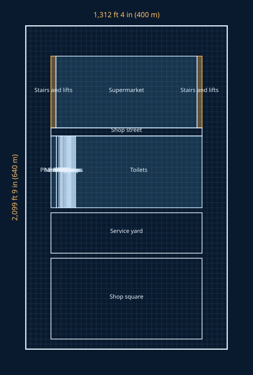
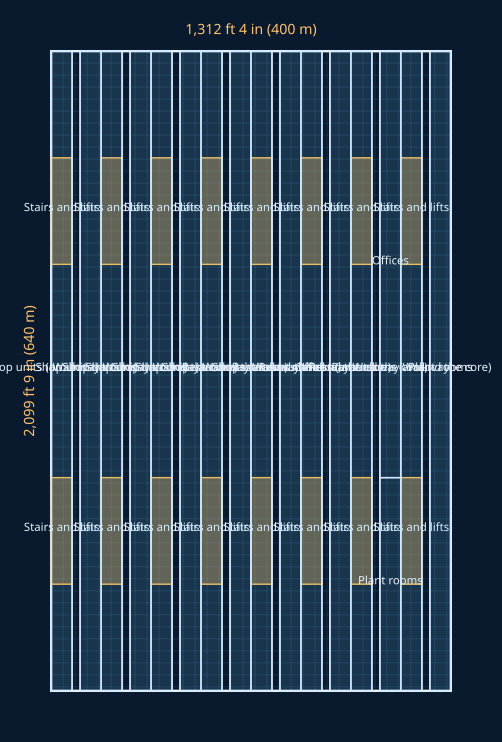

# P7-02 Station Shops: plan

Footprint 1,312 ft 4 in (400 m) × 2,099 ft 9 in (640 m) · structural grid 32 ft 10 in (10 m)

## Levels

| Level | Floor above deck | Height | Floor area |
|---|---|---|---|
| Level 1 · Ground floor | 0 ft (0 mm) | 16 ft 5 in (5,000 mm) | 886,516 sq ft (82,360 m²) |
| Level 2 · Level 2 | 16 ft 5 in (5,000 mm) | 14 ft 9 in (4,500 mm) | 886,516 sq ft (82,360 m²) |

## Elements

| ID | Designation | Type | Name | Level(s) | Size / length | Area | Status |
|---|---|---|---|---|---|---|---|
| E001 | D5F3P7B1A2L1R1, D5F3P7B1A2L2R1 | core | Stairs and lifts | L1, L2 | 32 ft 10 in (10 m) × 465 ft 11 in (142 m) | 15,285 sq ft (1,420 m²) | proposed |
| E002 | D5F3P7B1A2L1R2, D5F3P7B1A2L2R2 | core | Stairs and lifts | L1, L2 | 32 ft 10 in (10 m) × 465 ft 11 in (142 m) | 15,285 sq ft (1,420 m²) | proposed |
| E003 | D5F3P7B1A2L1R3 | zone | Shop street | L1 | 984 ft 3 in (300 m) × 52 ft 6 in (16 m) | 51,667 sq ft (4,800 m²) | proposed |
| E004 | D5F3P7B1A2L1R4 | room | Supermarket | L1 | 918 ft 8 in (280 m) × 465 ft 11 in (142 m) | 427,973 sq ft (39,760 m²) | proposed |
| E005 | D5F3P7B1A2L1R5 | room | Pharmacy | L1 | 34 ft 9 in (11 m) × 465 ft 11 in (142 m) | 16,202 sq ft (1,505 m²) | proposed |
| E006 | D5F3P7B1A2L1R6 | room | Bakery | L1 | 18 ft 4 in (5,600 mm) × 465 ft 11 in (142 m) | 8,559 sq ft (795 m²) | proposed |
| E007 | D5F3P7B1A2L1R7 | room | Newsagent | L1 | 9 ft 2 in (2,800 mm) × 465 ft 11 in (142 m) | 4,280 sq ft (398 m²) | proposed |
| E008 | D5F3P7B1A2L1R8 | room | Shops | L1 | 6 ft 11 in (2,100 mm) × 465 ft 11 in (142 m) | 3,210 sq ft (298 m²) | proposed |
| E009 | D5F3P7B1A2L1R9 | room | Shops | L1 | 6 ft 11 in (2,100 mm) × 465 ft 11 in (142 m) | 3,210 sq ft (298 m²) | proposed |
| E010 | D5F3P7B1A2L1R10 | room | Shops | L1 | 7 ft 3 in (2,200 mm) × 465 ft 11 in (142 m) | 3,363 sq ft (312 m²) | proposed |
| E011 | D5F3P7B1A2L1R11 | room | Shops | L1 | 6 ft 11 in (2,100 mm) × 465 ft 11 in (142 m) | 3,210 sq ft (298 m²) | proposed |
| E012 | D5F3P7B1A2L1R12 | room | Shops | L1 | 6 ft 11 in (2,100 mm) × 465 ft 11 in (142 m) | 3,210 sq ft (298 m²) | proposed |
| E013 | D5F3P7B1A2L1R13 | room | Shops | L1 | 6 ft 11 in (2,100 mm) × 465 ft 11 in (142 m) | 3,210 sq ft (298 m²) | proposed |
| E014 | D5F3P7B1A2L1R14 | room | Shops | L1 | 6 ft 11 in (2,100 mm) × 465 ft 11 in (142 m) | 3,210 sq ft (298 m²) | proposed |
| E015 | D5F3P7B1A2L1R15 | room | Shops | L1 | 6 ft 11 in (2,100 mm) × 465 ft 11 in (142 m) | 3,210 sq ft (298 m²) | proposed |
| E016 | D5F3P7B1A2L1R16 | room | Shops | L1 | 6 ft 11 in (2,100 mm) × 465 ft 11 in (142 m) | 3,210 sq ft (298 m²) | proposed |
| E017 | D5F3P7B1A2L1R17 | room | Shops | L1 | 6 ft 11 in (2,100 mm) × 465 ft 11 in (142 m) | 3,210 sq ft (298 m²) | proposed |
| E018 | D5F3P7B1A2L1R18 | room | Shops | L1 | 7 ft 3 in (2,200 mm) × 465 ft 11 in (142 m) | 3,363 sq ft (312 m²) | proposed |
| E019 | D5F3P7B1A2L1R19 | room | Shops | L1 | 6 ft 11 in (2,100 mm) × 465 ft 11 in (142 m) | 3,210 sq ft (298 m²) | proposed |
| E020 | D5F3P7B1A2L1R20 | room | Shops | L1 | 6 ft 11 in (2,100 mm) × 465 ft 11 in (142 m) | 3,210 sq ft (298 m²) | proposed |
| E021 | D5F3P7B1A2L1R21 | room | Shops | L1 | 6 ft 11 in (2,100 mm) × 465 ft 11 in (142 m) | 3,210 sq ft (298 m²) | proposed |
| E022 | D5F3P7B1A2L1R22 | room | Toilets | L1 | 824 ft 10 in (251 m) × 465 ft 11 in (142 m) | 384,259 sq ft (35,699 m²) | proposed |
| E023 | D5F3P7B1A2L2R3 | zone | Shop street | L2 | 984 ft 3 in (300 m) × 52 ft 6 in (16 m) | 51,667 sq ft (4,800 m²) | proposed |
| E024 | D5F3P7B1A2L2R4 | room | Food court | L2 | 918 ft 8 in (280 m) × 465 ft 11 in (142 m) | 427,973 sq ft (39,760 m²) | proposed |
| E025 | D5F3P7B1A2L2R5 | room | Post office | L2 | 34 ft 9 in (11 m) × 465 ft 11 in (142 m) | 16,202 sq ft (1,505 m²) | proposed |
| E026 | D5F3P7B1A2L2R6 | room | Bank | L2 | 27 ft 7 in (8,400 mm) × 465 ft 11 in (142 m) | 12,839 sq ft (1,193 m²) | proposed |
| E027 | D5F3P7B1A2L2R7 | room | Shops | L2 | 6 ft 11 in (2,100 mm) × 465 ft 11 in (142 m) | 3,210 sq ft (298 m²) | proposed |
| E028 | D5F3P7B1A2L2R8 | room | Shops | L2 | 6 ft 11 in (2,100 mm) × 465 ft 11 in (142 m) | 3,210 sq ft (298 m²) | proposed |
| E029 | D5F3P7B1A2L2R9 | room | Shops | L2 | 7 ft 3 in (2,200 mm) × 465 ft 11 in (142 m) | 3,363 sq ft (312 m²) | proposed |
| E030 | D5F3P7B1A2L2R10 | room | Shops | L2 | 6 ft 11 in (2,100 mm) × 465 ft 11 in (142 m) | 3,210 sq ft (298 m²) | proposed |
| E031 | D5F3P7B1A2L2R11 | room | Shops | L2 | 6 ft 11 in (2,100 mm) × 465 ft 11 in (142 m) | 3,210 sq ft (298 m²) | proposed |
| E032 | D5F3P7B1A2L2R12 | room | Shops | L2 | 6 ft 11 in (2,100 mm) × 465 ft 11 in (142 m) | 3,210 sq ft (298 m²) | proposed |
| E033 | D5F3P7B1A2L2R13 | room | Shops | L2 | 6 ft 11 in (2,100 mm) × 465 ft 11 in (142 m) | 3,210 sq ft (298 m²) | proposed |
| E034 | D5F3P7B1A2L2R14 | room | Shops | L2 | 6 ft 11 in (2,100 mm) × 465 ft 11 in (142 m) | 3,210 sq ft (298 m²) | proposed |
| E035 | D5F3P7B1A2L2R15 | room | Shops | L2 | 6 ft 11 in (2,100 mm) × 465 ft 11 in (142 m) | 3,210 sq ft (298 m²) | proposed |
| E036 | D5F3P7B1A2L2R16 | room | Shops | L2 | 6 ft 11 in (2,100 mm) × 465 ft 11 in (142 m) | 3,210 sq ft (298 m²) | proposed |
| E037 | D5F3P7B1A2L2R17 | room | Offices | L2 | 852 ft 8 in (260 m) × 465 ft 11 in (142 m) | 397,251 sq ft (36,906 m²) | proposed |
| E038 | D5F3P7B1A2L1R23 | zone | Service yard | L1 | 984 ft 3 in (300 m) × 262 ft 6 in (80 m) | 258,334 sq ft (24,000 m²) | proposed |
| E039 | D5F3P7B1A2L1R24 | zone | Shop square | L1 | 984 ft 3 in (300 m) × 524 ft 11 in (160 m) | 516,668 sq ft (48,000 m²) | proposed |

## Drawings

### Level 1 · Ground floor

### Level 2 · Level 2

