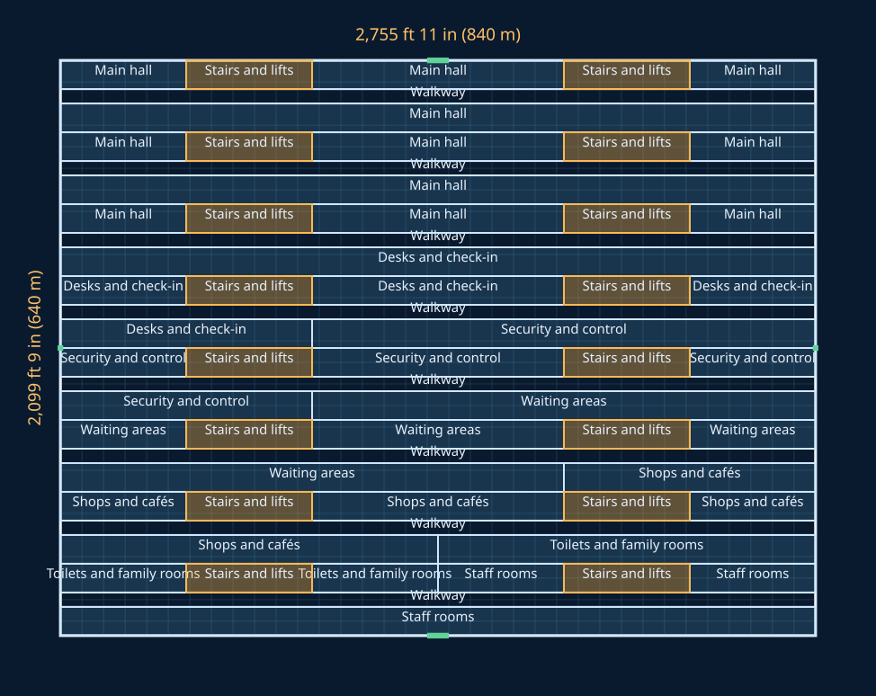
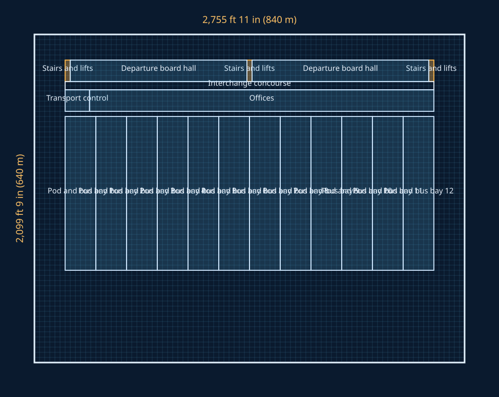
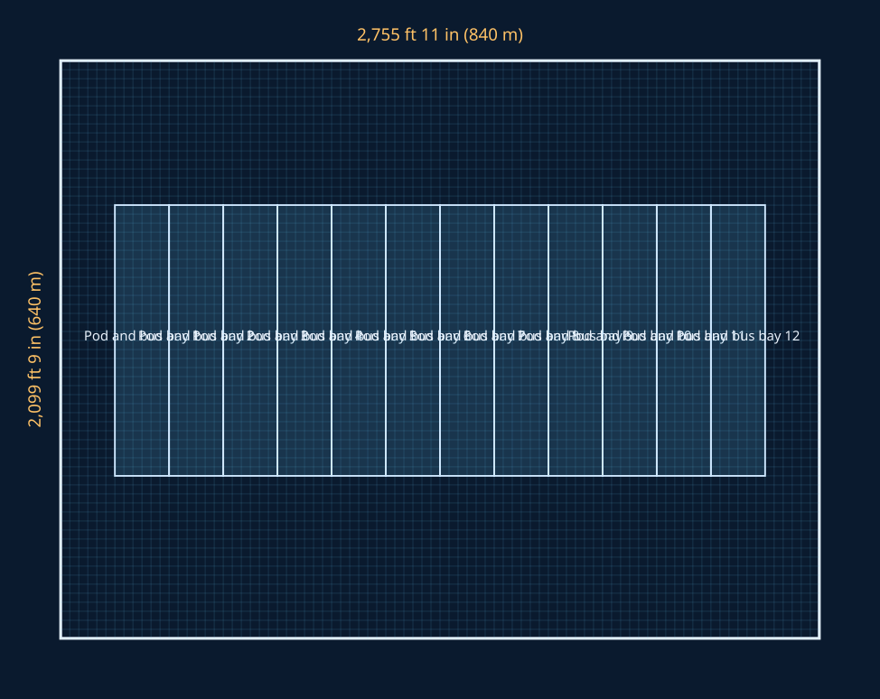

# P7-03 Interchange Hall: plan

Footprint 2,755 ft 11 in (840 m) × 2,099 ft 9 in (640 m) · structural grid 32 ft 10 in (10 m)

## Levels

| Level | Floor above deck | Height | Floor area |
|---|---|---|---|
| Level 1 · Bay level | 0 ft (0 mm) | 26 ft 3 in (8,000 mm) | 2,962,444 sq ft (275,220 m²) |
| Level 2 · Concourse | 26 ft 3 in (8,000 mm) | 19 ft 8 in (6,000 mm) | 2,962,444 sq ft (275,220 m²) |
| Level 3 · Roof | 45 ft 11 in (14 m) | 19 ft 8 in (6,000 mm) | 2,325,005 sq ft (216,000 m²) |

## Elements

| ID | Designation | Type | Name | Level(s) | Size / length | Area | Status |
|---|---|---|---|---|---|---|---|
| E001 | D5F3P7B4A1L1R1, D5F3P7B4A1L2R1 | core | Stairs and lifts | L1, L2 | 32 ft 10 in (10 m) × 137 ft 10 in (42 m) | 4,521 sq ft (420 m²) | proposed |
| E002 | D5F3P7B4A1L1R2, D5F3P7B4A1L2R2 | core | Stairs and lifts | L1, L2 | 32 ft 10 in (10 m) × 137 ft 10 in (42 m) | 4,521 sq ft (420 m²) | proposed |
| E003 | D5F3P7B4A1L1R3, D5F3P7B4A1L2R3 | core | Stairs and lifts | L1, L2 | 32 ft 10 in (10 m) × 137 ft 10 in (42 m) | 4,521 sq ft (420 m²) | proposed |
| E004 | D5F3P7B4A1L1R4 | zone | Interchange concourse | L1 | 2,362 ft 2 in (720 m) × 52 ft 6 in (16 m) | 124,000 sq ft (11,520 m²) | proposed |
| E005 | D5F3P7B4A1L1R5 | room | Ticket hall | L1 | 1,131 ft 11 in (345 m) × 137 ft 10 in (42 m) | 155,969 sq ft (14,490 m²) | proposed |
| E006 | D5F3P7B4A1L1R6 | room | Ticket hall | L1 | 305 ft 5 in (93 m) × 137 ft 10 in (42 m) | 42,089 sq ft (3,910 m²) | proposed |
| E007 | D5F3P7B4A1L1R7 | room | Travel information | L1 | 539 ft 1 in (164 m) × 137 ft 10 in (42 m) | 74,277 sq ft (6,901 m²) | proposed |
| E008 | D5F3P7B4A1L1R8 | room | Waiting rooms | L1 | 287 ft 5 in (88 m) × 137 ft 10 in (42 m) | 39,603 sq ft (3,679 m²) | proposed |
| E009 | D5F3P7B4A1L1R9 | room | Waiting rooms | L1 | 62 ft 4 in (19 m) × 137 ft 10 in (42 m) | 8,590 sq ft (798 m²) | proposed |
| E010 | D5F3P7B4A1L1R10 | room | Waiting rooms | L1 | 62 ft 8 in (19 m) × 137 ft 10 in (42 m) | 8,635 sq ft (802 m²) | proposed |
| E011 | D5F3P7B4A1L1R11 | room | Waiting rooms | L1 | 62 ft 4 in (19 m) × 137 ft 10 in (42 m) | 8,590 sq ft (798 m²) | proposed |
| E012 | D5F3P7B4A1L1R12 | room | Waiting rooms | L1 | 62 ft 8 in (19 m) × 137 ft 10 in (42 m) | 8,635 sq ft (802 m²) | proposed |
| E013 | D5F3P7B4A1L1R13 | room | Waiting rooms | L1 | 62 ft 4 in (19 m) × 137 ft 10 in (42 m) | 8,590 sq ft (798 m²) | proposed |
| E014 | D5F3P7B4A1L1R14 | room | Cafés | L1 | 31 ft 6 in (9,600 mm) × 137 ft 10 in (42 m) | 4,340 sq ft (403 m²) | proposed |
| E015 | D5F3P7B4A1L1R15 | room | Cafés | L1 | 31 ft 2 in (9,500 mm) × 137 ft 10 in (42 m) | 4,295 sq ft (399 m²) | proposed |
| E016 | D5F3P7B4A1L1R16 | room | Cafés | L1 | 31 ft 2 in (9,500 mm) × 137 ft 10 in (42 m) | 4,295 sq ft (399 m²) | proposed |
| E017 | D5F3P7B4A1L1R17 | room | Cafés | L1 | 31 ft 2 in (9,500 mm) × 137 ft 10 in (42 m) | 4,295 sq ft (399 m²) | proposed |
| E018 | D5F3P7B4A1L1R18 | room | Cafés | L1 | 31 ft 6 in (9,600 mm) × 137 ft 10 in (42 m) | 4,340 sq ft (403 m²) | proposed |
| E019 | D5F3P7B4A1L1R19 | room | Cafés | L1 | 31 ft 2 in (9,500 mm) × 137 ft 10 in (42 m) | 4,295 sq ft (399 m²) | proposed |
| E020 | D5F3P7B4A1L1R20 | room | Toilets | L1 | 1,862 ft 2 in (568 m) × 137 ft 10 in (42 m) | 256,603 sq ft (23,839 m²) | proposed |
| E021 | D5F3P7B4A1L2R4 | zone | Interchange concourse | L2 | 2,362 ft 2 in (720 m) × 52 ft 6 in (16 m) | 124,000 sq ft (11,520 m²) | proposed |
| E022 | D5F3P7B4A1L2R5 | room | Departure board hall | L2 | 1,131 ft 11 in (345 m) × 137 ft 10 in (42 m) | 155,969 sq ft (14,490 m²) | proposed |
| E023 | D5F3P7B4A1L2R6 | room | Departure board hall | L2 | 1,131 ft 11 in (345 m) × 137 ft 10 in (42 m) | 155,969 sq ft (14,490 m²) | proposed |
| E024 | D5F3P7B4A1L2R7 | room | Transport control | L2 | 156 ft 2 in (48 m) × 137 ft 10 in (42 m) | 21,519 sq ft (1,999 m²) | proposed |
| E025 | D5F3P7B4A1L2R8 | room | Offices | L2 | 2,206 ft (672 m) × 137 ft 10 in (42 m) | 303,981 sq ft (28,241 m²) | proposed |
| E026 | D5F3P7B4A1L1R21, D5F3P7B4A1L2R9, D5F3P7B4A1L3R1 | room | Pod and bus bay 1 | L1, L2, L3 | 196 ft 10 in (60 m) × 984 ft 3 in (300 m) | 193,750 sq ft (18,000 m²) | proposed |
| E027 | D5F3P7B4A1L1R22, D5F3P7B4A1L2R10, D5F3P7B4A1L3R2 | room | Pod and bus bay 2 | L1, L2, L3 | 196 ft 10 in (60 m) × 984 ft 3 in (300 m) | 193,750 sq ft (18,000 m²) | proposed |
| E028 | D5F3P7B4A1L1R23, D5F3P7B4A1L2R11, D5F3P7B4A1L3R3 | room | Pod and bus bay 3 | L1, L2, L3 | 196 ft 10 in (60 m) × 984 ft 3 in (300 m) | 193,750 sq ft (18,000 m²) | proposed |
| E029 | D5F3P7B4A1L1R24, D5F3P7B4A1L2R12, D5F3P7B4A1L3R4 | room | Pod and bus bay 4 | L1, L2, L3 | 196 ft 10 in (60 m) × 984 ft 3 in (300 m) | 193,750 sq ft (18,000 m²) | proposed |
| E030 | D5F3P7B4A1L1R25, D5F3P7B4A1L2R13, D5F3P7B4A1L3R5 | room | Pod and bus bay 5 | L1, L2, L3 | 196 ft 10 in (60 m) × 984 ft 3 in (300 m) | 193,750 sq ft (18,000 m²) | proposed |
| E031 | D5F3P7B4A1L1R26, D5F3P7B4A1L2R14, D5F3P7B4A1L3R6 | room | Pod and bus bay 6 | L1, L2, L3 | 196 ft 10 in (60 m) × 984 ft 3 in (300 m) | 193,750 sq ft (18,000 m²) | proposed |
| E032 | D5F3P7B4A1L1R27, D5F3P7B4A1L2R15, D5F3P7B4A1L3R7 | room | Pod and bus bay 7 | L1, L2, L3 | 196 ft 10 in (60 m) × 984 ft 3 in (300 m) | 193,750 sq ft (18,000 m²) | proposed |
| E033 | D5F3P7B4A1L1R28, D5F3P7B4A1L2R16, D5F3P7B4A1L3R8 | room | Pod and bus bay 8 | L1, L2, L3 | 196 ft 10 in (60 m) × 984 ft 3 in (300 m) | 193,750 sq ft (18,000 m²) | proposed |
| E034 | D5F3P7B4A1L1R29, D5F3P7B4A1L2R17, D5F3P7B4A1L3R9 | room | Pod and bus bay 9 | L1, L2, L3 | 196 ft 10 in (60 m) × 984 ft 3 in (300 m) | 193,750 sq ft (18,000 m²) | proposed |
| E035 | D5F3P7B4A1L1R30, D5F3P7B4A1L2R18, D5F3P7B4A1L3R10 | room | Pod and bus bay 10 | L1, L2, L3 | 196 ft 10 in (60 m) × 984 ft 3 in (300 m) | 193,750 sq ft (18,000 m²) | proposed |
| E036 | D5F3P7B4A1L1R31, D5F3P7B4A1L2R19, D5F3P7B4A1L3R11 | room | Pod and bus bay 11 | L1, L2, L3 | 196 ft 10 in (60 m) × 984 ft 3 in (300 m) | 193,750 sq ft (18,000 m²) | proposed |
| E037 | D5F3P7B4A1L1R32, D5F3P7B4A1L2R20, D5F3P7B4A1L3R12 | room | Pod and bus bay 12 | L1, L2, L3 | 196 ft 10 in (60 m) × 984 ft 3 in (300 m) | 193,750 sq ft (18,000 m²) | proposed |
| E038 | D5F3P7B4A1L1R33 | zone | Taxi rank | L1 | 2,362 ft 2 in (720 m) × 328 ft 1 in (100 m) | 775,002 sq ft (72,000 m²) | proposed |

## Drawings

### Level 1 · Bay level

### Level 2 · Concourse

### Level 3 · Roof

