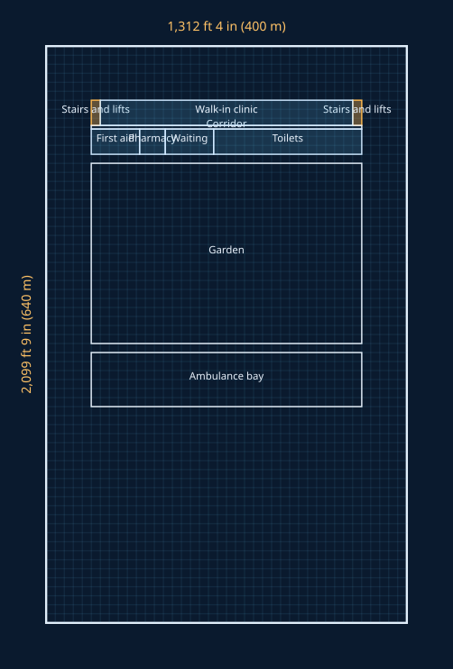
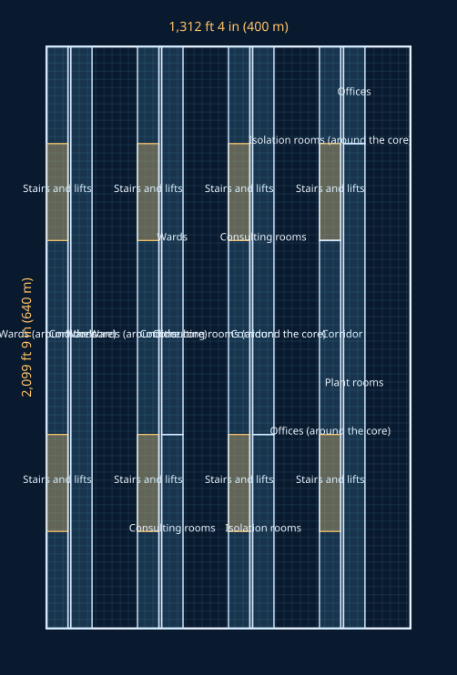

# P7-04 Station Clinic: plan

Footprint 1,312 ft 4 in (400 m) × 2,099 ft 9 in (640 m) · structural grid 32 ft 10 in (10 m)

## Levels

| Level | Floor above deck | Height | Floor area |
|---|---|---|---|
| Level 1 · Ground floor | 0 ft (0 mm) | 16 ft 5 in (5,000 mm) | 174,806 sq ft (16,240 m²) |
| Level 2 · Level 2 | 16 ft 5 in (5,000 mm) | 14 ft 9 in (4,500 mm) | 174,806 sq ft (16,240 m²) |

## Elements

| ID | Designation | Type | Name | Level(s) | Size / length | Area | Status |
|---|---|---|---|---|---|---|---|
| E001 | D5F3P7B6A1L1R1, D5F3P7B6A1L2R1 | core | Stairs and lifts | L1, L2 | 32 ft 10 in (10 m) × 91 ft 10 in (28 m) | 3,014 sq ft (280 m²) | proposed |
| E002 | D5F3P7B6A1L1R2, D5F3P7B6A1L2R2 | core | Stairs and lifts | L1, L2 | 32 ft 10 in (10 m) × 91 ft 10 in (28 m) | 3,014 sq ft (280 m²) | proposed |
| E003 | D5F3P7B6A1L1R3 | zone | Corridor | L1 | 984 ft 3 in (300 m) × 13 ft 1 in (4,000 mm) | 12,917 sq ft (1,200 m²) | proposed |
| E004 | D5F3P7B6A1L1R4 | room | Walk-in clinic | L1 | 918 ft 8 in (280 m) × 91 ft 10 in (28 m) | 84,389 sq ft (7,840 m²) | proposed |
| E005 | D5F3P7B6A1L1R5 | room | First aid | L1 | 175 ft 10 in (54 m) × 91 ft 10 in (28 m) | 16,154 sq ft (1,501 m²) | proposed |
| E006 | D5F3P7B6A1L1R6 | room | Pharmacy | L1 | 93 ft 6 in (28 m) × 91 ft 10 in (28 m) | 8,590 sq ft (798 m²) | proposed |
| E007 | D5F3P7B6A1L1R7 | room | Waiting | L1 | 175 ft 10 in (54 m) × 91 ft 10 in (28 m) | 16,154 sq ft (1,501 m²) | proposed |
| E008 | D5F3P7B6A1L1R8 | room | Toilets | L1 | 539 ft 1 in (164 m) × 91 ft 10 in (28 m) | 49,518 sq ft (4,600 m²) | proposed |
| E009 | D5F3P7B6A1L2R3 | zone | Corridor | L2 | 984 ft 3 in (300 m) × 13 ft 1 in (4,000 mm) | 12,917 sq ft (1,200 m²) | proposed |
| E010 | D5F3P7B6A1L2R4 | room | Consulting rooms | L2 | 114 ft 10 in (35 m) × 91 ft 10 in (28 m) | 10,549 sq ft (980 m²) | proposed |
| E011 | D5F3P7B6A1L2R5 | room | Consulting rooms | L2 | 114 ft 10 in (35 m) × 91 ft 10 in (28 m) | 10,549 sq ft (980 m²) | proposed |
| E012 | D5F3P7B6A1L2R6 | room | Consulting rooms | L2 | 114 ft 10 in (35 m) × 91 ft 10 in (28 m) | 10,549 sq ft (980 m²) | proposed |
| E013 | D5F3P7B6A1L2R7 | room | Consulting rooms | L2 | 114 ft 10 in (35 m) × 91 ft 10 in (28 m) | 10,549 sq ft (980 m²) | proposed |
| E014 | D5F3P7B6A1L2R8 | room | Consulting rooms | L2 | 114 ft 10 in (35 m) × 91 ft 10 in (28 m) | 10,549 sq ft (980 m²) | proposed |
| E015 | D5F3P7B6A1L2R9 | room | Consulting rooms | L2 | 114 ft 10 in (35 m) × 91 ft 10 in (28 m) | 10,549 sq ft (980 m²) | proposed |
| E016 | D5F3P7B6A1L2R10 | room | Consulting rooms | L2 | 114 ft 10 in (35 m) × 91 ft 10 in (28 m) | 10,549 sq ft (980 m²) | proposed |
| E017 | D5F3P7B6A1L2R11 | room | Consulting rooms | L2 | 114 ft 10 in (35 m) × 91 ft 10 in (28 m) | 10,549 sq ft (980 m²) | proposed |
| E018 | D5F3P7B6A1L2R12 | room | Consulting rooms | L2 | 3 ft 7 in (1,100 mm) × 91 ft 10 in (28 m) | 332 sq ft (31 m²) | proposed |
| E019 | D5F3P7B6A1L2R13 | room | Consulting rooms | L2 | 3 ft 3 in (1,000 mm) × 91 ft 10 in (28 m) | 301 sq ft (28 m²) | proposed |
| E020 | D5F3P7B6A1L2R14 | room | Consulting rooms | L2 | 3 ft 7 in (1,100 mm) × 91 ft 10 in (28 m) | 332 sq ft (31 m²) | proposed |
| E021 | D5F3P7B6A1L2R15 | room | Consulting rooms | L2 | 3 ft 7 in (1,100 mm) × 91 ft 10 in (28 m) | 332 sq ft (31 m²) | proposed |
| E022 | D5F3P7B6A1L2R16 | room | Consulting rooms | L2 | 3 ft 7 in (1,100 mm) × 91 ft 10 in (28 m) | 332 sq ft (31 m²) | proposed |
| E023 | D5F3P7B6A1L2R17 | room | Consulting rooms | L2 | 3 ft 3 in (1,000 mm) × 91 ft 10 in (28 m) | 301 sq ft (28 m²) | proposed |
| E024 | D5F3P7B6A1L2R18 | room | Consulting rooms | L2 | 3 ft 7 in (1,100 mm) × 91 ft 10 in (28 m) | 332 sq ft (31 m²) | proposed |
| E025 | D5F3P7B6A1L2R19 | room | Consulting rooms | L2 | 3 ft 7 in (1,100 mm) × 91 ft 10 in (28 m) | 332 sq ft (31 m²) | proposed |
| E026 | D5F3P7B6A1L2R20 | room | Staff | L2 | 956 ft (291 m) × 91 ft 10 in (28 m) | 87,825 sq ft (8,159 m²) | proposed |
| E027 | D5F3P7B6A1L1R9 | zone | Garden | L1 | 984 ft 3 in (300 m) × 656 ft 2 in (200 m) | 645,835 sq ft (60,000 m²) | proposed |
| E028 | D5F3P7B6A1L1R10 | zone | Ambulance bay | L1 | 984 ft 3 in (300 m) × 196 ft 10 in (60 m) | 193,750 sq ft (18,000 m²) | proposed |

## Drawings

### Level 1 · Ground floor

### Level 2 · Level 2

