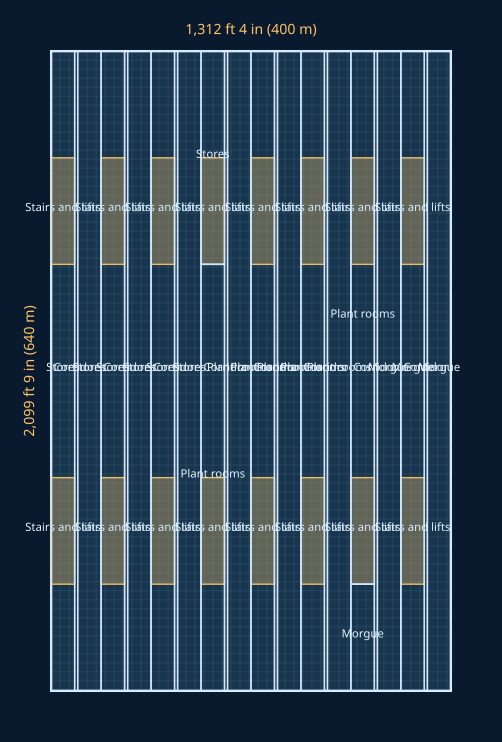

# P7-04 Station Clinic: plan

Footprint 1,312 ft 4 in (400 m) × 2,099 ft 9 in (640 m) · structural grid 29 ft 6 in (9,000 mm)

## Levels

| Level | Floor above deck | Height | Floor area |
|---|---|---|---|
| Level B1 · Service level | −16 ft 5 in (5,000 mm) | 16 ft 5 in (5,000 mm) | 2,590,228 sq ft (240,640 m²) |
| Level 1 · Ground floor | 0 ft (0 mm) | 14 ft 9 in (4,500 mm) | 2,158,793 sq ft (200,558 m²) |
| Level 2 · Upper floor | 14 ft 9 in (4,500 mm) | 14 ft 9 in (4,500 mm) | 1,295,114 sq ft (120,320 m²) |
| Level 3 · Upper floor | 29 ft 6 in (9,000 mm) | 14 ft 9 in (4,500 mm) | 1,295,114 sq ft (120,320 m²) |

## Elements

| ID | Designation | Type | Name | Level(s) | Size / length | Area | Status |
|---|---|---|---|---|---|---|---|
| L1-001 | D5F3P7B6A1L1R1 | zone | Corridor | L1 | 9 ft 10 in (3,000 mm) × 2,099 ft 9 in (640 m) | 20,667 sq ft (1,920 m²) | proposed |
| L1-002 | D5F3P7B6A1L1R2 | zone | Corridor | L1 | 9 ft 10 in (3,000 mm) × 2,099 ft 9 in (640 m) | 20,667 sq ft (1,920 m²) | proposed |
| L1-003 | D5F3P7B6A1L1R3 | zone | Corridor | L1 | 9 ft 10 in (3,000 mm) × 2,099 ft 9 in (640 m) | 20,667 sq ft (1,920 m²) | proposed |
| L1-004 | D5F3P7B6A1L1R4 | zone | Corridor | L1 | 9 ft 10 in (3,000 mm) × 2,099 ft 9 in (640 m) | 20,667 sq ft (1,920 m²) | proposed |
| L1-005 | D5F3P7B6A1L1R5 | zone | Corridor | L1 | 9 ft 10 in (3,000 mm) × 2,099 ft 9 in (640 m) | 20,667 sq ft (1,920 m²) | proposed |
| L1-006 | D5F3P7B6A1L1R6 | zone | Corridor | L1 | 9 ft 10 in (3,000 mm) × 2,099 ft 9 in (640 m) | 20,667 sq ft (1,920 m²) | proposed |
| L1-007 | D5F3P7B6A1L1R7 | zone | Corridor | L1 | 9 ft 10 in (3,000 mm) × 2,099 ft 9 in (640 m) | 20,667 sq ft (1,920 m²) | proposed |
| L1-008 | D5F3P7B6A1L1R8 | zone | Corridor | L1 | 9 ft 10 in (3,000 mm) × 2,099 ft 9 in (640 m) | 20,667 sq ft (1,920 m²) | proposed |
| L1-009 | D5F3P7B6A1L1R9 | room | Entrance and waiting | L1 | 77 ft 1 in (24 m) × 350 ft 1 in (107 m) | 26,990 sq ft (2,507 m²) | proposed |
| L1-010 | D5F3P7B6A1L1R10 | room | Entrance and waiting | L1 | 77 ft 1 in (24 m) × 700 ft 2 in (213 m) | 53,980 sq ft (5,015 m²) | proposed |
| L1-011 | D5F3P7B6A1L1R11 | room | Entrance and waiting | L1 | 77 ft 1 in (24 m) × 350 ft 1 in (107 m) | 26,990 sq ft (2,507 m²) | proposed |
| L1-012 | D5F3P7B6A1L1R12 | room | Entrance and waiting | L1 | 77 ft 1 in (24 m) × 2,099 ft 9 in (640 m) | 161,889 sq ft (15,040 m²) | proposed |
| L1-013 | D5F3P7B6A1L1R13 | room | Entrance and waiting | L1 | 77 ft 1 in (24 m) × 350 ft 1 in (107 m) | 26,990 sq ft (2,507 m²) | proposed |
| L1-014 | D5F3P7B6A1L1R14 | room | Entrance and waiting | L1 | 77 ft 1 in (24 m) × 350 ft 1 in (107 m) | 26,990 sq ft (2,507 m²) | proposed |
| L1-015 | D5F3P7B6A1L1R15 | room | Emergency and treatment | L1 | 77 ft 1 in (24 m) × 350 ft 1 in (107 m) | 26,990 sq ft (2,507 m²) | proposed |
| L1-016 | D5F3P7B6A1L1R16 | room | Emergency and treatment | L1 | 77 ft 1 in (24 m) × 350 ft 1 in (107 m) | 26,990 sq ft (2,507 m²) | proposed |
| L1-017 | D5F3P7B6A1L1R17 | room | Emergency and treatment | L1 | 77 ft 1 in (24 m) × 2,099 ft 9 in (640 m) | 161,889 sq ft (15,040 m²) | proposed |
| L1-018 | D5F3P7B6A1L1R18 | room | Emergency and treatment | L1 | 77 ft 1 in (24 m) × 350 ft 1 in (107 m) | 26,990 sq ft (2,507 m²) | proposed |
| L1-019 | D5F3P7B6A1L1R19 | room | Emergency and treatment | L1 | 77 ft 1 in (24 m) × 700 ft 2 in (213 m) | 53,980 sq ft (5,015 m²) | proposed |
| L1-020 | D5F3P7B6A1L1R20 | room | Emergency and treatment | L1 | 77 ft 1 in (24 m) × 350 ft 1 in (107 m) | 26,990 sq ft (2,507 m²) | proposed |
| L1-021 | D5F3P7B6A1L1R21 | room | Emergency and treatment | L1 | 77 ft 1 in (24 m) × 2,099 ft 9 in (640 m) | 161,889 sq ft (15,040 m²) | proposed |
| L1-022 | D5F3P7B6A1L1R22 | room | Emergency and treatment | L1 | 77 ft 1 in (24 m) × 350 ft 1 in (107 m) | 26,990 sq ft (2,507 m²) | proposed |
| L1-023 | D5F3P7B6A1L1R23 | room | Emergency and treatment | L1 | 77 ft 1 in (24 m) × 350 ft 1 in (107 m) | 26,990 sq ft (2,507 m²) | proposed |
| L1-024 | D5F3P7B6A1L1R24 | room | Screening rooms | L1 | 77 ft 1 in (24 m) × 350 ft 1 in (107 m) | 26,990 sq ft (2,507 m²) | proposed |
| L1-025 | D5F3P7B6A1L1R25 | room | Screening rooms | L1 | 77 ft 1 in (24 m) × 350 ft 1 in (107 m) | 26,990 sq ft (2,507 m²) | proposed |
| L1-026 | D5F3P7B6A1L1R26 | room | Screening rooms | L1 | 77 ft 1 in (24 m) × 2,099 ft 9 in (640 m) | 161,889 sq ft (15,040 m²) | proposed |
| L1-027 | D5F3P7B6A1L1R27 | room | Screening rooms | L1 | 77 ft 1 in (24 m) × 350 ft 1 in (107 m) | 26,990 sq ft (2,507 m²) | proposed |
| L1-028 | D5F3P7B6A1L1R28 | room | Screening rooms | L1 | 77 ft 1 in (24 m) × 700 ft 2 in (213 m) | 53,980 sq ft (5,015 m²) | proposed |
| L1-029 | D5F3P7B6A1L1R29 | room | Screening rooms | L1 | 77 ft 1 in (24 m) × 350 ft 1 in (107 m) | 26,990 sq ft (2,507 m²) | proposed |
| L1-030 | D5F3P7B6A1L1R30 | room | Screening rooms | L1 | 77 ft 1 in (24 m) × 1,399 ft 11 in (427 m) | 107,935 sq ft (10,027 m²) | proposed |
| L1-031 | D5F3P7B6A1L1R31 | room | Imaging | L1 | 77 ft 1 in (24 m) × 699 ft 10 in (213 m) | 53,955 sq ft (5,013 m²) | proposed |
| L1-032 | D5F3P7B6A1L1R32 | room | Imaging | L1 | 77 ft 1 in (24 m) × 350 ft 1 in (107 m) | 26,990 sq ft (2,507 m²) | proposed |
| L1-033 | D5F3P7B6A1L1R33 | room | Imaging | L1 | 77 ft 1 in (24 m) × 700 ft 2 in (213 m) | 53,980 sq ft (5,015 m²) | proposed |
| L1-034 | D5F3P7B6A1L1R34 | room | Imaging | L1 | 77 ft 1 in (24 m) × 350 ft 1 in (107 m) | 26,990 sq ft (2,507 m²) | proposed |
| L1-035 | D5F3P7B6A1L1R35 | room | Imaging | L1 | 77 ft 1 in (24 m) × 699 ft 10 in (213 m) | 53,955 sq ft (5,013 m²) | proposed |
| L1-036 | D5F3P7B6A1L1R36 | room | Pharmacy | L1 | 77 ft 1 in (24 m) × 1,399 ft 11 in (427 m) | 107,935 sq ft (10,027 m²) | proposed |
| L1-037 | D5F3P7B6A1L1R37 | room | Staff rooms | L1 | 77 ft 1 in (24 m) × 350 ft 1 in (107 m) | 26,990 sq ft (2,507 m²) | proposed |
| L1-038 | D5F3P7B6A1L1R38 | room | Staff rooms | L1 | 77 ft 1 in (24 m) × 700 ft 2 in (213 m) | 53,980 sq ft (5,015 m²) | proposed |
| L1-039 | D5F3P7B6A1L1R39 | room | Staff rooms | L1 | 77 ft 1 in (24 m) × 350 ft 1 in (107 m) | 26,990 sq ft (2,507 m²) | proposed |
| L1-040 | D5F3P7B6A1L1R40 | room | Staff rooms | L1 | 77 ft 1 in (24 m) × 1,399 ft 11 in (427 m) | 107,935 sq ft (10,027 m²) | proposed |
| L1-041 | D5F3P7B6A1L1R41 | room | Stores | L1 | 77 ft 1 in (24 m) × 699 ft 10 in (213 m) | 53,955 sq ft (5,013 m²) | proposed |
| L1-042 | D5F3P7B6A1L1R42 | room | Stores | L1 | 77 ft 1 in (24 m) × 350 ft 1 in (107 m) | 26,990 sq ft (2,507 m²) | proposed |
| L1-043 | D5F3P7B6A1L1R43 | room | Stores | L1 | 77 ft 1 in (24 m) × 700 ft 2 in (213 m) | 53,980 sq ft (5,015 m²) | proposed |
| L1-044 | D5F3P7B6A1L1R44 | room | Stores | L1 | 77 ft 1 in (24 m) × 350 ft 1 in (107 m) | 26,990 sq ft (2,507 m²) | proposed |
| L1-045 | D5F3P7B6A1L1R45 | room | Stores | L1 | 77 ft 1 in (24 m) × 2,099 ft 9 in (640 m) | 161,889 sq ft (15,040 m²) | proposed |
| L1-046 | D5F3P7B6A1LB1R1, D5F3P7B6A1L1R46, D5F3P7B6A1L2R1, D5F3P7B6A1L3R1 | core | Stairs and lifts | LB1, L1, L2, L3 | 77 ft 1 in (24 m) × 349 ft 9 in (107 m) | 26,965 sq ft (2,505 m²) | proposed |
| L1-047 | D5F3P7B6A1LB1R2, D5F3P7B6A1L1R47, D5F3P7B6A1L2R2, D5F3P7B6A1L3R2 | core | Stairs and lifts | LB1, L1, L2, L3 | 77 ft 1 in (24 m) × 349 ft 9 in (107 m) | 26,965 sq ft (2,505 m²) | proposed |
| L1-048 | D5F3P7B6A1LB1R3, D5F3P7B6A1L1R48 | core | Stairs and lifts | LB1, L1 | 77 ft 1 in (24 m) × 349 ft 9 in (107 m) | 26,965 sq ft (2,505 m²) | proposed |
| L1-049 | D5F3P7B6A1LB1R4, D5F3P7B6A1L1R49 | core | Stairs and lifts | LB1, L1 | 77 ft 1 in (24 m) × 349 ft 9 in (107 m) | 26,965 sq ft (2,505 m²) | proposed |
| L1-050 | D5F3P7B6A1LB1R5, D5F3P7B6A1L1R50, D5F3P7B6A1L2R3, D5F3P7B6A1L3R3 | core | Stairs and lifts | LB1, L1, L2, L3 | 77 ft 1 in (24 m) × 349 ft 9 in (107 m) | 26,965 sq ft (2,505 m²) | proposed |
| L1-051 | D5F3P7B6A1LB1R6, D5F3P7B6A1L1R51, D5F3P7B6A1L2R4, D5F3P7B6A1L3R4 | core | Stairs and lifts | LB1, L1, L2, L3 | 77 ft 1 in (24 m) × 349 ft 9 in (107 m) | 26,965 sq ft (2,505 m²) | proposed |
| L1-052 | D5F3P7B6A1LB1R7, D5F3P7B6A1L1R52 | core | Stairs and lifts | LB1, L1 | 77 ft 1 in (24 m) × 349 ft 9 in (107 m) | 26,965 sq ft (2,505 m²) | proposed |
| L1-053 | D5F3P7B6A1LB1R8, D5F3P7B6A1L1R53 | core | Stairs and lifts | LB1, L1 | 77 ft 1 in (24 m) × 349 ft 9 in (107 m) | 26,965 sq ft (2,505 m²) | proposed |
| L1-054 | D5F3P7B6A1LB1R9, D5F3P7B6A1L1R54, D5F3P7B6A1L2R5, D5F3P7B6A1L3R5 | core | Stairs and lifts | LB1, L1, L2, L3 | 77 ft 1 in (24 m) × 349 ft 9 in (107 m) | 26,965 sq ft (2,505 m²) | proposed |
| L1-055 | D5F3P7B6A1LB1R10, D5F3P7B6A1L1R55, D5F3P7B6A1L2R6, D5F3P7B6A1L3R6 | core | Stairs and lifts | LB1, L1, L2, L3 | 77 ft 1 in (24 m) × 349 ft 9 in (107 m) | 26,965 sq ft (2,505 m²) | proposed |
| L1-056 | D5F3P7B6A1LB1R11, D5F3P7B6A1L1R56 | core | Stairs and lifts | LB1, L1 | 77 ft 1 in (24 m) × 349 ft 9 in (107 m) | 26,965 sq ft (2,505 m²) | proposed |
| L1-057 | D5F3P7B6A1LB1R12, D5F3P7B6A1L1R57 | core | Stairs and lifts | LB1, L1 | 77 ft 1 in (24 m) × 349 ft 9 in (107 m) | 26,965 sq ft (2,505 m²) | proposed |
| L1-058 | D5F3P7B6A1LB1R13, D5F3P7B6A1L1R58, D5F3P7B6A1L2R7, D5F3P7B6A1L3R7 | core | Stairs and lifts | LB1, L1, L2, L3 | 77 ft 1 in (24 m) × 349 ft 9 in (107 m) | 26,965 sq ft (2,505 m²) | proposed |
| L1-059 | D5F3P7B6A1LB1R14, D5F3P7B6A1L1R59, D5F3P7B6A1L2R8, D5F3P7B6A1L3R8 | core | Stairs and lifts | LB1, L1, L2, L3 | 77 ft 1 in (24 m) × 349 ft 9 in (107 m) | 26,965 sq ft (2,505 m²) | proposed |
| L1-060 | D5F3P7B6A1LB1R15, D5F3P7B6A1L1R60 | core | Stairs and lifts | LB1, L1 | 77 ft 1 in (24 m) × 349 ft 9 in (107 m) | 26,965 sq ft (2,505 m²) | proposed |
| L1-061 | D5F3P7B6A1LB1R16, D5F3P7B6A1L1R61 | core | Stairs and lifts | LB1, L1 | 77 ft 1 in (24 m) × 349 ft 9 in (107 m) | 26,965 sq ft (2,505 m²) | proposed |
| LT-001 | D5F3P7B6A1L2R9, D5F3P7B6A1L3R9 | zone | Corridor | L2, L3 | 9 ft 10 in (3,000 mm) × 2,099 ft 9 in (640 m) | 20,667 sq ft (1,920 m²) | proposed |
| LT-002 | D5F3P7B6A1L2R10, D5F3P7B6A1L3R10 | zone | Corridor | L2, L3 | 9 ft 10 in (3,000 mm) × 2,099 ft 9 in (640 m) | 20,667 sq ft (1,920 m²) | proposed |
| LT-003 | D5F3P7B6A1L2R11, D5F3P7B6A1L3R11 | zone | Corridor | L2, L3 | 9 ft 10 in (3,000 mm) × 2,099 ft 9 in (640 m) | 20,667 sq ft (1,920 m²) | proposed |
| LT-004 | D5F3P7B6A1L2R12, D5F3P7B6A1L3R12 | zone | Corridor | L2, L3 | 9 ft 10 in (3,000 mm) × 2,099 ft 9 in (640 m) | 20,667 sq ft (1,920 m²) | proposed |
| LT-005 | D5F3P7B6A1L2R13, D5F3P7B6A1L3R13 | room | Wards (around the core) | L2, L3 | 77 ft 1 in (24 m) × 2,099 ft 9 in (640 m) | 161,889 sq ft (15,040 m²) | proposed |
| LT-006 | D5F3P7B6A1L2R14, D5F3P7B6A1L3R14 | room | Wards | L2, L3 | 77 ft 1 in (24 m) × 2,099 ft 9 in (640 m) | 161,889 sq ft (15,040 m²) | proposed |
| LT-007 | D5F3P7B6A1L2R15, D5F3P7B6A1L3R15 | room | Wards (around the core) | L2, L3 | 77 ft 1 in (24 m) × 2,099 ft 9 in (640 m) | 161,889 sq ft (15,040 m²) | proposed |
| LT-008 | D5F3P7B6A1L2R16, D5F3P7B6A1L3R16 | room | Wards | L2, L3 | 77 ft 1 in (24 m) × 1,399 ft 11 in (427 m) | 107,935 sq ft (10,027 m²) | proposed |
| LT-009 | D5F3P7B6A1L2R17, D5F3P7B6A1L3R17 | room | Consulting rooms | L2, L3 | 77 ft 1 in (24 m) × 699 ft 10 in (213 m) | 53,955 sq ft (5,013 m²) | proposed |
| LT-010 | D5F3P7B6A1L2R18, D5F3P7B6A1L3R18 | room | Consulting rooms (around the core) | L2, L3 | 77 ft 1 in (24 m) × 2,099 ft 9 in (640 m) | 161,889 sq ft (15,040 m²) | proposed |
| LT-011 | D5F3P7B6A1L2R19, D5F3P7B6A1L3R19 | room | Consulting rooms | L2, L3 | 77 ft 1 in (24 m) × 1,399 ft 11 in (427 m) | 107,935 sq ft (10,027 m²) | proposed |
| LT-012 | D5F3P7B6A1L2R20, D5F3P7B6A1L3R20 | room | Isolation rooms | L2, L3 | 77 ft 1 in (24 m) × 699 ft 10 in (213 m) | 53,955 sq ft (5,013 m²) | proposed |
| LT-013 | D5F3P7B6A1L2R21, D5F3P7B6A1L3R21 | room | Isolation rooms (around the core) | L2, L3 | 77 ft 1 in (24 m) × 699 ft 10 in (213 m) | 53,955 sq ft (5,013 m²) | proposed |
| LT-014 | D5F3P7B6A1L2R22, D5F3P7B6A1L3R22 | room | Offices (around the core) | L2, L3 | 77 ft 1 in (24 m) × 1,399 ft 11 in (427 m) | 107,935 sq ft (10,027 m²) | proposed |
| LT-015 | D5F3P7B6A1L2R23, D5F3P7B6A1L3R23 | room | Offices | L2, L3 | 77 ft 1 in (24 m) × 350 ft 1 in (107 m) | 26,990 sq ft (2,507 m²) | proposed |
| LT-016 | D5F3P7B6A1L2R24, D5F3P7B6A1L3R24 | room | Plant rooms | L2, L3 | 77 ft 1 in (24 m) × 1,749 ft 8 in (533 m) | 134,899 sq ft (12,533 m²) | proposed |
| BB1-001 | D5F3P7B6A1LB1R17 | zone | Corridor | LB1 | 9 ft 10 in (3,000 mm) × 2,099 ft 9 in (640 m) | 20,667 sq ft (1,920 m²) | proposed |
| BB1-002 | D5F3P7B6A1LB1R18 | zone | Corridor | LB1 | 9 ft 10 in (3,000 mm) × 2,099 ft 9 in (640 m) | 20,667 sq ft (1,920 m²) | proposed |
| BB1-003 | D5F3P7B6A1LB1R19 | zone | Corridor | LB1 | 9 ft 10 in (3,000 mm) × 2,099 ft 9 in (640 m) | 20,667 sq ft (1,920 m²) | proposed |
| BB1-004 | D5F3P7B6A1LB1R20 | zone | Corridor | LB1 | 9 ft 10 in (3,000 mm) × 2,099 ft 9 in (640 m) | 20,667 sq ft (1,920 m²) | proposed |
| BB1-005 | D5F3P7B6A1LB1R21 | zone | Corridor | LB1 | 9 ft 10 in (3,000 mm) × 2,099 ft 9 in (640 m) | 20,667 sq ft (1,920 m²) | proposed |
| BB1-006 | D5F3P7B6A1LB1R22 | zone | Corridor | LB1 | 9 ft 10 in (3,000 mm) × 2,099 ft 9 in (640 m) | 20,667 sq ft (1,920 m²) | proposed |
| BB1-007 | D5F3P7B6A1LB1R23 | zone | Corridor | LB1 | 9 ft 10 in (3,000 mm) × 2,099 ft 9 in (640 m) | 20,667 sq ft (1,920 m²) | proposed |
| BB1-008 | D5F3P7B6A1LB1R24 | zone | Corridor | LB1 | 9 ft 10 in (3,000 mm) × 2,099 ft 9 in (640 m) | 20,667 sq ft (1,920 m²) | proposed |
| BB1-009 | D5F3P7B6A1LB1R25 | room | Stores | LB1 | 77 ft 1 in (24 m) × 2,099 ft 9 in (640 m) | 161,889 sq ft (15,040 m²) | proposed |
| BB1-010 | D5F3P7B6A1LB1R26 | room | Stores | LB1 | 77 ft 1 in (24 m) × 2,099 ft 9 in (640 m) | 161,889 sq ft (15,040 m²) | proposed |
| BB1-011 | D5F3P7B6A1LB1R27 | room | Stores | LB1 | 77 ft 1 in (24 m) × 2,099 ft 9 in (640 m) | 161,889 sq ft (15,040 m²) | proposed |
| BB1-012 | D5F3P7B6A1LB1R28 | room | Stores | LB1 | 77 ft 1 in (24 m) × 2,099 ft 9 in (640 m) | 161,889 sq ft (15,040 m²) | proposed |
| BB1-013 | D5F3P7B6A1LB1R29 | room | Stores | LB1 | 77 ft 1 in (24 m) × 2,099 ft 9 in (640 m) | 161,889 sq ft (15,040 m²) | proposed |
| BB1-014 | D5F3P7B6A1LB1R30 | room | Stores | LB1 | 77 ft 1 in (24 m) × 2,099 ft 9 in (640 m) | 161,889 sq ft (15,040 m²) | proposed |
| BB1-015 | D5F3P7B6A1LB1R31 | room | Stores | LB1 | 77 ft 1 in (24 m) × 699 ft 10 in (213 m) | 53,955 sq ft (5,013 m²) | proposed |
| BB1-016 | D5F3P7B6A1LB1R32 | room | Plant rooms | LB1 | 77 ft 1 in (24 m) × 1,399 ft 11 in (427 m) | 107,935 sq ft (10,027 m²) | proposed |
| BB1-017 | D5F3P7B6A1LB1R33 | room | Plant rooms | LB1 | 77 ft 1 in (24 m) × 2,099 ft 9 in (640 m) | 161,889 sq ft (15,040 m²) | proposed |
| BB1-018 | D5F3P7B6A1LB1R34 | room | Plant rooms | LB1 | 77 ft 1 in (24 m) × 2,099 ft 9 in (640 m) | 161,889 sq ft (15,040 m²) | proposed |
| BB1-019 | D5F3P7B6A1LB1R35 | room | Plant rooms | LB1 | 77 ft 1 in (24 m) × 2,099 ft 9 in (640 m) | 161,889 sq ft (15,040 m²) | proposed |
| BB1-020 | D5F3P7B6A1LB1R36 | room | Plant rooms | LB1 | 77 ft 1 in (24 m) × 2,099 ft 9 in (640 m) | 161,889 sq ft (15,040 m²) | proposed |
| BB1-021 | D5F3P7B6A1LB1R37 | room | Plant rooms | LB1 | 77 ft 1 in (24 m) × 2,099 ft 9 in (640 m) | 161,889 sq ft (15,040 m²) | proposed |
| BB1-022 | D5F3P7B6A1LB1R38 | room | Plant rooms | LB1 | 77 ft 1 in (24 m) × 1,749 ft 8 in (533 m) | 134,899 sq ft (12,533 m²) | proposed |
| BB1-023 | D5F3P7B6A1LB1R39 | room | Morgue | LB1 | 77 ft 1 in (24 m) × 350 ft 1 in (107 m) | 26,990 sq ft (2,507 m²) | proposed |
| BB1-024 | D5F3P7B6A1LB1R40 | room | Morgue | LB1 | 77 ft 1 in (24 m) × 2,099 ft 9 in (640 m) | 161,889 sq ft (15,040 m²) | proposed |
| BB1-025 | D5F3P7B6A1LB1R41 | room | Morgue | LB1 | 77 ft 1 in (24 m) × 2,099 ft 9 in (640 m) | 161,889 sq ft (15,040 m²) | proposed |
| BB1-026 | D5F3P7B6A1LB1R42 | room | Morgue | LB1 | 77 ft 1 in (24 m) × 2,099 ft 9 in (640 m) | 161,889 sq ft (15,040 m²) | proposed |
| D-104 |  | door | Main entrance | L1 | 78 ft 9 in (24 m), 78 ft 9 in (24 m) wide | — | proposed |
| D-105 |  | door | Second entrance | L1 | 78 ft 9 in (24 m), 78 ft 9 in (24 m) wide | — | proposed |
| D-106 |  | door | Side door | L1 | 19 ft 8 in (6,000 mm), 19 ft 8 in (6,000 mm) wide | — | proposed |
| D-107 |  | door | Side door | L1 | 19 ft 8 in (6,000 mm), 19 ft 8 in (6,000 mm) wide | — | proposed |

## Drawings

### Level B1 · Service level

### Level 1 · Ground floor

### Level 2 · Upper floor

### Level 3 · Upper floor

