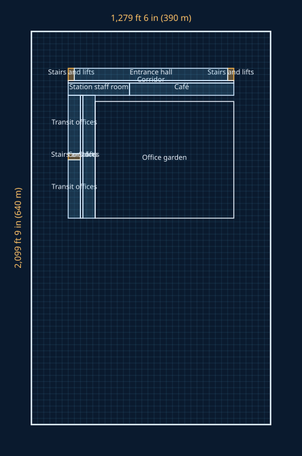
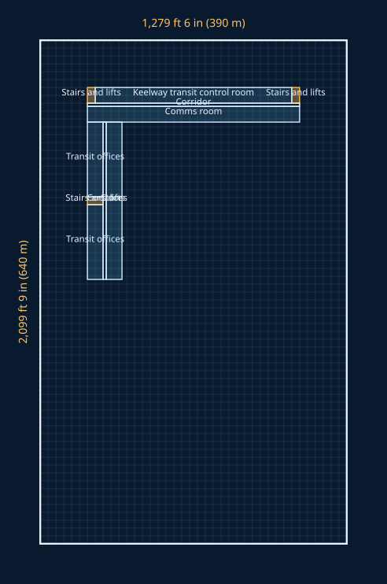
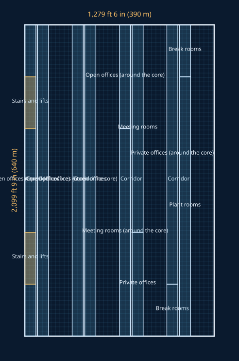
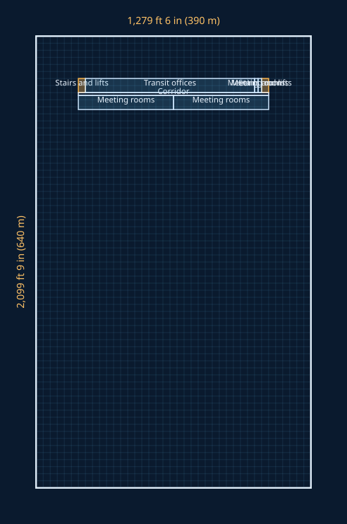

# P7-05 Station Offices: plan

Footprint 1,279 ft 6 in (390 m) × 2,099 ft 9 in (640 m) · structural grid 32 ft 10 in (10 m)

## Levels

| Level | Floor above deck | Height | Floor area |
|---|---|---|---|
| Level 1 · Ground floor | 0 ft (0 mm) | 16 ft 5 in (5,000 mm) | 195,903 sq ft (18,200 m²) |
| Level 2 · Level 2 | 16 ft 5 in (5,000 mm) | 13 ft 1 in (4,000 mm) | 195,903 sq ft (18,200 m²) |
| Level 3 · Level 3 | 29 ft 6 in (9,000 mm) | 13 ft 1 in (4,000 mm) | 195,903 sq ft (18,200 m²) |
| Level 4 · Level 4 | 42 ft 8 in (13 m) | 13 ft 1 in (4,000 mm) | 111,945 sq ft (10,400 m²) |
| Level 5 · Level 5 | 55 ft 9 in (17 m) | 13 ft 1 in (4,000 mm) | 111,945 sq ft (10,400 m²) |
| Level 6 · Level 6 | 68 ft 11 in (21 m) | 13 ft 1 in (4,000 mm) | 111,945 sq ft (10,400 m²) |

## Elements

| ID | Designation | Type | Name | Level(s) | Size / length | Area | Status |
|---|---|---|---|---|---|---|---|
| E001 | D5F3P7B6A2L1R1, D5F3P7B6A2L2R1, D5F3P7B6A2L3R1, D5F3P7B6A2L4R1, D5F3P7B6A2L5R1, D5F3P7B6A2L6R1 | core | Stairs and lifts | L1, L2, L3, L4, L5, L6 | 32 ft 10 in (10 m) × 65 ft 7 in (20 m) | 2,153 sq ft (200 m²) | proposed |
| E002 | D5F3P7B6A2L1R2, D5F3P7B6A2L2R2, D5F3P7B6A2L3R2, D5F3P7B6A2L4R2, D5F3P7B6A2L5R2, D5F3P7B6A2L6R2 | core | Stairs and lifts | L1, L2, L3, L4, L5, L6 | 32 ft 10 in (10 m) × 65 ft 7 in (20 m) | 2,153 sq ft (200 m²) | proposed |
| E003 | D5F3P7B6A2L1R3 | zone | Corridor | L1 | 885 ft 10 in (270 m) × 13 ft 1 in (4,000 mm) | 11,625 sq ft (1,080 m²) | proposed |
| E004 | D5F3P7B6A2L1R4 | room | Entrance hall | L1 | 820 ft 3 in (250 m) × 65 ft 7 in (20 m) | 53,820 sq ft (5,000 m²) | proposed |
| E005 | D5F3P7B6A2L1R5 | room | Station staff room | L1 | 328 ft 1 in (100 m) × 65 ft 7 in (20 m) | 21,528 sq ft (2,000 m²) | proposed |
| E006 | D5F3P7B6A2L1R6 | room | Café | L1 | 557 ft 9 in (170 m) × 65 ft 7 in (20 m) | 36,597 sq ft (3,400 m²) | proposed |
| E007 | D5F3P7B6A2L2R3 | zone | Corridor | L2 | 885 ft 10 in (270 m) × 13 ft 1 in (4,000 mm) | 11,625 sq ft (1,080 m²) | proposed |
| E008 | D5F3P7B6A2L2R4 | room | Keelway transit control room | L2 | 820 ft 3 in (250 m) × 65 ft 7 in (20 m) | 53,820 sq ft (5,000 m²) | proposed |
| E009 | D5F3P7B6A2L2R5 | room | Comms room | L2 | 885 ft 10 in (270 m) × 65 ft 7 in (20 m) | 58,125 sq ft (5,400 m²) | proposed |
| E010 | D5F3P7B6A2L3R3, D5F3P7B6A2L4R3, D5F3P7B6A2L5R3, D5F3P7B6A2L6R3 | zone | Corridor | L3, L4, L5, L6 | 885 ft 10 in (270 m) × 13 ft 1 in (4,000 mm) | 11,625 sq ft (1,080 m²) | proposed |
| E011 | D5F3P7B6A2L3R4, D5F3P7B6A2L4R4, D5F3P7B6A2L5R4, D5F3P7B6A2L6R4 | room | Transit offices | L3, L4, L5, L6 | 787 ft 5 in (240 m) × 65 ft 7 in (20 m) | 51,667 sq ft (4,800 m²) | proposed |
| E012 | D5F3P7B6A2L3R5, D5F3P7B6A2L4R5, D5F3P7B6A2L5R5, D5F3P7B6A2L6R5 | room | Meeting rooms | L3, L4, L5, L6 | 16 ft 5 in (5,000 mm) × 65 ft 7 in (20 m) | 1,076 sq ft (100 m²) | proposed |
| E013 | D5F3P7B6A2L3R6, D5F3P7B6A2L4R6, D5F3P7B6A2L5R6, D5F3P7B6A2L6R6 | room | Meeting rooms | L3, L4, L5, L6 | 16 ft 5 in (5,000 mm) × 65 ft 7 in (20 m) | 1,076 sq ft (100 m²) | proposed |
| E014 | D5F3P7B6A2L3R7, D5F3P7B6A2L4R7, D5F3P7B6A2L5R7, D5F3P7B6A2L6R7 | room | Meeting rooms | L3, L4, L5, L6 | 442 ft 11 in (135 m) × 65 ft 7 in (20 m) | 29,063 sq ft (2,700 m²) | proposed |
| E015 | D5F3P7B6A2L3R8, D5F3P7B6A2L4R8, D5F3P7B6A2L5R8, D5F3P7B6A2L6R8 | room | Meeting rooms | L3, L4, L5, L6 | 442 ft 11 in (135 m) × 65 ft 7 in (20 m) | 29,063 sq ft (2,700 m²) | proposed |
| E016 | D5F3P7B6A2L1R7, D5F3P7B6A2L2R6, D5F3P7B6A2L3R9 | core | Stairs and lifts | L1, L2, L3 | 65 ft 7 in (20 m) × 32 ft 10 in (10 m) | 2,153 sq ft (200 m²) | proposed |
| E017 | D5F3P7B6A2L1R8, D5F3P7B6A2L2R7, D5F3P7B6A2L3R10 | zone | Corridor | L1, L2, L3 | 13 ft 1 in (4,000 mm) × 656 ft 2 in (200 m) | 8,611 sq ft (800 m²) | proposed |
| E018 | D5F3P7B6A2L1R9, D5F3P7B6A2L2R8, D5F3P7B6A2L3R11 | room | Transit offices | L1, L2, L3 | 65 ft 7 in (20 m) × 311 ft 8 in (95 m) | 20,451 sq ft (1,900 m²) | proposed |
| E019 | D5F3P7B6A2L1R10, D5F3P7B6A2L2R9, D5F3P7B6A2L3R12 | room | Transit offices | L1, L2, L3 | 65 ft 7 in (20 m) × 311 ft 8 in (95 m) | 20,451 sq ft (1,900 m²) | proposed |
| E020 | D5F3P7B6A2L1R11, D5F3P7B6A2L2R10, D5F3P7B6A2L3R13 | room | Stores | L1, L2, L3 | 65 ft 7 in (20 m) × 656 ft 2 in (200 m) | 43,056 sq ft (4,000 m²) | proposed |
| E021 | D5F3P7B6A2L1R12 | zone | Office garden | L1 | 741 ft 6 in (226 m) × 623 ft 4 in (190 m) | 462,202 sq ft (42,940 m²) | proposed |

## Drawings

### Level 1 · Ground floor

### Level 2 · Level 2

### Level 3 · Level 3

### Level 4 · Level 4

### Level 5 · Level 5

### Level 6 · Level 6

