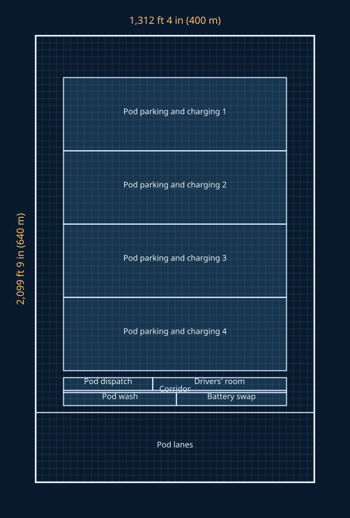
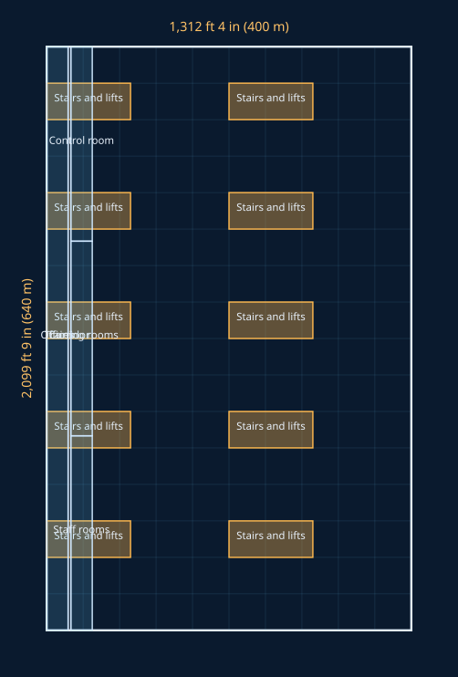
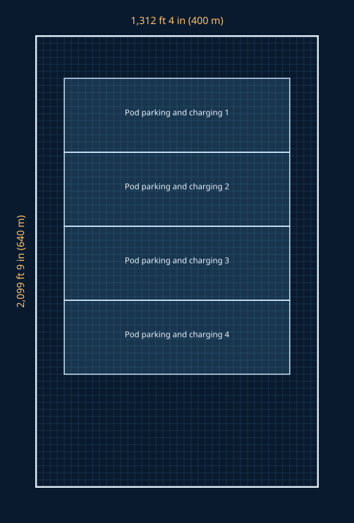

# P7-07 Station Pod Depot: plan

Footprint 1,312 ft 4 in (400 m) × 2,099 ft 9 in (640 m) · structural grid 32 ft 10 in (10 m)

## Levels

| Level | Floor above deck | Height | Floor area |
|---|---|---|---|
| Level 1 · Ground deck | 0 ft (0 mm) | 14 ft 9 in (4,500 mm) | 1,574,114 sq ft (146,240 m²) |
| Level 2 · Deck 2 | 14 ft 9 in (4,500 mm) | 13 ft 1 in (4,000 mm) | 1,446,670 sq ft (134,400 m²) |
| Level 3 · Deck 3 | 27 ft 11 in (8,500 mm) | 13 ft 1 in (4,000 mm) | 1,446,670 sq ft (134,400 m²) |

## Elements

| ID | Designation | Type | Name | Level(s) | Size / length | Area | Status |
|---|---|---|---|---|---|---|---|
| E001 | D5F3P7B8A1L1R1, D5F3P7B8A1L2R1, D5F3P7B8A1L3R1 | room | Pod parking and charging 1 | L1, L2, L3 | 1,049 ft 10 in (320 m) × 344 ft 6 in (105 m) | 361,667 sq ft (33,600 m²) | proposed |
| E002 | D5F3P7B8A1L1R2, D5F3P7B8A1L2R2, D5F3P7B8A1L3R2 | room | Pod parking and charging 2 | L1, L2, L3 | 1,049 ft 10 in (320 m) × 344 ft 6 in (105 m) | 361,667 sq ft (33,600 m²) | proposed |
| E003 | D5F3P7B8A1L1R3, D5F3P7B8A1L2R3, D5F3P7B8A1L3R3 | room | Pod parking and charging 3 | L1, L2, L3 | 1,049 ft 10 in (320 m) × 344 ft 6 in (105 m) | 361,667 sq ft (33,600 m²) | proposed |
| E004 | D5F3P7B8A1L1R4, D5F3P7B8A1L2R4, D5F3P7B8A1L3R4 | room | Pod parking and charging 4 | L1, L2, L3 | 1,049 ft 10 in (320 m) × 344 ft 6 in (105 m) | 361,667 sq ft (33,600 m²) | proposed |
| E005 | D5F3P7B8A1L1R5 | zone | Corridor | L1 | 1,049 ft 10 in (320 m) × 9 ft 10 in (3,000 mm) | 10,333 sq ft (960 m²) | proposed |
| E006 | D5F3P7B8A1L1R6 | room | Pod dispatch | L1 | 419 ft 11 in (128 m) × 60 ft 8 in (18 m) | 25,489 sq ft (2,368 m²) | proposed |
| E007 | D5F3P7B8A1L1R7 | room | Drivers' room | L1 | 629 ft 11 in (192 m) × 60 ft 8 in (18 m) | 38,233 sq ft (3,552 m²) | proposed |
| E008 | D5F3P7B8A1L1R8 | room | Pod wash | L1 | 532 ft 2 in (162 m) × 60 ft 8 in (18 m) | 32,299 sq ft (3,001 m²) | proposed |
| E009 | D5F3P7B8A1L1R9 | room | Battery swap | L1 | 517 ft 9 in (158 m) × 60 ft 8 in (18 m) | 31,423 sq ft (2,919 m²) | proposed |
| E010 | D5F3P7B8A1L1R10 | zone | Pod lanes | L1 | 1,312 ft 4 in (400 m) × 328 ft 1 in (100 m) | 430,556 sq ft (40,000 m²) | proposed |

## Drawings

### Level 1 · Ground deck

### Level 2 · Deck 2

### Level 3 · Deck 3

