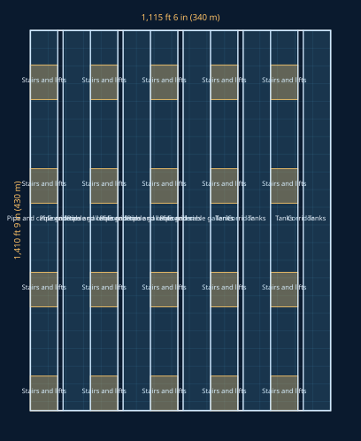
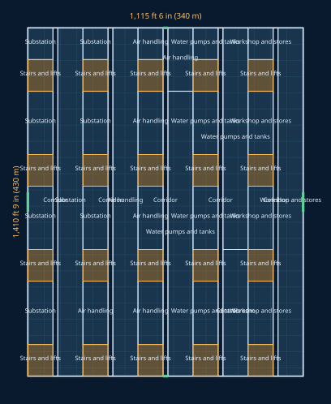
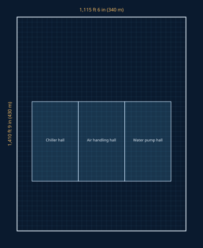

# P7-09 Station Utility Plant: plan

Footprint 1,115 ft 6 in (340 m) × 1,410 ft 9 in (430 m) · structural grid 65 ft 7 in (20 m)

## Levels

| Level | Floor above deck | Height | Floor area |
|---|---|---|---|
| Level B1 · Plant level | −19 ft 8 in (6,000 mm) | 19 ft 8 in (6,000 mm) | 1,434,829 sq ft (133,300 m²) |
| Level 1 · Ground floor | 0 ft (0 mm) | 26 ft 3 in (8,000 mm) | 1,173,891 sq ft (109,058 m²) |
| Level 2 · Upper floor | 26 ft 3 in (8,000 mm) | 26 ft 3 in (8,000 mm) | 1,434,829 sq ft (133,300 m²) |

## Elements

| ID | Designation | Type | Name | Level(s) | Size / length | Area | Status |
|---|---|---|---|---|---|---|---|
| L1-001 | D5F3P7B3A1L1R1 | zone | Corridor | L1 | 19 ft 8 in (6,000 mm) × 1,410 ft 9 in (430 m) | 27,771 sq ft (2,580 m²) | proposed |
| L1-002 | D5F3P7B3A1L1R2 | zone | Corridor | L1 | 19 ft 8 in (6,000 mm) × 1,410 ft 9 in (430 m) | 27,771 sq ft (2,580 m²) | proposed |
| L1-003 | D5F3P7B3A1L1R3 | zone | Corridor | L1 | 19 ft 8 in (6,000 mm) × 1,410 ft 9 in (430 m) | 27,771 sq ft (2,580 m²) | proposed |
| L1-004 | D5F3P7B3A1L1R4 | zone | Corridor | L1 | 19 ft 8 in (6,000 mm) × 1,410 ft 9 in (430 m) | 27,771 sq ft (2,580 m²) | proposed |
| L1-005 | D5F3P7B3A1L1R5 | zone | Corridor | L1 | 19 ft 8 in (6,000 mm) × 1,410 ft 9 in (430 m) | 27,771 sq ft (2,580 m²) | proposed |
| L1-006 | D5F3P7B3A1L1R6 | room | Substation | L1 | 101 ft 8 in (31 m) × 128 ft 3 in (39 m) | 13,047 sq ft (1,212 m²) | proposed |
| L1-007 | D5F3P7B3A1L1R7 | room | Substation | L1 | 101 ft 8 in (31 m) × 256 ft 7 in (78 m) | 26,094 sq ft (2,424 m²) | proposed |
| L1-008 | D5F3P7B3A1L1R8 | room | Substation | L1 | 101 ft 8 in (31 m) × 256 ft 3 in (78 m) | 26,061 sq ft (2,421 m²) | proposed |
| L1-009 | D5F3P7B3A1L1R9 | room | Substation | L1 | 101 ft 8 in (31 m) × 256 ft 7 in (78 m) | 26,094 sq ft (2,424 m²) | proposed |
| L1-010 | D5F3P7B3A1L1R10 | room | Substation | L1 | 101 ft 8 in (31 m) × 1,410 ft 9 in (430 m) | 143,483 sq ft (13,330 m²) | proposed |
| L1-011 | D5F3P7B3A1L1R11 | room | Substation | L1 | 101 ft 8 in (31 m) × 128 ft 3 in (39 m) | 13,047 sq ft (1,212 m²) | proposed |
| L1-012 | D5F3P7B3A1L1R12 | room | Substation | L1 | 101 ft 8 in (31 m) × 256 ft 7 in (78 m) | 26,094 sq ft (2,424 m²) | proposed |
| L1-013 | D5F3P7B3A1L1R13 | room | Substation | L1 | 101 ft 8 in (31 m) × 256 ft 3 in (78 m) | 26,061 sq ft (2,421 m²) | proposed |
| L1-014 | D5F3P7B3A1L1R14 | room | Air handling | L1 | 101 ft 8 in (31 m) × 256 ft 7 in (78 m) | 26,094 sq ft (2,424 m²) | proposed |
| L1-015 | D5F3P7B3A1L1R15 | room | Air handling | L1 | 101 ft 8 in (31 m) × 1,410 ft 9 in (430 m) | 143,483 sq ft (13,330 m²) | proposed |
| L1-016 | D5F3P7B3A1L1R16 | room | Air handling | L1 | 101 ft 8 in (31 m) × 128 ft 3 in (39 m) | 13,047 sq ft (1,212 m²) | proposed |
| L1-017 | D5F3P7B3A1L1R17 | room | Air handling | L1 | 101 ft 8 in (31 m) × 256 ft 7 in (78 m) | 26,094 sq ft (2,424 m²) | proposed |
| L1-018 | D5F3P7B3A1L1R18 | room | Air handling | L1 | 101 ft 8 in (31 m) × 256 ft 3 in (78 m) | 26,061 sq ft (2,421 m²) | proposed |
| L1-019 | D5F3P7B3A1L1R19 | room | Air handling | L1 | 101 ft 8 in (31 m) × 256 ft 7 in (78 m) | 26,094 sq ft (2,424 m²) | proposed |
| L1-020 | D5F3P7B3A1L1R20 | room | Air handling | L1 | 101 ft 8 in (31 m) × 256 ft 7 in (78 m) | 26,094 sq ft (2,424 m²) | proposed |
| L1-021 | D5F3P7B3A1L1R21 | room | Water pumps and tanks | L1 | 101 ft 8 in (31 m) × 1,154 ft 2 in (352 m) | 117,389 sq ft (10,906 m²) | proposed |
| L1-022 | D5F3P7B3A1L1R22 | room | Water pumps and tanks | L1 | 101 ft 8 in (31 m) × 128 ft 3 in (39 m) | 13,047 sq ft (1,212 m²) | proposed |
| L1-023 | D5F3P7B3A1L1R23 | room | Water pumps and tanks | L1 | 101 ft 8 in (31 m) × 256 ft 7 in (78 m) | 26,094 sq ft (2,424 m²) | proposed |
| L1-024 | D5F3P7B3A1L1R24 | room | Water pumps and tanks | L1 | 101 ft 8 in (31 m) × 256 ft 3 in (78 m) | 26,061 sq ft (2,421 m²) | proposed |
| L1-025 | D5F3P7B3A1L1R25 | room | Water pumps and tanks | L1 | 101 ft 8 in (31 m) × 256 ft 7 in (78 m) | 26,094 sq ft (2,424 m²) | proposed |
| L1-026 | D5F3P7B3A1L1R26 | room | Water pumps and tanks | L1 | 101 ft 8 in (31 m) × 897 ft 8 in (274 m) | 91,295 sq ft (8,482 m²) | proposed |
| L1-027 | D5F3P7B3A1L1R27 | room | Control room | L1 | 101 ft 8 in (31 m) × 513 ft 1 in (156 m) | 52,188 sq ft (4,848 m²) | proposed |
| L1-028 | D5F3P7B3A1L1R28 | room | Workshop and stores | L1 | 101 ft 8 in (31 m) × 128 ft 3 in (39 m) | 13,047 sq ft (1,212 m²) | proposed |
| L1-029 | D5F3P7B3A1L1R29 | room | Workshop and stores | L1 | 101 ft 8 in (31 m) × 256 ft 7 in (78 m) | 26,094 sq ft (2,424 m²) | proposed |
| L1-030 | D5F3P7B3A1L1R30 | room | Workshop and stores | L1 | 101 ft 8 in (31 m) × 256 ft 3 in (78 m) | 26,061 sq ft (2,421 m²) | proposed |
| L1-031 | D5F3P7B3A1L1R31 | room | Workshop and stores | L1 | 101 ft 8 in (31 m) × 256 ft 7 in (78 m) | 26,094 sq ft (2,424 m²) | proposed |
| L1-032 | D5F3P7B3A1L1R32 | room | Workshop and stores | L1 | 101 ft 8 in (31 m) × 1,410 ft 9 in (430 m) | 143,483 sq ft (13,330 m²) | proposed |
| L1-033 | D5F3P7B3A1LB1R1, D5F3P7B3A1L1R33, D5F3P7B3A1L2R1 | core | Stairs and lifts | LB1, L1, L2 | 101 ft 8 in (31 m) × 128 ft 3 in (39 m) | 13,047 sq ft (1,212 m²) | proposed |
| L1-034 | D5F3P7B3A1LB1R2, D5F3P7B3A1L1R34, D5F3P7B3A1L2R2 | core | Stairs and lifts | LB1, L1, L2 | 101 ft 8 in (31 m) × 128 ft 3 in (39 m) | 13,047 sq ft (1,212 m²) | proposed |
| L1-035 | D5F3P7B3A1LB1R3, D5F3P7B3A1L1R35, D5F3P7B3A1L2R3 | core | Stairs and lifts | LB1, L1, L2 | 101 ft 8 in (31 m) × 128 ft 3 in (39 m) | 13,047 sq ft (1,212 m²) | proposed |
| L1-036 | D5F3P7B3A1LB1R4, D5F3P7B3A1L1R36, D5F3P7B3A1L2R4 | core | Stairs and lifts | LB1, L1, L2 | 101 ft 8 in (31 m) × 128 ft 3 in (39 m) | 13,047 sq ft (1,212 m²) | proposed |
| L1-037 | D5F3P7B3A1LB1R5, D5F3P7B3A1L1R37, D5F3P7B3A1L2R5 | core | Stairs and lifts | LB1, L1, L2 | 101 ft 8 in (31 m) × 128 ft 3 in (39 m) | 13,047 sq ft (1,212 m²) | proposed |
| L1-038 | D5F3P7B3A1LB1R6, D5F3P7B3A1L1R38, D5F3P7B3A1L2R6 | core | Stairs and lifts | LB1, L1, L2 | 101 ft 8 in (31 m) × 128 ft 3 in (39 m) | 13,047 sq ft (1,212 m²) | proposed |
| L1-039 | D5F3P7B3A1LB1R7, D5F3P7B3A1L1R39, D5F3P7B3A1L2R7 | core | Stairs and lifts | LB1, L1, L2 | 101 ft 8 in (31 m) × 128 ft 3 in (39 m) | 13,047 sq ft (1,212 m²) | proposed |
| L1-040 | D5F3P7B3A1LB1R8, D5F3P7B3A1L1R40, D5F3P7B3A1L2R8 | core | Stairs and lifts | LB1, L1, L2 | 101 ft 8 in (31 m) × 128 ft 3 in (39 m) | 13,047 sq ft (1,212 m²) | proposed |
| L1-041 | D5F3P7B3A1LB1R9, D5F3P7B3A1L1R41, D5F3P7B3A1L2R9 | core | Stairs and lifts | LB1, L1, L2 | 101 ft 8 in (31 m) × 128 ft 3 in (39 m) | 13,047 sq ft (1,212 m²) | proposed |
| L1-042 | D5F3P7B3A1LB1R10, D5F3P7B3A1L1R42, D5F3P7B3A1L2R10 | core | Stairs and lifts | LB1, L1, L2 | 101 ft 8 in (31 m) × 128 ft 3 in (39 m) | 13,047 sq ft (1,212 m²) | proposed |
| L1-043 | D5F3P7B3A1LB1R11, D5F3P7B3A1L1R43, D5F3P7B3A1L2R11 | core | Stairs and lifts | LB1, L1, L2 | 101 ft 8 in (31 m) × 128 ft 3 in (39 m) | 13,047 sq ft (1,212 m²) | proposed |
| L1-044 | D5F3P7B3A1LB1R12, D5F3P7B3A1L1R44, D5F3P7B3A1L2R12 | core | Stairs and lifts | LB1, L1, L2 | 101 ft 8 in (31 m) × 128 ft 3 in (39 m) | 13,047 sq ft (1,212 m²) | proposed |
| L1-045 | D5F3P7B3A1LB1R13, D5F3P7B3A1L1R45, D5F3P7B3A1L2R13 | core | Stairs and lifts | LB1, L1, L2 | 101 ft 8 in (31 m) × 128 ft 3 in (39 m) | 13,047 sq ft (1,212 m²) | proposed |
| L1-046 | D5F3P7B3A1LB1R14, D5F3P7B3A1L1R46, D5F3P7B3A1L2R14 | core | Stairs and lifts | LB1, L1, L2 | 101 ft 8 in (31 m) × 128 ft 3 in (39 m) | 13,047 sq ft (1,212 m²) | proposed |
| L1-047 | D5F3P7B3A1LB1R15, D5F3P7B3A1L1R47, D5F3P7B3A1L2R15 | core | Stairs and lifts | LB1, L1, L2 | 101 ft 8 in (31 m) × 128 ft 3 in (39 m) | 13,047 sq ft (1,212 m²) | proposed |
| L1-048 | D5F3P7B3A1LB1R16, D5F3P7B3A1L1R48, D5F3P7B3A1L2R16 | core | Stairs and lifts | LB1, L1, L2 | 101 ft 8 in (31 m) × 128 ft 3 in (39 m) | 13,047 sq ft (1,212 m²) | proposed |
| L1-049 | D5F3P7B3A1LB1R17, D5F3P7B3A1L1R49, D5F3P7B3A1L2R17 | core | Stairs and lifts | LB1, L1, L2 | 101 ft 8 in (31 m) × 128 ft 3 in (39 m) | 13,047 sq ft (1,212 m²) | proposed |
| L1-050 | D5F3P7B3A1LB1R18, D5F3P7B3A1L1R50, D5F3P7B3A1L2R18 | core | Stairs and lifts | LB1, L1, L2 | 101 ft 8 in (31 m) × 128 ft 3 in (39 m) | 13,047 sq ft (1,212 m²) | proposed |
| L1-051 | D5F3P7B3A1LB1R19, D5F3P7B3A1L1R51, D5F3P7B3A1L2R19 | core | Stairs and lifts | LB1, L1, L2 | 101 ft 8 in (31 m) × 128 ft 3 in (39 m) | 13,047 sq ft (1,212 m²) | proposed |
| L1-052 | D5F3P7B3A1LB1R20, D5F3P7B3A1L1R52, D5F3P7B3A1L2R20 | core | Stairs and lifts | LB1, L1, L2 | 101 ft 8 in (31 m) × 128 ft 3 in (39 m) | 13,047 sq ft (1,212 m²) | proposed |
| LT-001 | D5F3P7B3A1L2R21 | zone | Corridor | L2 | 19 ft 8 in (6,000 mm) × 1,410 ft 9 in (430 m) | 27,771 sq ft (2,580 m²) | proposed |
| LT-002 | D5F3P7B3A1L2R22 | zone | Corridor | L2 | 19 ft 8 in (6,000 mm) × 1,410 ft 9 in (430 m) | 27,771 sq ft (2,580 m²) | proposed |
| LT-003 | D5F3P7B3A1L2R23 | zone | Corridor | L2 | 19 ft 8 in (6,000 mm) × 1,410 ft 9 in (430 m) | 27,771 sq ft (2,580 m²) | proposed |
| LT-004 | D5F3P7B3A1L2R24 | zone | Corridor | L2 | 19 ft 8 in (6,000 mm) × 1,410 ft 9 in (430 m) | 27,771 sq ft (2,580 m²) | proposed |
| LT-005 | D5F3P7B3A1L2R25 | zone | Corridor | L2 | 19 ft 8 in (6,000 mm) × 1,410 ft 9 in (430 m) | 27,771 sq ft (2,580 m²) | proposed |
| LT-006 | D5F3P7B3A1L2R26 | room | Air handling (around the core) | L2 | 101 ft 8 in (31 m) × 1,410 ft 9 in (430 m) | 143,483 sq ft (13,330 m²) | proposed |
| LT-007 | D5F3P7B3A1L2R27 | room | Air handling | L2 | 101 ft 8 in (31 m) × 1,410 ft 9 in (430 m) | 143,483 sq ft (13,330 m²) | proposed |
| LT-008 | D5F3P7B3A1L2R28 | room | Air handling (around the core) | L2 | 101 ft 8 in (31 m) × 1,410 ft 9 in (430 m) | 143,483 sq ft (13,330 m²) | proposed |
| LT-009 | D5F3P7B3A1L2R29 | room | Air handling | L2 | 101 ft 8 in (31 m) × 1,410 ft 9 in (430 m) | 143,483 sq ft (13,330 m²) | proposed |
| LT-010 | D5F3P7B3A1L2R30 | room | Air handling (around the core) | L2 | 101 ft 8 in (31 m) × 1,410 ft 9 in (430 m) | 143,483 sq ft (13,330 m²) | proposed |
| LT-011 | D5F3P7B3A1L2R31 | room | Switch rooms | L2 | 101 ft 8 in (31 m) × 1,410 ft 9 in (430 m) | 143,483 sq ft (13,330 m²) | proposed |
| LT-012 | D5F3P7B3A1L2R32 | room | Switch rooms (around the core) | L2 | 101 ft 8 in (31 m) × 1,410 ft 9 in (430 m) | 143,483 sq ft (13,330 m²) | proposed |
| LT-013 | D5F3P7B3A1L2R33 | room | Switch rooms | L2 | 101 ft 8 in (31 m) × 1,410 ft 9 in (430 m) | 143,483 sq ft (13,330 m²) | proposed |
| LT-014 | D5F3P7B3A1L2R34 | room | Offices (around the core) | L2 | 101 ft 8 in (31 m) × 1,410 ft 9 in (430 m) | 143,483 sq ft (13,330 m²) | proposed |
| LT-015 | D5F3P7B3A1L2R35 | room | Offices | L2 | 101 ft 8 in (31 m) × 1,410 ft 9 in (430 m) | 143,483 sq ft (13,330 m²) | proposed |
| BB1-001 | D5F3P7B3A1LB1R21 | zone | Corridor | LB1 | 19 ft 8 in (6,000 mm) × 1,410 ft 9 in (430 m) | 27,771 sq ft (2,580 m²) | proposed |
| BB1-002 | D5F3P7B3A1LB1R22 | zone | Corridor | LB1 | 19 ft 8 in (6,000 mm) × 1,410 ft 9 in (430 m) | 27,771 sq ft (2,580 m²) | proposed |
| BB1-003 | D5F3P7B3A1LB1R23 | zone | Corridor | LB1 | 19 ft 8 in (6,000 mm) × 1,410 ft 9 in (430 m) | 27,771 sq ft (2,580 m²) | proposed |
| BB1-004 | D5F3P7B3A1LB1R24 | zone | Corridor | LB1 | 19 ft 8 in (6,000 mm) × 1,410 ft 9 in (430 m) | 27,771 sq ft (2,580 m²) | proposed |
| BB1-005 | D5F3P7B3A1LB1R25 | zone | Corridor | LB1 | 19 ft 8 in (6,000 mm) × 1,410 ft 9 in (430 m) | 27,771 sq ft (2,580 m²) | proposed |
| BB1-006 | D5F3P7B3A1LB1R26 | room | Pipe and cable galleries | LB1 | 101 ft 8 in (31 m) × 1,410 ft 9 in (430 m) | 143,483 sq ft (13,330 m²) | proposed |
| BB1-007 | D5F3P7B3A1LB1R27 | room | Pipe and cable galleries | LB1 | 101 ft 8 in (31 m) × 1,410 ft 9 in (430 m) | 143,483 sq ft (13,330 m²) | proposed |
| BB1-008 | D5F3P7B3A1LB1R28 | room | Pipe and cable galleries | LB1 | 101 ft 8 in (31 m) × 1,410 ft 9 in (430 m) | 143,483 sq ft (13,330 m²) | proposed |
| BB1-009 | D5F3P7B3A1LB1R29 | room | Pipe and cable galleries | LB1 | 101 ft 8 in (31 m) × 1,410 ft 9 in (430 m) | 143,483 sq ft (13,330 m²) | proposed |
| BB1-010 | D5F3P7B3A1LB1R30 | room | Pipe and cable galleries | LB1 | 101 ft 8 in (31 m) × 1,410 ft 9 in (430 m) | 143,483 sq ft (13,330 m²) | proposed |
| BB1-011 | D5F3P7B3A1LB1R31 | room | Pipe and cable galleries | LB1 | 101 ft 8 in (31 m) × 1,410 ft 9 in (430 m) | 143,483 sq ft (13,330 m²) | proposed |
| BB1-012 | D5F3P7B3A1LB1R32 | room | Tanks | LB1 | 101 ft 8 in (31 m) × 1,410 ft 9 in (430 m) | 143,483 sq ft (13,330 m²) | proposed |
| BB1-013 | D5F3P7B3A1LB1R33 | room | Tanks | LB1 | 101 ft 8 in (31 m) × 1,410 ft 9 in (430 m) | 143,483 sq ft (13,330 m²) | proposed |
| BB1-014 | D5F3P7B3A1LB1R34 | room | Tanks | LB1 | 101 ft 8 in (31 m) × 1,410 ft 9 in (430 m) | 143,483 sq ft (13,330 m²) | proposed |
| BB1-015 | D5F3P7B3A1LB1R35 | room | Tanks | LB1 | 101 ft 8 in (31 m) × 1,410 ft 9 in (430 m) | 143,483 sq ft (13,330 m²) | proposed |
| D-83 |  | door | Main entrance | L1 | 78 ft 9 in (24 m), 78 ft 9 in (24 m) wide | — | proposed |
| D-84 |  | door | Second entrance | L1 | 78 ft 9 in (24 m), 78 ft 9 in (24 m) wide | — | proposed |
| D-85 |  | door | Side door | L1 | 19 ft 8 in (6,000 mm), 19 ft 8 in (6,000 mm) wide | — | proposed |
| D-86 |  | door | Side door | L1 | 19 ft 8 in (6,000 mm), 19 ft 8 in (6,000 mm) wide | — | proposed |

## Drawings

### Level B1 · Plant level

### Level 1 · Ground floor

### Level 2 · Upper floor

