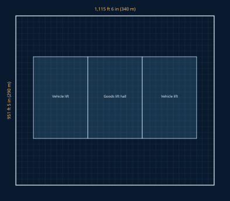
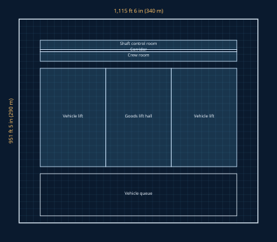
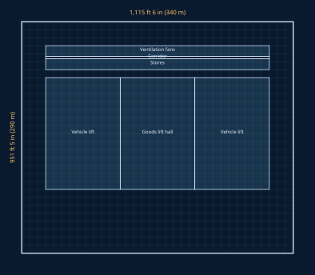

# P7-10 Station Service Shaft: plan

Footprint 1,115 ft 6 in (340 m) × 951 ft 5 in (290 m) · structural grid 32 ft 10 in (10 m)

## Levels

| Level | Floor above deck | Height | Floor area |
|---|---|---|---|
| Level B1 · Shaft head | −32 ft 10 in (10 m) | 32 ft 10 in (10 m) | 421,945 sq ft (39,200 m²) |
| Level 1 · Ground floor | 0 ft (0 mm) | 23 ft (7,000 mm) | 503,320 sq ft (46,760 m²) |
| Level 2 · Lift machine level | 23 ft (7,000 mm) | 19 ft 8 in (6,000 mm) | 503,320 sq ft (46,760 m²) |

## Elements

| ID | Designation | Type | Name | Level(s) | Size / length | Area | Status |
|---|---|---|---|---|---|---|---|
| E001 | D5F3P7B3A2L1R1 | zone | Corridor | L1 | 918 ft 8 in (280 m) × 9 ft 10 in (3,000 mm) | 9,042 sq ft (840 m²) | proposed |
| E002 | D5F3P7B3A2L1R2 | room | Shaft control room | L1 | 918 ft 8 in (280 m) × 44 ft 3 in (14 m) | 40,688 sq ft (3,780 m²) | proposed |
| E003 | D5F3P7B3A2L1R3 | room | Crew room | L1 | 918 ft 8 in (280 m) × 44 ft 3 in (14 m) | 40,688 sq ft (3,780 m²) | proposed |
| E004 | D5F3P7B3A2L2R1 | zone | Corridor | L2 | 918 ft 8 in (280 m) × 9 ft 10 in (3,000 mm) | 9,042 sq ft (840 m²) | proposed |
| E005 | D5F3P7B3A2L2R2 | room | Ventilation fans | L2 | 918 ft 8 in (280 m) × 44 ft 3 in (14 m) | 40,688 sq ft (3,780 m²) | proposed |
| E006 | D5F3P7B3A2L2R3 | room | Stores | L2 | 918 ft 8 in (280 m) × 44 ft 3 in (14 m) | 40,688 sq ft (3,780 m²) | proposed |
| E007 | D5F3P7B3A2LB1R1, D5F3P7B3A2L1R4, D5F3P7B3A2L2R4 | room | Vehicle lift | LB1, L1, L2 | 306 ft 1 in (93 m) × 459 ft 4 in (140 m) | 140,598 sq ft (13,062 m²) | proposed |
| E008 | D5F3P7B3A2LB1R2, D5F3P7B3A2L1R5, D5F3P7B3A2L2R5 | room | Goods lift hall | LB1, L1, L2 | 306 ft 5 in (93 m) × 459 ft 4 in (140 m) | 140,749 sq ft (13,076 m²) | proposed |
| E009 | D5F3P7B3A2LB1R3, D5F3P7B3A2L1R6, D5F3P7B3A2L2R6 | room | Vehicle lift | LB1, L1, L2 | 306 ft 1 in (93 m) × 459 ft 4 in (140 m) | 140,598 sq ft (13,062 m²) | proposed |
| E010 | D5F3P7B3A2L1R7 | zone | Vehicle queue | L1 | 918 ft 8 in (280 m) × 196 ft 10 in (60 m) | 180,834 sq ft (16,800 m²) | proposed |

## Drawings

### Level B1 · Shaft head

### Level 1 · Ground floor

### Level 2 · Lift machine level

