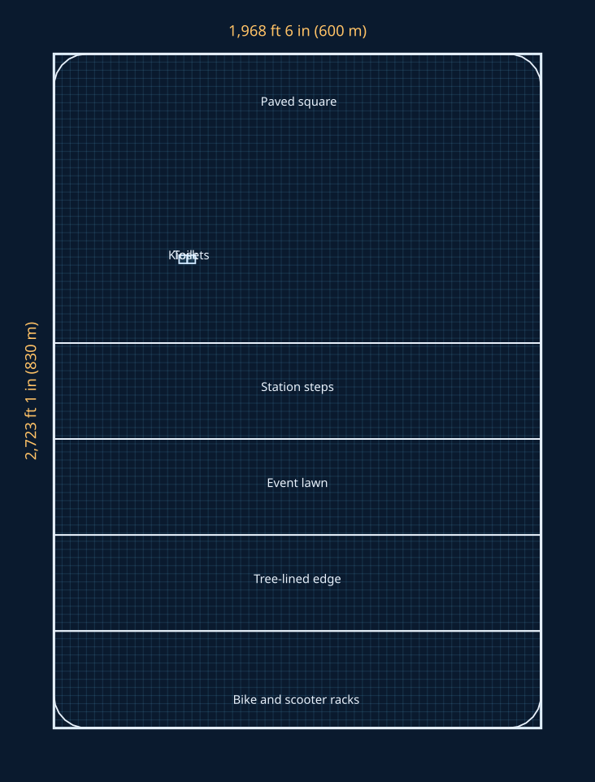

# P7-11 Keelway Square: plan

Footprint 1,968 ft 6 in (600 m) × 2,723 ft 1 in (830 m) · structural grid 32 ft 10 in (10 m)

## Levels

| Level | Floor above deck | Height | Floor area |
|---|---|---|---|
| Level 1 · Ground | 0 ft (0 mm) | 13 ft 1 in (4,000 mm) | 2,153 sq ft (200 m²) |

## Elements

| ID | Designation | Type | Name | Level(s) | Size / length | Area | Status |
|---|---|---|---|---|---|---|---|
| E001 | D5F3P7B5A1R1 | zone | Paved square | L1 | 1,967 ft 10 in (600 m) × 1,167 ft 8 in (356 m) | 2,288,319 sq ft (212,592 m²) | proposed |
| E002 | D5F3P7B5A1R2 | room | Kiosk | L1 | 32 ft 10 in (10 m) × 32 ft 10 in (10 m) | 1,076 sq ft (100 m²) | proposed |
| E003 | D5F3P7B5A1R3 | room | Toilets | L1 | 32 ft 10 in (10 m) × 32 ft 10 in (10 m) | 1,076 sq ft (100 m²) | proposed |
| E004 | D5F3P7B5A1R4 | zone | Station steps | L1 | 1,967 ft 2 in (600 m) × 387 ft 10 in (118 m) | 762,868 sq ft (70,873 m²) | proposed |
| E005 | D5F3P7B5A1R5 | zone | Event lawn | L1 | 1,967 ft 6 in (600 m) × 387 ft 10 in (118 m) | 762,868 sq ft (70,873 m²) | proposed |
| E006 | D5F3P7B5A1R6 | zone | Tree-lined edge | L1 | 1,967 ft 6 in (600 m) × 387 ft 10 in (118 m) | 762,868 sq ft (70,873 m²) | proposed |
| E007 | D5F3P7B5A1R7 | zone | Bike and scooter racks | L1 | 1,967 ft 2 in (600 m) × 392 ft 1 in (120 m) | 762,577 sq ft (70,846 m²) | proposed |

## Drawings

### Level 1 · Ground

