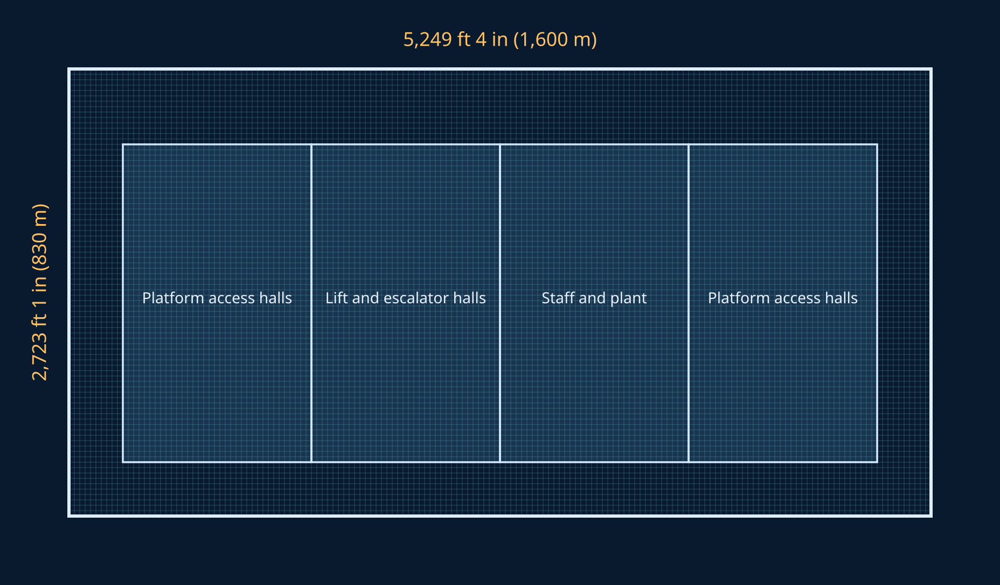
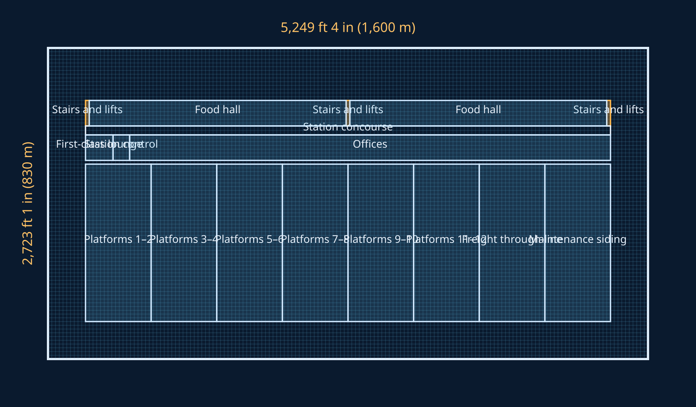

# P7-13 Keelway Port Station: plan

Footprint 5,249 ft 4 in (1,600 m) × 2,723 ft 1 in (830 m) · structural grid 131 ft 3 in (40 m)

## Levels

| Level | Floor above deck | Height | Floor area |
|---|---|---|---|
| Level B1 · Platform level | −32 ft 10 in (10 m) | 32 ft 10 in (10 m) | 11,538,913 sq ft (1,072,000 m²) |
| Level 1 · Ground floor | 0 ft (0 mm) | 32 ft 10 in (10 m) | 9,616,241 sq ft (893,378 m²) |
| Level 2 · Upper floor | 32 ft 10 in (10 m) | 32 ft 10 in (10 m) | 11,538,913 sq ft (1,072,000 m²) |

## Elements

| ID | Designation | Type | Name | Level(s) | Size / length | Area | Status |
|---|---|---|---|---|---|---|---|
| L1-001 | D5F3P7B5A3L1R1 | zone | Walkway | L1 | 5,249 ft 4 in (1,600 m) × 65 ft 7 in (20 m) | 344,445 sq ft (32,000 m²) | proposed |
| L1-002 | D5F3P7B5A3L1R2 | zone | Walkway | L1 | 5,249 ft 4 in (1,600 m) × 65 ft 7 in (20 m) | 344,445 sq ft (32,000 m²) | proposed |
| L1-003 | D5F3P7B5A3L1R3 | zone | Walkway | L1 | 5,249 ft 4 in (1,600 m) × 65 ft 7 in (20 m) | 344,445 sq ft (32,000 m²) | proposed |
| L1-004 | D5F3P7B5A3L1R4 | zone | Walkway | L1 | 5,249 ft 4 in (1,600 m) × 65 ft 7 in (20 m) | 344,445 sq ft (32,000 m²) | proposed |
| L1-005 | D5F3P7B5A3L1R5 | zone | Walkway | L1 | 5,249 ft 4 in (1,600 m) × 65 ft 7 in (20 m) | 344,445 sq ft (32,000 m²) | proposed |
| L1-006 | D5F3P7B5A3L1R6 | zone | Walkway | L1 | 5,249 ft 4 in (1,600 m) × 65 ft 7 in (20 m) | 344,445 sq ft (32,000 m²) | proposed |
| L1-007 | D5F3P7B5A3L1R7 | zone | Walkway | L1 | 5,249 ft 4 in (1,600 m) × 65 ft 7 in (20 m) | 344,445 sq ft (32,000 m²) | proposed |
| L1-008 | D5F3P7B5A3L1R8 | zone | Walkway | L1 | 5,249 ft 4 in (1,600 m) × 65 ft 7 in (20 m) | 344,445 sq ft (32,000 m²) | proposed |
| L1-009 | D5F3P7B5A3L1R9 | room | Concourse | L1 | 875 ft (267 m) × 137 ft 6 in (42 m) | 120,284 sq ft (11,175 m²) | proposed |
| L1-010 | D5F3P7B5A3L1R10 | room | Concourse | L1 | 1,750 ft (533 m) × 137 ft 6 in (42 m) | 240,568 sq ft (22,349 m²) | proposed |
| L1-011 | D5F3P7B5A3L1R11 | room | Concourse | L1 | 875 ft (267 m) × 137 ft 6 in (42 m) | 120,284 sq ft (11,175 m²) | proposed |
| L1-012 | D5F3P7B5A3L1R12 | room | Concourse | L1 | 5,249 ft 4 in (1,600 m) × 137 ft 6 in (42 m) | 721,613 sq ft (67,040 m²) | proposed |
| L1-013 | D5F3P7B5A3L1R13 | room | Concourse | L1 | 875 ft (267 m) × 137 ft 2 in (42 m) | 119,997 sq ft (11,148 m²) | proposed |
| L1-014 | D5F3P7B5A3L1R14 | room | Concourse | L1 | 1,750 ft (533 m) × 137 ft 2 in (42 m) | 239,993 sq ft (22,296 m²) | proposed |
| L1-015 | D5F3P7B5A3L1R15 | room | Concourse | L1 | 875 ft (267 m) × 137 ft 2 in (42 m) | 119,997 sq ft (11,148 m²) | proposed |
| L1-016 | D5F3P7B5A3L1R16 | room | Concourse | L1 | 5,249 ft 4 in (1,600 m) × 137 ft 6 in (42 m) | 721,613 sq ft (67,040 m²) | proposed |
| L1-017 | D5F3P7B5A3L1R17 | room | Concourse | L1 | 875 ft (267 m) × 137 ft 6 in (42 m) | 120,284 sq ft (11,175 m²) | proposed |
| L1-018 | D5F3P7B5A3L1R18 | room | Concourse | L1 | 1,750 ft (533 m) × 137 ft 6 in (42 m) | 240,568 sq ft (22,349 m²) | proposed |
| L1-019 | D5F3P7B5A3L1R19 | room | Concourse | L1 | 875 ft (267 m) × 137 ft 6 in (42 m) | 120,284 sq ft (11,175 m²) | proposed |
| L1-020 | D5F3P7B5A3L1R20 | room | Concourse | L1 | 3,499 ft 8 in (1,067 m) × 137 ft 2 in (42 m) | 479,942 sq ft (44,588 m²) | proposed |
| L1-021 | D5F3P7B5A3L1R21 | room | Platform access and lifts | L1 | 1,749 ft 8 in (533 m) × 137 ft 2 in (42 m) | 239,948 sq ft (22,292 m²) | proposed |
| L1-022 | D5F3P7B5A3L1R22 | room | Platform access and lifts | L1 | 875 ft (267 m) × 137 ft 6 in (42 m) | 120,284 sq ft (11,175 m²) | proposed |
| L1-023 | D5F3P7B5A3L1R23 | room | Platform access and lifts | L1 | 1,750 ft (533 m) × 137 ft 6 in (42 m) | 240,568 sq ft (22,349 m²) | proposed |
| L1-024 | D5F3P7B5A3L1R24 | room | Platform access and lifts | L1 | 875 ft (267 m) × 137 ft 6 in (42 m) | 120,284 sq ft (11,175 m²) | proposed |
| L1-025 | D5F3P7B5A3L1R25 | room | Platform access and lifts | L1 | 5,249 ft 4 in (1,600 m) × 137 ft 6 in (42 m) | 721,613 sq ft (67,040 m²) | proposed |
| L1-026 | D5F3P7B5A3L1R26 | room | Platform access and lifts | L1 | 875 ft (267 m) × 137 ft 6 in (42 m) | 120,284 sq ft (11,175 m²) | proposed |
| L1-027 | D5F3P7B5A3L1R27 | room | Platform access and lifts | L1 | 1,750 ft (533 m) × 137 ft 6 in (42 m) | 240,568 sq ft (22,349 m²) | proposed |
| L1-028 | D5F3P7B5A3L1R28 | room | Platform access and lifts | L1 | 875 ft (267 m) × 137 ft 6 in (42 m) | 120,284 sq ft (11,175 m²) | proposed |
| L1-029 | D5F3P7B5A3L1R29 | room | Platform access and lifts | L1 | 3,499 ft 8 in (1,067 m) × 137 ft 6 in (42 m) | 481,090 sq ft (44,695 m²) | proposed |
| L1-030 | D5F3P7B5A3L1R30 | room | Ticket halls | L1 | 1,749 ft 8 in (533 m) × 137 ft 6 in (42 m) | 240,522 sq ft (22,345 m²) | proposed |
| L1-031 | D5F3P7B5A3L1R31 | room | Ticket halls | L1 | 875 ft (267 m) × 137 ft 2 in (42 m) | 119,997 sq ft (11,148 m²) | proposed |
| L1-032 | D5F3P7B5A3L1R32 | room | Ticket halls | L1 | 1,750 ft (533 m) × 137 ft 2 in (42 m) | 239,993 sq ft (22,296 m²) | proposed |
| L1-033 | D5F3P7B5A3L1R33 | room | Ticket halls | L1 | 875 ft (267 m) × 137 ft 2 in (42 m) | 119,997 sq ft (11,148 m²) | proposed |
| L1-034 | D5F3P7B5A3L1R34 | room | Ticket halls | L1 | 1,749 ft 8 in (533 m) × 137 ft 6 in (42 m) | 240,522 sq ft (22,345 m²) | proposed |
| L1-035 | D5F3P7B5A3L1R35 | room | Waiting areas | L1 | 3,499 ft 8 in (1,067 m) × 137 ft 6 in (42 m) | 481,090 sq ft (44,695 m²) | proposed |
| L1-036 | D5F3P7B5A3L1R36 | room | Waiting areas | L1 | 875 ft (267 m) × 137 ft 6 in (42 m) | 120,284 sq ft (11,175 m²) | proposed |
| L1-037 | D5F3P7B5A3L1R37 | room | Waiting areas | L1 | 1,750 ft (533 m) × 137 ft 6 in (42 m) | 240,568 sq ft (22,349 m²) | proposed |
| L1-038 | D5F3P7B5A3L1R38 | room | Waiting areas | L1 | 875 ft (267 m) × 137 ft 6 in (42 m) | 120,284 sq ft (11,175 m²) | proposed |
| L1-039 | D5F3P7B5A3L1R39 | room | Waiting areas | L1 | 3,499 ft 8 in (1,067 m) × 137 ft 2 in (42 m) | 479,942 sq ft (44,588 m²) | proposed |
| L1-040 | D5F3P7B5A3L1R40 | room | Shops and cafés | L1 | 1,749 ft 8 in (533 m) × 137 ft 2 in (42 m) | 239,948 sq ft (22,292 m²) | proposed |
| L1-041 | D5F3P7B5A3L1R41 | room | Shops and cafés | L1 | 875 ft (267 m) × 137 ft 6 in (42 m) | 120,284 sq ft (11,175 m²) | proposed |
| L1-042 | D5F3P7B5A3L1R42 | room | Shops and cafés | L1 | 1,750 ft (533 m) × 137 ft 6 in (42 m) | 240,568 sq ft (22,349 m²) | proposed |
| L1-043 | D5F3P7B5A3L1R43 | room | Shops and cafés | L1 | 875 ft (267 m) × 137 ft 6 in (42 m) | 120,284 sq ft (11,175 m²) | proposed |
| L1-044 | D5F3P7B5A3L1R44 | room | Shops and cafés | L1 | 1,749 ft 8 in (533 m) × 137 ft 6 in (42 m) | 240,522 sq ft (22,345 m²) | proposed |
| L1-045 | D5F3P7B5A3L1R45 | room | Staff and control | L1 | 3,499 ft 8 in (1,067 m) × 137 ft 6 in (42 m) | 481,090 sq ft (44,695 m²) | proposed |
| L1-046 | D5F3P7B5A3LB1R1, D5F3P7B5A3L1R46, D5F3P7B5A3L2R1 | core | Stairs and lifts | LB1, L1, L2 | 874 ft 8 in (267 m) × 137 ft 6 in (42 m) | 120,239 sq ft (11,171 m²) | proposed |
| L1-047 | D5F3P7B5A3LB1R2, D5F3P7B5A3L1R47, D5F3P7B5A3L2R2 | core | Stairs and lifts | LB1, L1, L2 | 874 ft 8 in (267 m) × 137 ft 6 in (42 m) | 120,239 sq ft (11,171 m²) | proposed |
| L1-048 | D5F3P7B5A3LB1R3, D5F3P7B5A3L1R48, D5F3P7B5A3L2R3 | core | Stairs and lifts | LB1, L1, L2 | 874 ft 8 in (267 m) × 137 ft 2 in (42 m) | 119,952 sq ft (11,144 m²) | proposed |
| L1-049 | D5F3P7B5A3LB1R4, D5F3P7B5A3L1R49, D5F3P7B5A3L2R4 | core | Stairs and lifts | LB1, L1, L2 | 874 ft 8 in (267 m) × 137 ft 2 in (42 m) | 119,952 sq ft (11,144 m²) | proposed |
| L1-050 | D5F3P7B5A3LB1R5, D5F3P7B5A3L1R50, D5F3P7B5A3L2R5 | core | Stairs and lifts | LB1, L1, L2 | 874 ft 8 in (267 m) × 137 ft 6 in (42 m) | 120,239 sq ft (11,171 m²) | proposed |
| L1-051 | D5F3P7B5A3LB1R6, D5F3P7B5A3L1R51, D5F3P7B5A3L2R6 | core | Stairs and lifts | LB1, L1, L2 | 874 ft 8 in (267 m) × 137 ft 6 in (42 m) | 120,239 sq ft (11,171 m²) | proposed |
| L1-052 | D5F3P7B5A3LB1R7, D5F3P7B5A3L1R52, D5F3P7B5A3L2R7 | core | Stairs and lifts | LB1, L1, L2 | 874 ft 8 in (267 m) × 137 ft 6 in (42 m) | 120,239 sq ft (11,171 m²) | proposed |
| L1-053 | D5F3P7B5A3LB1R8, D5F3P7B5A3L1R53, D5F3P7B5A3L2R8 | core | Stairs and lifts | LB1, L1, L2 | 874 ft 8 in (267 m) × 137 ft 6 in (42 m) | 120,239 sq ft (11,171 m²) | proposed |
| L1-054 | D5F3P7B5A3LB1R9, D5F3P7B5A3L1R54, D5F3P7B5A3L2R9 | core | Stairs and lifts | LB1, L1, L2 | 874 ft 8 in (267 m) × 137 ft 6 in (42 m) | 120,239 sq ft (11,171 m²) | proposed |
| L1-055 | D5F3P7B5A3LB1R10, D5F3P7B5A3L1R55, D5F3P7B5A3L2R10 | core | Stairs and lifts | LB1, L1, L2 | 874 ft 8 in (267 m) × 137 ft 6 in (42 m) | 120,239 sq ft (11,171 m²) | proposed |
| L1-056 | D5F3P7B5A3LB1R11, D5F3P7B5A3L1R56, D5F3P7B5A3L2R11 | core | Stairs and lifts | LB1, L1, L2 | 874 ft 8 in (267 m) × 137 ft 2 in (42 m) | 119,952 sq ft (11,144 m²) | proposed |
| L1-057 | D5F3P7B5A3LB1R12, D5F3P7B5A3L1R57, D5F3P7B5A3L2R12 | core | Stairs and lifts | LB1, L1, L2 | 874 ft 8 in (267 m) × 137 ft 2 in (42 m) | 119,952 sq ft (11,144 m²) | proposed |
| L1-058 | D5F3P7B5A3LB1R13, D5F3P7B5A3L1R58, D5F3P7B5A3L2R13 | core | Stairs and lifts | LB1, L1, L2 | 874 ft 8 in (267 m) × 137 ft 6 in (42 m) | 120,239 sq ft (11,171 m²) | proposed |
| L1-059 | D5F3P7B5A3LB1R14, D5F3P7B5A3L1R59, D5F3P7B5A3L2R14 | core | Stairs and lifts | LB1, L1, L2 | 874 ft 8 in (267 m) × 137 ft 6 in (42 m) | 120,239 sq ft (11,171 m²) | proposed |
| L1-060 | D5F3P7B5A3LB1R15, D5F3P7B5A3L1R60, D5F3P7B5A3L2R15 | core | Stairs and lifts | LB1, L1, L2 | 874 ft 8 in (267 m) × 137 ft 6 in (42 m) | 120,239 sq ft (11,171 m²) | proposed |
| L1-061 | D5F3P7B5A3LB1R16, D5F3P7B5A3L1R61, D5F3P7B5A3L2R16 | core | Stairs and lifts | LB1, L1, L2 | 874 ft 8 in (267 m) × 137 ft 6 in (42 m) | 120,239 sq ft (11,171 m²) | proposed |
| LT-001 | D5F3P7B5A3L2R17 | zone | Walkway | L2 | 5,249 ft 4 in (1,600 m) × 65 ft 7 in (20 m) | 344,445 sq ft (32,000 m²) | proposed |
| LT-002 | D5F3P7B5A3L2R18 | zone | Walkway | L2 | 5,249 ft 4 in (1,600 m) × 65 ft 7 in (20 m) | 344,445 sq ft (32,000 m²) | proposed |
| LT-003 | D5F3P7B5A3L2R19 | zone | Walkway | L2 | 5,249 ft 4 in (1,600 m) × 65 ft 7 in (20 m) | 344,445 sq ft (32,000 m²) | proposed |
| LT-004 | D5F3P7B5A3L2R20 | zone | Walkway | L2 | 5,249 ft 4 in (1,600 m) × 65 ft 7 in (20 m) | 344,445 sq ft (32,000 m²) | proposed |
| LT-005 | D5F3P7B5A3L2R21 | zone | Walkway | L2 | 5,249 ft 4 in (1,600 m) × 65 ft 7 in (20 m) | 344,445 sq ft (32,000 m²) | proposed |
| LT-006 | D5F3P7B5A3L2R22 | zone | Walkway | L2 | 5,249 ft 4 in (1,600 m) × 65 ft 7 in (20 m) | 344,445 sq ft (32,000 m²) | proposed |
| LT-007 | D5F3P7B5A3L2R23 | zone | Walkway | L2 | 5,249 ft 4 in (1,600 m) × 65 ft 7 in (20 m) | 344,445 sq ft (32,000 m²) | proposed |
| LT-008 | D5F3P7B5A3L2R24 | zone | Walkway | L2 | 5,249 ft 4 in (1,600 m) × 65 ft 7 in (20 m) | 344,445 sq ft (32,000 m²) | proposed |
| LT-009 | D5F3P7B5A3L2R25 | room | Mezzanine walkways (around the core) | L2 | 5,249 ft 4 in (1,600 m) × 137 ft 6 in (42 m) | 721,613 sq ft (67,040 m²) | proposed |
| LT-010 | D5F3P7B5A3L2R26 | room | Mezzanine walkways | L2 | 5,249 ft 4 in (1,600 m) × 137 ft 6 in (42 m) | 721,613 sq ft (67,040 m²) | proposed |
| LT-011 | D5F3P7B5A3L2R27 | room | Mezzanine walkways (around the core) | L2 | 5,249 ft 4 in (1,600 m) × 137 ft 2 in (42 m) | 719,890 sq ft (66,880 m²) | proposed |
| LT-012 | D5F3P7B5A3L2R28 | room | Mezzanine walkways | L2 | 5,249 ft 4 in (1,600 m) × 137 ft 6 in (42 m) | 721,613 sq ft (67,040 m²) | proposed |
| LT-013 | D5F3P7B5A3L2R29 | room | Mezzanine walkways (around the core) | L2 | 5,249 ft 4 in (1,600 m) × 137 ft 6 in (42 m) | 721,613 sq ft (67,040 m²) | proposed |
| LT-014 | D5F3P7B5A3L2R30 | room | Mezzanine walkways | L2 | 5,249 ft 4 in (1,600 m) × 137 ft 2 in (42 m) | 719,890 sq ft (66,880 m²) | proposed |
| LT-015 | D5F3P7B5A3L2R31 | room | Mezzanine walkways (around the core) | L2 | 1,749 ft 8 in (533 m) × 137 ft 6 in (42 m) | 240,522 sq ft (22,345 m²) | proposed |
| LT-016 | D5F3P7B5A3L2R32 | room | Waiting lounges (around the core) | L2 | 3,499 ft 8 in (1,067 m) × 137 ft 6 in (42 m) | 481,090 sq ft (44,695 m²) | proposed |
| LT-017 | D5F3P7B5A3L2R33 | room | Waiting lounges | L2 | 5,249 ft 4 in (1,600 m) × 137 ft 6 in (42 m) | 721,613 sq ft (67,040 m²) | proposed |
| LT-018 | D5F3P7B5A3L2R34 | room | Waiting lounges (around the core) | L2 | 5,249 ft 4 in (1,600 m) × 137 ft 6 in (42 m) | 721,613 sq ft (67,040 m²) | proposed |
| LT-019 | D5F3P7B5A3L2R35 | room | Waiting lounges | L2 | 5,249 ft 4 in (1,600 m) × 137 ft 6 in (42 m) | 721,613 sq ft (67,040 m²) | proposed |
| LT-020 | D5F3P7B5A3L2R36 | room | Waiting lounges (around the core) | L2 | 1,749 ft 8 in (533 m) × 137 ft 2 in (42 m) | 239,948 sq ft (22,292 m²) | proposed |
| LT-021 | D5F3P7B5A3L2R37 | room | Offices and control (around the core) | L2 | 3,499 ft 8 in (1,067 m) × 137 ft 2 in (42 m) | 479,942 sq ft (44,588 m²) | proposed |
| LT-022 | D5F3P7B5A3L2R38 | room | Offices and control | L2 | 5,249 ft 4 in (1,600 m) × 137 ft 6 in (42 m) | 721,613 sq ft (67,040 m²) | proposed |
| LT-023 | D5F3P7B5A3L2R39 | room | Offices and control (around the core) | L2 | 5,249 ft 4 in (1,600 m) × 137 ft 6 in (42 m) | 721,613 sq ft (67,040 m²) | proposed |
| LT-024 | D5F3P7B5A3L2R40 | room | Offices and control | L2 | 3,499 ft 8 in (1,067 m) × 137 ft 2 in (42 m) | 479,942 sq ft (44,588 m²) | proposed |
| LT-025 | D5F3P7B5A3L2R41 | room | Plant rooms | L2 | 1,749 ft 8 in (533 m) × 137 ft 2 in (42 m) | 239,948 sq ft (22,292 m²) | proposed |
| LT-026 | D5F3P7B5A3L2R42 | room | Plant rooms (around the core) | L2 | 5,249 ft 4 in (1,600 m) × 137 ft 6 in (42 m) | 721,613 sq ft (67,040 m²) | proposed |
| LT-027 | D5F3P7B5A3L2R43 | room | Plant rooms | L2 | 5,249 ft 4 in (1,600 m) × 137 ft 6 in (42 m) | 721,613 sq ft (67,040 m²) | proposed |
| BB1-001 | D5F3P7B5A3LB1R17 | zone | Walkway | LB1 | 5,249 ft 4 in (1,600 m) × 65 ft 7 in (20 m) | 344,445 sq ft (32,000 m²) | proposed |
| BB1-002 | D5F3P7B5A3LB1R18 | zone | Walkway | LB1 | 5,249 ft 4 in (1,600 m) × 65 ft 7 in (20 m) | 344,445 sq ft (32,000 m²) | proposed |
| BB1-003 | D5F3P7B5A3LB1R19 | zone | Walkway | LB1 | 5,249 ft 4 in (1,600 m) × 65 ft 7 in (20 m) | 344,445 sq ft (32,000 m²) | proposed |
| BB1-004 | D5F3P7B5A3LB1R20 | zone | Walkway | LB1 | 5,249 ft 4 in (1,600 m) × 65 ft 7 in (20 m) | 344,445 sq ft (32,000 m²) | proposed |
| BB1-005 | D5F3P7B5A3LB1R21 | zone | Walkway | LB1 | 5,249 ft 4 in (1,600 m) × 65 ft 7 in (20 m) | 344,445 sq ft (32,000 m²) | proposed |
| BB1-006 | D5F3P7B5A3LB1R22 | zone | Walkway | LB1 | 5,249 ft 4 in (1,600 m) × 65 ft 7 in (20 m) | 344,445 sq ft (32,000 m²) | proposed |
| BB1-007 | D5F3P7B5A3LB1R23 | zone | Walkway | LB1 | 5,249 ft 4 in (1,600 m) × 65 ft 7 in (20 m) | 344,445 sq ft (32,000 m²) | proposed |
| BB1-008 | D5F3P7B5A3LB1R24 | zone | Walkway | LB1 | 5,249 ft 4 in (1,600 m) × 65 ft 7 in (20 m) | 344,445 sq ft (32,000 m²) | proposed |
| BB1-009 | D5F3P7B5A3LB1R25 | room | Platforms | LB1 | 5,249 ft 4 in (1,600 m) × 137 ft 6 in (42 m) | 721,613 sq ft (67,040 m²) | proposed |
| BB1-010 | D5F3P7B5A3LB1R26 | room | Platforms | LB1 | 5,249 ft 4 in (1,600 m) × 137 ft 6 in (42 m) | 721,613 sq ft (67,040 m²) | proposed |
| BB1-011 | D5F3P7B5A3LB1R27 | room | Platforms | LB1 | 5,249 ft 4 in (1,600 m) × 137 ft 2 in (42 m) | 719,890 sq ft (66,880 m²) | proposed |
| BB1-012 | D5F3P7B5A3LB1R28 | room | Platforms | LB1 | 5,249 ft 4 in (1,600 m) × 137 ft 6 in (42 m) | 721,613 sq ft (67,040 m²) | proposed |
| BB1-013 | D5F3P7B5A3LB1R29 | room | Platforms | LB1 | 5,249 ft 4 in (1,600 m) × 137 ft 6 in (42 m) | 721,613 sq ft (67,040 m²) | proposed |
| BB1-014 | D5F3P7B5A3LB1R30 | room | Platforms | LB1 | 5,249 ft 4 in (1,600 m) × 137 ft 2 in (42 m) | 719,890 sq ft (66,880 m²) | proposed |
| BB1-015 | D5F3P7B5A3LB1R31 | room | Platforms | LB1 | 5,249 ft 4 in (1,600 m) × 137 ft 6 in (42 m) | 721,613 sq ft (67,040 m²) | proposed |
| BB1-016 | D5F3P7B5A3LB1R32 | room | Platforms | LB1 | 5,249 ft 4 in (1,600 m) × 137 ft 6 in (42 m) | 721,613 sq ft (67,040 m²) | proposed |
| BB1-017 | D5F3P7B5A3LB1R33 | room | Platforms | LB1 | 5,249 ft 4 in (1,600 m) × 137 ft 6 in (42 m) | 721,613 sq ft (67,040 m²) | proposed |
| BB1-018 | D5F3P7B5A3LB1R34 | room | Platforms | LB1 | 3,499 ft 8 in (1,067 m) × 137 ft 6 in (42 m) | 481,090 sq ft (44,695 m²) | proposed |
| BB1-019 | D5F3P7B5A3LB1R35 | room | Track and lift shafts | LB1 | 1,749 ft 8 in (533 m) × 137 ft 6 in (42 m) | 240,522 sq ft (22,345 m²) | proposed |
| BB1-020 | D5F3P7B5A3LB1R36 | room | Track and lift shafts | LB1 | 5,249 ft 4 in (1,600 m) × 137 ft 2 in (42 m) | 719,890 sq ft (66,880 m²) | proposed |
| BB1-021 | D5F3P7B5A3LB1R37 | room | Track and lift shafts | LB1 | 5,249 ft 4 in (1,600 m) × 137 ft 6 in (42 m) | 721,613 sq ft (67,040 m²) | proposed |
| BB1-022 | D5F3P7B5A3LB1R38 | room | Track and lift shafts | LB1 | 5,249 ft 4 in (1,600 m) × 137 ft 6 in (42 m) | 721,613 sq ft (67,040 m²) | proposed |
| BB1-023 | D5F3P7B5A3LB1R39 | room | Track and lift shafts | LB1 | 5,249 ft 4 in (1,600 m) × 137 ft 2 in (42 m) | 719,890 sq ft (66,880 m²) | proposed |
| BB1-024 | D5F3P7B5A3LB1R40 | room | Track and lift shafts | LB1 | 1,749 ft 8 in (533 m) × 137 ft 6 in (42 m) | 240,522 sq ft (22,345 m²) | proposed |
| BB1-025 | D5F3P7B5A3LB1R41 | room | Plant rooms | LB1 | 3,499 ft 8 in (1,067 m) × 137 ft 6 in (42 m) | 481,090 sq ft (44,695 m²) | proposed |
| BB1-026 | D5F3P7B5A3LB1R42 | room | Plant rooms | LB1 | 5,249 ft 4 in (1,600 m) × 137 ft 6 in (42 m) | 721,613 sq ft (67,040 m²) | proposed |
| D-115 |  | door | Main entrance | L1 | 78 ft 9 in (24 m), 78 ft 9 in (24 m) wide | — | proposed |
| D-116 |  | door | Second entrance | L1 | 78 ft 9 in (24 m), 78 ft 9 in (24 m) wide | — | proposed |
| D-117 |  | door | Side door | L1 | 19 ft 8 in (6,000 mm), 19 ft 8 in (6,000 mm) wide | — | proposed |
| D-118 |  | door | Side door | L1 | 19 ft 8 in (6,000 mm), 19 ft 8 in (6,000 mm) wide | — | proposed |

## Drawings

### Level B1 · Platform level

### Level 1 · Ground floor

### Level 2 · Upper floor

