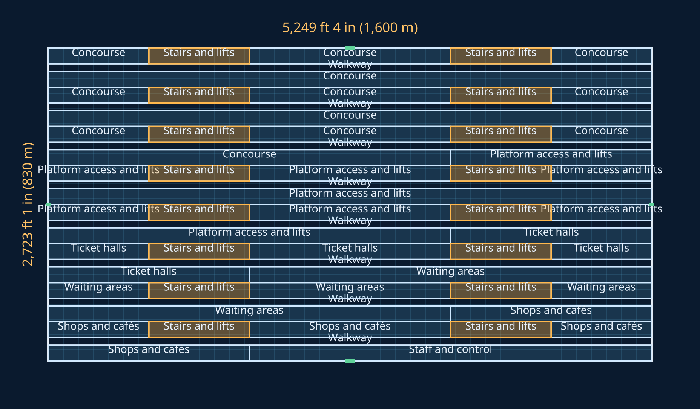
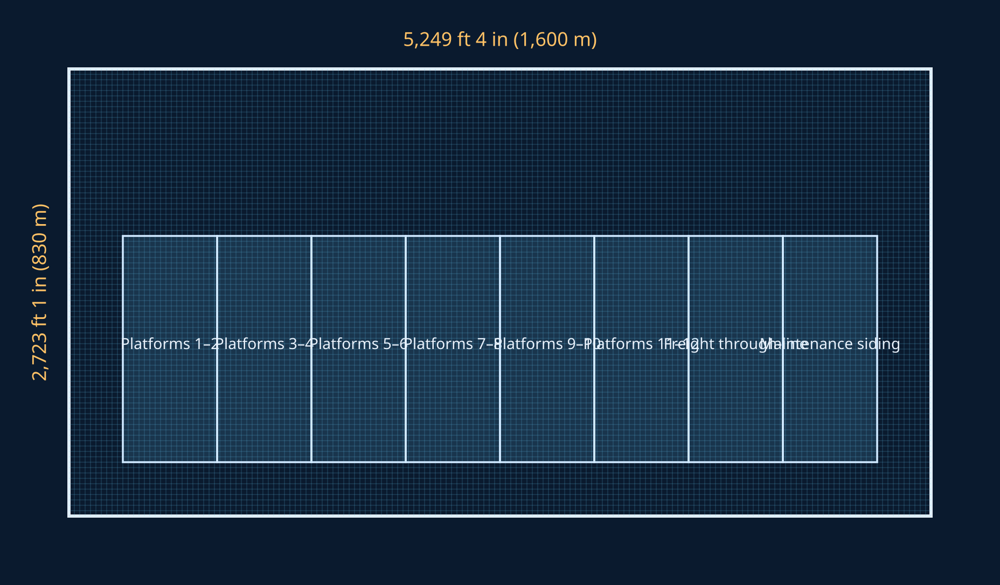

# P7-13 Keelway Port Station: plan

Footprint 5,249 ft 4 in (1,600 m) × 2,723 ft 1 in (830 m) · structural grid 32 ft 10 in (10 m)

## Levels

| Level | Floor above deck | Height | Floor area |
|---|---|---|---|
| Level B1 · Platform level | −32 ft 10 in (10 m) | 32 ft 10 in (10 m) | 8,890,991 sq ft (826,000 m²) |
| Level 1 · Concourse | 0 ft (0 mm) | 29 ft 6 in (9,000 mm) | 8,356,670 sq ft (776,360 m²) |
| Level 2 · Upper concourse | 29 ft 6 in (9,000 mm) | 23 ft (7,000 mm) | 8,356,670 sq ft (776,360 m²) |
| Level 3 · Train shed | 52 ft 6 in (16 m) | 32 ft 10 in (10 m) | 6,329,180 sq ft (588,000 m²) |

## Elements

| ID | Designation | Type | Name | Level(s) | Size / length | Area | Status |
|---|---|---|---|---|---|---|---|
| E001 | D5F3P7B5A3L1R1 | zone | Station forecourt | L1 | 3,937 ft (1,200 m) × 360 ft 11 in (110 m) | 1,420,836 sq ft (132,000 m²) | proposed |
| E002 | D5F3P7B5A3L1R2, D5F3P7B5A3L2R1 | core | Stairs and lifts | L1, L2 | 32 ft 10 in (10 m) × 223 ft 1 in (68 m) | 7,319 sq ft (680 m²) | proposed |
| E003 | D5F3P7B5A3L1R3, D5F3P7B5A3L2R2 | core | Stairs and lifts | L1, L2 | 32 ft 10 in (10 m) × 223 ft 1 in (68 m) | 7,319 sq ft (680 m²) | proposed |
| E004 | D5F3P7B5A3L1R4, D5F3P7B5A3L2R3 | core | Stairs and lifts | L1, L2 | 32 ft 10 in (10 m) × 223 ft 1 in (68 m) | 7,319 sq ft (680 m²) | proposed |
| E005 | D5F3P7B5A3L1R5 | zone | Station concourse | L1 | 4,593 ft 2 in (1,400 m) × 78 ft 9 in (24 m) | 361,667 sq ft (33,600 m²) | proposed |
| E006 | D5F3P7B5A3L1R6 | room | Ticket hall | L1 | 1,382 ft 10 in (422 m) × 223 ft 1 in (68 m) | 308,515 sq ft (28,662 m²) | proposed |
| E007 | D5F3P7B5A3L1R7 | room | Gate lines | L1 | 864 ft 6 in (264 m) × 223 ft 1 in (68 m) | 192,868 sq ft (17,918 m²) | proposed |
| E008 | D5F3P7B5A3L1R8 | room | Gate lines | L1 | 172 ft 11 in (53 m) × 223 ft 1 in (68 m) | 38,574 sq ft (3,584 m²) | proposed |
| E009 | D5F3P7B5A3L1R9 | room | Waiting hall | L1 | 2,074 ft 6 in (632 m) × 223 ft 1 in (68 m) | 462,809 sq ft (42,996 m²) | proposed |
| E010 | D5F3P7B5A3L1R10 | room | Travel centre | L1 | 144 ft 8 in (44 m) × 223 ft 1 in (68 m) | 32,279 sq ft (2,999 m²) | proposed |
| E011 | D5F3P7B5A3L1R11 | room | Shops | L1 | 19 ft 4 in (5,900 mm) × 223 ft 1 in (68 m) | 4,318 sq ft (401 m²) | proposed |
| E012 | D5F3P7B5A3L1R12 | room | Shops | L1 | 19 ft 4 in (5,900 mm) × 223 ft 1 in (68 m) | 4,318 sq ft (401 m²) | proposed |
| E013 | D5F3P7B5A3L1R13 | room | Shops | L1 | 19 ft 4 in (5,900 mm) × 223 ft 1 in (68 m) | 4,318 sq ft (401 m²) | proposed |
| E014 | D5F3P7B5A3L1R14 | room | Shops | L1 | 19 ft (5,800 mm) × 223 ft 1 in (68 m) | 4,245 sq ft (394 m²) | proposed |
| E015 | D5F3P7B5A3L1R15 | room | Shops | L1 | 19 ft 4 in (5,900 mm) × 223 ft 1 in (68 m) | 4,318 sq ft (401 m²) | proposed |
| E016 | D5F3P7B5A3L1R16 | room | Shops | L1 | 19 ft 4 in (5,900 mm) × 223 ft 1 in (68 m) | 4,318 sq ft (401 m²) | proposed |
| E017 | D5F3P7B5A3L1R17 | room | Shops | L1 | 19 ft 4 in (5,900 mm) × 223 ft 1 in (68 m) | 4,318 sq ft (401 m²) | proposed |
| E018 | D5F3P7B5A3L1R18 | room | Shops | L1 | 19 ft 4 in (5,900 mm) × 223 ft 1 in (68 m) | 4,318 sq ft (401 m²) | proposed |
| E019 | D5F3P7B5A3L1R19 | room | Shops | L1 | 19 ft 4 in (5,900 mm) × 223 ft 1 in (68 m) | 4,318 sq ft (401 m²) | proposed |
| E020 | D5F3P7B5A3L1R20 | room | Shops | L1 | 19 ft (5,800 mm) × 223 ft 1 in (68 m) | 4,245 sq ft (394 m²) | proposed |
| E021 | D5F3P7B5A3L1R21 | room | Shops | L1 | 19 ft 4 in (5,900 mm) × 223 ft 1 in (68 m) | 4,318 sq ft (401 m²) | proposed |
| E022 | D5F3P7B5A3L1R22 | room | Shops | L1 | 19 ft 4 in (5,900 mm) × 223 ft 1 in (68 m) | 4,318 sq ft (401 m²) | proposed |
| E023 | D5F3P7B5A3L1R23 | room | Shops | L1 | 19 ft 4 in (5,900 mm) × 223 ft 1 in (68 m) | 4,318 sq ft (401 m²) | proposed |
| E024 | D5F3P7B5A3L1R24 | room | Shops | L1 | 19 ft 4 in (5,900 mm) × 223 ft 1 in (68 m) | 4,318 sq ft (401 m²) | proposed |
| E025 | D5F3P7B5A3L1R25 | room | Shops | L1 | 19 ft 4 in (5,900 mm) × 223 ft 1 in (68 m) | 4,318 sq ft (401 m²) | proposed |
| E026 | D5F3P7B5A3L1R26 | room | Shops | L1 | 19 ft (5,800 mm) × 223 ft 1 in (68 m) | 4,245 sq ft (394 m²) | proposed |
| E027 | D5F3P7B5A3L1R27 | room | Shops | L1 | 19 ft 4 in (5,900 mm) × 223 ft 1 in (68 m) | 4,318 sq ft (401 m²) | proposed |
| E028 | D5F3P7B5A3L1R28 | room | Shops | L1 | 19 ft 4 in (5,900 mm) × 223 ft 1 in (68 m) | 4,318 sq ft (401 m²) | proposed |
| E029 | D5F3P7B5A3L1R29 | room | Shops | L1 | 19 ft 4 in (5,900 mm) × 223 ft 1 in (68 m) | 4,318 sq ft (401 m²) | proposed |
| E030 | D5F3P7B5A3L1R30 | room | Shops | L1 | 19 ft 4 in (5,900 mm) × 223 ft 1 in (68 m) | 4,318 sq ft (401 m²) | proposed |
| E031 | D5F3P7B5A3L1R31 | room | Cafés | L1 | 28 ft 10 in (8,800 mm) × 223 ft 1 in (68 m) | 6,441 sq ft (598 m²) | proposed |
| E032 | D5F3P7B5A3L1R32 | room | Cafés | L1 | 28 ft 10 in (8,800 mm) × 223 ft 1 in (68 m) | 6,441 sq ft (598 m²) | proposed |
| E033 | D5F3P7B5A3L1R33 | room | Cafés | L1 | 28 ft 10 in (8,800 mm) × 223 ft 1 in (68 m) | 6,441 sq ft (598 m²) | proposed |
| E034 | D5F3P7B5A3L1R34 | room | Cafés | L1 | 29 ft 2 in (8,900 mm) × 223 ft 1 in (68 m) | 6,514 sq ft (605 m²) | proposed |
| E035 | D5F3P7B5A3L1R35 | room | Cafés | L1 | 28 ft 10 in (8,800 mm) × 223 ft 1 in (68 m) | 6,441 sq ft (598 m²) | proposed |
| E036 | D5F3P7B5A3L1R36 | room | Cafés | L1 | 28 ft 10 in (8,800 mm) × 223 ft 1 in (68 m) | 6,441 sq ft (598 m²) | proposed |
| E037 | D5F3P7B5A3L1R37 | room | Cafés | L1 | 28 ft 10 in (8,800 mm) × 223 ft 1 in (68 m) | 6,441 sq ft (598 m²) | proposed |
| E038 | D5F3P7B5A3L1R38 | room | Cafés | L1 | 29 ft 2 in (8,900 mm) × 223 ft 1 in (68 m) | 6,514 sq ft (605 m²) | proposed |
| E039 | D5F3P7B5A3L1R39 | room | Cafés | L1 | 28 ft 10 in (8,800 mm) × 223 ft 1 in (68 m) | 6,441 sq ft (598 m²) | proposed |
| E040 | D5F3P7B5A3L1R40 | room | Cafés | L1 | 28 ft 10 in (8,800 mm) × 223 ft 1 in (68 m) | 6,441 sq ft (598 m²) | proposed |
| E041 | D5F3P7B5A3L1R41 | room | Lost property | L1 | 38 ft 9 in (12 m) × 223 ft 1 in (68 m) | 8,637 sq ft (802 m²) | proposed |
| E042 | D5F3P7B5A3L1R42 | room | Toilets | L1 | 3,734 ft 3 in (1,138 m) × 223 ft 1 in (68 m) | 833,101 sq ft (77,398 m²) | proposed |
| E043 | D5F3P7B5A3L2R4 | zone | Station concourse | L2 | 4,593 ft 2 in (1,400 m) × 78 ft 9 in (24 m) | 361,667 sq ft (33,600 m²) | proposed |
| E044 | D5F3P7B5A3L2R5 | room | Food hall | L2 | 2,247 ft 5 in (685 m) × 223 ft 1 in (68 m) | 501,383 sq ft (46,580 m²) | proposed |
| E045 | D5F3P7B5A3L2R6 | room | Food hall | L2 | 2,247 ft 5 in (685 m) × 223 ft 1 in (68 m) | 501,383 sq ft (46,580 m²) | proposed |
| E046 | D5F3P7B5A3L2R7 | room | First-class lounge | L2 | 241 ft 2 in (74 m) × 223 ft 1 in (68 m) | 53,798 sq ft (4,998 m²) | proposed |
| E047 | D5F3P7B5A3L2R8 | room | Station control | L2 | 144 ft 8 in (44 m) × 223 ft 1 in (68 m) | 32,279 sq ft (2,999 m²) | proposed |
| E048 | D5F3P7B5A3L2R9 | room | Offices | L2 | 4,207 ft 4 in (1,282 m) × 223 ft 1 in (68 m) | 938,647 sq ft (87,203 m²) | proposed |
| E049 | D5F3P7B5A3L1R43, D5F3P7B5A3L2R10, D5F3P7B5A3L3R1 | room | Platforms 1–2 | L1, L2, L3 | 574 ft 2 in (175 m) × 1,377 ft 11 in (420 m) | 791,147 sq ft (73,500 m²) | proposed |
| E050 | D5F3P7B5A3L1R44, D5F3P7B5A3L2R11, D5F3P7B5A3L3R2 | room | Platforms 3–4 | L1, L2, L3 | 574 ft 2 in (175 m) × 1,377 ft 11 in (420 m) | 791,147 sq ft (73,500 m²) | proposed |
| E051 | D5F3P7B5A3L1R45, D5F3P7B5A3L2R12, D5F3P7B5A3L3R3 | room | Platforms 5–6 | L1, L2, L3 | 574 ft 2 in (175 m) × 1,377 ft 11 in (420 m) | 791,147 sq ft (73,500 m²) | proposed |
| E052 | D5F3P7B5A3L1R46, D5F3P7B5A3L2R13, D5F3P7B5A3L3R4 | room | Platforms 7–8 | L1, L2, L3 | 574 ft 2 in (175 m) × 1,377 ft 11 in (420 m) | 791,147 sq ft (73,500 m²) | proposed |
| E053 | D5F3P7B5A3L1R47, D5F3P7B5A3L2R14, D5F3P7B5A3L3R5 | room | Platforms 9–10 | L1, L2, L3 | 574 ft 2 in (175 m) × 1,377 ft 11 in (420 m) | 791,147 sq ft (73,500 m²) | proposed |
| E054 | D5F3P7B5A3L1R48, D5F3P7B5A3L2R15, D5F3P7B5A3L3R6 | room | Platforms 11–12 | L1, L2, L3 | 574 ft 2 in (175 m) × 1,377 ft 11 in (420 m) | 791,147 sq ft (73,500 m²) | proposed |
| E055 | D5F3P7B5A3L1R49, D5F3P7B5A3L2R16, D5F3P7B5A3L3R7 | room | Freight through-line | L1, L2, L3 | 574 ft 2 in (175 m) × 1,377 ft 11 in (420 m) | 791,147 sq ft (73,500 m²) | proposed |
| E056 | D5F3P7B5A3L1R50, D5F3P7B5A3L2R17, D5F3P7B5A3L3R8 | room | Maintenance siding | L1, L2, L3 | 574 ft 2 in (175 m) × 1,377 ft 11 in (420 m) | 791,147 sq ft (73,500 m²) | proposed |
| E057 | D5F3P7B5A3LB1R1 | room | Platform access halls | LB1 | 1,148 ft 4 in (350 m) × 1,935 ft 8 in (590 m) | 2,222,748 sq ft (206,500 m²) | proposed |
| E058 | D5F3P7B5A3LB1R2 | room | Lift and escalator halls | LB1 | 1,148 ft 4 in (350 m) × 1,935 ft 8 in (590 m) | 2,222,748 sq ft (206,500 m²) | proposed |
| E059 | D5F3P7B5A3LB1R3 | room | Staff and plant | LB1 | 1,148 ft 4 in (350 m) × 1,935 ft 8 in (590 m) | 2,222,748 sq ft (206,500 m²) | proposed |
| E060 | D5F3P7B5A3LB1R4 | room | Platform access halls | LB1 | 1,148 ft 4 in (350 m) × 1,935 ft 8 in (590 m) | 2,222,748 sq ft (206,500 m²) | proposed |
| E061 | D5F3P7B5A3L1R51 | zone | Keelway approach | L1 | 5,249 ft 4 in (1,600 m) × 295 ft 3 in (90 m) | 1,550,003 sq ft (144,000 m²) | proposed |
| E062 |  | door | Main entrance | L1 | 262 ft 6 in (80 m), 262 ft 6 in (80 m) wide | — | proposed |

## Drawings

### Level B1 · Platform level

### Level 1 · Concourse

### Level 2 · Upper concourse

### Level 3 · Train shed

