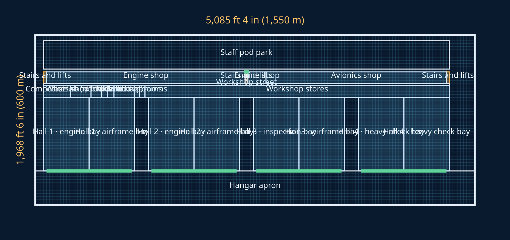
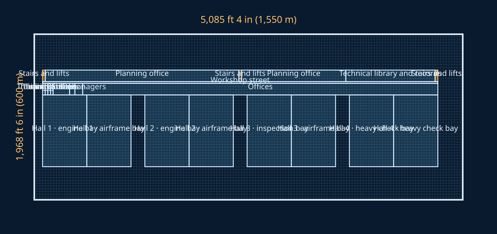
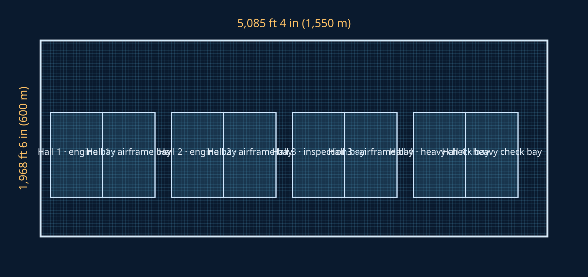

# P8-01 Maintenance Shops: plan

Footprint 5,085 ft 4 in (1,550 m) × 1,968 ft 6 in (600 m) · structural grid 32 ft 10 in (10 m)

## Levels

| Level | Floor above deck | Height | Floor area |
|---|---|---|---|
| Level 1 · Ground floor | 0 ft (0 mm) | 19 ft 8 in (6,000 mm) | 4,861,628 sq ft (451,660 m²) |
| Level 2 · Upper floor | 19 ft 8 in (6,000 mm) | 19 ft 8 in (6,000 mm) | 4,861,628 sq ft (451,660 m²) |
| Level 3 · Hall upper | 39 ft 4 in (12 m) | 19 ft 8 in (6,000 mm) | 3,582,230 sq ft (332,800 m²) |
| Level 4 · Hall roof space | 59 ft 1 in (18 m) | 19 ft 8 in (6,000 mm) | 3,582,230 sq ft (332,800 m²) |

## Elements

| ID | Designation | Type | Name | Level(s) | Size / length | Area | Status |
|---|---|---|---|---|---|---|---|
| E001 | D5F3P8B8A1L1R1 | zone | Hangar apron | L1 | 5,085 ft 4 in (1,550 m) × 393 ft 8 in (120 m) | 2,002,087 sq ft (186,000 m²) | proposed |
| E002 | D5F3P8B8A1L1R2, D5F3P8B8A1L2R1, D5F3P8B8A1L3R1, D5F3P8B8A1L4R1 | room | Hall 1 · engine bay | L1, L2, L3, L4 | 524 ft 11 in (160 m) × 853 ft (260 m) | 447,779 sq ft (41,600 m²) | proposed |
| E003 | D5F3P8B8A1L1R3, D5F3P8B8A1L2R2, D5F3P8B8A1L3R2, D5F3P8B8A1L4R2 | room | Hall 1 · airframe bay | L1, L2, L3, L4 | 524 ft 11 in (160 m) × 853 ft (260 m) | 447,779 sq ft (41,600 m²) | proposed |
| E004 | D5F3P8B8A1L1R4, D5F3P8B8A1L2R3, D5F3P8B8A1L3R3, D5F3P8B8A1L4R3 | room | Hall 2 · engine bay | L1, L2, L3, L4 | 524 ft 11 in (160 m) × 853 ft (260 m) | 447,779 sq ft (41,600 m²) | proposed |
| E005 | D5F3P8B8A1L1R5, D5F3P8B8A1L2R4, D5F3P8B8A1L3R4, D5F3P8B8A1L4R4 | room | Hall 2 · airframe bay | L1, L2, L3, L4 | 524 ft 11 in (160 m) × 853 ft (260 m) | 447,779 sq ft (41,600 m²) | proposed |
| E006 | D5F3P8B8A1L1R6, D5F3P8B8A1L2R5, D5F3P8B8A1L3R5, D5F3P8B8A1L4R5 | room | Hall 3 · inspection bay | L1, L2, L3, L4 | 524 ft 11 in (160 m) × 853 ft (260 m) | 447,779 sq ft (41,600 m²) | proposed |
| E007 | D5F3P8B8A1L1R7, D5F3P8B8A1L2R6, D5F3P8B8A1L3R6, D5F3P8B8A1L4R6 | room | Hall 3 · airframe bay | L1, L2, L3, L4 | 524 ft 11 in (160 m) × 853 ft (260 m) | 447,779 sq ft (41,600 m²) | proposed |
| E008 | D5F3P8B8A1L1R8, D5F3P8B8A1L2R7, D5F3P8B8A1L3R7, D5F3P8B8A1L4R7 | room | Hall 4 · heavy check bay | L1, L2, L3, L4 | 524 ft 11 in (160 m) × 853 ft (260 m) | 447,779 sq ft (41,600 m²) | proposed |
| E009 | D5F3P8B8A1L1R9, D5F3P8B8A1L2R8, D5F3P8B8A1L3R8, D5F3P8B8A1L4R8 | room | Hall 4 · heavy check bay | L1, L2, L3, L4 | 524 ft 11 in (160 m) × 853 ft (260 m) | 447,779 sq ft (41,600 m²) | proposed |
| E010 | D5F3P8B8A1L1R10, D5F3P8B8A1L2R9 | core | Stairs and lifts | L1, L2 | 32 ft 10 in (10 m) × 137 ft 10 in (42 m) | 4,521 sq ft (420 m²) | proposed |
| E011 | D5F3P8B8A1L1R11, D5F3P8B8A1L2R10 | core | Stairs and lifts | L1, L2 | 32 ft 10 in (10 m) × 137 ft 10 in (42 m) | 4,521 sq ft (420 m²) | proposed |
| E012 | D5F3P8B8A1L1R12, D5F3P8B8A1L2R11 | core | Stairs and lifts | L1, L2 | 32 ft 10 in (10 m) × 137 ft 10 in (42 m) | 4,521 sq ft (420 m²) | proposed |
| E013 | D5F3P8B8A1L1R13 | zone | Workshop street | L1 | 4,691 ft 7 in (1,430 m) × 19 ft 8 in (6,000 mm) | 92,354 sq ft (8,580 m²) | proposed |
| E014 | D5F3P8B8A1L1R14 | room | Engine shop | L1 | 2,296 ft 7 in (700 m) × 137 ft 10 in (42 m) | 316,459 sq ft (29,400 m²) | proposed |
| E015 | D5F3P8B8A1L1R15 | room | Engine shop | L1 | 208 ft 8 in (64 m) × 137 ft 10 in (42 m) | 28,753 sq ft (2,671 m²) | proposed |
| E016 | D5F3P8B8A1L1R16 | room | Avionics shop | L1 | 2,087 ft 11 in (636 m) × 137 ft 10 in (42 m) | 287,706 sq ft (26,729 m²) | proposed |
| E017 | D5F3P8B8A1L1R17 | room | Composites shop | L1 | 312 ft 4 in (95 m) × 137 ft 10 in (42 m) | 43,038 sq ft (3,998 m²) | proposed |
| E018 | D5F3P8B8A1L1R18 | room | Wheels and brakes | L1 | 234 ft 7 in (71 m) × 137 ft 10 in (42 m) | 32,324 sq ft (3,003 m²) | proposed |
| E019 | D5F3P8B8A1L1R19 | room | Test lab (non-destructive) | L1 | 125 ft (38 m) × 137 ft 10 in (42 m) | 17,224 sq ft (1,600 m²) | proposed |
| E020 | D5F3P8B8A1L1R20 | room | Tool crib | L1 | 70 ft 3 in (21 m) × 137 ft 10 in (42 m) | 9,675 sq ft (899 m²) | proposed |
| E021 | D5F3P8B8A1L1R21 | room | Tool crib | L1 | 70 ft 3 in (21 m) × 137 ft 10 in (42 m) | 9,675 sq ft (899 m²) | proposed |
| E022 | D5F3P8B8A1L1R22 | room | Parts cage | L1 | 234 ft 3 in (71 m) × 137 ft 10 in (42 m) | 32,279 sq ft (2,999 m²) | proposed |
| E023 | D5F3P8B8A1L1R23 | room | Locker rooms | L1 | 62 ft 8 in (19 m) × 137 ft 10 in (42 m) | 8,635 sq ft (802 m²) | proposed |
| E024 | D5F3P8B8A1L1R24 | room | Locker rooms | L1 | 62 ft 4 in (19 m) × 137 ft 10 in (42 m) | 8,590 sq ft (798 m²) | proposed |
| E025 | D5F3P8B8A1L1R25 | room | Workshop stores | L1 | 3,520 ft (1,073 m) × 137 ft 10 in (42 m) | 485,041 sq ft (45,062 m²) | proposed |
| E026 | D5F3P8B8A1L2R12 | zone | Workshop street | L2 | 4,691 ft 7 in (1,430 m) × 19 ft 8 in (6,000 mm) | 92,354 sq ft (8,580 m²) | proposed |
| E027 | D5F3P8B8A1L2R13 | room | Planning office | L2 | 2,296 ft 7 in (700 m) × 137 ft 10 in (42 m) | 316,459 sq ft (29,400 m²) | proposed |
| E028 | D5F3P8B8A1L2R14 | room | Planning office | L2 | 1,236 ft 7 in (377 m) × 137 ft 10 in (42 m) | 170,391 sq ft (15,830 m²) | proposed |
| E029 | D5F3P8B8A1L2R15 | room | Technical library and records | L2 | 1,060 ft (323 m) × 137 ft 10 in (42 m) | 146,068 sq ft (13,570 m²) | proposed |
| E030 | D5F3P8B8A1L2R16 | room | Training rooms | L2 | 31 ft 2 in (9,500 mm) × 137 ft 10 in (42 m) | 4,295 sq ft (399 m²) | proposed |
| E031 | D5F3P8B8A1L2R17 | room | Training rooms | L2 | 31 ft 2 in (9,500 mm) × 137 ft 10 in (42 m) | 4,295 sq ft (399 m²) | proposed |
| E032 | D5F3P8B8A1L2R18 | room | Training rooms | L2 | 31 ft 6 in (9,600 mm) × 137 ft 10 in (42 m) | 4,340 sq ft (403 m²) | proposed |
| E033 | D5F3P8B8A1L2R19 | room | Training rooms | L2 | 31 ft 2 in (9,500 mm) × 137 ft 10 in (42 m) | 4,295 sq ft (399 m²) | proposed |
| E034 | D5F3P8B8A1L2R20 | room | Canteen | L2 | 195 ft 3 in (60 m) × 137 ft 10 in (42 m) | 26,899 sq ft (2,499 m²) | proposed |
| E035 | D5F3P8B8A1L2R21 | room | Kitchen | L2 | 62 ft 8 in (19 m) × 137 ft 10 in (42 m) | 8,635 sq ft (802 m²) | proposed |
| E036 | D5F3P8B8A1L2R22 | room | Shift managers | L2 | 93 ft 6 in (28 m) × 137 ft 10 in (42 m) | 12,884 sq ft (1,197 m²) | proposed |
| E037 | D5F3P8B8A1L2R23 | room | Offices | L2 | 4,215 ft 3 in (1,285 m) × 137 ft 10 in (42 m) | 580,838 sq ft (53,962 m²) | proposed |
| E038 | D5F3P8B8A1L1R26 | zone | Staff pod park | L1 | 4,691 ft 7 in (1,430 m) × 328 ft 1 in (100 m) | 1,539,239 sq ft (143,000 m²) | proposed |
| E039 |  | door | Hall 1 folding door | L1 | 984 ft 3 in (300 m), 984 ft 3 in (300 m) wide | — | proposed |
| E040 |  | door | Hall 2 folding door | L1 | 984 ft 3 in (300 m), 984 ft 3 in (300 m) wide | — | proposed |
| E041 |  | door | Hall 3 folding door | L1 | 984 ft 3 in (300 m), 984 ft 3 in (300 m) wide | — | proposed |
| E042 |  | door | Hall 4 folding door | L1 | 984 ft 3 in (300 m), 984 ft 3 in (300 m) wide | — | proposed |
| E043 |  | door | Staff entrance | L1 | 65 ft 7 in (20 m), 65 ft 7 in (20 m) wide | — | proposed |

## Drawings

### Level 1 · Ground floor

### Level 2 · Upper floor

### Level 3 · Hall upper

### Level 4 · Hall roof space

