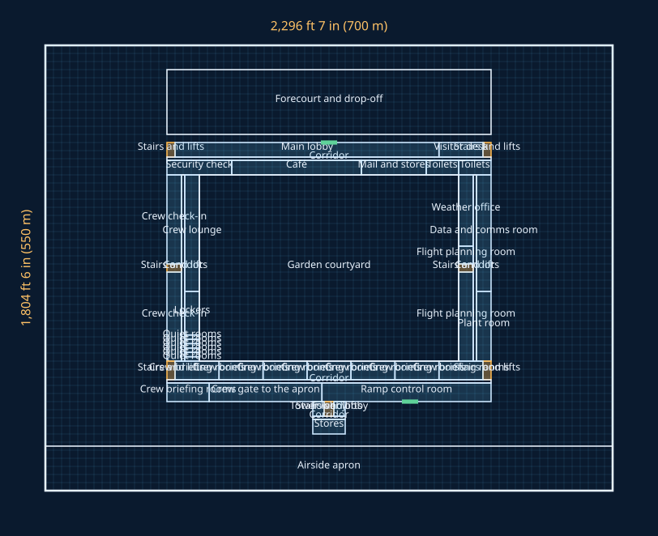
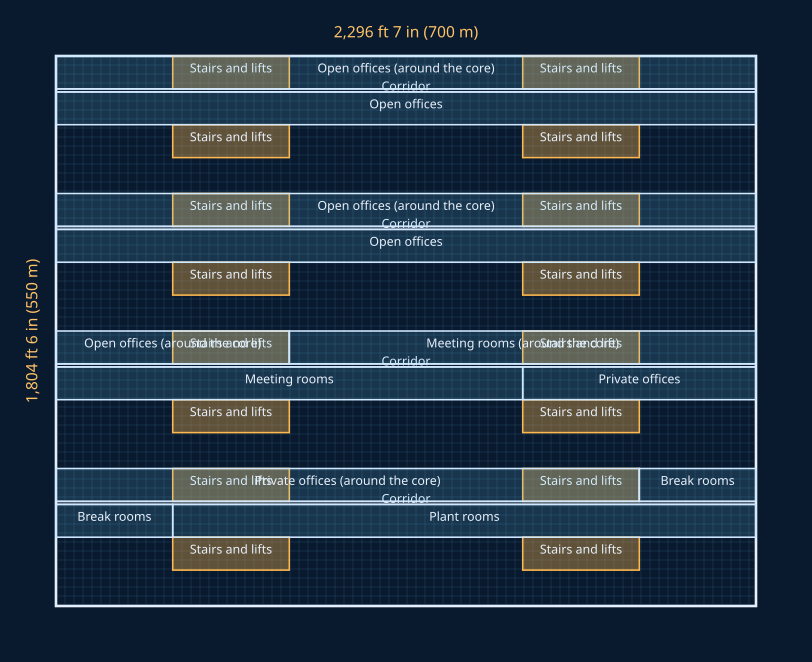
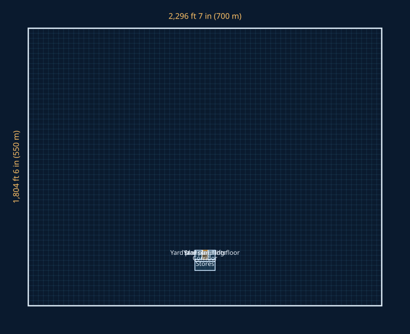
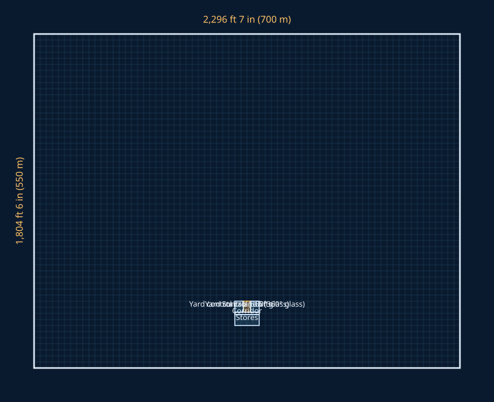

# P8-02 Shuttle Ops: plan

Footprint 2,296 ft 7 in (700 m) × 1,804 ft 6 in (550 m) · structural grid 32 ft 10 in (10 m)

## Levels

| Level | Floor above deck | Height | Floor area |
|---|---|---|---|
| Level 1 · Ground floor | 0 ft (0 mm) | 16 ft 5 in (5,000 mm) | 306,793 sq ft (28,502 m²) |
| Level 2 · Level 2 | 16 ft 5 in (5,000 mm) | 14 ft 9 in (4,500 mm) | 306,793 sq ft (28,502 m²) |
| Level 3 · Level 3 | 31 ft 2 in (9,500 mm) | 14 ft 9 in (4,500 mm) | 306,793 sq ft (28,502 m²) |
| Level 4 · Tower | 45 ft 11 in (14 m) | 14 ft 9 in (4,500 mm) | 13,175 sq ft (1,224 m²) |
| Level 5 · Tower | 60 ft 8 in (18 m) | 14 ft 9 in (4,500 mm) | 13,175 sq ft (1,224 m²) |
| Level 6 · Tower | 75 ft 6 in (23 m) | 14 ft 9 in (4,500 mm) | 13,175 sq ft (1,224 m²) |
| Level 7 · Tower | 90 ft 3 in (28 m) | 14 ft 9 in (4,500 mm) | 13,175 sq ft (1,224 m²) |
| Level 8 · Tower | 105 ft (32 m) | 14 ft 9 in (4,500 mm) | 13,175 sq ft (1,224 m²) |
| Level 9 · Control cab | 119 ft 9 in (36 m) | 19 ft 8 in (6,000 mm) | 13,175 sq ft (1,224 m²) |

## Elements

| ID | Designation | Type | Name | Level(s) | Size / length | Area | Status |
|---|---|---|---|---|---|---|---|
| E001 | D5F3P8B15A1L1R1 | zone | Forecourt and drop-off | L1 | 1,181 ft 1 in (360 m) × 328 ft 1 in (100 m) | 387,501 sq ft (36,000 m²) | proposed |
| E002 | D5F3P8B15A1L1R2, D5F3P8B15A1L2R1, D5F3P8B15A1L3R1 | core | Stairs and lifts | L1, L2, L3 | 32 ft 10 in (10 m) × 37 ft 9 in (12 m) | 1,238 sq ft (115 m²) | proposed |
| E003 | D5F3P8B15A1L1R3, D5F3P8B15A1L2R2, D5F3P8B15A1L3R2 | core | Stairs and lifts | L1, L2, L3 | 32 ft 10 in (10 m) × 37 ft 9 in (12 m) | 1,238 sq ft (115 m²) | proposed |
| E004 | D5F3P8B15A1L1R4 | zone | Corridor | L1 | 1,181 ft 1 in (360 m) × 9 ft 10 in (3,000 mm) | 11,625 sq ft (1,080 m²) | proposed |
| E005 | D5F3P8B15A1L1R5 | room | Main lobby | L1 | 956 ft (291 m) × 37 ft 9 in (12 m) | 36,071 sq ft (3,351 m²) | proposed |
| E006 | D5F3P8B15A1L1R6 | room | Visitor desk | L1 | 159 ft 5 in (49 m) × 37 ft 9 in (12 m) | 6,016 sq ft (559 m²) | proposed |
| E007 | D5F3P8B15A1L1R7 | room | Security check | L1 | 236 ft 3 in (72 m) × 37 ft 9 in (12 m) | 8,913 sq ft (828 m²) | proposed |
| E008 | D5F3P8B15A1L1R8 | room | Café | L1 | 472 ft 5 in (144 m) × 37 ft 9 in (12 m) | 17,825 sq ft (1,656 m²) | proposed |
| E009 | D5F3P8B15A1L1R9 | room | Mail and stores | L1 | 236 ft 3 in (72 m) × 37 ft 9 in (12 m) | 8,913 sq ft (828 m²) | proposed |
| E010 | D5F3P8B15A1L1R10 | room | Toilets | L1 | 118 ft 1 in (36 m) × 37 ft 9 in (12 m) | 4,456 sq ft (414 m²) | proposed |
| E011 | D5F3P8B15A1L1R11 | room | Toilets | L1 | 118 ft 1 in (36 m) × 37 ft 9 in (12 m) | 4,456 sq ft (414 m²) | proposed |
| E012 | D5F3P8B15A1L2R3, D5F3P8B15A1L3R3 | zone | Corridor | L2, L3 | 1,181 ft 1 in (360 m) × 9 ft 10 in (3,000 mm) | 11,625 sq ft (1,080 m²) | proposed |
| E013 | D5F3P8B15A1L2R4, D5F3P8B15A1L3R4 | room | Staff offices | L2, L3 | 1,046 ft 11 in (319 m) × 37 ft 9 in (12 m) | 39,500 sq ft (3,670 m²) | proposed |
| E014 | D5F3P8B15A1L2R5, D5F3P8B15A1L3R5 | room | Meeting rooms | L2, L3 | 34 ft 5 in (10 m) × 37 ft 9 in (12 m) | 1,300 sq ft (121 m²) | proposed |
| E015 | D5F3P8B15A1L2R6, D5F3P8B15A1L3R6 | room | Meeting rooms | L2, L3 | 34 ft 1 in (10 m) × 37 ft 9 in (12 m) | 1,287 sq ft (120 m²) | proposed |
| E016 | D5F3P8B15A1L2R7, D5F3P8B15A1L3R7 | room | Meeting rooms | L2, L3 | 590 ft 7 in (180 m) × 37 ft 9 in (12 m) | 22,281 sq ft (2,070 m²) | proposed |
| E017 | D5F3P8B15A1L2R8, D5F3P8B15A1L3R8 | room | Meeting rooms | L2, L3 | 590 ft 7 in (180 m) × 37 ft 9 in (12 m) | 22,281 sq ft (2,070 m²) | proposed |
| E018 | D5F3P8B15A1L1R12, D5F3P8B15A1L2R9, D5F3P8B15A1L3R9 | core | Stairs and lifts | L1, L2, L3 | 37 ft 9 in (12 m) × 32 ft 10 in (10 m) | 1,238 sq ft (115 m²) | proposed |
| E019 | D5F3P8B15A1L1R13 | zone | Corridor | L1 | 9 ft 10 in (3,000 mm) × 813 ft 8 in (248 m) | 8,008 sq ft (744 m²) | proposed |
| E020 | D5F3P8B15A1L1R14 | room | Crew check-in | L1 | 37 ft 9 in (12 m) × 390 ft 5 in (119 m) | 14,730 sq ft (1,368 m²) | proposed |
| E021 | D5F3P8B15A1L1R15 | room | Crew check-in | L1 | 37 ft 9 in (12 m) × 390 ft 5 in (119 m) | 14,730 sq ft (1,368 m²) | proposed |
| E022 | D5F3P8B15A1L1R16 | room | Crew lounge | L1 | 37 ft 9 in (12 m) × 508 ft 6 in (155 m) | 19,187 sq ft (1,782 m²) | proposed |
| E023 | D5F3P8B15A1L1R17 | room | Lockers | L1 | 37 ft 9 in (12 m) × 190 ft 7 in (58 m) | 7,192 sq ft (668 m²) | proposed |
| E024 | D5F3P8B15A1L1R18 | room | Quiet rooms | L1 | 37 ft 9 in (12 m) × 19 ft (5,800 mm) | 718 sq ft (67 m²) | proposed |
| E025 | D5F3P8B15A1L1R19 | room | Quiet rooms | L1 | 37 ft 9 in (12 m) × 19 ft 4 in (5,900 mm) | 730 sq ft (68 m²) | proposed |
| E026 | D5F3P8B15A1L1R20 | room | Quiet rooms | L1 | 37 ft 9 in (12 m) × 19 ft (5,800 mm) | 718 sq ft (67 m²) | proposed |
| E027 | D5F3P8B15A1L1R21 | room | Quiet rooms | L1 | 37 ft 9 in (12 m) × 19 ft (5,800 mm) | 718 sq ft (67 m²) | proposed |
| E028 | D5F3P8B15A1L1R22 | room | Quiet rooms | L1 | 37 ft 9 in (12 m) × 19 ft (5,800 mm) | 718 sq ft (67 m²) | proposed |
| E029 | D5F3P8B15A1L1R23 | room | Quiet rooms | L1 | 37 ft 9 in (12 m) × 19 ft (5,800 mm) | 718 sq ft (67 m²) | proposed |
| E030 | D5F3P8B15A1L2R10, D5F3P8B15A1L3R10 | zone | Corridor | L2, L3 | 9 ft 10 in (3,000 mm) × 813 ft 8 in (248 m) | 8,008 sq ft (744 m²) | proposed |
| E031 | D5F3P8B15A1L2R11, D5F3P8B15A1L3R11 | room | Training rooms | L2, L3 | 37 ft 9 in (12 m) × 260 ft 2 in (79 m) | 9,816 sq ft (912 m²) | proposed |
| E032 | D5F3P8B15A1L2R12, D5F3P8B15A1L3R12 | room | Training rooms | L2, L3 | 37 ft 9 in (12 m) × 130 ft 3 in (40 m) | 4,914 sq ft (457 m²) | proposed |
| E033 | D5F3P8B15A1L2R13, D5F3P8B15A1L3R13 | room | Training rooms | L2, L3 | 37 ft 9 in (12 m) × 130 ft 3 in (40 m) | 4,914 sq ft (457 m²) | proposed |
| E034 | D5F3P8B15A1L2R14, D5F3P8B15A1L3R14 | room | Training rooms | L2, L3 | 37 ft 9 in (12 m) × 260 ft 2 in (79 m) | 9,816 sq ft (912 m²) | proposed |
| E035 | D5F3P8B15A1L2R15, D5F3P8B15A1L3R15 | room | Training rooms | L2, L3 | 37 ft 9 in (12 m) × 57 ft 1 in (17 m) | 2,154 sq ft (200 m²) | proposed |
| E036 | D5F3P8B15A1L2R16, D5F3P8B15A1L3R16 | room | Training rooms | L2, L3 | 37 ft 9 in (12 m) × 57 ft 1 in (17 m) | 2,154 sq ft (200 m²) | proposed |
| E037 | D5F3P8B15A1L2R17, D5F3P8B15A1L3R17 | room | Training rooms | L2, L3 | 37 ft 9 in (12 m) × 57 ft 1 in (17 m) | 2,154 sq ft (200 m²) | proposed |
| E038 | D5F3P8B15A1L2R18, D5F3P8B15A1L3R18 | room | Offices | L2, L3 | 37 ft 9 in (12 m) × 642 ft 5 in (196 m) | 24,237 sq ft (2,252 m²) | proposed |
| E039 | D5F3P8B15A1L1R24, D5F3P8B15A1L2R19, D5F3P8B15A1L3R19 | core | Stairs and lifts | L1, L2, L3 | 37 ft 9 in (12 m) × 32 ft 10 in (10 m) | 1,238 sq ft (115 m²) | proposed |
| E040 | D5F3P8B15A1L1R25 | zone | Corridor | L1 | 9 ft 10 in (3,000 mm) × 813 ft 8 in (248 m) | 8,008 sq ft (744 m²) | proposed |
| E041 | D5F3P8B15A1L1R26 | room | Weather office | L1 | 37 ft 9 in (12 m) × 312 ft 4 in (95 m) | 11,784 sq ft (1,095 m²) | proposed |
| E042 | D5F3P8B15A1L1R27 | room | Flight planning room | L1 | 37 ft 9 in (12 m) × 78 ft 1 in (24 m) | 2,946 sq ft (274 m²) | proposed |
| E043 | D5F3P8B15A1L1R28 | room | Flight planning room | L1 | 37 ft 9 in (12 m) × 390 ft 5 in (119 m) | 14,730 sq ft (1,368 m²) | proposed |
| E044 | D5F3P8B15A1L1R29 | room | Data and comms room | L1 | 37 ft 9 in (12 m) × 508 ft 6 in (155 m) | 19,187 sq ft (1,782 m²) | proposed |
| E045 | D5F3P8B15A1L1R30 | room | Plant room | L1 | 37 ft 9 in (12 m) × 305 ft 1 in (93 m) | 11,512 sq ft (1,070 m²) | proposed |
| E046 | D5F3P8B15A1L2R20, D5F3P8B15A1L3R20 | zone | Corridor | L2, L3 | 9 ft 10 in (3,000 mm) × 813 ft 8 in (248 m) | 8,008 sq ft (744 m²) | proposed |
| E047 | D5F3P8B15A1L2R21, D5F3P8B15A1L3R21 | room | Scheduling office | L2, L3 | 37 ft 9 in (12 m) × 390 ft 5 in (119 m) | 14,730 sq ft (1,368 m²) | proposed |
| E048 | D5F3P8B15A1L2R22, D5F3P8B15A1L3R22 | room | Scheduling office | L2, L3 | 37 ft 9 in (12 m) × 390 ft 5 in (119 m) | 14,730 sq ft (1,368 m²) | proposed |
| E049 | D5F3P8B15A1L2R23, D5F3P8B15A1L3R23 | room | Offices | L2, L3 | 37 ft 9 in (12 m) × 813 ft 8 in (248 m) | 30,699 sq ft (2,852 m²) | proposed |
| E050 | D5F3P8B15A1L1R31, D5F3P8B15A1L2R24, D5F3P8B15A1L3R24 | core | Stairs and lifts | L1, L2, L3 | 32 ft 10 in (10 m) × 37 ft 9 in (12 m) | 1,238 sq ft (115 m²) | proposed |
| E051 | D5F3P8B15A1L1R32, D5F3P8B15A1L2R25, D5F3P8B15A1L3R25 | core | Stairs and lifts | L1, L2, L3 | 32 ft 10 in (10 m) × 37 ft 9 in (12 m) | 1,238 sq ft (115 m²) | proposed |
| E052 | D5F3P8B15A1L1R33 | zone | Corridor | L1 | 1,181 ft 1 in (360 m) × 9 ft 10 in (3,000 mm) | 11,625 sq ft (1,080 m²) | proposed |
| E053 | D5F3P8B15A1L1R34 | room | Crew briefing rooms | L1 | 159 ft 5 in (49 m) × 37 ft 9 in (12 m) | 6,016 sq ft (559 m²) | proposed |
| E054 | D5F3P8B15A1L1R35 | room | Crew briefing rooms | L1 | 159 ft 1 in (49 m) × 37 ft 9 in (12 m) | 6,004 sq ft (558 m²) | proposed |
| E055 | D5F3P8B15A1L1R36 | room | Crew briefing rooms | L1 | 159 ft 5 in (49 m) × 37 ft 9 in (12 m) | 6,016 sq ft (559 m²) | proposed |
| E056 | D5F3P8B15A1L1R37 | room | Crew briefing rooms | L1 | 159 ft 5 in (49 m) × 37 ft 9 in (12 m) | 6,016 sq ft (559 m²) | proposed |
| E057 | D5F3P8B15A1L1R38 | room | Crew briefing rooms | L1 | 159 ft 5 in (49 m) × 37 ft 9 in (12 m) | 6,016 sq ft (559 m²) | proposed |
| E058 | D5F3P8B15A1L1R39 | room | Crew briefing rooms | L1 | 159 ft 1 in (48 m) × 37 ft 9 in (12 m) | 6,004 sq ft (558 m²) | proposed |
| E059 | D5F3P8B15A1L1R40 | room | Crew briefing rooms | L1 | 159 ft 5 in (49 m) × 37 ft 9 in (12 m) | 6,016 sq ft (559 m²) | proposed |
| E060 | D5F3P8B15A1L1R41 | room | Crew briefing rooms | L1 | 154 ft 2 in (47 m) × 37 ft 9 in (12 m) | 5,818 sq ft (540 m²) | proposed |
| E061 | D5F3P8B15A1L1R42 | room | Crew gate to the apron | L1 | 410 ft 9 in (125 m) × 37 ft 9 in (12 m) | 15,498 sq ft (1,440 m²) | proposed |
| E062 | D5F3P8B15A1L1R43 | room | Ramp control room | L1 | 616 ft 2 in (188 m) × 37 ft 9 in (12 m) | 23,247 sq ft (2,160 m²) | proposed |
| E063 | D5F3P8B15A1L2R26, D5F3P8B15A1L3R26 | zone | Corridor | L2, L3 | 1,181 ft 1 in (360 m) × 9 ft 10 in (3,000 mm) | 11,625 sq ft (1,080 m²) | proposed |
| E064 | D5F3P8B15A1L2R27, D5F3P8B15A1L3R27 | room | Dispatch floor | L2, L3 | 1,115 ft 6 in (340 m) × 37 ft 9 in (12 m) | 42,087 sq ft (3,910 m²) | proposed |
| E065 | D5F3P8B15A1L2R28, D5F3P8B15A1L3R28 | room | Duty managers | L2, L3 | 114 ft 2 in (35 m) × 37 ft 9 in (12 m) | 4,308 sq ft (400 m²) | proposed |
| E066 | D5F3P8B15A1L2R29, D5F3P8B15A1L3R29 | room | Offices | L2, L3 | 1,066 ft 11 in (325 m) × 37 ft 9 in (12 m) | 40,255 sq ft (3,740 m²) | proposed |
| E067 | D5F3P8B15A1L1R44 | zone | Garden courtyard | L1 | 1,010 ft 6 in (308 m) × 813 ft 8 in (248 m) | 822,191 sq ft (76,384 m²) | proposed |
| E068 | D5F3P8B15A1L1R45, D5F3P8B15A1L2R30, D5F3P8B15A1L3R30, D5F3P8B15A1L4R1, D5F3P8B15A1L5R1, D5F3P8B15A1L6R1, D5F3P8B15A1L7R1, D5F3P8B15A1L8R1, D5F3P8B15A1L9R1 | core | Stairs and lifts | L1, L2, L3, L4, L5, L6, L7, L8, L9 | 39 ft 4 in (12 m) × 59 ft 1 in (18 m) | 2,325 sq ft (216 m²) | proposed |
| E069 | D5F3P8B15A1L1R46, D5F3P8B15A1L2R31, D5F3P8B15A1L3R31 | zone | Corridor | L1, L2, L3 | 131 ft 3 in (40 m) × 13 ft 1 in (4,000 mm) | 1,722 sq ft (160 m²) | proposed |
| E070 | D5F3P8B15A1L1R47, D5F3P8B15A1L2R32, D5F3P8B15A1L3R32 | room | Tower lobby | L1, L2, L3 | 45 ft 11 in (14 m) × 59 ft 1 in (18 m) | 2,713 sq ft (252 m²) | proposed |
| E071 | D5F3P8B15A1L1R48, D5F3P8B15A1L2R33, D5F3P8B15A1L3R33 | room | Tower lobby | L1, L2, L3 | 45 ft 11 in (14 m) × 59 ft 1 in (18 m) | 2,713 sq ft (252 m²) | proposed |
| E072 | D5F3P8B15A1L1R49, D5F3P8B15A1L2R34, D5F3P8B15A1L3R34 | room | Stores | L1, L2, L3 | 131 ft 3 in (40 m) × 59 ft 1 in (18 m) | 7,750 sq ft (720 m²) | proposed |
| E073 | D5F3P8B15A1L4R2, D5F3P8B15A1L5R2, D5F3P8B15A1L6R2, D5F3P8B15A1L7R2, D5F3P8B15A1L8R2 | zone | Corridor | L4, L5, L6, L7, L8 | 131 ft 3 in (40 m) × 13 ft 1 in (4,000 mm) | 1,722 sq ft (160 m²) | proposed |
| E074 | D5F3P8B15A1L4R3, D5F3P8B15A1L5R3, D5F3P8B15A1L6R3, D5F3P8B15A1L7R3, D5F3P8B15A1L8R3 | room | Yard planning floor | L4, L5, L6, L7, L8 | 45 ft 11 in (14 m) × 59 ft 1 in (18 m) | 2,713 sq ft (252 m²) | proposed |
| E075 | D5F3P8B15A1L4R4, D5F3P8B15A1L5R4, D5F3P8B15A1L6R4, D5F3P8B15A1L7R4, D5F3P8B15A1L8R4 | room | Yard planning floor | L4, L5, L6, L7, L8 | 45 ft 11 in (14 m) × 59 ft 1 in (18 m) | 2,713 sq ft (252 m²) | proposed |
| E076 | D5F3P8B15A1L4R5, D5F3P8B15A1L5R5, D5F3P8B15A1L6R5, D5F3P8B15A1L7R5, D5F3P8B15A1L8R5 | room | Stores | L4, L5, L6, L7, L8 | 131 ft 3 in (40 m) × 59 ft 1 in (18 m) | 7,750 sq ft (720 m²) | proposed |
| E077 | D5F3P8B15A1L9R2 | zone | Corridor | L9 | 131 ft 3 in (40 m) × 13 ft 1 in (4,000 mm) | 1,722 sq ft (160 m²) | proposed |
| E078 | D5F3P8B15A1L9R3 | room | Yard control cab (360° glass) | L9 | 45 ft 11 in (14 m) × 59 ft 1 in (18 m) | 2,713 sq ft (252 m²) | proposed |
| E079 | D5F3P8B15A1L9R4 | room | Yard control cab (360° glass) | L9 | 45 ft 11 in (14 m) × 59 ft 1 in (18 m) | 2,713 sq ft (252 m²) | proposed |
| E080 | D5F3P8B15A1L9R5 | room | Stores | L9 | 131 ft 3 in (40 m) × 59 ft 1 in (18 m) | 7,750 sq ft (720 m²) | proposed |
| E081 | D5F3P8B15A1L1R50 | zone | Airside apron | L1 | 2,296 ft 7 in (700 m) × 180 ft 5 in (55 m) | 414,411 sq ft (38,500 m²) | proposed |
| E082 |  | door | Main entrance | L1 | 98 ft 5 in (30 m), 98 ft 5 in (30 m) wide | — | proposed |
| E083 |  | door | Crew gate | L1 | 65 ft 7 in (20 m), 65 ft 7 in (20 m) wide | — | proposed |

## Drawings

### Level 1 · Ground floor

### Level 2 · Level 2

### Level 3 · Level 3

### Level 4 · Tower

### Level 5 · Tower

### Level 6 · Tower

### Level 7 · Tower

### Level 8 · Tower

### Level 9 · Control cab

